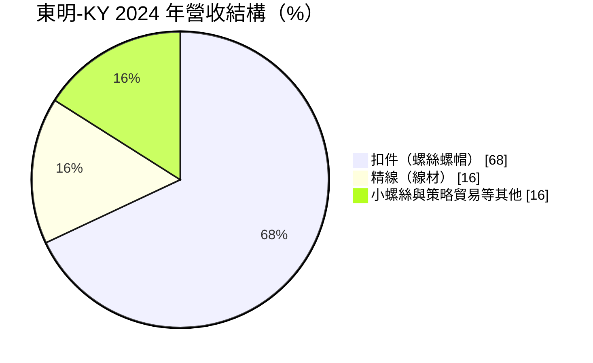
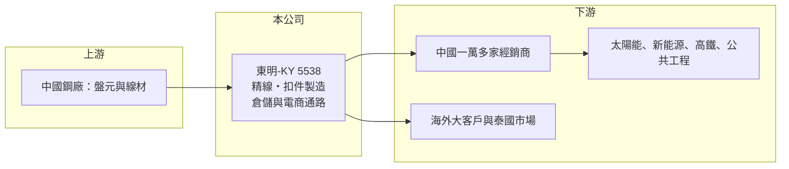

# 5538 東明-KY

> 上市｜[[產業索引-鋼鐵工業|鋼鐵工業]]｜上市（櫃）日期 2013/12/16

# 第一章：企業模式與商業藍圖

> [!info] 撰寫說明
> 本文由 Claude 依公開資料整理，架構比照 [[2330台積電]] 的四章研究，資料截至 2026-10-08。財務數字來源：Goodinfo 年度經營績效頁、富果研究 2025 年 8 月法說會備忘錄、證交所開放資料（基本資料、資產負債、綜合損益、營益分析、股利、每月營收）。銷售地區比重、總扣件產能與新廠時程未查得；產業描述為整理性內容，尚未逐條比對原始文件。#待校對

在評估單一個股的長期投資價值時，首要步驟是拆解企業的底層獲利邏輯。本章說明東明控股（股票代號：5538，以下簡稱東明）如何以「製造加通路」的模式，成為中國標準扣件市場的重要業者。

## 一、核心定位：中國的扣件製造商兼經銷平台

東明是註冊在開曼群島的控股公司，2009 年 11 月成立，2013 年 12 月在台灣上市，2026 年實收資本額約 20.1 億元，董事長為蔡清東。主要生產基地在中國浙江，另在台灣、日本與泰國設有子公司；台灣子公司為高雄岡山的東穎（依發言人職稱）。#待校對

東明的產品可分為三大類，2024 年的營收結構如下：

* **扣件：** 螺絲、螺帽等標準件，應用於太陽能支架、新能源、高鐵與公共工程，是最大的營收來源。
* **[[精線]]：** 由浙江東和廠生產，用於五金、自行車輻條與彈簧，2025 年上半年出貨穩定在每月 2,500 噸以上。
* **小螺絲與貿易品：** 浙江高科廠生產的小螺絲，投產兩年後月產量已超過 800 噸；另透過全球合作夥伴提供特殊或高階規格的策略性貿易產品。（其他類別的細分比重未查得）

## 二、通路模式：一萬家經銷商與電商平台

東明最大的特色不是製造，而是通路。公司直接服務超過一萬家活躍經銷商，透過工廠直銷、自有品牌通路與電商平台接單，並在中國建立三個區域大倉與七個中型倉，總倉儲容量約 4 萬噸。另有約 120 家海外大客戶取得電商平台帳號。

這種模式的商業意義在於：標準螺絲單價低、規格多，下游五金行與工程商需要的是「隨時有貨、一次買齊」。東明以大量庫存與倉儲網絡提供現貨服務，就像扣件業的[[金屬服務中心]]，客戶黏著度與規模經濟都比單純的製造廠高。

## 三、長期方向：把電商模式國際化

東明的長期策略有三個方向：把電商通路模式複製到海外，先從泰國開始，並評估歐洲；以機器人、倉儲管理系統（WMS）與綠能升級製造；以及加深經銷商關係與擴大產品廣度，提高在中國與全球的市占率。如果國際化成功，東明可以把中國的成本優勢與通路經驗帶到東南亞與歐洲，降低對中國內需的依賴。

# 第二章：護城河深度與競爭優勢

在長期價值投資中，「護城河」指企業抵禦競爭、維持超額利潤的保護機制。本章分析東明的護城河來源，以及它在中國扣件市場的競爭位置。

## 一、護城河組成

* **通路網絡效應：** 一萬多家經銷商與電商平台構成的通路，讓東明的庫存周轉與規模經濟優於一般製造廠。經銷商越依賴東明的現貨與品項，新進者越難替代。
* **倉儲與品項廣度：** 4 萬噸的倉儲容量與多元規格，是「一次買齊」服務的基礎，需要大量資本與時間累積。
* **上游自製線材：** 自產精線可以控制扣件原料品質與成本，是部分垂直整合的優勢。

## 二、競爭對手格局

| 對手 | 定位 | 對東明的影響 |
|---|---|---|
| 中國中小型螺絲廠 | 數量多、價格競爭激烈 | 壓低標準件價格 |
| [[8415大國鋼]] | 北美扣件經銷通路 | 同樣以通路模式經營，但市場在北美 |
| [[2012春雨]]、[[2062橋椿]]、[[5015華祺]] | 台灣外銷螺絲廠 | 國際市場的競爭者 |

## 三、守得住與守不住的地方

* **守得住：** 中國內需市場的經銷商網絡與現貨服務。這是東明獲利能在 2024 至 2025 年回到 ROE 8% 以上的主因。
* **守不住：** 鋼價與需求循環。2021 年鋼價大漲時 EPS 8 元、ROE 27%，2023 年需求轉弱時 EPS 只剩 0.67 元，代表通路優勢仍無法完全抵銷景氣。
* **觀察重點：** 泰國與歐洲電商通路的進展、中國基建與新能源需求，以及毛利率能否維持在 12% 以上。

# 第三章：財務體質與盈利規模

資料日期：2026-10-08，表格是撰寫當時的快照；最新月營收、毛利率、累計 EPS 由自動排程寫在本筆記的屬性欄位（月營收、毛利率、累計EPS 等）。#待校對

財務報表是檢驗護城河是否真實存在的最終標準。本章用多年度三率、ROE 與資本報酬，檢視東明的獲利品質。

## 一、多年度獲利

| 年度 | 營收（新台幣） | [[毛利率]] | [[營業利益率]] | EPS（元） | [[ROE]] |
|---|---|---|---|---|---|
| 2019 | 88.1 億 | 13.9% | 7.43% | 2.77 | 12.0% |
| 2020 | 91.7 億 | 13.9% | 7.56% | 2.94 | 12.3% |
| 2021 | 132 億 | 20.4% | 14.8% | 8.00 | 27.0% |
| 2022 | 154 億 | 13.0% | 7.62% | 4.53 | 13.6% |
| 2023 | 130 億 | 7.47% | 1.26% | 0.67 | 2.02% |
| 2024 | 125 億 | 11.9% | 5.23% | 2.86 | 8.47% |
| 2025 | 127 億 | 12.1% | 5.56% | 3.02 | 8.36% |
| 2026 上半年 | 68.3 億 | 17.61% | 10.87% | 2.74 | 未查得 |

* **2026 年明顯改善：** 上半年毛利率 17.6%、營業利益率 10.9%，EPS 2.74 元已接近 2025 年全年，1 至 8 月營收年增約 14%。
* **景氣循環明顯：** 2021 年高峰與 2023 年谷底的 EPS 相差十倍以上，顯示通路模式雖然穩定，但毛利率仍隨鋼價與中國需求大幅變動。
* **規模成長：** 營收從 2019 年的 88 億元成長到 2025 年的 127 億元。

## 二、長期指標

* **平均 ROE：** 2021 至 2025 年平均約 11.9%（推算）。
* **營收年複合成長率：** 2019 至 2025 年約 6.3%（推算）。
* **股利：** 2025 年度配發現金股利 1.5 元，配息率約 50%（推算）；歷年平均約 1.89 元（Goodinfo），保留盈餘約 38.7 億元，配息能力穩定。
* **財務結構：** 2026 年第二季流動資產 127.1 億元、流動負債 64.0 億元，流動比率約 2.0 倍（推算），負債比約 50%；流動資產中應以存貨占大宗（推估），符合通路商需要大量庫存的特性。

## 三、[[ROIC]] 與 [[WACC]]：價值創造利差

**ROIC 推算：** 2025 年營業利益約 7.1 億元（127 億元 × 5.56%），稅後約 5.6 億元（稅率 20%）。投入資本以 2026 年第二季權益 79.9 億元加負債 81.1 億元計（以負債總額代替有息負債會高估投入資本），ROIC 約 3.5%（推算）；只以權益計算約 7.1%（推算）。2026 年上半年營業利益率已升到 10.9%，年化後 ROIC 約 7% 至 15%（推算）。

**WACC 推算：** 以 [[CAPM]] 推估，台灣 10 年期公債 1.75%、市場風險溢酬 6%、β 取 1.0（中國曝險較高的 KY 股，假設值，非來源數字），權益成本約 7.75%；負債成本假設 3%（中國借款利率較高），稅後 2.4%。依帳面權益約 50%、負債約 50% 計算，WACC 約 5.1%；若只計有息負債，約 6% 至 7%（推算）。

**結論：** 東明在 2023 至 2025 年 ROIC 大致在 WACC 附近或略低，2021 年與 2026 年上半年則明顯超過。長期看，它是一家能在景氣循環中維持獲利與配息、高峰期創造超額報酬的公司，但平均利差不大。

# 第四章：總體風險與地緣政治

任何企業都無法脫離宏觀環境獨立存在。本章分析東明必須面對的地緣政治、產業週期與營運風險。

## 一、地緣政治與貿易風險

* **中國集中：** 生產與主要市場都在中國，受中國經濟、政策與兩岸關係影響大。
* **反傾銷與關稅：** 歐盟對中國扣件課徵[[反傾銷]]稅，美國對中國產品有高額關稅與 [[232 條款]]鋼鐵關稅，限制東明的出口空間，也是它選擇以泰國作為國際化起點的原因之一（推估）。

## 二、產業週期

* **中國基建與新能源：** 扣件需求與太陽能、電網、高鐵等投資高度相關，中國基建或新能源投資放緩會直接影響銷量。
* **鋼價：** 線材原料價格波動會造成[[庫存利益]]或跌價損失，大量庫存的通路模式對價格更敏感。

## 三、營運與其他風險

* **KY 股治理：** 註冊地在開曼、營運在中國，資訊揭露與資金匯回需要投資人額外留意。
* **匯率：** 以人民幣營運、以新台幣計價股利，人民幣貶值會降低換算後的獲利。
* **國際化執行：** 電商模式在泰國與歐洲能否複製，取決於當地通路生態與物流成本，存在不確定性。

# 專有名詞解析

## 金融

- **[[庫存利益]]**：原料或產品價格上漲時，先前以低價買進的庫存被以較高售價賣出所產生的額外利潤。

## 產業

- **[[螺絲扣件]]**：用來鎖固與連接零件的螺絲、螺栓、螺帽等產品，台灣高雄岡山是全球重要的生產聚落。
- **[[精線]]**：將盤元經酸洗、抽線與熱處理製成尺寸精準的鋼線，是螺絲、彈簧與五金的直接原料。
- **[[金屬服務中心]]**：向鋼廠或鋁廠大量採購金屬材料，再依客戶需求裁切、加工並少量配送的通路業者，美國代表為 Reliance、Ryerson。
- **[[反傾銷]]**：進口國對低於正常價格銷售的進口商品加徵關稅，以保護本國產業的貿易救濟措施。

# 核心供應鏈

## 1. 上游：原料
- 中國鋼廠的盤元與線材（具名供應商未查得）

## 2. 本公司與同業
- 扣件同業：[[2012春雨]]、[[2062橋椿]]、[[5015華祺]]、[[8349恒耀]]
- 扣件通路同業：[[8415大國鋼]]

## 3. 下游：客戶
- 中國五金與工業品經銷商、工程承包商
- 太陽能支架、新能源與公共工程業者
- 海外大客戶（約 120 家取得電商帳號）

## 最新新聞
<!-- news:start -->
<!-- news:end -->

## 相關連結
- [公開資訊觀測站](https://mopsov.twse.com.tw/mops/web/t05st03?step=1&firstin=1&co_id=5538)
- [Goodinfo](https://goodinfo.tw/tw/StockDetail.asp?STOCK_ID=5538)
- [Yahoo 股市](https://tw.stock.yahoo.com/quote/5538)
- [鉅亨網新聞](https://www.cnyes.com/twstock/5538/news)
