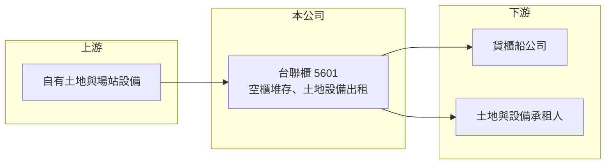

# 5601 台聯櫃

> 上櫃｜[[產業索引-航運業|航運業]]｜上市（櫃）日期 1994/11/24

# 第一章：企業模式與商業藍圖

> [!info] 撰寫說明
> 精簡版，由 Claude 依公開資料整理，架構比照 [[2330台積電]] 的四章研究，資料截至 2026-10-08。來源：櫃買中心開放資料（基本資料、綜合損益、資產負債、本益比）、nstock 公司簡介。公開資料有限，2021 至 2024 年財務數字未查得。#待校對

臺聯貨櫃通運（以下簡稱台聯櫃）是基隆地區的老牌貨櫃場業者。理解它的關鍵是：公司早已從經營貨櫃集散站，轉型為以空櫃堆存與土地、設備出租為主的資產收租型公司。

- **核心業務：** 台聯櫃 1973 年成立、1994 年上櫃，原本主要經營貨櫃集散站，1998 年（民國 87 年）起停止部分業務，目前主要為空櫃堆存，以及把部分用地與設備出租（[[不動產出租]]）。[[貨櫃場]]是船公司存放空櫃、進行[[空櫃調度]]的場地，靠近港口的土地是這類業務最重要的資產。
- **營收結構：** 營收來源包括空櫃堆存費與土地、設備租金，各項比重未查得。營收規模很小，2025 年全年約 0.94 億元，2026 年 1 至 9 月累計約 0.71 億元。收入主要由租約決定，波動低於一般航運與物流業。
- **營運據點：** 公司登記與營業地址在基隆市七堵區，鄰近基隆港的內陸貨櫃場區。基隆港的貨櫃量長期受台北港與高雄港分流，七堵一帶的貨櫃場使用需求也隨之變化，這是台聯櫃轉向出租經營的背景（推估）。
- **長期方向：** 公司未在可取得的資料中揭露明確的成長計畫。對這類資產型公司而言，長期價值主要取決於土地的使用方式：持續收租、與船公司簽長期堆存合約，或在都市計畫變更後活化開發，都是可能的方向（推估）。

# 第二章：護城河深度與競爭優勢

台聯櫃的競爭力不在營運技術，而在於土地位置。這種「資產型」護城河穩定，但成長空間有限。

- **競爭優勢：** 港區周邊可作為貨櫃場的大面積土地取得不易，既有場地本身就是進入門檻。收租型業務的成本結構簡單，2026 上半年毛利率約 60%、營業利益率約 34%（推算），獲利率遠高於一般物流業。
- **主要對手：** 基隆與北部地區的貨櫃場業者，例如 [[2613中櫃]]、[[2607榮運]] 等港埠與貨櫃場經營者，以及船公司自有的場站。台聯櫃規模小，主要服務特定船公司或承租人。
- **觀察重點：** 第一是租約是否穩定續約、租金能否隨物價調整。第二是土地資產的帳面價值與市價差距，市場給予約 1.36 倍股價淨值比（2026 年 10 月初），反映對資產價值的評價。第三是公司是否有活化土地或調整業務的計畫。

# 第三章：財務體質與盈利規模

資料日期：2026-10-08，表格是撰寫當時的快照；最新月營收、毛利率、累計 EPS 由自動排程寫在本筆記的屬性欄位（月營收、毛利率、累計EPS 等）。#待校對

台聯櫃的財務規模很小，評估重點是租金收入的穩定性與資產報酬率，而不是成長性。

| 年度 | 營收（新台幣） | [[毛利率]] | [[營業利益率]] | EPS（元） | [[ROE]] |
|---|---|---|---|---|---|
| 2021 | 未查得 | 未查得 | 未查得 | 未查得 | 未查得 |
| 2022 | 未查得 | 未查得 | 未查得 | 未查得 | 未查得 |
| 2023 | 未查得 | 未查得 | 未查得 | 未查得 | 未查得 |
| 2024 | 未查得 | 未查得 | 未查得 | 未查得 | 未查得 |
| 2025 | 0.94 億 | 未查得 | 未查得 | 0.42 | 約 2%（推算） |
| 2026 上半年 | 0.47 億 | 60.1%（推算） | 33.8%（推算） | 0.20 | 未查得 |

註：2025 年取自 nstock；2026 上半年取自櫃買中心綜合損益開放資料，毛利率與營業利益率以毛利 2,813 萬元、營業利益 1,584 萬元除以營收 4,681 萬元推算。2025 年 ROE 以 EPS 0.42 元除以每股淨值約 21 元推算。

- **營收規模：** 年營收不到 1 億元，2026 年前 9 個月累計 0.71 億元，與 2025 年的節奏相近，顯示收入以租約為主、變化不大。
- **獲利：** 2026 上半年稅後淨利約 1,322 萬元、EPS 0.20 元，2025 年 EPS 0.42 元。以每股淨值 21.25 元計，ROE 約 2%（推算），資本效率偏低，這是持有大量土地、收入規模小的資產型公司常見的情況。
- **財務特色：** 2026 年第二季底總資產約 18.9 億元，權益約 13.8 億元，負債約 5.1 億元，其中非流動負債約 4.65 億元，性質未查得（可能為土地相關的遞延稅負或長期負債，推估）；流動負債僅約 0.43 億元。最近一次現金股利 0.38 元，2026 年 10 月初本益比約 70 倍、殖利率約 1.31%。
- **[[ROIC]] 與 [[WACC]]：** 以 2026 上半年營業利益 1,584 萬元年化約 3,170 萬元，扣除 20% 稅率約 2,530 萬元；投入資本以權益 13.8 億元計（有息負債金額未查得，假設很低，推估），ROIC 約 1.8%（推算）。WACC 假設公債 1.75%、市場風險溢酬 6%、β 取收租型公司常見值 0.6（推估），權益成本約 5.35%，在幾乎無有息負債下 WACC 約 5.3%（推算）。ROIC 明顯低於 WACC，代表以帳面資本計算，目前的租金收入並未創造足夠報酬；股東的報酬主要寄託在土地資產的長期增值或未來活化。

# 第四章：總體風險與地緣政治

台聯櫃的營運波動小，但風險在於收入集中、規模小，以及土地價值能否被實現。

- **產業週期：** 空櫃堆存需求跟著基隆港貨櫃量與船公司的調度策略變化，航運景氣好時貨櫃周轉快、堆存需求反而可能下降，景氣差時空櫃堆積、需求上升，週期與一般航運股不同。
- **營運風險：** 收入來自少數承租人與堆存客戶，單一租約到期不續會明顯影響營收；場地與設備老舊時需要維修投資。公司規模小、資訊揭露有限，投資人較難追蹤經營細節。
- **其他風險：** 都市計畫、港區政策與土地使用分區的變更，可能帶來活化機會，也可能限制用途；地價稅與相關稅負變化會影響收租淨收益；股票成交量低，流動性風險較高。

# 專有名詞解析

## 金融

- **[[ROIC]]**：投入資本報酬率，稅後營業利益除以股東權益與有息負債之和，衡量所有投入資本的報酬。
- **[[WACC]]**：加權平均資金成本，依權益與負債比重加權的資金成本，是 ROIC 需要超越的門檻。

## 產業

- **[[貨櫃場]]**：位於港口或內陸交通節點、提供貨櫃堆存、裝卸、拆併櫃與調度服務的場站。
- **[[空櫃調度]]**：船公司把卸貨後的空貨櫃存放、整理並調往有出口需求地區的作業，貨櫃場是調度的中繼站。
- **[[不動產出租]]**：企業把自有土地或建物出租給他人使用並收取租金，收入穩定但成長有限。

# 核心供應鏈

- 上游：自有土地（基隆七堵）、場站與裝卸設備維護。
- 下游／客戶：使用基隆港的貨櫃船公司（空櫃堆存）、土地與設備承租人（名稱未揭露）。
- 同業：[[2613中櫃]]、[[2607榮運]] 等港埠貨櫃場經營者。

## 最新新聞
<!-- news:start -->
<!-- news:end -->

## 相關連結
- [公開資訊觀測站](https://mopsov.twse.com.tw/mops/web/t05st03?step=1&firstin=1&co_id=5601)
- [Goodinfo](https://goodinfo.tw/tw/StockDetail.asp?STOCK_ID=5601)
- [Yahoo 股市](https://tw.stock.yahoo.com/quote/5601)
- [鉅亨網新聞](https://www.cnyes.com/twstock/5601/news)
