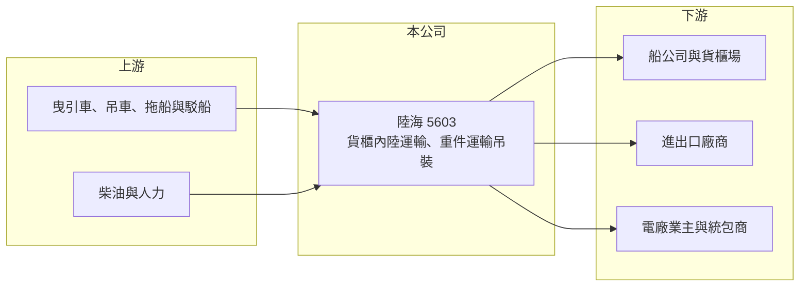

# 5603 陸海

> 上櫃｜[[產業索引-航運業|航運業]]｜上市（櫃）日期 1997/01/25

# 第一章：企業模式與商業藍圖

> [!info] 撰寫說明
> 精簡版，由 Claude 依公開資料整理，架構比照 [[2330台積電]] 的四章研究，資料截至 2026-10-08。來源：櫃買中心開放資料（基本資料、綜合損益、資產負債、本益比）、Goodinfo 年度經營績效、富果 2025 年 9 月法說會備忘錄。各業務營收比重未查得，公開資料有限。#待校對

陸海股份有限公司（以下簡稱陸海）是台灣老牌的陸上運輸業者，核心是把貨櫃從港口拖運到內陸，以及承攬發電機組、大型設備等重件的運輸與吊裝。近年再延伸到油氣銷售、洋酒代理與不動產出租，形成多角化的經營結構。

- **核心業務：** 陸海 1973 年成立、1997 年上櫃，總部在新北市汐止，北、中、南設有營業據點。主業有兩塊：一是[[貨櫃內陸運輸]]，用曳引車把貨櫃在港口、[[貨櫃場]]與工廠之間拖運；二是重機件運輸與吊裝起重，搬運電廠機組、變壓器等超大超重設備，部分需要駁船與[[港勤拖船]]走海路。
- **營收結構：** 依 2025 年法說備忘錄，除運輸主業外，陸海也經營油氣銷售與再生能源、洋酒進口代理與不動產出租，各業務的營收比重未揭露。重件業務以專案計價，營收會隨大型專案的認列時點大幅波動；貨櫃運輸則與港口進出口貨量連動。
- **營運據點：** 以北部港口（基隆港、台北港）周邊為主，並在中、南部設點服務台中港與高雄港的貨櫃與重件需求（推估）。重件業務需要大型拖車、吊車、駁船與拖船，這些設備投資金額大，也構成一定的進入門檻。
- **長期方向：** 公司 2025 年的策略是：貨櫃運輸由依賴大型船公司的長途轉運，轉向深耕在地貨櫃場客戶；[[重件運輸]]鎖定能源轉型商機，特別是燃氣電廠新建與更新，並投資建造一艘 5,000 匹馬力拖船與一艘 85 米駁船。台灣電力基礎建設的長期投資，是陸海重件業務最重要的需求來源。

# 第二章：護城河深度與競爭優勢

陸海的護城河主要在重件運輸：設備、經驗與工安紀錄不易複製；貨櫃運輸則是高度競爭的市場。

- **競爭優勢：** 重件運輸與吊裝需要專用拖車、駁船、拖船與大型吊車，加上規劃路線、申請道路許可與吊裝工程的經驗，業主（電力公司、電廠統包商）通常會選擇有長期實績的業者。陸海成立超過五十年，在電廠與大型工程的重件市場累積了口碑。
- **主要對手：** 貨櫃運輸方面有 [[5604中連]]、[[2613中櫃]] 旗下車隊等眾多拖車業者，競爭激烈、價格透明；重件運輸則與國內外專業重件物流業者競爭。2025 年法說提到貨櫃運輸面臨同業削價競爭。
- **觀察重點：** 第一是燃氣電廠與電網建設帶來的重件專案量，以及新拖船、駁船投入後的使用率。第二是貨櫃運輸轉向在地客戶後，毛利能否穩定。第三是多角化業務（油氣、洋酒、不動產）的獲利貢獻，以及是否分散了管理資源。

# 第三章：財務體質與盈利規模

資料日期：2026-10-08，表格是撰寫當時的快照；最新月營收、毛利率、累計 EPS 由自動排程寫在本筆記的屬性欄位（月營收、毛利率、累計EPS 等）。#待校對

陸海的財報顯示營收規模持平偏弱、利潤率薄，重件專案的有無會讓單年獲利大幅變動。

| 年度 | 營收（新台幣） | [[毛利率]] | [[營業利益率]] | EPS（元） | [[ROE]] |
|---|---|---|---|---|---|
| 2021 | 19.9 億 | 13.9% | 4.95% | 9.20 | 46.0% |
| 2022 | 19.6 億 | 16.1% | 6.53% | 1.89 | 11.5% |
| 2023 | 18.0 億 | 15.2% | 4.89% | 1.93 | 11.2% |
| 2024 | 18.2 億 | 14.9% | 5.17% | 1.24 | 6.64% |
| 2025 | 13.6 億 | 12.2% | -0.08% | 0.40 | 2.23% |
| 2026 上半年 | 7.10 億 | 12.5%（推算） | 0.09%（推算） | 0.06 | 未查得 |

註：2021 至 2025 年取自 Goodinfo；2026 上半年取自櫃買中心綜合損益開放資料，毛利率與營業利益率以毛利 8,859 萬元、營業利益 63 萬元除以營收推算。2021 年 EPS 9.2 元遠高於營業利益可支撐的水準，推估含處分資產等一次性業外收益。

- **營收規模：** 2021 至 2024 年營收維持在 18 億至 20 億元，2025 年降到 13.6 億元，主因是重件業務在 2024 年大型專案認列後進入空窗期，以及貨櫃量減少與同業削價。2026 上半年營收約 7.1 億元，與 2025 年水準相近。
- **獲利：** 毛利率長期在 12% 至 16%，營業利益率在 5% 上下，2025 年轉為小幅營業虧損，2026 上半年接近損益兩平。近 5 年平均 ROE 約 15.5%（推算），但扣除 2021 年的異常值後，2022 至 2024 年約 6% 至 11%，2025 年降到 2%。
- **財務特色：** 2026 年第二季底總資產約 27.4 億元，權益約 19.5 億元（歸屬母公司 18.7 億元），負債約 8.0 億元，負債比約 29%，財務結構保守。最近一次現金股利 0.5 元，2026 年 10 月初股價淨值比約 0.80 倍。
- **[[ROIC]] 與 [[WACC]]：** 2025 年營業利益約負 0.01 億元（13.6 億元乘以負 0.08%），稅後營業利益約為零；投入資本以權益 19.5 億元加推估有息負債約 3 億元（推估）計，約 22.5 億元，ROIC 約 0%（推算）。若以 2022 至 2024 年平均營業利益率約 5.5% 與營收 18.6 億元估算常態水準，稅後營業利益約 0.82 億元，ROIC 約 3.6%（推算）。WACC 假設公債 1.75%、市場風險溢酬 6%、β 取運輸業常見值 0.7（推估），權益成本約 5.95%；負債成本 2.5%、稅後 2.0%，權益與負債比約 87 比 13，WACC 約 5.4%（推算）。即使在常態年度，ROIC 仍低於 WACC，代表陸海的本業長期難以創造超額報酬，股價低於淨值也反映這一點；改善的關鍵在重件專案量能否因能源建設而穩定放大。

# 第四章：總體風險與地緣政治

陸海的風險在於主業的需求不穩定，以及多角化經營是否帶來足夠的報酬。

- **產業週期：** 貨櫃內陸運輸跟著進出口貨量走，美國關稅政策或全球貿易轉弱時，港口貨櫃量下降，拖車業者就會搶貨降價。重件運輸則取決於電廠、電網與重大工程的推動進度，屬於專案型需求，常出現一年高峰、一年空窗的情況。
- **營運風險：** 拖船、駁船與重型機具投資大，若專案量不足，折舊與維修成本會壓低獲利；駁船上架維修等費用也會造成季度間的波動。司機人力短缺與薪資上漲，是陸上運輸業共同的壓力。
- **其他風險：** 柴油價格影響車隊成本；環保法規要求汰換舊型曳引車（公司持續汰換為六期環保標準車輛），帶來資本支出；重件吊裝屬高風險作業，工安事故可能造成重大損失與商譽影響；油氣銷售與洋酒代理則受價格與法規變化影響。

# 專有名詞解析

## 金融

- **[[ROIC]]**：投入資本報酬率，稅後營業利益除以股東權益與有息負債之和，衡量所有投入資本的報酬。
- **[[WACC]]**：加權平均資金成本，依權益與負債比重加權的資金成本，是 ROIC 需要超越的門檻。

## 產業

- **[[貨櫃內陸運輸]]**：用曳引車把貨櫃在港口、貨櫃場與工廠之間拖運的陸上運輸服務，是海運進出口的最後一段。
- **[[重件運輸]]**：搬運電廠機組、變壓器等超大超重設備的專業運輸，需要特殊車輛、路線規劃與吊裝工程。
- **[[貨櫃場]]**：位於港口或內陸交通節點、提供貨櫃堆存、裝卸、拆併櫃與調度服務的場站。
- **[[港勤拖船]]**：在港內或近海協助大型船舶或駁船移動、靠離碼頭的動力船舶。

# 核心供應鏈

- 上游：曳引車與重型機具、拖船與駁船（含新造 5,000 匹馬力拖船與 85 米駁船）、柴油與司機人力。
- 下游／客戶：貨櫃船公司（如 [[2603長榮]]、[[2609陽明]]、[[2615萬海]]，推估）、在地貨櫃場與進出口廠商、燃氣電廠業主與統包商。
- 同業：[[5604中連]]、[[2613中櫃]]、其他拖車與重件物流業者。

## 最新新聞
<!-- news:start -->
<!-- news:end -->

## 相關連結
- [公開資訊觀測站](https://mopsov.twse.com.tw/mops/web/t05st03?step=1&firstin=1&co_id=5603)
- [Goodinfo](https://goodinfo.tw/tw/StockDetail.asp?STOCK_ID=5603)
- [Yahoo 股市](https://tw.stock.yahoo.com/quote/5603)
- [鉅亨網新聞](https://www.cnyes.com/twstock/5603/news)
