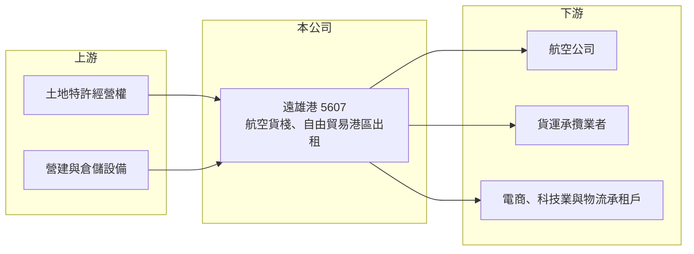

# 5607 遠雄港

> 上市｜[[產業索引-航運業|航運業]]｜上市（櫃）日期 2004/12/02

# 第一章：企業模式與商業藍圖

> [!info] 撰寫說明
> 精簡版，由 Claude 依公開資料整理，架構比照 [[2330台積電]] 的四章研究，資料截至 2026-10-08。來源：證交所開放資料（基本資料、綜合損益、資產負債、營益分析、股利、本益比）、Goodinfo 年度經營績效、nstock 公司簡介、ETtoday 2025 年報導標題。BOT 年限、集團關係與客戶類型憑記憶撰寫，已標待校對。#待校對

遠雄自由貿易港區（以下簡稱遠雄港）經營桃園機場旁的航空[[自由貿易港區]]。它的商業模式類似「機場旁的收費站加房東」：一方面處理航空貨物的進出口倉儲與裝卸，另一方面把園區內的廠辦與倉庫出租給物流、電商與科技業者。

- **核心業務：** 遠雄港 1991 年設立、2004 年上市，2006 年轉型為投資控股公司，屬於遠雄集團（待校對）。主要業務包括航空貨物與航空貨櫃、貨盤的裝拆櫃、裝拆盤、裝卸車與進出口[[航空貨棧]]，並出租桃園航空自由貿易港區內的廠辦與倉儲。自由貿易港區內的貨物可以像在[[保稅倉]]一樣免稅暫存、加工後再出口，對轉運與跨境物流業者有明顯的成本與時效優勢。
- **營收結構：** 營收來自兩類：一是貨棧作業收入，按處理的貨量與倉儲天數收費，與桃園機場的航空貨運量連動；二是園區廠辦與倉儲的租金收入，屬於長期租約、相對穩定。兩者的比重本次未查得。2025 年營收約 41.4 億元，2026 年 1 至 9 月累計約 40.8 億元、年增約 36%，顯示航空貨量（特別是 AI 伺服器等高科技貨物，推估）明顯成長。
- **營運據點：** 營運集中在桃園機場航空自由貿易港區，園區土地以 [[BOT]] 方式向民航主管機關取得經營權（待校對）。依 2025 年報導，加值園區 H 棟於 2025 年第三季完工，增加可出租的倉儲與廠辦空間。
- **長期方向：** 遠雄港的成長來自兩個方向：一是桃園機場貨運量長期成長，尤其台灣作為 AI 伺服器、半導體出口中心，高價值空運貨物需求持續增加；二是持續興建加值園區，把土地轉化為收租資產。這是一門靠地理位置與特許經營權、長期累積的生意。

# 第二章：護城河深度與競爭優勢

遠雄港的護城河來自特許經營權與地理位置：機場旁的自由貿易港區土地有限，新進者很難在同一位置複製。

- **競爭優勢：** 第一是區位：園區緊鄰桃園機場，貨物不必出關即可在園區內倉儲、加工與轉運，這種時效與保稅優勢是一般倉庫無法提供的。第二是特許經營權：自由貿易港區與航空貨棧需要政府核准，機場周邊可開發的土地有限，形成天然的寡占。第三是收租資產的穩定性：廠辦與倉儲租約多為長期，提供穩定的基本收入。
- **主要對手：** 桃園機場的其他航空貨運站，例如華航旗下的華儲與長榮集團旗下的榮儲（待校對），在貨棧作業上與遠雄港直接競爭；園區出租業務則與機場周邊的一般物流園區競爭。三家貨運站分食桃園機場的貨量，價格由主管機關費率與市場共同決定。
- **觀察重點：** 第一是桃園機場航空貨運量的長期趨勢，特別是 AI 伺服器與半導體出口能否持續。第二是加值園區新棟的出租率與租金水準。第三是 BOT 經營期限與續約條件（待校對），這決定資產能產生現金流的年限。

# 第三章：財務體質與盈利規模

資料日期：2026-10-08，表格是撰寫當時的快照；最新月營收、毛利率、累計 EPS 由自動排程寫在本筆記的屬性欄位（月營收、毛利率、累計EPS 等）。#待校對

遠雄港的財報具有基礎設施型公司的特徵：毛利率高、營業費用低，但因為持續興建園區，負債與折舊也較高。

| 年度 | 營收（新台幣） | [[毛利率]] | [[營業利益率]] | EPS（元） | [[ROE]] |
|---|---|---|---|---|---|
| 2021 | 25.3 億 | 58.3% | 40.5% | 2.48 | 10.2% |
| 2022 | 32.0 億 | 60.7% | 45.0% | 4.27 | 15.6% |
| 2023 | 29.1 億 | 49.2% | 32.7% | 2.91 | 9.93% |
| 2024 | 34.6 億 | 47.2% | 32.9% | 1.97 | 7.03% |
| 2025 | 41.4 億 | 49.7% | 36.9% | 2.77 | 9.57% |
| 2026 上半年 | 25.84 億 | 52.98% | 45.85% | 2.18 | 未查得 |

註：2021 至 2025 年取自 Goodinfo；2026 上半年取自證交所營益分析與綜合損益開放資料。

- **營收規模：** 營收由 2021 年 25.3 億元成長到 2025 年 41.4 億元，4 年年複合成長率約 13.1%（推算）。2026 年前 9 個月已接近 2025 年全年，成長動能來自航空貨量增加與新園區出租。
- **獲利：** 毛利率長期在 47% 至 61%，營業利益率 33% 至 46%，屬於高利潤率的基礎設施業務。2026 上半年營業利益率回升到 45.85%，EPS 2.18 元，已接近 2025 年全年的八成。近 5 年平均 ROE 約 10.5%（推算），穩定落在 7% 至 16% 之間。
- **財務特色：** 2026 年第二季底總資產約 271 億元，權益約 112 億元，負債約 159 億元，其中非流動負債約 125 億元，推估以園區興建借款與 BOT 相關負債為主。2025 年度配發現金股利 1.8 元，配息率約 65%（推算），公司章程規定現金股利以不低於股利總額 20% 為原則。2026 年 10 月初本益比約 14 倍、殖利率約 3.4%。
- **[[ROIC]] 與 [[WACC]]：** 2025 年營業利益約 15.3 億元（41.4 億元乘以 36.9%），扣除 20% 稅率約 12.2 億元；投入資本以權益 112 億元加推估有息負債約 110 億元（推估）計，約 222 億元，ROIC 約 5.5%（推算）。以 2026 上半年營業利益 11.8 億元年化，ROIC 約 8.5%（推算）。WACC 假設公債 1.75%、市場風險溢酬 6%、β 取基礎設施業常見值 0.7（推估），權益成本約 5.95%；負債成本 2.3%、稅後約 1.8%，權益與負債比約 50 比 50，WACC 約 3.9%（推算）。ROIC 高於 WACC，2026 年利差擴大到約 4 至 5 個百分點，代表遠雄港長期在創造價值；這種利差來自特許經營權與區位帶來的高利潤率，只要航空貨量持續成長，利差有機會維持。

# 第四章：總體風險與地緣政治

遠雄港的風險集中在單一機場的貨運量，以及特許經營權的期限與條件。

- **產業週期：** 航空貨運量跟著全球電子產品出貨與景氣循環波動，2023 年營收與獲利下滑就反映了疫情後空運貨量回落。目前貨量成長很大程度依賴 AI 伺服器與高科技產品出口，若這波投資放緩，貨棧業務會受到影響。
- **營運風險：** 營運集中在桃園機場單一地點，機場設施規劃、跑道與貨運站擴建計畫都可能改變競爭格局。持續興建園區帶來大額資本支出與借款，若新棟出租不如預期，折舊與利息會壓低報酬率。
- **其他風險：** BOT 經營期滿後資產須移轉或重新議約（待校對），會影響長期價值；利率上升增加融資成本；自由貿易港區的法規與關稅政策調整、兩岸與國際貿易政策變化，都可能影響轉運與跨境電商業務。

# 專有名詞解析

## 金融

- **[[ROIC]]**：投入資本報酬率，稅後營業利益除以股東權益與有息負債之和，衡量所有投入資本的報酬。
- **[[WACC]]**：加權平均資金成本，依權益與負債比重加權的資金成本，是 ROIC 需要超越的門檻。

## 產業

- **[[自由貿易港區]]**：經政府核准、貨物進出可免關稅與簡化通關的特定區域，適合轉運、加工與跨境物流。
- **[[航空貨棧]]**：機場旁處理航空貨物進出口的倉庫，負責裝拆盤、存放、通關與交貨。
- **[[BOT]]**：興建、營運、移轉，民間投資興建公共設施並經營一段期間後，再移轉給政府的合作模式。
- **[[保稅倉]]**：經海關核准、貨物可暫不課徵關稅存放的倉庫，適合轉運、加工與再出口。

# 核心供應鏈

- 上游：桃園機場周邊土地的特許經營權、園區營建（集團關係：[[5522遠雄]]，待校對）、倉儲與裝卸設備。
- 下游／客戶：航空公司（[[2610華航]]、[[2618長榮航]]、[[2646星宇航空]] 等，推估）、貨運承攬業者（[[2643捷迅]]、[[5609中菲行]] 等，推估）、園區內電商、科技與物流承租戶。
- 同業：華儲、榮儲等桃園機場航空貨運站業者（待校對）。

## 最新新聞
<!-- news:start（自動產生，請勿手動編輯此範圍） -->
- 2026-10-08 📰 媒體 19:51｜營收速報 - 遠雄港(5607)9月營收4.97億元年增率高達35.53％｜[鉅亨網](https://news.cnyes.com/news/id/6625894)

完整紀錄：[[5607遠雄港 新聞]]
<!-- news:end -->

## 相關連結
- [公開資訊觀測站](https://mopsov.twse.com.tw/mops/web/t05st03?step=1&firstin=1&co_id=5607)
- [Goodinfo](https://goodinfo.tw/tw/StockDetail.asp?STOCK_ID=5607)
- [Yahoo 股市](https://tw.stock.yahoo.com/quote/5607)
- [鉅亨網新聞](https://www.cnyes.com/twstock/5607/news)
