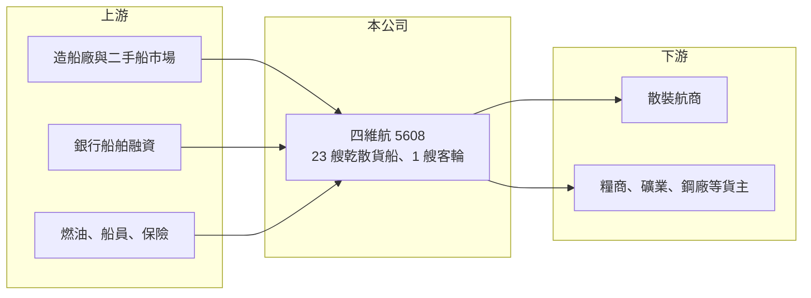

# 5608 四維航

> 上市｜[[產業索引-航運業|航運業]]｜上市（櫃）日期 2003/08/25

# 第一章：企業模式與商業藍圖

> [!info] 撰寫說明
> 精簡版，由 Claude 依公開資料整理，架構比照 [[2330台積電]] 的四章研究，資料截至 2026-10-08。來源：證交所開放資料（基本資料、綜合損益、資產負債、營益分析、股利、本益比）、Goodinfo 年度經營績效、富果 2026 年 6 月法說會備忘錄。與慧洋的家族關係憑記憶撰寫，已標待校對。#待校對

四維航業（以下簡稱四維航）是台灣老牌的乾散貨船東，以輕便型散裝船為主力。它的獲利模式與其他散裝船東相同：擁有船舶、出租給航商與貨主，收入由船隊規模與租金水準決定。

- **核心業務：** 四維航 1985 年成立、2003 年上市，主要擁有並營運乾散貨船，載運穀物、煤炭、礦砂、鋼材與肥料等大宗物資。董事長藍心琪，與 [[2637慧洋-KY]] 同屬藍姓航運家族（待校對）。散裝船東的收入本質上是「船隊艘數乘以每日租金」，因此經營重點在於船隊規模、[[船齡]]與租約安排。
- **營收結構：** 依 2026 年 6 月法說備忘錄，截至 2026 年第二季共有 23 艘散裝船與 1 艘客輪；散裝船中輕便型（Handy）16 艘、超輕便極限型（Ultramax）4 艘、巴拿馬型／卡姆薩型 3 艘。租約結構為長約約 48%、短約約 26%、即期市場（[[即期運價]]）約 26%；其中 18 艘為固定租金的[[期租]]、5 艘採[[指數連結租約]]（當時約為指數的 125%）。
- **營運據點：** 船隊航行全球，經營團隊在台灣。輕便型散裝船可以進出吃水較淺的港口，貨種多元，需求比大型船分散，但單船運量小、規模經濟較弱。
- **長期方向：** 公司策略是汰舊換新：2025 年出售 4 艘老船，2026 年 7 月預計交付 1 艘新的 Ultramax 節能船，並持續尋找 4 萬至 6 萬噸級的船舶。汰除老船能降低營運成本，2026 年第一季營業成本年減 17.5%，部分就來自老船報廢與成本控制。

# 第二章：護城河深度與競爭優勢

散裝航運高度同質化，四維航的競爭力取決於船隊結構、成本控制與在週期中的買賣時點，護城河偏淺。

- **競爭優勢：** 第一是長期經營經驗：成立四十年，與國際航商、貨主維持長期往來，有助於簽訂長約。第二是長短約搭配：約一半船隊簽長約，提供基本收入，另一半保留在短約與即期市場，市況好時可以分享運價上漲。第三是財務結構相對保守，負債比約 42%，在景氣低迷時有一定的承受能力。
- **主要對手：** 國內散裝船東包括 [[2637慧洋-KY]]、[[2641正德]]、[[2606裕民]]、[[2612中航]]、[[2605新興]]；國際上有大量希臘、日本與中國船東。四維航的船隊規模遠小於慧洋，與正德相近，但船齡偏老、近年獲利明顯較弱。
- **觀察重點：** 第一是汰舊換新的速度與成本，新船交付後能否降低平均船齡並提高租金。第二是即期與短約比例約一半，[[BDI]] 波動會直接反映在營收。第三是 2023 至 2025 年連續虧損後，2026 年能否穩定轉盈。

# 第三章：財務體質與盈利規模

資料日期：2026-10-08，表格是撰寫當時的快照；最新月營收、毛利率、累計 EPS 由自動排程寫在本筆記的屬性欄位（月營收、毛利率、累計EPS 等）。#待校對

四維航的財報呈現散裝船東的高槓桿特性：運價高峰時利潤率超過 40%，市況轉弱時迅速轉為虧損。

| 年度 | 營收（新台幣） | [[毛利率]] | [[營業利益率]] | EPS（元） | [[ROE]] |
|---|---|---|---|---|---|
| 2021 | 55.3 億 | 46.7% | 41.0% | 7.16 | 34.6% |
| 2022 | 67.2 億 | 47.2% | 42.1% | 6.08 | 22.5% |
| 2023 | 34.6 億 | 3.93% | -4.83% | -1.26 | -5.75% |
| 2024 | 34.9 億 | 8.94% | 0.47% | -0.69 | -4.05% |
| 2025 | 31.8 億 | 6.38% | -2.98% | -0.13 | -1.33% |
| 2026 上半年 | 16.22 億 | 18.42% | 8.70% | 0.32 | 未查得 |

註：2021 至 2025 年取自 Goodinfo；2026 上半年取自證交所營益分析與綜合損益開放資料。

- **營收規模：** 營收在 2022 年散裝高峰達 67.2 億元，2023 年腰斬到 34.6 億元，之後維持在 32 億至 35 億元。營收下滑除了運價回落，也與出售老船、船隊縮小有關。
- **獲利：** 2021 至 2022 年營業利益率超過 40%，2023 至 2025 年則在負 5% 至正 0.5% 之間，連續三年稅後虧損。2026 上半年毛利率回升到 18.42%、營業利益率 8.70%，EPS 0.32 元，顯示汰舊降本與散裝市況回溫的效果。近 5 年平均 ROE 約 9.2%（推算），但主要由 2021 至 2022 年貢獻。
- **財務特色：** 2026 年第二季底總資產約 171 億元，權益約 98 億元，負債約 73 億元，其中非流動負債約 42 億元，推估以購船貸款為主。每股淨值約 25 元，2026 年 10 月初股價淨值比約 0.67 倍，市場給予明顯低於淨值的評價。2025 年度虧損未配發股利，公司章程規定優先保留營運與擴展所需資金。
- **[[ROIC]] 與 [[WACC]]：** 2025 年營業虧損約 0.95 億元（31.8 億元乘以負 2.98%），虧損年度不計稅；投入資本以權益 98 億元加推估有息負債約 50 億元（推估）計，約 148 億元，ROIC 約負 0.6%（推算）。以 2026 上半年營業利益 1.41 億元年化並扣除 20% 稅率，ROIC 約 1.5%（推算）。WACC 假設公債 1.75%、市場風險溢酬 6%、β 取航運業常見值 1.1（推估），權益成本約 8.35%；負債成本 3%、稅後 2.4%，權益與負債比約 66 比 34，WACC 約 6.3%（推算）。2023 至 2025 年 ROIC 為負或接近零，遠低於 WACC，代表這段期間公司在毀損價值；2021 至 2022 年則遠高於資金成本。股價低於淨值正反映市場對其長期報酬率低於資金成本的看法，改善關鍵在於汰舊換新後能否把常態營業利益率拉回 10% 以上。

# 第四章：總體風險與地緣政治

四維航的風險與所有散裝船東相同，但老船比例較高、即期比例較大，使它對景氣反轉更敏感。

- **產業週期：** 散裝運價隨中國基建、全球糧食與能源貿易，以及新船供給循環，[[BDI]] 可以在一兩年內大幅上下。四維航約一半船隊暴露在短約與即期市場，2023 年營業利益率由 42% 跌到負 5%，就是這種敏感度的寫照。
- **營運風險：** 老船油耗與維修成本高，若汰舊速度不足，在租金下滑時更容易虧損；新船造價高，若在船價高點購入，未來折舊負擔重。1 艘客輪屬非核心業務，其營運與安全規範也需另外管理。
- **其他風險：** 國際海事組織的碳排規範會讓老船面臨降速或改裝，增加成本；營收以美元計價，匯率波動影響獲利；船舶貸款利率上升增加財務負擔；全球經濟放緩、通膨與地緣衝突（公司法說亦提及）都會影響散裝需求。

# 專有名詞解析

## 金融

- **[[ROIC]]**：投入資本報酬率，稅後營業利益除以股東權益與有息負債之和，衡量所有投入資本的報酬。
- **[[WACC]]**：加權平均資金成本，依權益與負債比重加權的資金成本，是 ROIC 需要超越的門檻。

## 產業

- **[[BDI]]**：波羅的海乾散貨指數，綜合各型散裝船運價編製，是觀察散裝航運景氣最常用的指標。
- **[[期租]]**：船東把船連同船員出租給租船人一段期間、按日收取租金的合約，可鎖定收入、降低運價波動影響。
- **[[指數連結租約]]**：租金依波羅的海分船型運價指數的一定比例浮動的租船合約，船東可分享運價上漲，但也承擔下跌風險。
- **[[即期運價]]**：依當下市場供需決定的單次航程運價，景氣好時上漲快速，景氣差時也下跌快速。
- **[[船齡]]**：船舶自交船起算的年數，船齡越高通常油耗與維修成本越高，租金與轉售價值越低。

# 核心供應鏈

- 上游：造船廠與二手船市場、銀行船舶融資、燃油與船員管理服務。
- 下游／客戶：國際散裝航商與大宗物資貨主（租家名稱未揭露）。
- 同業：[[2637慧洋-KY]]、[[2641正德]]、[[2606裕民]]、[[2612中航]]、[[2605新興]]。

## 最新新聞
<!-- news:start（自動產生，請勿手動編輯此範圍） -->
- 2026-10-07 📰 媒體 19:50｜營收速報 - 四維航(5608)9月營收3.58億元年增率高達38.97％｜[鉅亨網](https://news.cnyes.com/news/id/6623957)

完整紀錄：[[5608四維航 新聞]]
<!-- news:end -->

## 相關連結
- [公開資訊觀測站](https://mopsov.twse.com.tw/mops/web/t05st03?step=1&firstin=1&co_id=5608)
- [Goodinfo](https://goodinfo.tw/tw/StockDetail.asp?STOCK_ID=5608)
- [Yahoo 股市](https://tw.stock.yahoo.com/quote/5608)
- [鉅亨網新聞](https://www.cnyes.com/twstock/5608/news)
