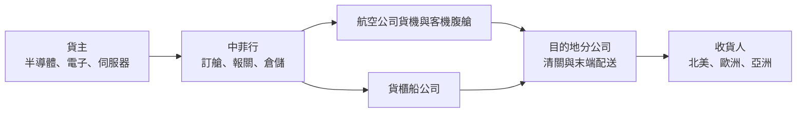
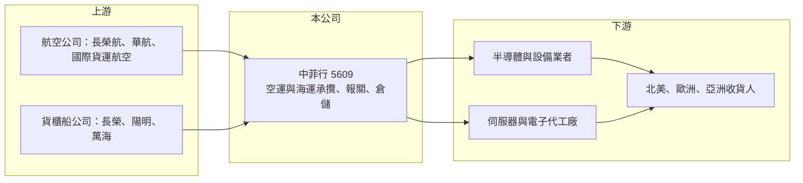

# 5609 中菲行

> 上櫃｜[[產業索引-航運業|航運業]]｜上市（櫃）日期 2001/10/15

# 第一章：企業模式與商業藍圖

> [!info] 撰寫說明
> 精簡版，由 Claude 依公開資料整理，架構比照 [[2330台積電]] 的四章研究，資料截至 2026-10-08。來源：Goodinfo 年度經營績效頁、優分析 2026 年 1 月營收報導、櫃買中心開放資料（基本資料、2026 年第二季資產負債與綜合損益、每月營收、本益比殖利率）；全球據點與客戶產業的描述部分依記憶整理，標示待校對。#待校對

中菲行是台灣規模最大的本土國際貨運承攬商之一，本章說明它不擁有飛機與船、卻能經營全球物流的商業模式，以及它為何與台灣科技業的出貨節奏高度連動。

## 一、核心定位：不持有運具的國際貨運承攬商

中菲行成立於 1985 年，2001 年上櫃，董事長為錢文君，實收資本額約 14.3 億元（櫃買中心開放資料）。公司的本業是國際[[承攬運送]]，也就是替貨主向航空公司與船公司訂艙位、安排報關、倉儲與末端配送，本身不擁有飛機或貨櫃船。這種模式的好處是資本支出很低、可以隨景氣快速調整艙位採購量；代價是毛利率偏低，獲利來自「買艙與賣艙的價差」乘上貨量。

* **以空運為強項：** 依公司對外說明，中菲行在台灣半導體產業有逾 50 年的物流服務經驗（優分析引述），空運轉運樞紐包括台北、香港、首爾、東京成田與新加坡。高單價、急件性質的電子零組件與 AI 伺服器多走空運，這是中菲行最主要的獲利來源。
* **海運與合約物流為輔：** 海運承攬與倉儲、供應鏈管理服務提供較穩定的基本收入，但公開資料中未查得各業務的營收比重。

## 二、營運據點：亞洲與北美為主的自營網絡

中菲行以自有分公司為主，在亞洲、北美等地設立據點，並在部分地區與代理商合作（據點數未查得，待校對）。自營網絡的意義在於，貨物從台灣出口到美國時，起運地與目的地都由自家公司處理，能掌握完整的報關與交貨資訊，對於需要嚴格控管的半導體設備、晶片與伺服器客戶特別重要。

## 三、資本轉化邏輯：輕資產、高周轉

承攬業的營收會隨運價大幅放大或縮小，但真正的獲利是每公斤或每個貨櫃的服務價差。2021 至 2022 年疫情期間運價暴漲，中菲行營收衝到 390 億至 412 億元，EPS 達 16.98 元與 18.71 元；2023 年運價回落後營收降到 220 億元，EPS 仍有 7.24 元（Goodinfo），顯示在正常運價下公司仍維持穩定獲利。

## 四、企業長期藍圖

長期成長動能來自兩條主線。第一是 AI 伺服器與半導體的全球布建，亞太往北美、歐洲的高價值空運需求，2025 年底仍是推升貨量的主力（優分析）。第二是供應鏈多元化，客戶把產能從中國移往東南亞、印度與墨西哥，物流路線變長、節點變多，對熟悉跨國報關與關稅規則的承攬商有利。董事長錢文君在 2026 年初表示，貿易政策已從單純的合規議題變成核心商業策略，公司定位是協助客戶強化供應鏈韌性（優分析）。

# 第二章：護城河深度與競爭優勢

承攬業進入門檻不高，本章分析中菲行如何在這個高度分散的產業中建立差異化，以及哪些優勢在運價循環中守得住。

## 一、護城河的核心組成要素

* **產業專業與客戶黏著：** 半導體設備與晶片運輸需要溫濕度、防震與保全控管，出錯的代價遠高於運費本身。中菲行長期服務台灣科技業，熟悉這類貨物的作業流程，客戶一旦導入很少因為小幅運費差異而轉換，這是它最主要的轉換成本。
* **自營網絡：** 相較於只在台灣接單、海外交給代理的小型承攬商，自營據點能提供端到端的資訊與服務品質，也能直接在海外接單，降低對單一出口市場的依賴。
* **艙位採購規模：** 承攬商的議價能力來自貨量。中菲行年營收約 290 億至 300 億元，能向航空公司簽訂較穩定的艙位合約，在旺季缺艙時較有保障。

## 二、主要競爭對手

| 對手 | 定位 | 與中菲行的比較 |
|---|---|---|
| DHL Global Forwarding、DSV、Kuehne+Nagel | 全球前幾大承攬商 | 網絡與規模遠大於中菲行，搶大型跨國客戶 |
| [[2636台驊控股]] | 台灣上市承攬商，以中國與亞洲網絡見長 | 業務重疊度最高的本土同業 |
| [[2643捷迅]]、[[2611志信]] | 台灣空運承攬與報關 | 規模較小，聚焦特定產業或地區 |
| [[7716昱臺國際]] | 台灣承攬新兵，主攻東南亞 | 規模約為中菲行的十五分之一 |

## 三、守得住與守不住

* **守得住：** 科技業高價值空運的服務價差。只要台灣仍是全球半導體與 AI 伺服器的出貨中心，具備專業作業能力的承攬商就有穩定的需求。
* **守不住：** 運價本身。2023 年運價正常化後，營收一年內從 412 億元腰斬到 220 億元，承攬商無法左右市場運價，營收規模會隨之大幅波動。
* **觀察重點：** 毛利率能否維持在 13% 以上、AI 伺服器空運需求的延續性，以及美國關稅政策造成的供應鏈轉移是否帶來新航線與新客戶。

# 第三章：財務體質與盈利規模

資料日期：2026-10-08，表格是撰寫當時的快照；最新月營收、毛利率、累計 EPS 由自動排程寫在本筆記的屬性欄位（月營收、毛利率、累計EPS 等）。#待校對

本章用多年度數據檢視中菲行在運價循環中的獲利穩定度與資本效率。

## 一、多年度三率與 ROE

| 年度 | 營收（新台幣） | [[毛利率]] | [[營業利益率]] | EPS（元） | [[ROE]] |
|---|---|---|---|---|---|
| 2020 | 229 億 | 16.3% | 5.32% | 8.62 | 43.1% |
| 2021 | 390 億 | 14.9% | 6.90% | 16.98 | 64.5% |
| 2022 | 412 億 | 14.4% | 6.25% | 18.71 | 48.1% |
| 2023 | 220 億 | 17.2% | 4.91% | 7.24 | 16.9% |
| 2024 | 289 億 | 13.5% | 3.49% | 6.78 | 15.7% |
| 2025 | 297 億 | 13.7% | 4.29% | 8.00 | 17.7% |
| 2026 上半年 | 167.2 億 | 12.68% | 3.83% | 4.03 | 未查得 |

註：2020 至 2025 年取自 Goodinfo；2026 上半年依櫃買中心綜合損益推算。優分析依月營收加總的 2025 年營收為 293.05 億元，與 Goodinfo 略有差異，以年報為準。

* **毛利率與營業利益率：** 承攬業毛利率長期落在 13% 至 17%，營業利益率 3.5% 至 7%，屬於低利潤率、高周轉的生意。運價高漲時毛利率反而略降，因為營收被運價放大，但每票的價差並未等比例擴大。
* **營收趨勢：** 2020 至 2025 年營收年複合成長率約 5.3%（推算），中間經歷 2021 至 2022 年的疫情高峰與 2023 年的回落。2026 年 1 至 8 月累計營收約 232.7 億元、年增約 20.9%（櫃買中心每月營收），反映 AI 相關空運需求強勁。
* **ROE：** 2021 至 2025 年平均 ROE 約 32.6%（推算），即使在運價正常化的 2023 至 2025 年也維持在 15% 至 18%，在輕資產模式下資本效率很高。

## 二、股利與現金流

最近一次現金股利為 5.6 元（櫃買中心本益比殖利率資料），以 2025 年 EPS 8 元計算配發率約 70%（推算）。承攬業不需要大額資本支出，營業現金流扣掉少量的倉儲與系統投資後，自由現金流大致長期為正（推估）。2026 年第二季底權益總計約 64.1 億元、總負債約 47.4 億元，負債以應付運費等營運性負債為主（櫃買中心資產負債）。

## 三、[[ROIC]] 與 [[WACC]]

**ROIC 推算：** 2025 年營業利益約 297 億元 × 4.29% ≈ 12.7 億元，扣除 20% 稅率後約 10.2 億元。投入資本以 2026 年第二季底權益 64.1 億元，加上假設的有息負債約 5 億元（推估，承攬業多為營運性負債）計算，約 69 億元，ROIC 約 15%（推算）。

**WACC 推算：** 台灣 10 年期公債殖利率取 1.75%、市場風險溢酬 6%、β 取物流同業常見值 0.8，權益成本約 6.55%；負債比重低，WACC 約 6.4%（推算）。

**結論：** ROIC 明顯高於 WACC，代表中菲行即使在運價正常的年份也持續創造價值。輕資產讓它不必承擔運具的折舊與閒置風險，這是承攬模式最大的優勢；但利差的大小仍取決於貨量與服務價差，景氣下行時 ROIC 可能下滑到個位數。

# 第四章：總體風險與地緣政治

本章整理中菲行長期必須面對的產業週期、營運與外部風險。

## 一、產業週期

* **運價與貨量的雙重循環：** 承攬業的營收由運價與貨量決定，兩者都受全球景氣與電子產品週期影響。2021 至 2022 年的疫情紅利已證明是一次性的，投資人不應以高峰年度推估長期獲利。
* **電子產業集中度：** 客戶以科技業為主，AI 伺服器與半導體出貨若放緩，空運貨量會同步下滑，[[長鞭效應]]也會放大庫存調整期的衝擊。

## 二、營運風險

* **艙位成本風險：** 承攬商若事先承諾大量艙位，市場需求突然轉弱時可能出現賣不掉的空艙成本；反之旺季缺艙時又可能接不到貨。
* **大型對手的價格競爭：** 全球大型承攬商透過併購擴大規模，數位化訂艙平台也降低了轉換成本，中小型承攬商的價差可能被壓縮。

## 三、其他風險

* **關稅與貿易政策：** 美國關稅政策反覆變動，可能讓客戶延後或提前出貨，造成貨量大幅波動；但供應鏈轉移本身也帶來新的物流需求。
* **匯率：** 運費多以美元計價，新台幣升值會使換算後的營收下降，2025 年中曾有匯率侵蝕營收的情形（新聞標題）。
* **地緣政治：** 台海或紅海等航運要道的衝突，可能造成航線中斷與運價劇烈波動。

# 專有名詞解析

## 金融

- **[[ROIC]]**：投入資本報酬率，衡量企業用股東與債權人投入的資本，每年能產生多少稅後營業利益。
- **[[WACC]]**：加權平均資金成本，股東要求報酬與負債利息依資本結構加權後的平均值，是判斷是否創造價值的門檻。

## 產業

- **[[承攬運送]]**：貨運承攬商不擁有飛機或船，而是向運輸業者購買艙位，替貨主安排運送、報關與配送，賺取服務價差。
- **[[長鞭效應]]**：終端需求的小幅變動，沿供應鏈往上游傳遞時被逐級放大，造成上游庫存與訂單劇烈波動。

# 核心供應鏈

- 上游：航空公司艙位，如 [[2618長榮航]]、[[2610華航]]；貨櫃船公司，如 [[2603長榮]]、[[2609陽明]]、[[2615萬海]]。
- 下游／客戶：半導體與電子產業（具體客戶名單未公開），AI 伺服器供應鏈如 [[2382廣達]]、[[3231緯創]] 屬於這類空運需求的代表產業（非指名客戶）。
- 同業：[[2636台驊控股]]、[[2643捷迅]]、[[2611志信]]、[[7716昱臺國際]]，以及 DHL、DSV、Kuehne+Nagel 等國際承攬商。

## 最新新聞
<!-- news:start（自動產生，請勿手動編輯此範圍） -->
- 2026-10-06 📰 媒體 19:43｜Q4海空運運力都緊 中菲行：海運部分急貨轉空運｜[鉅亨網](https://news.cnyes.com/news/id/6622891)
- 2026-10-06 📰 媒體 13:50｜營收速報 - 中菲行(5609)9月營收36.55億元年增率高達46.96％｜[鉅亨網](https://news.cnyes.com/news/id/6622659)

完整紀錄：[[5609中菲行 新聞]]
<!-- news:end -->

## 相關連結
- [公開資訊觀測站](https://mopsov.twse.com.tw/mops/web/t05st03?step=1&firstin=1&co_id=5609)
- [Goodinfo](https://goodinfo.tw/tw/StockDetail.asp?STOCK_ID=5609)
- [Yahoo 股市](https://tw.stock.yahoo.com/quote/5609)
- [鉅亨網新聞](https://www.cnyes.com/twstock/5609/news)
