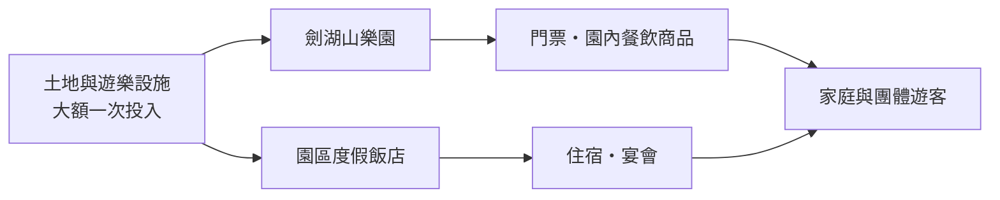
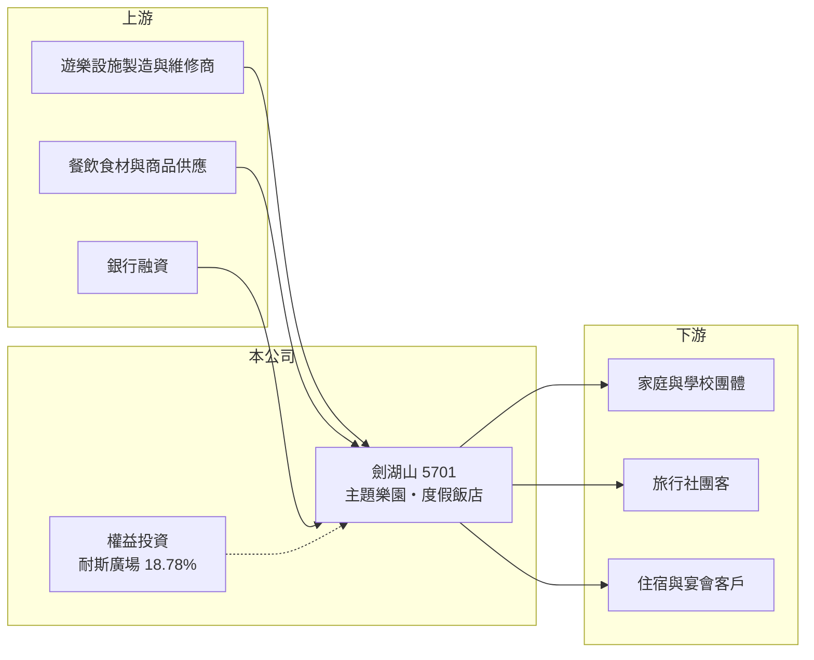

# 5701 劍湖山

> 上櫃｜[[產業索引-觀光餐旅|觀光餐旅]]｜上市（櫃）日期 1998/03/12

# 第一章：企業模式與商業藍圖

> [!info] 撰寫說明
> 本文由 Claude 依公開資料整理，架構比照 [[2330台積電]] 的四章研究，資料截至 2026-10-08。財務數字來源：櫃買中心開放資料（基本資料、2026 年第二季資產負債表與綜合損益表）、Goodinfo 年度經營績效頁、nStock 公司簡介；公開資料有限，查不到遊客人次、飯店房間數與樂園／飯店的營收比重，產業描述為整理性內容，尚未逐條比對原始文件。#待校對

在評估單一個股的長期投資價值時，首要步驟是拆解企業的底層獲利邏輯。本章說明劍湖山世界（股票代號：5701，以下簡稱劍湖山）這座中南部老牌[[主題樂園]]的商業模式，以及它為何長期處於虧損。

## 一、核心定位：雲林的樂園加飯店

劍湖山於 1986 年 8 月設立，原名劍湖山遊樂事業，1990 年 11 月更名為劍湖山世界。依 nStock 整理，公司業務以提供遊樂設施為主，經營天然風景區的規劃與經營，並附設休閒旅館與餐廳。樂園位於雲林古坑，園區內設有度假飯店（劍湖山王子大飯店，憑記憶補充，待校對），屬於耐斯集團旗下的觀光事業（待校對）。

公司過去曾經營更多元的事業：2006 年馬哥波羅國際開發公司開始營業，2007 年 10 月由劍湖山吸收合併；2015 年 8 月，公司把嘉義耐斯王子飯店與耐斯百貨部門分割給新設的耐斯廣場公司；2017 年因未依持股比例參與耐斯廣場增資，持股降至 18.78%，喪失控制權。經過這兩次調整，劍湖山的本業收斂為雲林的樂園與飯店。

## 二、資本轉化邏輯：一次投入、長期攤提

主題樂園是典型的重資產生意：土地、大型遊樂設施與飯店需要一次投入大筆資金，之後每年要負擔折舊、維修與安全檢查費用。收入則來自門票、園內餐飲商品與住宿，高度依賴遊客人次。這種結構有強烈的[[營運槓桿]]：遊客多時，增加的收入幾乎都是利潤；遊客少時，固定成本照樣發生，虧損迅速擴大。劍湖山的毛利率長年在 44% 至 50%，但營業費用與利息支出讓營業利益與淨利多年為負。

## 三、長期方向

主題樂園要維持吸引力，必須每隔幾年引進新設施或改裝主題區，這需要持續的資本支出。劍湖山目前負債沉重，2026 年第二季底流動負債 12.4 億元，而流動資產僅 0.72 億元，再投資能力受限。長期來看，公司的方向取決於能否透過資產活化、集團支持或引進策略夥伴，取得更新設施所需的資金。

# 第二章：護城河深度與競爭優勢

「護城河」指企業抵禦競爭、維持超額利潤的保護機制。台灣主題樂園市場小、競爭者固定，本章說明劍湖山的相對位置。

## 一、相對優勢

主題樂園需要大面積土地、開發許可與多年累積的品牌知名度，新進者很難在短期內複製，這是劍湖山最主要的進入障礙。它是雲嘉地區規模最大的樂園之一，對中部與南部的家庭與學校團體具有地理上的便利性。不過這道障礙只能阻止新競爭者，並不能保證獲利：消費者的休閒預算可以轉向出國旅遊或其他娛樂，樂園本身的定價權有限。

## 二、主要競爭對手

| 對手 | 定位 | 對劍湖山的威脅 |
|---|---|---|
| [[2705六福]] | 新竹六福村主題樂園與飯店 | 北部家庭客群的主要選擇 |
| 麗寶樂園 | 台中大型樂園與購物中心 | 在中部市場直接競爭 |
| 義大遊樂世界 | 高雄樂園結合購物與飯店 | 爭奪南部遊客 |
| 出國旅遊 | 日本、韓國等短程旅遊 | 分食家庭的休閒旅遊預算 |

## 三、守得住／守不住／觀察重點

守得住的是土地、園區與品牌知名度。守不住的是遊客成長，台灣少子化使家庭與學校團體的客源長期縮小，國人出國旅遊增加也分走需求。長期觀察重點是設施更新計畫、財務結構能否改善，以及營業利益率能否從接近損益平衡轉為穩定獲利。

# 第三章：財務體質與盈利規模

資料日期：2026-10-08，表格是撰寫當時的快照；最新月營收、毛利率、累計 EPS 由自動排程寫在本筆記的屬性欄位（月營收、毛利率、累計EPS 等）。#待校對

財務報表是檢驗護城河是否真實存在的最終標準。本章用六年的三率、ROE 與資本報酬檢視劍湖山的獲利品質。

## 一、多年度經營績效

| 年度 | 營收（新台幣） | [[毛利率]] | [[營業利益率]] | EPS（元） | [[ROE]] |
|---|---|---|---|---|---|
| 2020 | 4.60 億 | 44.1% | -16.7% | -0.54 | -19.9% |
| 2021 | 3.06 億 | 27.0% | -49.0% | -0.65 | -28.0% |
| 2022 | 4.74 億 | 44.3% | -9.31% | -0.29 | -16.3% |
| 2023 | 5.58 億 | 48.0% | -2.31% | -0.35 | -8.22% |
| 2024 | 5.07 億 | 47.0% | -7.18% | -0.52 | -11.7% |
| 2025 | 5.44 億 | 50.5% | -1.24% | -0.26 | -6.55% |
| 2026 上半年 | 2.27 億 | 41.1% | -21.0% | -0.48 | 未查得 |

資料來源：2020 至 2025 年為 Goodinfo，2026 上半年為櫃買中心開放資料。

劍湖山的營業利益率從 2021 年疫情期間的 -49% 改善到 2025 年的 -1.24%，已經接近損益平衡，但始終沒有轉正；加上利息等業外支出，稅後仍為虧損。2026 年上半年因季節性（暑假旺季在第三季）營業利益率回到 -21%。2021 至 2025 年平均 ROE 約 -14%（推算）；營收年複合成長率在 2021 至 2025 年約 15%（推算，基期為疫情低點），若以 2020 年為基期則僅約 3%。近五年沒有配發現金股利。

## 二、財務結構

2026 年第二季底，劍湖山總資產 23.3 億元，其中非流動資產（土地、設施與投資）22.6 億元；負債 18.9 億元，負債比約 81%。流動資產僅 0.72 億元，流動負債 12.4 億元，流動比率不到 6%，短期債務高度依賴借新還舊。保留盈餘 -9.64 億元，約為股本 14.3 億元的 67%，每股淨值 3.09 元。

## 三、[[ROIC]] 與 [[WACC]]：價值創造利差

**ROIC 推算：** 2025 年營業虧損約 0.07 億元（5.44 億 × -1.24%），虧損年度不計稅盾。2026 年第二季底權益約 4.41 億元，負債 18.9 億元中假設六成為有息負債約 11.3 億元（推估），投入資本約 15.8 億元，ROIC 約 -0.4%（推算），接近零。

**WACC 推算：** 台灣 10 年期公債取 1.75%、市場風險溢酬 6%；因負債比高，β 取 1.3（高槓桿調整後，推估），股東權益成本約 9.55%；負債成本假設 3.5%，虧損無法抵稅以稅前計；權益約 28%、負債約 72%，WACC 約 5.2%（推算）。

**結論：** ROIC 接近零、低於 WACC 約 5 個百分點。即使本業已接近損益平衡，仍賺不回利息與股東要求的報酬。若要創造價值，營業利益率需要回到 10% 以上，或透過處分資產降低負債。

# 第四章：總體風險與地緣政治

任何企業都無法脫離宏觀環境獨立存在。本章分析劍湖山長期必須面對的風險。

## 一、財務與流動性風險

流動比率極低、負債比超過八成，是劍湖山最大的風險。若銀行緊縮授信或利率上升，公司可能面臨資金調度壓力，需要集團支持、處分資產或增資。累積虧損已接近股本的七成，未來也可能需要減資彌補虧損。

## 二、需求結構風險

少子化讓主題樂園的核心客群（家庭與學校團體）長期減少，國人出國旅遊比例上升也排擠國內樂園需求。天候對樂園影響很大，颱風與酷暑都會直接減少遊客。

## 三、設施與安全風險

遊樂設施老化需要持續投資更新，否則吸引力下降；設施故障或安全事故則可能造成營運中斷與商譽損失。人力成本上升與基本工資調整，也持續壓縮樂園與飯店的利潤。

# 專有名詞解析

## 金融

- **[[營運槓桿]]**：固定成本占比高時，營收小幅變動就會讓獲利大幅增減；營收萎縮時虧損也會被放大。
- **[[ROIC]]**：投入資本報酬率，稅後營業利益除以股東權益加有息負債，衡量本業運用資本的效率。
- **[[WACC]]**：加權平均資金成本，股東與債權人要求報酬率的加權平均，是 ROIC 要超越的門檻。

## 產業

- **[[主題樂園]]**：以遊樂設施與主題園區為核心、收取門票與園內消費的觀光事業，屬於重資產且高度依賴遊客人次的行業。

# 核心供應鏈

## 1. 上游：設施、物資與資金
- 遊樂設施製造與維修、餐飲食材與商品供應、銀行融資

## 2. 中游：劍湖山與轉投資
- 雲林劍湖山樂園與園區飯店；耐斯廣場（持股 18.78%，2017 年起非子公司）

## 3. 下游與同業
- 客戶：家庭與學校團體、旅行社團客、住宿與宴會客戶
- 同業：[[2705六福]]、麗寶樂園、義大遊樂世界；旅行社通路如 [[2731雄獅]]

## 最新新聞
<!-- news:start（自動產生，請勿手動編輯此範圍） -->
- 2026-10-08 🏛️ 重訊 16:03｜公告本公司115年09月份銀行融資額度使用情形 及未來三個月之現金收支及資金調度狀況。｜[觀測站](https://mops.twse.com.tw/mops/#/web/t05st01)

完整紀錄：[[5701劍湖山 新聞]]
<!-- news:end -->

## 相關連結
- [公開資訊觀測站](https://mopsov.twse.com.tw/mops/web/t05st03?step=1&firstin=1&co_id=5701)
- [Goodinfo](https://goodinfo.tw/tw/StockDetail.asp?STOCK_ID=5701)
- [Yahoo 股市](https://tw.stock.yahoo.com/quote/5701)
- [鉅亨網新聞](https://www.cnyes.com/twstock/5701/news)
