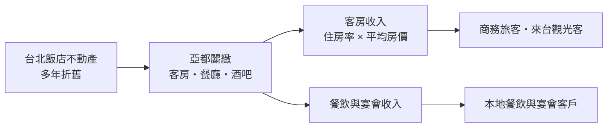
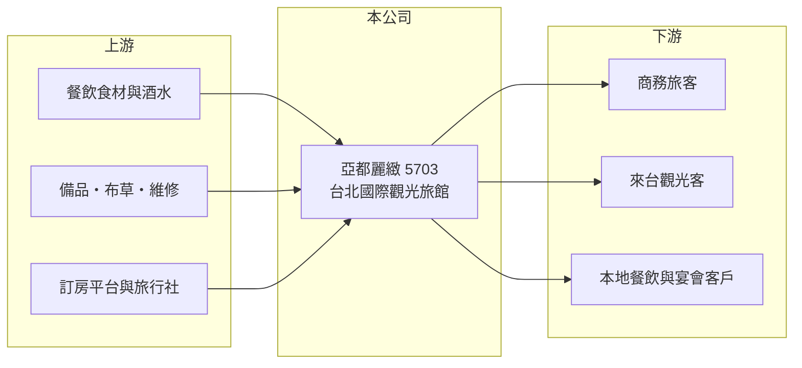

# 5703 亞都

> 上櫃｜[[產業索引-觀光餐旅|觀光餐旅]]｜上市（櫃）日期 1999/06/15

# 第一章：企業模式與商業藍圖

> [!info] 撰寫說明
> 本文由 Claude 依公開資料整理，架構比照 [[2330台積電]] 的四章研究，資料截至 2026-10-08。財務數字來源：櫃買中心開放資料（基本資料、2026 年第二季資產負債表與綜合損益表）、Goodinfo 年度經營績效頁、nStock 公司簡介；公開資料有限，查不到房間數、住房率、平均房價與客房／餐飲營收比重，憑記憶補充的內容已標註，產業描述為整理性內容，尚未逐條比對原始文件。#待校對

在評估單一個股的長期投資價值時，首要步驟是拆解企業的底層獲利邏輯。本章說明亞都麗緻大飯店（股票代號：5703，以下簡稱亞都麗緻）這家台北老牌精品飯店的商業模式，以及單一飯店公司的優勢與侷限。

## 一、核心定位：台北的單一精品國際觀光旅館

亞都麗緻於 1977 年 5 月設立，1979 年 11 月開始營業，1999 年 6 月在櫃買中心掛牌。依 nStock 整理，公司主要經營國際觀光旅館業務，並附設餐廳、咖啡廳與酒吧。飯店位於台北市民權東路，房間數約兩百間（憑記憶補充，待校對），以歐式精品服務聞名，是台灣「麗緻」飯店品牌的發源地（待校對）。

和連鎖飯店集團不同，亞都麗緻的上市主體基本上就是一間飯店。這代表公司的營收來源集中：客房收入取決於[[住房率]]與[[平均房價]]，餐飲收入則來自館內餐廳與宴會。疫情期間（2021 年，憑記憶補充，待校對），同品牌的台中亞緻飯店結束營業，進一步讓集團資源集中在台北本館。

## 二、資本轉化邏輯：老飯店的營運槓桿

飯店經營四十多年，硬體投資多已折舊攤提，但人力、維修與能源成本是固定支出。這種結構的[[營運槓桿]]很明顯：2021 年疫情期間營收只有 2.11 億元，毛利率轉為 -12.4%；2023 年國境解封後營收回升到 4.32 億元，毛利率立刻跳到 42%，營業利益率轉為 10.7%。2026 年上半年營收 2.51 億元、營業利益率約 14%，是近年較好的水準。

## 三、長期方向

單一老飯店的長期課題是「維持精品定位」與「控制翻修成本」之間的平衡。精品飯店的房價需要靠服務與裝潢維持，每隔一段時間就需要整修；但公司規模小，大規模翻修可能需要停業並投入大筆資本。另一個方向是品牌與管理輸出，以輕資產的方式擴大「麗緻」品牌，但目前公開資料未見具體計畫。

# 第二章：護城河深度與競爭優勢

「護城河」指企業抵禦競爭、維持超額利潤的保護機制。台北高端飯店市場近年新進者眾多，本章說明亞都麗緻的相對位置。

## 一、相對優勢

亞都麗緻的優勢在於品牌歷史與服務口碑。四十多年經營累積的老客戶、企業長期合作與「精品服務」的形象，是新飯店短期內難以複製的無形資產。地點位於台北市區、交通便利，對商務客有一定吸引力。不過飯店業的品牌優勢需要持續投入維護，且台北近年有多家國際連鎖高端飯店開幕，亞都麗緻的護城河屬於窄幅。

## 二、主要競爭對手

| 對手 | 定位 | 對亞都麗緻的威脅 |
|---|---|---|
| [[2707晶華]] | 台北高端飯店與多品牌連鎖 | 品牌、規模與會員體系較強 |
| [[2704國賓]] | 台北老牌國際觀光飯店 | 爭奪同一批商務客與宴會客 |
| [[2739寒舍]] | 台北喜來登與艾美 | 國際品牌會員導客能力強 |
| 國際連鎖新飯店 | 新硬體、全球會員體系 | 以新設施吸引高端旅客 |

## 三、守得住／守不住／觀察重點

守得住的是品牌口碑與老客戶。守不住的是硬體競爭力，新飯店的設施與國際會員體系會持續分走高端客源。長期觀察重點是平均房價能否維持、整修計畫與資本支出規模，以及營業利益率能否穩定在 10% 以上。

# 第三章：財務體質與盈利規模

資料日期：2026-10-08，表格是撰寫當時的快照；最新月營收、毛利率、累計 EPS 由自動排程寫在本筆記的屬性欄位（月營收、毛利率、累計EPS 等）。#待校對

財務報表是檢驗護城河是否真實存在的最終標準。本章用六年的三率、ROE 與資本報酬檢視亞都麗緻的獲利品質。

## 一、多年度經營績效

| 年度 | 營收（新台幣） | [[毛利率]] | [[營業利益率]] | EPS（元） | [[ROE]] |
|---|---|---|---|---|---|
| 2020 | 2.96 億 | 7.56% | -35.7% | -2.36 | -22.9% |
| 2021 | 2.11 億 | -12.4% | -64.8% | -1.77 | -21.4% |
| 2022 | 2.53 億 | 8.79% | -34.1% | -1.22 | -17.9% |
| 2023 | 4.32 億 | 42.0% | 10.7% | 0.55 | 8.47% |
| 2024 | 4.25 億 | 37.5% | 3.46% | 0.19 | 2.83% |
| 2025 | 4.49 億 | 43.9% | 9.98% | 0.53 | 7.33% |
| 2026 上半年 | 2.51 億 | 47.6% | 14.0% | 0.43 | 未查得 |

資料來源：2020 至 2025 年為 Goodinfo，2026 上半年為櫃買中心開放資料。

亞都麗緻的數字分成兩段：2020 至 2022 年疫情期間連續三年虧損，2023 年起轉虧為盈，2025 年 EPS 0.53 元、ROE 7.33%。2021 至 2025 年平均 ROE 約 -4%（推算），若只看疫後的 2023 至 2025 年則約 6%。營收年複合成長率在 2021 至 2025 年約 21%（推算，基期為疫情低點）。雖然已恢復獲利，但近五年沒有配發現金股利，主要是疫情期間累積的虧損尚未完全彌補。

## 二、財務結構

2026 年第二季底，亞都麗緻總資產 9.97 億元、負債 4.44 億元，負債比約 45%；流動資產 3.86 億元，流動負債 2.85 億元，流動比率約 135%。權益 5.53 億元，保留盈餘 -1.22 億元，每股淨值 7.87 元，仍低於面額。

## 三、[[ROIC]] 與 [[WACC]]：價值創造利差

**ROIC 推算：** 2025 年營業利益約 0.45 億元（4.49 億 × 9.98%），稅後約 0.36 億元。2026 年第二季底權益約 5.53 億元，負債 4.44 億元中假設四成為有息負債約 1.78 億元（推估），投入資本約 7.3 億元，ROIC 約 5%（推算）。

**WACC 推算：** 台灣 10 年期公債取 1.75%、市場風險溢酬 6%、β 取觀光飯店股常見值 0.8，股東權益成本約 6.55%；負債成本 2.5%、稅後 2%；權益約 76%、負債約 24%，WACC 約 5.5%（推算）。

**結論：** 疫後 ROIC 已回升到與 WACC 相當的水準，代表飯店大致能賺回資金成本，但還談不上持續創造超額價值。若 2026 年上半年約 14% 的營業利益率能延續全年，ROIC 有機會小幅超過 WACC。

# 第四章：總體風險與地緣政治

任何企業都無法脫離宏觀環境獨立存在。本章分析亞都麗緻長期必須面對的風險。

## 一、單一資產集中風險

公司營收幾乎全部來自台北一間飯店，任何影響這間飯店的事件，例如整修停業、設備故障、周邊環境變化或租約與土地問題，都會直接衝擊整體營收。這與擁有多間飯店的連鎖集團相比，風險分散程度低得多。

## 二、觀光需求與競爭風險

疫情期間營收大減的經驗顯示，國際旅遊中斷對台北國際觀光旅館的衝擊極大。來台旅客人數、商務差旅需求與國際航線恢復程度，都會影響住房率。台北高端飯店供給持續增加，也會壓抑房價。

## 三、成本與硬體老化風險

人力成本與基本工資上升、餐飲食材價格上漲，會壓縮毛利率。飯店營運超過四十年，硬體翻新需要大筆資本支出，若投資不足，房價與住房率可能逐步下滑。

# 專有名詞解析

## 金融

- **[[營運槓桿]]**：固定成本占比高時，營收小幅變動就會讓獲利大幅增減；營收萎縮時虧損也會被放大。
- **[[ROIC]]**：投入資本報酬率，稅後營業利益除以股東權益加有息負債，衡量本業運用資本的效率。
- **[[WACC]]**：加權平均資金成本，股東與債權人要求報酬率的加權平均，是 ROIC 要超越的門檻。

## 產業

- **[[住房率]]**：已售出客房數占可售客房數的比例，是衡量飯店需求最直接的指標。
- **[[平均房價]]**：客房收入除以已出租房數，反映飯店的定價能力。

# 核心供應鏈

## 1. 上游：營運物資與通路
- 餐飲食材與酒水、備品與布草、訂房平台與旅行社

## 2. 中游：亞都麗緻本身
- 台北亞都麗緻大飯店（客房、餐廳、咖啡廳、酒吧）

## 3. 下游與同業
- 客戶：商務旅客、來台觀光客、本地餐飲與宴會客戶
- 同業：[[2707晶華]]、[[2704國賓]]、[[2739寒舍]]、[[2706第一店]]

## 最新新聞
<!-- news:start -->
<!-- news:end -->

## 相關連結
- [公開資訊觀測站](https://mopsov.twse.com.tw/mops/web/t05st03?step=1&firstin=1&co_id=5703)
- [Goodinfo](https://goodinfo.tw/tw/StockDetail.asp?STOCK_ID=5703)
- [Yahoo 股市](https://tw.stock.yahoo.com/quote/5703)
- [鉅亨網新聞](https://www.cnyes.com/twstock/5703/news)
