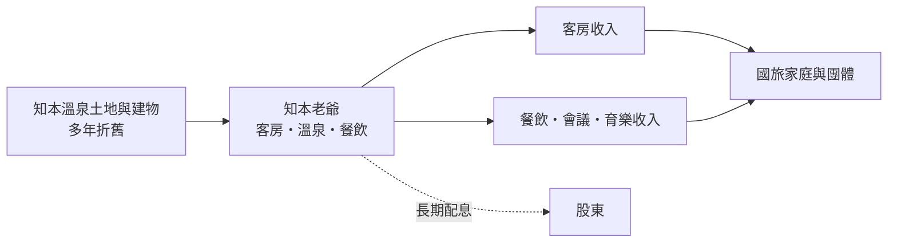
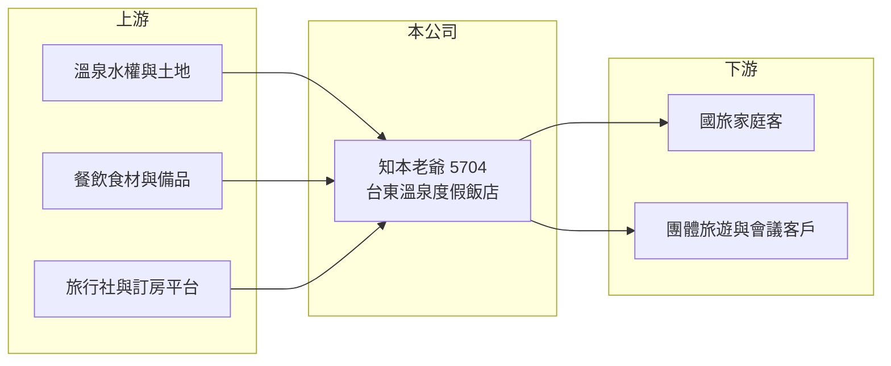

# 5704 老爺知

> 上櫃｜[[產業索引-觀光餐旅|觀光餐旅]]｜上市（櫃）日期 1999/12/21

# 第一章：企業模式與商業藍圖

> [!info] 撰寫說明
> 本文由 Claude 依公開資料整理，架構比照 [[2330台積電]] 的四章研究，資料截至 2026-10-08。財務數字來源：櫃買中心開放資料（基本資料、2026 年第二季資產負債表與綜合損益表）、Goodinfo 年度經營績效頁、nStock 公司簡介、winvest 月營收快訊標題；公開資料有限，查不到房間數、住房率與平均房價。成立日期依櫃買中心資料為 1992 年 11 月，nStock 記載為 1990 年 3 月，需以年報核對。產業描述為整理性內容，尚未逐條比對原始文件。#待校對

在評估單一個股的長期投資價值時，首要步驟是拆解企業的底層獲利邏輯。本章說明知本老爺大酒店（股票代號：5704，以下簡稱知本老爺）這家台東溫泉度假飯店的商業模式，以及它為何能在多數觀光股虧損時維持獲利與配息。

## 一、核心定位：台東知本的溫泉度假飯店

依 nStock 整理，知本老爺主要經營國際觀光旅館，包括客房與會議廳出租、餐飲服務、運動育樂設施，以及運動用品買賣。飯店位於台東知本溫泉區，屬於「老爺酒店」品牌體系（憑記憶補充，待校對）。截至 2026 年 6 月 30 日，公司員工 183 人。

和都市商務飯店不同，溫泉度假飯店的客人以國內家庭與團體旅遊為主，入住目的是休閒，停留時間較長，客房之外的餐飲、溫泉與育樂設施消費也較多。這讓[[住房率]]與[[平均房價]]之外，「每位住客的館內消費」也成為獲利關鍵。

## 二、資本轉化邏輯：零負債的單一度假飯店

知本老爺最大的財務特色是幾乎沒有負債：2026 年第二季底總負債僅 1.31 億元，非流動負債只有 341 萬元，股東權益 9.80 億元。飯店硬體多年營運、折舊已大量攤提，沒有利息負擔，因此只要住房率維持一定水準，就能穩定產生現金並發放股利。2020 至 2023 年營業利益率都在 14% 至 24% 之間，即使在疫情期間也維持獲利，因為疫情時國人無法出國，反而推升了國旅需求。

## 三、長期方向：翻修與國旅需求

2024 年起營業利益率降到 4% 至 7%，2026 年 5 至 8 月月營收每月只有 60 多萬至 80 多萬元、年減超過 95%（winvest 月營收快訊標題），推估飯店在這段期間停業整修（推估，待校對）。若屬實，這是一次決定未來十年競爭力的資本投入：翻修後若能提高平均房價、吸引新一代旅客，公司有機會恢復過去的獲利水準；但整修期間的營收空窗與後續折舊增加，也會壓抑短期獲利。

# 第二章：護城河深度與競爭優勢

「護城河」指企業抵禦競爭、維持超額利潤的保護機制。東台灣度假飯店的競爭相對有限，本章說明知本老爺的相對優勢。

## 一、相對優勢

知本老爺的優勢有三：第一是溫泉資源與地點，溫泉區的開發受環境與土地法規限制，新的大型度假飯店不易進入；第二是品牌，老爺酒店在國旅市場有長期的知名度；第三是財務體質，零負債讓公司在景氣低迷時仍能撐過，並有能力自行出資翻修。這三點構成一道窄而穩定的護城河。

## 二、主要競爭對手

| 對手 | 定位 | 對知本老爺的威脅 |
|---|---|---|
| 知本、台東當地溫泉飯店 | 同區域溫泉度假 | 直接爭奪同一批國旅客 |
| [[2722夏都]] | 墾丁海景度假飯店 | 南台灣度假市場競爭 |
| [[2748雲品]] | 日月潭等度假飯店 | 國旅高端度假客群競爭 |
| 出國旅遊 | 日本溫泉等短程旅遊 | 分食國人度假預算 |

## 三、守得住／守不住／觀察重點

守得住的是溫泉資源、地點與零負債的財務結構。守不住的是國旅需求的長期成長：國境開放後，國人轉往日本等地泡溫泉，2024 年起營收與利潤明顯下滑。長期觀察重點是整修後的平均房價與住房率、營業利益率能否回到 15% 以上，以及配息能否恢復過去水準。

# 第三章：財務體質與盈利規模

資料日期：2026-10-08，表格是撰寫當時的快照；最新月營收、毛利率、累計 EPS 由自動排程寫在本筆記的屬性欄位（月營收、毛利率、累計EPS 等）。#待校對

財務報表是檢驗護城河是否真實存在的最終標準。本章用六年的三率、ROE 與資本報酬檢視知本老爺的獲利品質。

## 一、多年度經營績效

| 年度 | 營收（新台幣） | [[毛利率]] | [[營業利益率]] | EPS（元） | [[ROE]] |
|---|---|---|---|---|---|
| 2020 | 4.31 億 | 46.6% | 20.7% | 2.41 | 18.6% |
| 2021 | 3.62 億 | 42.8% | 14.1% | 1.51 | 11.3% |
| 2022 | 4.79 億 | 50.1% | 24.1% | 2.44 | 17.9% |
| 2023 | 4.67 億 | 49.4% | 20.6% | 2.98 | 20.5% |
| 2024 | 3.52 億 | 40.0% | 6.81% | 0.41 | 2.84% |
| 2025 | 3.28 億 | 40.1% | 4.47% | 0.39 | 2.77% |
| 2026 上半年 | 1.02 億 | 27.4% | -18.6% | -0.27 | 未查得 |

資料來源：2020 至 2025 年為 Goodinfo，2026 上半年為櫃買中心開放資料。

2020 至 2023 年是知本老爺的黃金期，疫情期間國旅爆發，ROE 維持在 11% 至 21%。2024 年國境全面開放後，營收從 4.67 億元降到 3.52 億元，營業利益率從 20.6% 降到 6.81%，充分展現度假飯店的[[營運槓桿]]：營收減少約四分之一，營業利益卻減少約四分之三。2021 至 2025 年平均 ROE 約 11%（推算），營收年複合成長率約 -2%（推算）。依 nStock 整理，近五年平均現金股利約 1.02 元，填息率 100%，但 2025 年度未配發現金股利，推估與整修資金需求有關（推估）。

## 二、財務結構

2026 年第二季底，總資產 11.1 億元、負債 1.31 億元，負債比僅約 12%；流動資產 3.58 億元，流動負債 1.28 億元，流動比率約 280%。保留盈餘 1.50 億元為正數，每股淨值 16.65 元，是本批觀光股中財務最健康的公司之一。

## 三、[[ROIC]] 與 [[WACC]]：價值創造利差

**ROIC 推算：** 2025 年營業利益約 0.15 億元（3.28 億 × 4.47%），稅後約 0.12 億元。公司幾乎沒有有息負債（假設為 0），投入資本即權益約 9.80 億元，2025 年 ROIC 約 1.2%（推算）。對照 2023 年營業利益約 0.96 億元（4.67 億 × 20.6%）、稅後約 0.77 億元，當年 ROIC 約 8%（推算，以相同資本基礎估）。

**WACC 推算：** 台灣 10 年期公債取 1.75%、市場風險溢酬 6%、β 取零負債度假飯店股 0.7（推估），股東權益成本約 6%；沒有負債，WACC 即約 6%（推算）。

**結論：** 2020 至 2023 年 ROIC 高於 WACC，公司確實為股東創造價值；2024 至 2025 年 ROIC 掉到 WACC 以下，2026 年整修期間更轉為負值。翻修後能否把 ROIC 拉回 6% 以上，是判斷這筆資本支出是否值得的關鍵。

# 第四章：總體風險與地緣政治

任何企業都無法脫離宏觀環境獨立存在。本章分析知本老爺長期必須面對的風險。

## 一、國旅需求與出國替代風險

知本老爺的客源以國旅為主，國人出國旅遊（特別是日本溫泉）的增加，直接排擠東台灣溫泉度假需求。疫情期間的高獲利屬於特殊環境，不宜視為常態。

## 二、地理與天災風險

台東位處颱風與地震較頻繁的地區，交通也依賴南迴與花東鐵公路，天災或交通中斷會直接減少旅客。2009 年莫拉克颱風曾重創知本溫泉區（憑記憶補充，待校對），顯示這類風險並非理論。

## 三、單一資產與整修風險

公司營收集中在一間飯店，整修期間營收幾乎歸零；整修若延誤或超支，會增加財務負擔。整修後折舊上升，也需要更高的房價或住房率才能維持原本的獲利。

# 專有名詞解析

## 金融

- **[[營運槓桿]]**：固定成本占比高時，營收小幅變動就會讓獲利大幅增減；營收萎縮時虧損也會被放大。
- **[[ROIC]]**：投入資本報酬率，稅後營業利益除以股東權益加有息負債，衡量本業運用資本的效率。
- **[[WACC]]**：加權平均資金成本，股東與債權人要求報酬率的加權平均，是 ROIC 要超越的門檻。

## 產業

- **[[住房率]]**：已售出客房數占可售客房數的比例，是衡量飯店需求最直接的指標。
- **[[平均房價]]**：客房收入除以已出租房數，反映飯店的定價能力。

# 核心供應鏈

## 1. 上游：資源與通路
- 溫泉水權與土地、餐飲食材與備品；旅行社通路如 [[2731雄獅]]、[[5706鳳凰]]

## 2. 中游：知本老爺本身
- 知本老爺大酒店（客房、溫泉、餐飲、會議與育樂設施）

## 3. 下游與同業
- 客戶：國旅家庭客、團體旅遊與企業會議
- 同業：[[2722夏都]]、[[2748雲品]]、[[2707晶華]]

## 最新新聞
<!-- news:start -->
<!-- news:end -->

## 相關連結
- [公開資訊觀測站](https://mopsov.twse.com.tw/mops/web/t05st03?step=1&firstin=1&co_id=5704)
- [Goodinfo](https://goodinfo.tw/tw/StockDetail.asp?STOCK_ID=5704)
- [Yahoo 股市](https://tw.stock.yahoo.com/quote/5704)
- [鉅亨網新聞](https://www.cnyes.com/twstock/5704/news)
