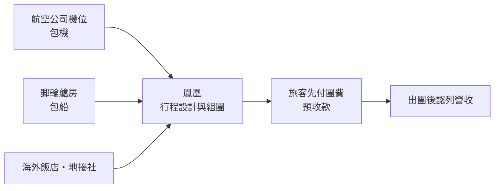
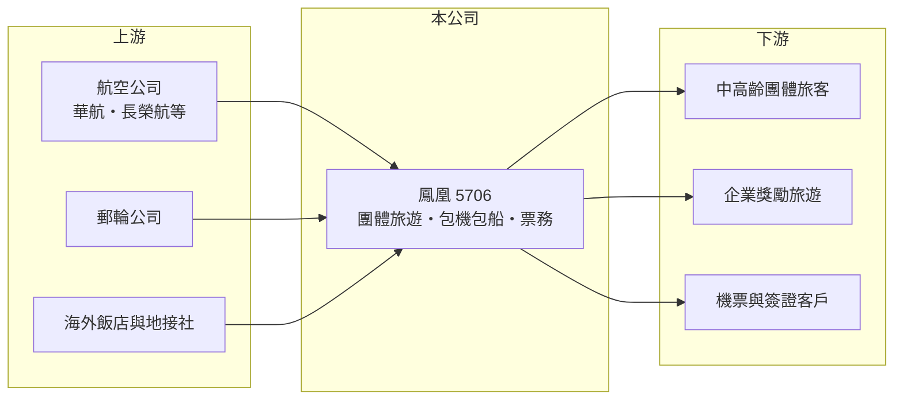

# 5706 鳳凰

> 上市｜[[產業索引-觀光餐旅|觀光餐旅]]｜上市（櫃）日期 2011/10/21

# 第一章：企業模式與商業藍圖

> [!info] 撰寫說明
> 本文由 Claude 依公開資料整理，架構比照 [[2330台積電]] 的四章研究，資料截至 2026-10-08。財務數字來源：證交所開放資料（基本資料、2026 年第二季資產負債表與綜合損益表）、Goodinfo 年度經營績效頁、nStock 公司簡介與股利資料、中央社新聞標題；公開資料有限，查不到各產品線（長線、短線、郵輪、機票）的營收比重，產業描述為整理性內容，尚未逐條比對原始文件。#待校對

在評估單一個股的長期投資價值時，首要步驟是拆解企業的底層獲利邏輯。本章說明鳳凰國際旅行社（股票代號：5706，以下簡稱鳳凰）這家台灣最老字號的上市旅行社之一，如何以團體旅遊為核心，並透過包機、包船擴大業務。

## 一、核心定位：近七十年的團體旅遊業者

鳳凰於 1957 年 4 月設立，2001 年 11 月在櫃買中心掛牌，2011 年 10 月轉往證交所上市，是台灣歷史最悠久的旅行社之一。依 nStock 整理，公司以包辦旅遊方式經營，自行組團安排國內外旅遊的食宿，並代售國內外運輸客票、代購機票，以及代辦託運行李與出入境簽證。鳳凰長期以歐洲、紐澳等長程精緻[[團體旅遊]]為主力（憑記憶補充，待校對），客群偏向重視品質、預算較高的中高齡旅客。

## 二、資本轉化邏輯：輕資產、薄毛利、收預收款

旅行社是典型的輕資產、薄毛利生意。鳳凰的營收以團費總額認列，其中大部分要支付給航空公司、飯店與海外地接社，因此[[毛利率]]只有 14% 至 17%。但旅客通常在出團前付款，公司帳上會累積大量[[預收款]]：2026 年第二季底流動負債 17.2 億元，多數推估是預收團費（推估）。這讓旅行社可以「用客戶的錢週轉」，不需要大量資本就能經營，也是鳳凰能長期穩定配息的原因。

## 三、長期方向：包機與包船

依中央社 2025 年 6 月的新聞標題，鳳凰增加[[包機]]與包船業務以增添營運動能。包機與包船是旅行社向航空公司或郵輪公司買下整架飛機、整艘船（或大量艙位）再自行銷售，好處是能掌握旺季機位、開發獨家行程並提高毛利；代價是必須自行承擔空位風險。這代表鳳凰從單純的「行程零售商」，往「掌握運力的批發商」延伸，長期能否成功取決於銷售能力與對需求的判斷。

# 第二章：護城河深度與競爭優勢

「護城河」指企業抵禦競爭、維持超額利潤的保護機制。旅行社進入門檻低，本章說明鳳凰的相對優勢與限制。

## 一、相對優勢

鳳凰的優勢在於品牌歷史與長程團的經驗。長程團的行程設計、海外地接社網絡與領隊素質需要多年累積，客人一旦信任某家旅行社，回購率通常較高；近七十年的品牌對中高齡客群具有可信度。此外，公司財務穩健、帳上有大量預收款與投資部位，能承受包機包船的空位風險。不過旅行社業整體缺乏轉換成本，客人隨時可以比價換家，這道護城河屬於窄幅。

## 二、主要競爭對手

| 對手 | 定位 | 對鳳凰的威脅 |
|---|---|---|
| [[2731雄獅]] | 台灣最大綜合旅行社 | 規模、通路與品牌全面領先 |
| [[6961旅天下]] | 雄獅體系的加盟旅行社 | 以加盟門市深入地方市場 |
| [[2743山富]] | 團體旅遊與郵輪 | 爭奪長程團與郵輪客 |
| [[2734易飛網]]、線上旅遊平台 | 機票、訂房與自由行 | 讓年輕旅客轉向自由行，縮小團體旅遊市場 |

## 三、守得住／守不住／觀察重點

守得住的是長程團品牌與中高齡客群。守不住的是年輕旅客，自由行與線上平台持續侵蝕團體旅遊市場。長期觀察重點是包機包船的獲利貢獻、長程團的毛利率，以及公司能否培養新一代客群。

# 第三章：財務體質與盈利規模

資料日期：2026-10-08，表格是撰寫當時的快照；最新月營收、毛利率、累計 EPS 由自動排程寫在本筆記的屬性欄位（月營收、毛利率、累計EPS 等）。#待校對

財務報表是檢驗護城河是否真實存在的最終標準。本章用六年的三率、ROE 與資本報酬檢視鳳凰的獲利品質。

## 一、多年度經營績效

| 年度 | 營收（新台幣） | [[毛利率]] | [[營業利益率]] | EPS（元） | [[ROE]] |
|---|---|---|---|---|---|
| 2020 | 4.90 億 | 26.5% | -6.52% | 0.15 | 1.18% |
| 2021 | 1.50 億 | 29.2% | -44.0% | 1.17 | 6.62% |
| 2022 | 2.03 億 | 24.8% | -29.3% | -0.43 | -2.43% |
| 2023 | 22.0 億 | 16.7% | 8.32% | 2.44 | 13.3% |
| 2024 | 31.4 億 | 14.6% | 7.33% | 3.75 | 18.6% |
| 2025 | 31.4 億 | 14.9% | 7.34% | 3.39 | 15.3% |
| 2026 上半年 | 15.31 億 | 13.4% | 5.2% | 1.79 | 未查得 |

資料來源：2020 至 2025 年為 Goodinfo，2026 上半年為證交所開放資料。

2020 至 2022 年疫情期間出國旅遊幾乎停擺，營收只剩 1.5 億至 4.9 億元，但 2021 年仍有 EPS 1.17 元，推估靠的是業外的投資收益與處分利益（推估）。2023 年國境開放後營收跳升到 22 億元，2024、2025 年穩定在 31.4 億元，營業利益率約 7%。2026 年上半年營業利益 0.79 億元，[[業外收益]]卻有 1.10 億元，顯示投資收益對鳳凰的稅後獲利占比很高，評估本業時應以營業利益為準。2021 至 2025 年平均 ROE 約 10%（推算），2023 至 2025 年約 16%。

鳳凰的配息相當積極：依 nStock 整理，2024 年度配發現金股利 2.75 元加股票股利 0.5 元，現金配發率約 77%；2025 年度現金股利 4.54 元，已於 2026 年 6 月除息；近五年平均現金股利約 2.12 元。

## 二、財務結構

2026 年第二季底，鳳凰總資產 35.9 億元、負債 18.2 億元，其中流動負債 17.2 億元，非流動負債僅 1.04 億元。流動資產 22.2 億元，流動比率約 129%。權益 17.6 億元、保留盈餘 5.45 億元，其他權益 1.48 億元（推估多為金融資產未實現評價利益），每股淨值 20.42 元。

## 三、[[ROIC]] 與 [[WACC]]：價值創造利差

**ROIC 推算：** 2025 年營業利益約 2.30 億元（31.4 億 × 7.34%），稅後約 1.84 億元。2026 年第二季底權益約 17.6 億元；負債多為預收團費，假設僅一成為有息負債約 1.82 億元（推估），投入資本約 19.4 億元，ROIC 約 9.5%（推算）。若扣除帳上與本業無關的投資部位，本業 ROIC 會更高。

**WACC 推算：** 台灣 10 年期公債取 1.75%、市場風險溢酬 6%、β 取旅行社股常見值 0.9，股東權益成本約 7.15%；負債成本 2.5%、稅後 2%；權益約 91%、負債約 9%，WACC 約 6.7%（推算）。

**結論：** 疫後 ROIC 高於 WACC 約 3 個百分點，鳳凰的本業確實在創造價值。旅行社輕資產、收預收款的特性，讓它在需求正常時能以很少的資本賺取穩定報酬；但疫情三年的經驗也顯示，這種報酬會在外部衝擊下瞬間歸零。

# 第四章：總體風險與地緣政治

任何企業都無法脫離宏觀環境獨立存在。本章分析鳳凰長期必須面對的風險。

## 一、外部衝擊風險

旅行社的營收完全依賴旅客能自由出入境。疫情期間營收從疫前水準掉到每年僅 1.5 億至 4.9 億元，戰爭、恐攻、傳染病與天災都可能在短時間內讓出團停擺。中東與歐洲地緣政治事件也會影響長程團的出團意願。

## 二、包機包船與匯率風險

包機包船需要事先承諾購買運力，若銷售不如預期，空位成本由旅行社自行吸收，可能侵蝕整年獲利。團費以新台幣收取，但支付給海外飯店與地接社多以外幣計價，匯率大幅波動會影響毛利。

## 三、產業結構與投資風險

自由行與線上旅遊平台持續擴張，團體旅遊市場長期面臨萎縮壓力。另一方面，鳳凰的稅後獲利有相當比重來自業外投資，股市下跌時業外收益與其他綜合損益都可能轉為負值，讓 EPS 與配息出現較大波動。

# 專有名詞解析

## 金融

- **[[預收款]]**：顧客先付款、公司尚未提供服務的金額，在帳上列為負債，服務完成後轉為營收。
- **[[業外收益]]**：本業以外的收入，例如投資收益、處分資產利益或匯兌利益，通常不具持續性。
- **[[ROIC]]**：投入資本報酬率，稅後營業利益除以股東權益加有息負債，衡量本業運用資本的效率。
- **[[WACC]]**：加權平均資金成本，股東與債權人要求報酬率的加權平均，是 ROIC 要超越的門檻。

## 產業

- **[[團體旅遊]]**：旅行社把機票、住宿、交通與導遊打包成固定行程販售的旅遊產品，以團費總額認列營收。
- **[[包機]]**：旅行社向航空公司包下整架飛機或固定航班座位，自行負責銷售，可確保旺季機位但須承擔空位風險。

# 核心供應鏈

## 1. 上游：運力與海外資源
- 航空公司：[[2610華航]]、[[2618長榮航]] 及外籍航空
- 郵輪公司、海外飯店與地接社

## 2. 中游：鳳凰本身
- 團體旅遊、包機包船、機票代售與簽證代辦

## 3. 下游與同業
- 客戶：中高齡團體旅客、企業獎勵旅遊、票務客戶
- 同業：[[2731雄獅]]、[[6961旅天下]]、[[2743山富]]、[[2734易飛網]]、[[2719燦星旅]]

## 最新新聞
<!-- news:start（自動產生，請勿手動編輯此範圍） -->
- 2026-10-08 🏛️ 重訊 14:33｜代子公司雍利企業股份有限公司公告取得私募有價證券｜[觀測站](https://mops.twse.com.tw/mops/#/web/t05st01)
- 2026-10-08 🏛️ 重訊 14:24｜公告本公司取得私募有價證券｜[觀測站](https://mops.twse.com.tw/mops/#/web/t05st01)

完整紀錄：[[5706鳳凰 新聞]]
<!-- news:end -->

## 相關連結
- [公開資訊觀測站](https://mopsov.twse.com.tw/mops/web/t05st03?step=1&firstin=1&co_id=5706)
- [Goodinfo](https://goodinfo.tw/tw/StockDetail.asp?STOCK_ID=5706)
- [Yahoo 股市](https://tw.stock.yahoo.com/quote/5706)
- [鉅亨網新聞](https://www.cnyes.com/twstock/5706/news)
