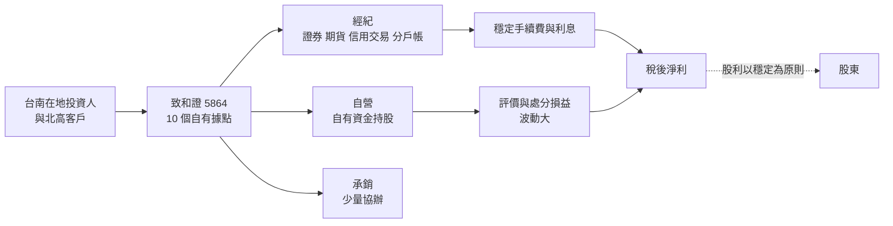
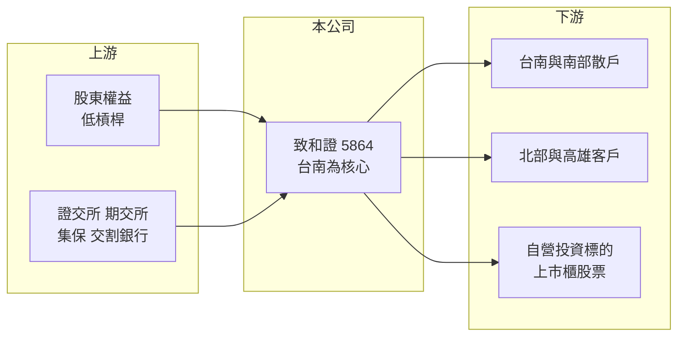

# 5864 致和證

> 上櫃｜[[產業索引-金融保險業|金融保險業]]｜上市（櫃）日期 2018/04/02

# 第一章：企業模式與商業藍圖

> [!info] 撰寫說明
> 精簡版，由 Claude 依公開資料整理，架構比照 [[2330台積電]] 的四章研究，資料截至 2026-10-08。財務數字來源：Goodinfo 年度經營績效頁、富果研究（致和證 2026 年 6 月法說會備忘錄）、櫃買中心開放資料（基本資料、本益比殖利率）；股東背景未查得，公開資料有限。#待校對

本章說明致和證券（股票代號：5864，以下簡稱致和證）的商業模式：一家以台南為根據地的小型券商，經紀業務提供穩定的客戶基礎，真正決定獲利高低的則是以自有資金持股的自營部門。

- **核心業務：** 致和證成立於 1989 年，2018 年上櫃，董事長為王文促、總經理為潘嬅蓁。業務以證券與期貨[[經紀業務]]為重心，搭配信用交易、有價證券借貸與[[分戶帳]]服務；[[自營業務]]則以公司資金投資股票，對整體獲利具有關鍵地位。承銷業務規模很小，2026 年前五月只協辦 1 件案件。
- **營收結構：** 致和證的營收與獲利高度受自營部位評價影響。依法說會備忘錄，2026 年前五月營業收入約 49.5 億元、稅後淨利 47.2 億元、EPS 10.4 元，主要來自自營持股的評價利益與成交量帶動的手續費收入；同期信用交易利息收入只有約 3,688 萬元。這個比例說明致和證的本質更接近「附帶經紀業務的投資公司」（此期間數字待以財報校對）。
- **營運據點：** 全台 10 個營業據點，以台南為核心：台南市 5 個（2026 年 6 月增設小北分公司後為 6 個）、台北市 3 個、高雄市 1 個，員工約 211 人。所有營業據點都是自有資產，公司認為這能降低員工流動率、維持客戶黏著度，並避免租金上漲與續租風險。
- **長期方向：** 公司提出四個方向：人才培育與服務優化、數位金融（優化線上開戶、推廣分戶帳）、永續發展與資安防護。沒有大規模擴張的計畫，經營風格是「在地深耕、自有資產、穩定配息」。

# 第二章：護城河深度與競爭優勢

本章分析致和證的競爭位置。小型區域券商在全國經紀市場沒有規模優勢，能夠存活下來，靠的是在地關係與經營成本控制。

- **競爭優勢：** 第一是台南在地客戶關係，營業員與客戶長期往來，區域口碑與黏著度高，大型券商的低手續費攻勢較難完全取代。第二是低成本結構，據點自有、人員精簡，固定成本低於租用店面的同業。第三是資本雄厚，ROA 長期在 8% 至 13%，代表負債槓桿很低、資本大多用於自營投資，景氣差時不容易出現財務危機。整體屬於「窄護城河」，且集中在地區性客群。
- **主要對手：** 全國性券商如 [[2885元大金]] 旗下元大證券、[[2881富邦金]] 旗下富邦證券、[[6005群益證]] 在台南都設有分公司；數位券商與網路下單的低手續費也持續吸引年輕客群。同為小型券商的 [[6020大展證]]、[[6015宏遠證]]、[[6016康和證]] 則是經營模式相近的比較對象。
- **觀察重點：** 自營部位的持股集中度與評價波動、台南據點擴張（小北分公司）的成效，以及在高獲利年度後股利政策是否維持穩定。

| 對手 | 定位 | 對致和證的影響 |
|---|---|---|
| 全國性大型券商 | 品牌、系統、手續費折讓 | 在台南爭奪活躍交易客戶 |
| 數位券商與網路下單 | 低手續費、年輕客群 | 壓縮新客戶來源 |
| 小型同業 | 經紀加自營 | 經營模式相近，作為獲利波動的比較基準 |

# 第三章：財務體質與盈利規模

資料日期：2026-10-08，表格是撰寫當時的快照；最新月營收、累計 EPS 由自動排程寫在本筆記的屬性欄位（月營收、累計EPS 等）。#待校對

券商不適用毛利率，本章以營業收入、稅後淨利、[[ROE]]、[[ROA]] 與股利檢視致和證的獲利品質，並說明自營部位造成的波動。

| 年度 | 營業收入（新台幣） | 稅後淨利 | EPS（元） | [[ROE]] | [[ROA]] |
|---|---|---|---|---|---|
| 2020 | 7.30 億 | 4.69 億 | 1.98 | 12.5% | 8.20% |
| 2021 | 10.6 億 | 7.03 億 | 2.79 | 16.2% | 9.46% |
| 2022 | 0.41 億 | -2.25 億 | -0.84 | -4.98% | -3.23% |
| 2023 | 11.5 億 | 8.76 億 | 3.18 | 17.6% | 13.3% |
| 2024 | 9.95 億 | 6.88 億 | 1.98 | 10.7% | 8.41% |
| 2025 | 14.1 億 | 11.6 億 | 2.56 | 15.1% | 11.0% |

註：取自 Goodinfo 合併報表。2022 年營收僅 0.41 億元，是因為自營評價損失直接抵減營業收入。

- **營收規模：** 2020 至 2025 年營收從 7.30 億元增至 14.1 億元，年複合成長率約 14.1%（推算），但每年波動極大，2022 年幾乎歸零。這種起伏來自自營部位，不是經紀業務本身。
- **獲利：** 稅後淨利占營收的比例常在七成以上，代表成本結構很輕、多出的營收幾乎直接變成獲利。2021 至 2025 年平均 ROE 約 10.9%（推算），只有 2022 年虧損。
- **自營與經紀結構：** 經紀市占率與各業務獲利占比未查得；從營收波動判斷，自營損益是決定年度獲利的主因（推估）。ROA 與 ROE 差距很小（例如 2025 年 11.0% 對 15.1%），說明公司幾乎沒有財務槓桿。
- **股利：** 櫃買中心資料顯示最近一次每股股利 1.6 元，配息率約 63%（推算，1.6 ÷ 2.56）；公司表示股利以穩定為原則，近年平均約 1.2 至 1.5 元。

**ROE 與權益資金成本：** 券商的負債多屬營業性質，[[ROIC]] 與 [[WACC]] 不適用，改以 ROE 對比 [[CAPM]] 推算的權益資金成本。致和證獲利主要來自股票自營，與台股連動程度高，假設 β 取 1.2（以自營為主的小型券商推估值，非來源數字）、台灣 10 年期公債殖利率 1.75%、市場風險溢酬 6%，權益資金成本約 1.75% ＋ 1.2 × 6% ＝ 8.95%（推算）。2021 至 2025 年平均 ROE 約 10.9%，高於權益成本約 2 個百分點，但這份超額報酬主要來自台股多頭期間的持股表現，可持續性取決於自營團隊的選股能力與市場環境。櫃買中心資料顯示股價淨值比約 1.37 倍。

# 第四章：總體風險與地緣政治

本章分析致和證面對的市場、集中度與營運風險。

- **產業週期：** 券商是順週期產業，致和證又以股票自營為獲利主軸，對台股的敏感度高於一般券商。多頭年度可以賺進數倍於平常的獲利，空頭年度則可能像 2022 年一樣虧損，投資人不宜用單一年度的 EPS 推估長期獲利能力。
- **營運風險：** 自營持股若集中在少數個股或產業，單一標的大跌就可能明顯影響淨值。經紀業務集中在台南，區域經濟或客群老化會影響成交量；年輕投資人偏好數位券商，也讓傳統營業員模式面臨轉型壓力。
- **其他風險：** 主管機關對券商自營、資本與信用交易的規範變動；資安法規要求提高帶來的合規成本；以及地緣政治、全球經濟放緩造成的台股大幅修正。

# 專有名詞解析

## 金融

- **[[經紀業務]]**：券商替投資人買賣股票並收取手續費的業務，收入與市場成交量高度相關。
- **[[自營業務]]**：券商以自有資金投資股票、債券與衍生性商品，獲利隨市場波動。
- **[[分戶帳]]**：券商在交割專戶下替每位客戶設立的子帳戶，客戶的交易款項可留在券商端，用於再投資、定期定額等服務。
- **[[CAPM]]**：資本資產定價模型，以無風險利率加上 β 乘以市場風險溢酬，推估股東要求的報酬率。
- **[[ROIC]]**：投入資本報酬率，稅後營業利益除以股東權益加有息負債，衡量本業運用資本的效率；不適用於銀行、保險與券商。
- **[[WACC]]**：加權平均資金成本，依股權與負債比重加權的資金成本，是判斷 ROIC 是否創造價值的門檻。

# 核心供應鏈

- 上游：股東權益是主要資金來源；證交所、期交所、集保與交割銀行提供交易基礎設施。
- 下游／客戶：台南為主的在地散戶、北部與高雄客戶；自營部門投資的上市櫃股票。
- 同業：小型券商 [[6020大展證]]、[[6015宏遠證]]、[[6016康和證]]、[[6026福邦證]]、[[6021美好證]]；大型券商 [[6005群益證]]、[[2885元大金]]。

## 最新新聞
<!-- news:start（自動產生，請勿手動編輯此範圍） -->
- 2026-10-05 🏛️ 重訊 14:39｜公告本公司115年09月份損益｜[觀測站](https://mops.twse.com.tw/mops/#/web/t05st01)

完整紀錄：[[5864致和證 新聞]]
<!-- news:end -->

## 相關連結
- [公開資訊觀測站](https://mopsov.twse.com.tw/mops/web/t05st03?step=1&firstin=1&co_id=5864)
- [Goodinfo](https://goodinfo.tw/tw/StockDetail.asp?STOCK_ID=5864)
- [Yahoo 股市](https://tw.stock.yahoo.com/quote/5864)
- [鉅亨網新聞](https://www.cnyes.com/twstock/5864/news)
