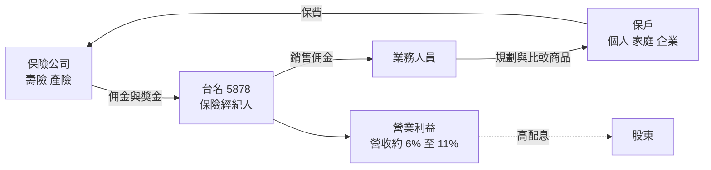
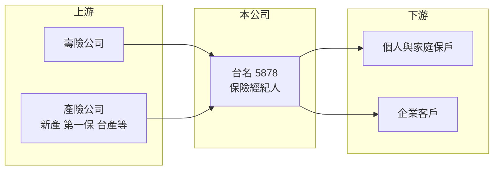

# 5878 台名

> 上櫃｜[[產業索引-金融保險業|金融保險業]]｜上市（櫃）日期 2014/10/28

# 第一章：企業模式與商業藍圖

> [!info] 撰寫說明
> 精簡版，由 Claude 依公開資料整理，架構比照 [[2330台積電]] 的四章研究，資料截至 2026-10-08。財務數字來源：Goodinfo 年度經營績效頁、nStock（公司概況、營收與股利）、櫃買中心開放資料（基本資料、2026 年第二季資產負債與損益、本益比殖利率）；合作保險公司、業務員規模與股東結構未查得，公開資料有限。#待校對

本章說明台名保險經紀人（股票代號：5878，以下簡稱台名）的商業模式。保險經紀人不承擔保險風險，而是站在保戶這一端替客戶比較各家保險公司的商品，成交後向保險公司收取佣金，是保險業的「通路商」。

- **核心業務：** 台名成立於 2002 年，2014 年上櫃，主要經營人身保險與財產保險的[[保險經紀人]]業務，董事長為陳昭鋒。它的收入來自保險公司支付的佣金與服務獎金，主要成本則是付給第一線業務人員的佣金，因此[[毛利率]]只有 16% 至 22%，屬於「量大、利薄、輕資產」的服務業。
- **營收結構：** 壽險與產險佣金的比重未查得。2025 年營收 8.83 億元，2026 年 1 至 9 月累計 6.45 億元、年增 0.47%，月營收約 0.6 億元上下，規模穩定但成長有限。
- **營運據點：** 總公司位於台北市館前路，透過全台業務單位與業務人員銷售（據點與人數未查得）。2026 年第二季總資產 7.37 億元、股東權益 5.19 億元，實收資本額只有約 2.5 億元，是台股中規模很小的金融股。
- **長期方向：** 台灣保險銷售中，保經代通路的占比長期提升，因為消費者偏好在一個窗口比較多家商品，保險公司也樂於利用外部通路降低自建業務員的固定成本。台名的長期機會在於搭上這個通路結構的變化，挑戰則是規模小、需與大型保經代集團和銀行保險通路競爭（推估）。

# 第二章：護城河深度與競爭優勢

本章分析台名的競爭位置。保險經紀業的進入門檻在於證照與業務團隊，不在資本，因此護城河主要來自業務員的穩定度與客戶關係。

- **競爭優勢：** 第一是輕資產與高現金回饋，台名不需要承擔保險風險，也不需要大量資本，賺到的錢幾乎可以全數配發，2024 年配發率達 103.6%。第二是與多家保險公司合作的中立角色，可以替客戶挑選不同公司的商品，這是保險公司自有業務員無法提供的價值。第三是長期經營的業務團隊與保戶關係，續期佣金與服務關係帶來一定的穩定性。整體屬於「窄護城河」，規模小是最大限制。
- **主要對手：** 大型保經代集團（永達、全球、磐石等，多數未上市或未在本筆記庫建檔）規模與商品議價力都大於台名；銀行保險通路（[[2884玉山金]]、[[2891中信金]]、[[2882國泰金]] 等金控旗下銀行）是保險銷售的另一大通路；保險公司自有業務員體系也直接競爭同一批客戶。
- **觀察重點：** 營收能否擺脫 7 億至 9 億元的區間、毛利率能否回到 2020 至 2022 年 21% 至 22% 的水準，以及保險商品法規與佣金規範的變化。

| 對手 | 定位 | 對台名的影響 |
|---|---|---|
| 大型保經代集團 | 業務員數多、對保險公司議價力強 | 爭取較高佣金率與熱門商品 |
| 銀行保險通路 | 掌握存款與理財客戶 | 吸走儲蓄型與投資型保單需求 |
| 保險公司自有業務員 | 品牌與商品完整 | 直接競爭保障型客戶 |

# 第三章：財務體質與盈利規模

資料日期：2026-10-08，表格是撰寫當時的快照；最新月營收、毛利率、累計 EPS 由自動排程寫在本筆記的屬性欄位（月營收、毛利率、累計EPS 等）。#待校對

台名財報採一般產業格式，可以使用[[毛利率]]與[[營業利益率]]。本章用多年度三率、[[ROE]]、資本報酬與股利檢視台名的獲利品質。

| 年度 | 營收（新台幣） | [[毛利率]] | [[營業利益率]] | 稅後淨利 | EPS（元） | [[ROE]] |
|---|---|---|---|---|---|---|
| 2020 | 9.15 億 | 21.7% | 11.3% | 0.87 億 | 3.47 | 16.0% |
| 2021 | 8.13 億 | 21.7% | 10.5% | 0.75 億 | 2.98 | 13.3% |
| 2022 | 7.38 億 | 22.0% | 9.06% | 0.66 億 | 2.64 | 12.0% |
| 2023 | 7.84 億 | 18.6% | 6.85% | 0.55 億 | 2.20 | 10.2% |
| 2024 | 8.47 億 | 16.6% | 5.32% | 0.55 億 | 2.22 | 10.2% |
| 2025 | 8.83 億 | 18.1% | 6.40% | 0.72 億 | 2.86 | 13.3% |

註：取自 Goodinfo 合併報表。2026 年上半年營收 4.45 億元、毛利率約 20.1%、營業利益率約 8.2%、EPS 1.30 元（櫃買中心資料）。

- **營收規模：** 2020 至 2025 年營收從 9.15 億元降到 8.83 億元，年複合成長率約 -0.7%（推算），2022 年低點後逐步回升，但沒有回到 2020 年水準。
- **獲利：** 毛利率從 2022 年的 22.0% 降到 2024 年的 16.6%，營業利益率同步從 9% 降到 5% 左右，推估與付給業務人員的佣金比例上升、保險商品結構改變有關（推估）。2025 年起毛利率回升，ROE 回到 13.3%。2021 至 2025 年平均 ROE 約 11.8%（推算）。
- **財務特色：** 2026 年第二季總負債 2.18 億元，多為應付佣金等營業負債，沒有查到明顯的銀行借款，財務結構非常輕。高配息是最大特色：近五年平均現金股利約 2.58 元，2024 年度配發 2.3 元（配發率 103.6%），2025 年度配發 2.4 元（配發率約 84%，推算）。

**ROE 與權益資金成本：** 依金融業的比較方式，以 ROE 對比 [[CAPM]] 推算的權益資金成本。假設台灣 10 年期公債殖利率 1.75%、市場風險溢酬 6%、β 取 0.7（小型保經公司推估值，非來源數字），權益資金成本約 5.95%（推算）。台名 2021 至 2025 年平均 ROE 約 11.8%，高於權益成本約 6 個百分點，屬於穩定創造價值。由於台名沒有有息負債，[[ROIC]] 可近似為稅後營業利益除以股東權益：2025 年營業利益約 0.565 億元（8.83 億 × 6.4%），稅後約 0.45 億元，除以股東權益約 5.2 億元，ROIC 約 8.7%（推算），高於同樣等於權益成本的 [[WACC]]（約 6%，無負債）。ROE 高於 ROIC，是因為帳上現金與業外收益貢獻了一部分獲利。櫃買中心資料顯示股價淨值比約 1.81 倍。

# 第四章：總體風險與地緣政治

本章分析台名面對的保險市場週期、法規與營運風險。

- **產業週期：** 保險經紀收入跟著新契約保費走。利率與匯率環境會影響儲蓄型、美元保單的熱度；監理政策引導保險回歸保障型商品時，單件保費較低，經紀人的佣金收入也可能下降。
- **營運風險：** 保經公司的核心資產是業務人員，業務團隊流失或被大型通路挖角，會直接影響營收。佣金率由保險公司決定，規模小的經紀人議價力有限；毛利率在 2023 至 2024 年下滑就是成本端壓力的例子。
- **其他風險：** 主管機關對保經代的招攬行為、佣金揭露、商品適合度與資安規範持續加強，合規成本上升對小型業者影響較大。[[IFRS 17]] 實施後，保險公司調整商品結構與佣金制度，也可能改變經紀人的收入來源（推估）。

# 專有名詞解析

## 金融

- **[[保險經紀人]]**：基於保戶利益替客戶洽訂保險契約、向保險公司收取佣金的中介業者，不承擔保險風險。
- **[[IFRS 17]]**：國際保險合約會計準則，改變保險公司認列保費收入與負債的方式，台灣於 2026 年接軌。
- **[[CAPM]]**：資本資產定價模型，以無風險利率加上 β 乘以市場風險溢酬，推估股東要求的報酬率。
- **[[ROIC]]**：投入資本報酬率，稅後營業利益除以股東權益加有息負債，衡量本業運用資本的效率。
- **[[WACC]]**：加權平均資金成本，依股權與負債比重加權的資金成本，是判斷 ROIC 是否創造價值的門檻。

# 核心供應鏈

- 上游：合作的壽險與產險公司（具體名單未查得），產險同業如 [[2850新產]]、[[2852第一保]]、[[2832台產]]、[[2816旺旺保]] 屬於這類潛在合作對象。
- 下游／客戶：個人與家庭保戶、企業團體保險與財產保險客戶。
- 同業：大型保經代集團（未在本筆記庫建檔）；銀行保險通路 [[2884玉山金]]、[[2891中信金]]、[[2882國泰金]]。

## 最新新聞
<!-- news:start -->
<!-- news:end -->

## 相關連結
- [公開資訊觀測站](https://mopsov.twse.com.tw/mops/web/t05st03?step=1&firstin=1&co_id=5878)
- [Goodinfo](https://goodinfo.tw/tw/StockDetail.asp?STOCK_ID=5878)
- [Yahoo 股市](https://tw.stock.yahoo.com/quote/5878)
- [鉅亨網新聞](https://www.cnyes.com/twstock/5878/news)
