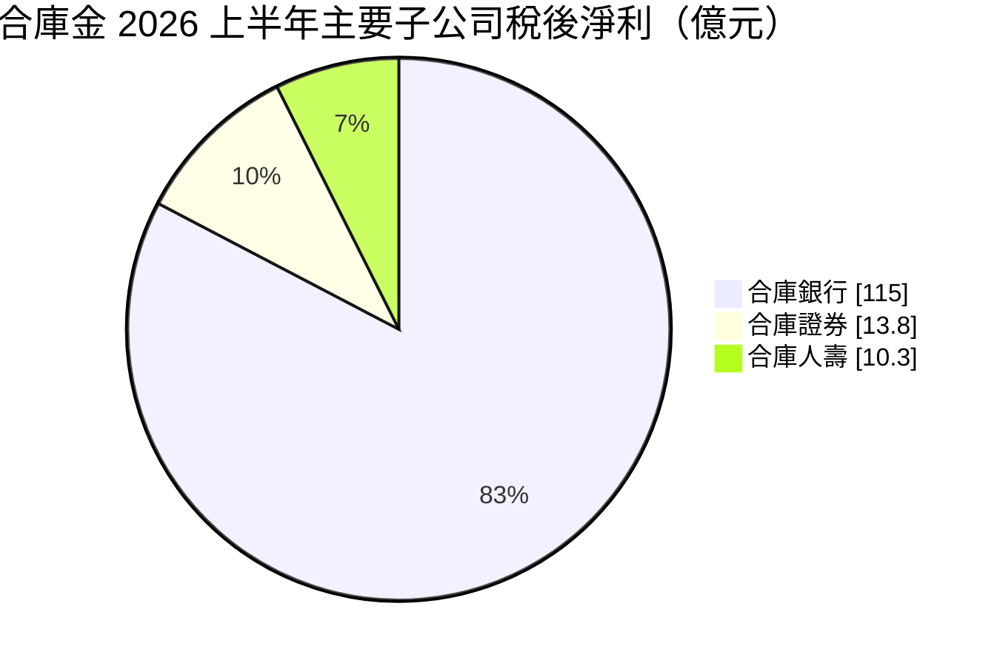
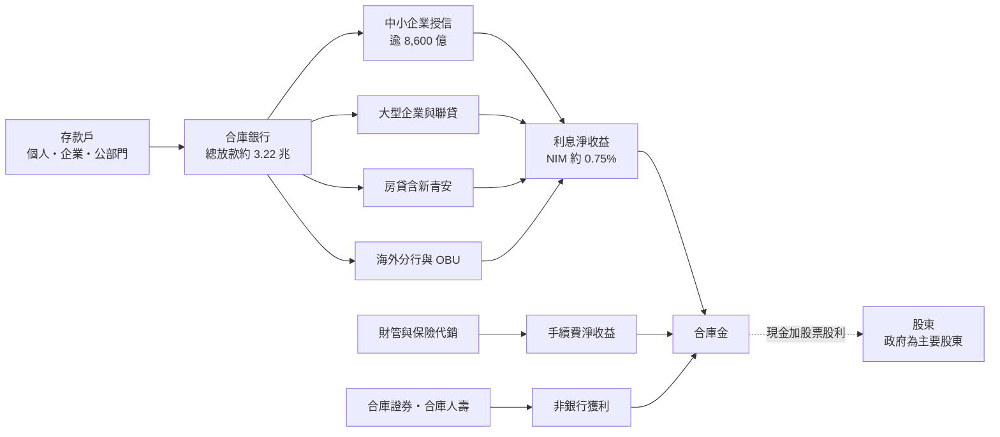
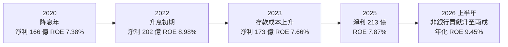
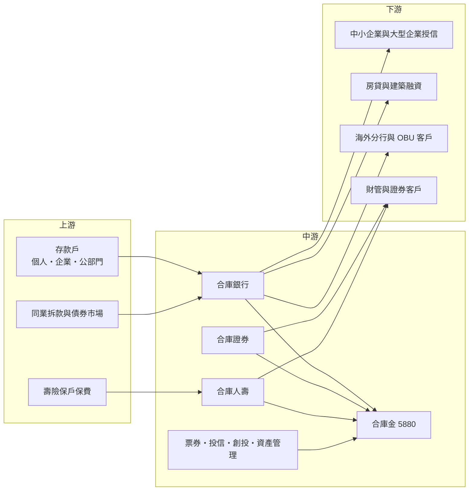

# 5880 合庫金

> 上市｜[[產業索引-金融保險業|金融保險業]]｜上市（櫃）日期 2011/12/01

# 第一章：企業模式與商業藍圖

> [!info] 撰寫說明
> 本文由 Claude 依公開資料整理，架構比照 [[2330台積電]] 的四章研究，資料截至 2026-10-08。財務數字來源：證交所開放資料快照（基本資料、2025 年度股利）、Goodinfo 經營績效頁與股利政策頁（2016 至 2025 年）、富果研究 2026 年 5 月法說會整理（2026 年第一季利差、資產品質與資本）、優分析 2026 年 8 月法說會報導（2026 年上半年子公司獲利）；合作金庫的沿革（1946 年改組、2006 年合併中國農民銀行）係憑記憶整理，尚未逐條比對原始文件。#待校對

在評估金融股的長期投資價值時，第一步是看清楚它的錢從哪裡來、靠什麼賺利差，以及這套模式能不能長期維持。本章針對合作金庫金融控股（股票代號：5880，以下簡稱合庫金）的商業模式進行定性分析，說明這家以國內存放款規模見長的公股[[金控]]，為什麼長年給人「大而穩、但賺得不多」的印象，以及它正在用哪些方式改變這個結構。

## 一、核心定位：以銀行為核心的公股金控

合庫金於 2011 年 12 月 1 日成立並同日上市，核心子公司是合作金庫商業銀行（以下簡稱合庫銀行），另有合庫證券、合庫人壽、合庫票券、合庫投信、合庫創投與資產管理等子公司。合庫銀行的歷史可追溯到日治時期的合作金融體系，1946 年改組為台灣省合作金庫，2006 年合併中國農民銀行（沿革年份待校對）。長期以來，它的存款與放款規模都名列國內銀行前段班，政府是主要股東。

理解合庫金，可以抓住兩個基本特徵。第一，它是一家「量大價低」的銀行。依富果研究整理的 2026 年第一季法說會資料，金控總資產約 5.43 兆元、總放款約 3.22 兆元，但銀行的淨利息收益率（[[NIM]]）只有 0.753%。也就是說，合庫靠的是龐大的資產規模，而不是每一筆放款的高利差。第二，它的獲利高度集中在銀行。2026 年第一季銀行占集團獲利約 80.66%，直到 2026 年上半年台股熱絡、證券與壽險獲利跳升後，非銀行子公司的貢獻度才升到 22.57%。

這兩個特徵決定了合庫金的長期樣貌：獲利穩定、波動小，但資本報酬率不高。Goodinfo 的資料顯示，2016 至 2025 年合庫金的 [[ROE]] 一直落在 7.3% 至 9.0% 之間，十年平均約 7.9%（推算），幾乎沒有大起大落。對投資人而言，它比較像是一檔「類債券」的金融股，而不是追求高成長的標的。

## 二、業務板塊：銀行打底、證券與壽險補強

以 2026 年上半年主要子公司的稅後淨利來看，獲利結構如下：

圖中三家合計約 139 億元，略高於金控合併稅後淨利 133.92 億元，差額來自金控層級費用、其他子公司與合併調整（推估）；票券、投信、創投的個別數字本次未查得。

- **合庫銀行：** 獲利來源可以分成利息與手續費兩塊。2026 年第一季利息淨收益 89.26 億元、年增 8.29%，手續費淨收益 30.31 億元、年增 15.38%。利息收入仍是絕對主力，代表合庫的獲利對利率走勢與放款成長最敏感。手續費成長較快，主要來自財富管理與保險代銷，顯示銀行正試著降低對利差的依賴。
- **企業授信：** 合庫的中小企業放款超過 8,600 億元，在國內排名第二；大型企業放款在 2026 年第一季年增 10.18%。中小企業授信是合庫的傳統強項，客戶關係深、往來時間長，但每筆放款的規模小、管理成本高，利差也受同業競爭壓縮。
- **房貸：** 房貸是公股銀行的重要業務，但受政策影響很大。2026 年第一季新承作房貸約 300 億元、年減 45%，其中[[新青安]]貸款約占 49%，反映央行選擇性信用管制後房貸成長明顯放緩。
- **證券與壽險：** 合庫證券 2026 年上半年稅後淨利 13.79 億元，受惠台股成交熱絡；合庫人壽同期稅後淨利 10.34 億元，主要來自投資收益改善。這兩家子公司規模都不大，但在股市好的年份能明顯拉高金控獲利，是合庫金獲利彈性的主要來源。

## 三、資本轉化邏輯：大量低成本存款如何變成獲利

- **以規模換取獲利：** 銀行的基本生意是用較低的利率吸收存款，再用較高的利率放款，賺取中間的利差。合庫的利差偏薄，因此必須靠很大的資產規模才能累積出可觀的獲利。從杜邦分析來看，合庫金的資產報酬率（[[ROA]]）長年只有 0.4% 至 0.5%，但總資產大約是股東權益的 19 至 20 倍（推算），兩者相乘才得到約 8% 的 ROE。這種高[[財務槓桿]]是銀行業的常態，也說明為什麼資本適足與資產品質對銀行如此重要。
- **公股身分的雙面性：** 公股背景讓合庫能吸收大量存款，也讓客戶在金融動盪時更願意把錢放在這裡。但公股銀行也常被期待配合政策，例如承作青年購屋貸款、綠能與中小企業放款，這些業務的社會意義高，利差卻未必理想。
- **股票股利的稀釋效果：** 合庫金長年同時發放現金與股票股利。股票股利讓資本可以留在公司內支應放款成長與資本適足要求，但也讓股數逐年增加。2016 年稅後淨利約 138 億元，2025 年增加到約 213 億元，成長約五成，但 EPS 只從 1.16 元增加到 1.36 元，差距主要就來自股本膨脹。

## 四、企業長期藍圖：海外、非銀行與手續費

- **海外擴點：** 合庫在 2025 年 10 月開設東京分行，新加坡分行預計 2026 年底前開業，偏好的市場是美國、歐洲、澳洲、香港與日本，中國採取「重質不重量」，東南亞相對保守。2026 年上半年美國、香港、澳洲的外幣放款分別成長約 26%、21% 與 20%。海外放款的利差通常高於國內，是改善整體利差的重要途徑。
- **非銀行貢獻約兩成：** 管理層希望非銀行子公司的貢獻度維持在 20% 左右，證券目標在 6% 以上。若能做到，合庫金的獲利會比過去更有彈性，但也更受股市循環影響。
- **手續費與交叉銷售：** 2026 年第一季財管手續費年增 27.08%、保險佣金收入年增 34.47%。透過分行網把基金、保險賣給既有存款客戶，也就是[[交叉銷售]]，是提升獲利率而不必大量增加資本的方式。

# 第二章：護城河深度與競爭優勢

在長期價值投資中，「護城河」指企業抵禦競爭、長期維持超額利潤的保護機制。銀行的產品同質性很高，護城河多半來自資金成本、規模、客戶關係與監理身分。本章分析合庫金的護城河由哪些要素構成、它在國內金融業的主要對手，以及這些優勢實際能轉化成多少超額報酬。

## 一、合庫金護城河的核心組成要素

合庫金的護城河屬於「窄而穩」的類型：它能保護獲利不容易崩跌，卻不足以帶來高於同業的報酬，主要由四個要素組成。

- **1. 存款基礎與資金成本：** 公股信用加上遍布全台的分行網，讓合庫銀行能長期吸收大量存款，資金成本相對低。銀行的存款基礎需要數十年累積，新進者很難在短時間內複製，這是合庫最根本的優勢。
- **2. 中小企業與地方客群：** 合庫源自合作金融體系，與各地中小企業、地方政府和公部門往來深厚，中小企業放款規模在國內名列前茅。這類客戶的往來關係通常持續多年，換銀行的意願不高，替合庫提供了穩定的放款基礎。
- **3. 系統性重要銀行地位：** 合庫銀行是國內[[D-SIB]]（系統性重要銀行）之一。這個身分要求它保留更多資本，但也代表在主管機關與市場眼中，它是金融體系中「不能倒」的機構，在危機時期反而更容易吸引存款。
- **4. 保守的資產品質：** 2026 年第一季[[逾放比]]約 0.15%、[[備抵呆帳覆蓋率]]約 800%，代表壞帳很少、提列的緩衝很厚。保守授信讓合庫在景氣下行時不容易出現大額虧損，這也是它 ROE 長期波動很小的原因。

## 二、國內主要競爭對手格局

| 對手 | 定位 | 對合庫金的影響 |
|---|---|---|
| [[2886兆豐金]]、[[2892第一金]]、[[2880華南金]] | 同為公股銀行型金控 | 在企業授信、公部門業務與中小企業客群正面競爭，利差與手續費模式最接近 |
| 臺灣銀行、土地銀行 | 未上市的公營銀行 | 在房貸、政策性放款與公部門存款競爭 |
| [[2834臺企銀]] | 以中小企業放款為主的公股銀行 | 在中小企業授信直接重疊 |
| [[2891中信金]]、[[2884玉山金]]、[[2890永豐金]] | 民營銀行型金控 | 財富管理、信用卡與數位服務能力較強，爭取高資產與年輕客群 |
| [[2881富邦金]]、[[2882國泰金]] | 壽險型金控 | 在財管、房貸與保險銷售競爭，股市好的年份獲利彈性遠大於合庫 |

## 三、優勢轉化：哪些守得住、哪些守不住

- **守得住：** 存款規模、中小企業客群與公股信用，這是合庫金獲利穩定的基礎。2016 至 2025 年合庫金每年稅後淨利都維持在約 138 億至 213 億元之間，沒有任何一年出現虧損或大幅衰退，顯示這條護城河在不同利率與景氣環境下都能發揮作用。
- **守不住：** 獲利率。合庫的 NIM 明顯低於民營銀行，手續費收入比重也偏低，ROE 長期在 8% 上下，低於多數民營金控在景氣好時的水準。公股銀行在定價上較保守，也常需要配合政策性放款，這讓它很難靠提高利差來擴大獲利。
- **觀察重點：** 長期可以追蹤三件事。第一是海外放款比重與海外獲利能否持續提升，帶動整體利差改善；第二是非銀行子公司在股市降溫的年份能否維持合理貢獻；第三是手續費收入占淨收益的比重是否逐年上升。這三點決定合庫金能否擺脫「大而不賺」的印象。

# 第三章：財務體質與盈利規模

資料日期：2026-10-08。數字取自 Goodinfo 經營績效頁與股利政策頁、證交所開放資料快照與富果研究法說會整理，表格是撰寫當時的快照；最新月營收、毛利率、累計 EPS 由自動排程寫在本筆記的屬性欄位（月營收、毛利率、累計EPS 等）。#待校對

財務報表是檢驗護城河是否真實存在的最終標準。金控沒有一般產業的毛利率、營業利益率與資本支出，本章改用淨收益、稅後淨利、[[ROE]]、[[ROA]]、資本與股利等金融業指標，並以 ROE 對比 [[CAPM]] 股東權益成本，取代一般產業的 [[ROIC]] 與 [[WACC]]。

## 一、獲利能力的基石：淨收益、淨利與 ROE

| 年度 | 淨收益（億元） | 稅後淨利（億元） | EPS（元） | [[ROE]] | [[ROA]] | 每股淨值（元） |
|---|---|---|---|---|---|---|
| 2019 | 491 | 172 | 1.33 | 8.02% | 0.49% | 17.10 |
| 2020 | 518 | 166 | 1.24 | 7.38% | 0.43% | 17.33 |
| 2021 | 544 | 205 | 1.51 | 8.83% | 0.49% | 17.37 |
| 2022 | 532 | 202 | 1.45 | 8.98% | 0.47% | 15.38 |
| 2023 | 614 | 173 | 1.17 | 7.66% | 0.39% | 16.31 |
| 2024 | 658 | 192 | 1.26 | 7.84% | 0.40% | 16.69 |
| 2025 | 744 | 213 | 1.36 | 7.87% | 0.41% | 17.81 |

（來源：Goodinfo 經營績效頁，合併報表；「淨收益」即 Goodinfo 的營業收入欄位。金融業不適用毛利率與營業利益率，故以 ROA 與每股淨值取代。2026 年上半年稅後淨利 133.92 億元、EPS 0.99 元、年化 ROE 約 9.45%，依優分析法說會報導。）

- **穩定是最大的特色：** 2019 至 2025 年合庫金的 ROE 只在 7.4% 至 9.0% 之間移動，EPS 介於 1.17 至 1.51 元。這種穩定來自銀行放款業務的本質，也來自保守的授信與投資策略。對追求穩定現金流的投資人來說，這是優點；對追求成長的投資人來說，這代表獲利很難跳升。
- **利率週期的影響：** 2022 年央行開始升息，放款利率先調整，ROE 升到 8.98%；2023 年存款利率跟著上調、定存比重上升，利差被壓縮，淨利降到 173 億元。這說明銀行獲利對利率的反應有時間差，升息初期有利，之後存款成本追上就會回吐。
- **長期成長率：** 2020 至 2025 年淨收益年複合成長率約 7.5%，稅後淨利年複合成長率約 5.1%（推算）。獲利成長大致跟著資產規模走，屬於穩健但不突出的成長。

## 二、ROE 的拆解：低 ROA 乘上高槓桿

用杜邦分析來看，ROE 等於 ROA 乘上權益乘數。合庫金 2025 年 ROA 約 0.41%，ROE 約 7.87%，代表權益乘數大約 19 倍（推算）。換句話說，股東每出 1 元，銀行大約運用 19 元的資產，其中大部分是存款戶的錢。

這個結構說明了兩件事。第一，合庫金要提高 ROE，最健康的方式是提高 ROA，也就是改善利差、增加手續費收入、控制營運成本，而不是再拉高槓桿，因為身為 D-SIB，主管機關要求它保留更多資本緩衝。第二，資產品質稍有惡化就會對 ROE 造成放大的衝擊：若呆帳損失吃掉 0.1% 的資產，ROE 就可能少掉約 2 個百分點（推算）。這也是為什麼評估銀行時，逾放比與覆蓋率和獲利一樣重要。

## 三、資本適足、資產品質與股利

- **資本：** 依 2026 年第一季法說會資料，銀行[[資本適足率]] 15.74%、第一類資本比率 13.71%。管理層表示會在業務成長的同時逐年提高資本適足率。足夠的資本是銀行能持續放款與配息的前提，也是 D-SIB 的監理要求。
- **資產品質：** 逾放比約 0.15%、備抵呆帳覆蓋率約 800%，在國內銀行中屬於相當保守的水準。這代表目前的獲利沒有建立在高風險授信之上。
- **股利政策：** 合庫金的公司章程採剩餘股利政策，每年提撥可分配盈餘的 30% 至 100% 分派，其中現金股利不低於 10%（證交所股利資料）。實際上近十年每年合計股利大致在 1.0 至 1.3 元之間，2016 至 2025 年度現金股利介於 0.5 至 1 元、股票股利介於 0.2 至 0.5 元（Goodinfo）。以合計股利除以 EPS 計算，2021 至 2025 年度的配發率約在 69% 至 86% 之間（推算），2025 年度為現金 0.8 元加股票 0.25 元。
- **股利穩定度：** 合庫金幾乎每年都配股又配息，股利總額很穩定，但股票股利會持續擴大股本。長期持有者真正拿到的報酬，要把股數增加一併考慮，不能只看 EPS 是否成長。

## 四、ROE 與 CAPM 股東權益成本：價值創造利差

金融業的負債大部分是存款，屬於營業的原料而不是一般意義的融資，因此不適合用 ROIC 與 WACC 衡量，改以 ROE 和股東要求的報酬率（股東權益成本）比較。

- **股東權益成本（推算）：** 以 CAPM 估算，無風險利率取台灣 10 年期公債約 1.75%，市場風險溢酬 6%，β 假設 0.6（公股金控股價波動通常低於大盤，同業常見值約 0.5 至 0.7，未查得合庫金實際數字），股東權益成本約 1.75% ＋ 0.6 × 6% ＝ 5.35%。若 β 取較保守的 0.8，權益成本約 6.55%。
- **ROE（實際）：** 2021 至 2025 年平均 ROE 約 8.24%，2016 至 2025 年十年平均約 7.88%（依 Goodinfo 數字推算）。
- **價值創造判斷：** 合庫金的長期 ROE 比推算的股東權益成本高出約 1.7 至 2.9 個百分點，代表它有創造價值，只是幅度不大。這和合庫的護城河特性一致：它能穩定賺到略高於資金成本的報酬，卻難以大幅超越。若海外放款、手續費與非銀行子公司能把 ROE 長期推升到 9% 至 10%，價值創造利差才會明顯擴大；反之，若降息壓縮利差、或股票股利持續膨脹股本而獲利成長停滯，利差就可能收斂。

# 第四章：總體風險與地緣政治

任何金融機構都無法脫離宏觀環境獨立存在，銀行更是整體經濟的縮影。本章分析合庫金未來必須面對的地緣政治、利率與景氣週期、營運風險，以及法規與技術變化。

## 一、地緣政治風險

- **兩岸風險：** 合庫金的資產幾乎都與台灣經濟綁在一起，放款客戶、持有的債券與股票也以台灣為主。兩岸關係若出現劇烈變化，企業客戶的還款能力、資本市場與存款流動都會同時受到衝擊，這是所有台灣銀行共同面對、也無法分散的風險。
- **海外曝險：** 海外分行與 OBU 放款成長快，代表合庫金暴露在更多國家的景氣、匯率與法規之下。2025 年第四季法說會曾揭露中東相關曝險約 469 億元，這類區域在地緣衝突升溫時，授信品質需要持續追蹤。
- **中國曝險：** 合庫對中國市場採取「重質不重量」的策略，這降低了中國經濟下行對資產品質的衝擊，但也意味著它在這個市場的成長空間有限。

## 二、利率週期與市場結構風險

- **利率週期：** 合庫的獲利以利息收入為主，NIM 又偏低，對利率變動相當敏感。降息時，放款利率通常比存款利率調整得快，利差會被進一步壓縮；升息時雖然短期有利，但存款轉向定存後，存款成本也會跟著上升。2022 至 2023 年的獲利起伏就是例子。
- **房市與政策：** 房貸與建築融資占公股銀行放款的比重不小。央行的選擇性信用管制、新青安等政策貸款的調整，都會直接影響房貸成長；若房價大幅修正，擔保品價值下降也會影響資產品質。
- **股市循環：** 非銀行子公司的獲利高度依賴股市，2026 年上半年非銀行貢獻升到兩成以上，主要是台股熱絡所致。股市降溫的年份，證券經紀收入與壽險投資收益都可能明顯回落。

## 三、營運環境的隱性風險

- **公股治理：** 合庫金的董事長與總經理人選受政府影響，經營策略有時需要配合政策目標。過去也曾出現公股金控整併的討論，這類政策方向的改變，可能影響合庫的長期策略與股東權益。
- **股本膨脹：** 長期發放股票股利讓股本持續擴大，若獲利成長速度跟不上股本成長，每股盈餘與每股股利就難以提升。這是合庫金長期股東最容易忽略的隱性成本。
- **壽險規模偏小：** 合庫人壽在國內壽險市場的規模不大，缺乏規模經濟，在新會計與資本制度下需要的資本投入相對沉重。

## 四、法規與技術演進風險

- **D-SIB 與資本規範：** 身為系統性重要銀行，合庫須保留額外的資本緩衝。若主管機關未來提高資本要求，可能限制放款成長或配息彈性。
- **[[IFRS 17]] 與 [[ICS]]：** 2026 年起保險業接軌新會計準則與新資本標準，合庫人壽需要更多資本支撐既有保單，對金控的資本配置是長期壓力。
- **數位金融競爭：** 純網路銀行、行動支付與民營銀行的數位服務，正在爭取年輕與高頻交易的客群。合庫以實體分行為主的服務模式，若數位轉型速度落後，長期可能流失新世代客戶。

# 專有名詞解析

## 金融

- **[[金控]]**：金融控股公司，旗下同時持有銀行、保險、證券等子公司，透過集團整合交叉銷售金融商品。
- **[[NIM]]**：淨利息收益率，銀行利息淨收益除以生息資產，是衡量銀行利差獲利能力的核心指標。
- **[[新青安]]**：政府推出的青年安心成家購屋優惠貸款，提供較高成數、較長年限與利息補貼。
- **[[D-SIB]]**：國內系統性重要銀行，倒閉會衝擊整體金融體系的大型銀行，需額外提列資本緩衝。
- **[[逾放比]]**：逾期放款占總放款的比率，數字越低代表銀行資產品質越好。
- **[[備抵呆帳覆蓋率]]**：銀行提列的備抵呆帳除以逾期放款，比率越高代表吸收壞帳損失的緩衝越厚。
- **[[資本適足率]]**：自有資本除以風險性資產的比率，主管機關以此確保金融機構有足夠資本吸收損失。
- **[[交叉銷售]]**：把集團內不同子公司的商品賣給同一批客戶，例如向銀行客戶銷售保險與基金。
- **[[ROE]]**：股東權益報酬率，稅後淨利除以股東權益，是衡量金控資本效率的主要指標。
- **[[ROA]]**：資產報酬率，稅後淨利除以總資產，衡量金融機構運用資產創造獲利的效率。
- **[[財務槓桿]]**：用借來的資金或存款擴大資產規模，銀行的總資產常是股東權益的十幾倍以上，報酬與風險都會被放大。
- **[[CAPM]]**：資本資產定價模型，以無風險利率加上 β 乘以市場風險溢酬估算股東要求報酬率。
- **[[IFRS 17]]**：國際保險合約會計準則，改以現值方式衡量保險負債，讓壽險獲利認列更貼近保單實際經濟價值。
- **[[ICS]]**：保險資本標準，國際保險監理官協會制定的壽險資本規範，台灣接軌後壽險需準備更多資本。

# 核心供應鏈

## 1. 上游：資金來源
- 存款：個人、企業與公部門存款，是合庫銀行最主要的資金來源
- 保費收入：合庫人壽的保戶
- 金融市場：同業拆款、債券與票券市場

## 2. 中游：合庫金本身與子公司
- 合庫銀行、合庫證券、合庫人壽、合庫票券、合庫投信、合庫創投與資產管理

## 3. 同業競爭者
- 公股金控與銀行：[[2886兆豐金]]、[[2892第一金]]、[[2880華南金]]、[[2834臺企銀]]、臺灣銀行、土地銀行
- 民營金控：[[2891中信金]]、[[2884玉山金]]、[[2890永豐金]]、[[2881富邦金]]、[[2882國泰金]]

## 4. 下游：客戶
- 企業授信：中小企業、大型企業與聯貸案
- 個人金融：房貸、信貸與財富管理客戶
- 海外：東京、新加坡、美國、香港、澳洲等海外據點與 OBU 客戶

## 最新新聞
<!-- news:start（自動產生，請勿手動編輯此範圍） -->
- 2026-10-15 🏛️ 重訊 17:07｜代子公司合作金庫證券股份有限公司公告取得合庫金控115年度第1期無擔保普通公司債｜[觀測站](https://mops.twse.com.tw/mops/#/web/t05st01)
- 2026-10-14 🏛️ 重訊 15:20｜公告本公司暨主要子公司115年9月份自結合併盈餘｜[觀測站](https://mops.twse.com.tw/mops/#/web/t05st01)
- 2026-10-06 🏛️ 重訊 15:23｜補充說明本公司115年5月25日公告發行無擔保主順位普通公司債｜[觀測站](https://mops.twse.com.tw/mops/#/web/t05st01)

完整紀錄：[[5880合庫金 新聞]]
<!-- news:end -->

## 相關連結
- [公開資訊觀測站](https://mopsov.twse.com.tw/mops/web/t05st03?step=1&firstin=1&co_id=5880)
- [Goodinfo](https://goodinfo.tw/tw/StockDetail.asp?STOCK_ID=5880)
- [Yahoo 股市](https://tw.stock.yahoo.com/quote/5880)
- [鉅亨網新聞](https://www.cnyes.com/twstock/5880/news)
