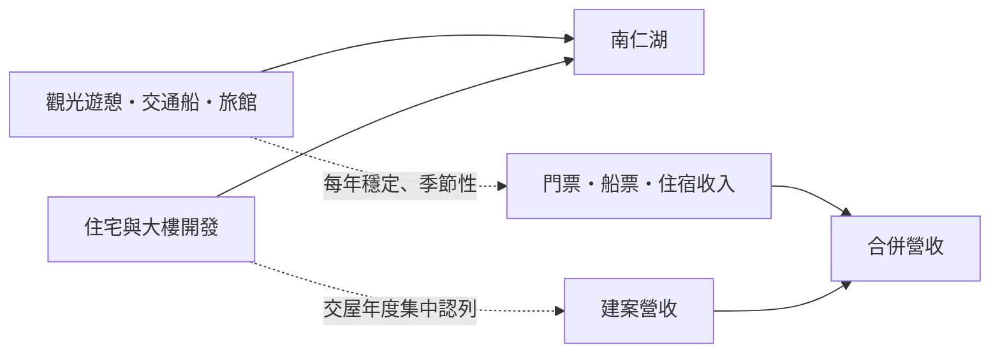
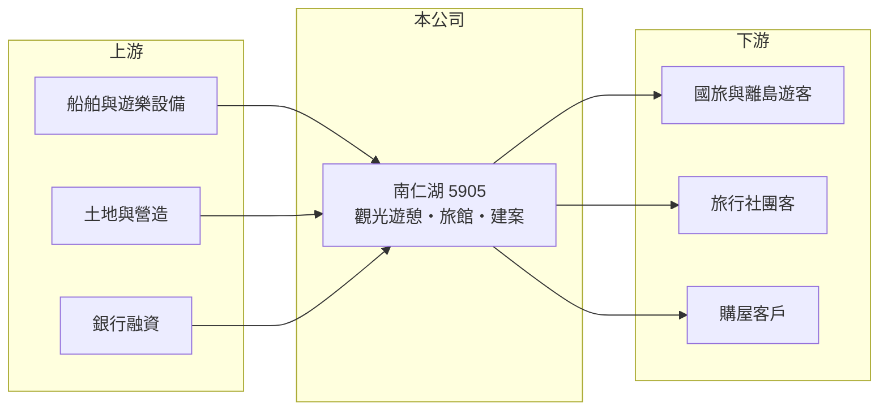

# 5905 南仁湖

> 上櫃｜[[產業索引-觀光餐旅|觀光餐旅]]｜上市（櫃）日期 2003/06/17

# 第一章：企業模式與商業藍圖

> [!info] 撰寫說明
> 本文由 Claude 依公開資料整理，架構比照 [[2330台積電]] 的四章研究，資料截至 2026-10-08。財務數字來源：櫃買中心開放資料（基本資料、2026 年第二季資產負債表與綜合損益表）、Goodinfo 年度經營績效頁、nStock 公司簡介、winvest 月營收快訊標題；公開資料有限，查不到各據點名稱、遊客人次與營收比重，關於營運據點的描述憑記憶補充並已標註，產業描述為整理性內容，尚未逐條比對原始文件。#待校對

在評估單一個股的長期投資價值時，首要步驟是拆解企業的底層獲利邏輯。本章說明南仁湖育樂（股票代號：5905，以下簡稱南仁湖）如何結合觀光遊憩、旅館與不動產開發，以及這種組合帶來的營收波動。

## 一、核心定位：觀光遊憩加不動產開發

南仁湖於 1989 年 11 月設立，1995 年 12 月與南仁湖建設合併並為存續公司，2003 年 6 月在櫃買中心掛牌。依 nStock 整理，公司營業項目涵蓋遊樂區機器設備進出口、附設旅館及餐廳、菸酒與一般百貨銷售，以及住宅與大樓開發租售。也就是說，南仁湖同時是觀光業者與建設公司。

觀光事業方面，南仁湖的營運重心在屏東，包括墾丁一帶的遊憩設施與小琉球的交通船與觀光服務（憑記憶補充，待校對）。這類離島與海濱觀光事業的特點是高度季節性：夏季與連假人潮集中，冬季與颱風期間則明顯冷清。

## 二、資本轉化邏輯：兩種完全不同的營收節奏

觀光業務每年貢獻約 8 億至 12 億元營收，[[毛利率]]高達 66% 至 78%，因為門票、船票與住宿的直接成本低；但人事、折舊與管理費用高且大多固定，營業利益率多年為負，是典型的[[營運槓桿]]結構：遊客多一點就能明顯改善，遊客少一點虧損就擴大。不動產開發則屬於[[建案交屋]]時才一次認列的營收。2026 年 4 至 6 月月營收分別為 6.29 億、4.19 億與 2.53 億元，年增 227% 至 686%（winvest 月營收快訊標題），1 至 8 月累計 22.43 億元已超過 2025 年全年的兩倍，推估是建案交屋所致（推估）。

## 三、長期方向

南仁湖的長期價值來自兩個方向：一是觀光事業能否提升營業效率，讓高毛利真正轉為營業利益；二是手上的土地能否持續開發，提供穩定的建案收入。2026 年上半年營收 19.2 億元，但毛利率降到約 27%，營業利益僅 0.15 億元，顯示建案的毛利率遠低於觀光本業，建案營收雖大，對獲利的貢獻有限。

# 第二章：護城河深度與競爭優勢

「護城河」指企業抵禦競爭、維持超額利潤的保護機制。本章說明南仁湖在屏東觀光市場的相對位置。

## 一、相對優勢

南仁湖的優勢在於地點與特許性質的資產。離島交通船航線與海濱遊憩據點需要主管機關核准，數量有限，新業者不易進入；長期在屏東經營累積的土地與設施，也提供了不動產開發的基礎。不過這些優勢沒有轉化為穩定獲利：觀光本業的毛利率雖高，營業利益率在 2021 至 2025 年都是負值，說明費用控制與資產效率仍是問題。

## 二、主要競爭對手

| 對手 | 定位 | 對南仁湖的威脅 |
|---|---|---|
| [[2722夏都]] | 墾丁海景度假飯店 | 在墾丁住宿與觀光市場直接競爭 |
| 墾丁與小琉球當地業者 | 民宿、船運與水上活動 | 以價格彈性搶散客 |
| [[2705六福]]、[[5701劍湖山]] | 主題樂園與飯店 | 爭奪國旅家庭客的休閒預算 |
| 出國旅遊 | 東南亞與日本海島 | 分食國人海島度假需求 |

## 三、守得住／守不住／觀察重點

守得住的是屏東的據點與航線資源。守不住的是國旅需求：墾丁觀光人潮近十多年長期下滑（產業常見觀察，待校對），國人出國增加也排擠國內海島旅遊。長期觀察重點是觀光事業的營業利益率能否轉正、建案銷售與交屋進度，以及負債結構能否改善。

# 第三章：財務體質與盈利規模

資料日期：2026-10-08，表格是撰寫當時的快照；最新月營收、毛利率、累計 EPS 由自動排程寫在本筆記的屬性欄位（月營收、毛利率、累計EPS 等）。#待校對

財務報表是檢驗護城河是否真實存在的最終標準。本章用六年的三率、ROE 與資本報酬檢視南仁湖的獲利品質。

## 一、多年度經營績效

| 年度 | 營收（新台幣） | [[毛利率]] | [[營業利益率]] | EPS（元） | [[ROE]] |
|---|---|---|---|---|---|
| 2020 | 11.6 億 | 72.2% | -0.89% | 0.26 | 2.11% |
| 2021 | 8.10 億 | 66.2% | -31.8% | -0.77 | -6.11% |
| 2022 | 9.66 億 | 69.6% | -21.0% | -0.80 | -5.84% |
| 2023 | 10.8 億 | 78.0% | -8.96% | -0.15 | -0.77% |
| 2024 | 9.79 億 | 73.8% | -17.3% | -0.51 | -4.17% |
| 2025 | 10.7 億 | 73.0% | -13.9% | -0.63 | -9.65% |
| 2026 上半年 | 19.23 億 | 27.0% | 0.8% | 0.06 | 未查得 |

資料來源：2020 至 2025 年為 Goodinfo，2026 上半年為櫃買中心開放資料。

2021 至 2025 年南仁湖每年都是營業虧損，即使 2023 年疫後國旅仍熱、毛利率達 78%，營業利益率仍為 -9%。2026 年上半年因建案認列，營收暴增但毛利率降到 27%，營業利益率勉強轉正。2021 至 2025 年平均 ROE 約 -5%（推算），營收年複合成長率約 7%（2021 年 8.1 億元到 2025 年 10.7 億元，推算）。近五年沒有配發現金股利。

## 二、財務結構

2026 年第二季底，南仁湖總資產 69.9 億元，其中非流動資產 57.6 億元；負債 37.8 億元，負債比約 54%，非流動負債 22.2 億元推估以長期借款為主（推估）。流動資產 12.3 億元低於流動負債 15.6 億元，流動比率約 79%。權益 32.1 億元（其中非控制權益 4.0 億元），保留盈餘 -4.23 億元，每股淨值 9.98 元。

## 三、[[ROIC]] 與 [[WACC]]：價值創造利差

**ROIC 推算：** 2025 年營業虧損約 1.49 億元（10.7 億 × -13.9%），虧損年度不計稅盾。2026 年第二季底權益約 32.1 億元，負債 37.8 億元中假設六成為有息負債約 22.7 億元（推估），投入資本約 54.8 億元，ROIC 約 -2.7%（推算）。

**WACC 推算：** 台灣 10 年期公債取 1.75%、市場風險溢酬 6%、β 取觀光兼營建的常見值 1.0，股東權益成本約 7.75%；負債成本假設 3%，虧損無法抵稅以稅前計；權益約 59%、負債約 41%，WACC 約 5.8%（推算）。

**結論：** ROIC 低於 WACC 約 8 個百分點，龐大的土地與設施資產沒有產生足夠的營業報酬。建案收入能短期改善營收，但長期價值仍取決於觀光本業能否轉為穩定獲利。

# 第四章：總體風險與地緣政治

任何企業都無法脫離宏觀環境獨立存在。本章分析南仁湖長期必須面對的風險。

## 一、觀光需求與季節風險

離島與海濱觀光高度依賴天候與季節，颱風、東北季風與海象不佳都會導致交通船停航、遊客減少。國人出國旅遊比例上升、墾丁觀光形象與交通不便，也是長期壓抑需求的因素。

## 二、不動產與財務風險

建案營收集中在交屋年度，交屋結束後營收可能大幅回落，造成年度間劇烈波動。房市景氣與央行信用管制會影響銷售與去化。流動比率低於 100%、長期負債高，利率上升會加重財務負擔。

## 三、營運與安全風險

交通船與水上遊憩涉及旅客安全，若發生事故，可能面臨停航、賠償與商譽損失。人力成本上升與基本工資調整，也持續壓縮觀光本業的利潤。

# 專有名詞解析

## 金融

- **[[營運槓桿]]**：固定成本占比高時，營收小幅變動就會讓獲利大幅增減；營收萎縮時虧損也會被放大。
- **[[ROIC]]**：投入資本報酬率，稅後營業利益除以股東權益加有息負債，衡量本業運用資本的效率。
- **[[WACC]]**：加權平均資金成本，股東與債權人要求報酬率的加權平均，是 ROIC 要超越的門檻。

## 產業

- **[[建案交屋]]**：建商在房屋完工並交付買方時才認列營收，因此營建公司的營收常集中在交屋年度。

# 核心供應鏈

## 1. 上游：設備、土地與資金
- 船舶與遊樂設備、土地與營造、銀行融資

## 2. 中游：南仁湖本身與子公司
- 屏東觀光遊憩、交通船與旅館（據點細節待校對）；住宅與大樓開發

## 3. 下游與同業
- 客戶：國旅與離島遊客、旅行社團客（如 [[2731雄獅]]）、購屋客戶
- 同業：[[2722夏都]]、[[2705六福]]、[[5701劍湖山]]

## 最新新聞
<!-- news:start（自動產生，請勿手動編輯此範圍） -->
- 2026-10-20 🏛️ 重訊 13:57｜本公司受邀參加統一證券舉辦之線上法說會｜[觀測站](https://mops.twse.com.tw/mops/#/web/t05st01)
- 2026-10-08 📰 媒體 21:20｜營收速報 - 南仁湖(5905)9月營收1.35億元年增率高達34.41％｜[鉅亨網](https://news.cnyes.com/news/id/6626017)

完整紀錄：[[5905南仁湖 新聞]]
<!-- news:end -->

## 相關連結
- [公開資訊觀測站](https://mopsov.twse.com.tw/mops/web/t05st03?step=1&firstin=1&co_id=5905)
- [Goodinfo](https://goodinfo.tw/tw/StockDetail.asp?STOCK_ID=5905)
- [Yahoo 股市](https://tw.stock.yahoo.com/quote/5905)
- [鉅亨網新聞](https://www.cnyes.com/twstock/5905/news)
