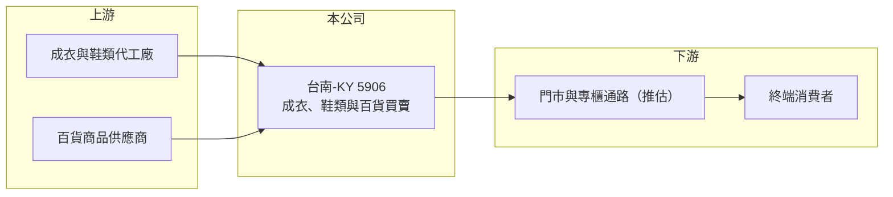

# 5906 台南-KY

> 上市｜[[產業索引-貿易百貨業|貿易百貨業]]｜上市（櫃）日期 2011/10/24

# 第一章：企業模式與商業藍圖

> [!info] 撰寫說明
> 精簡版，由 Claude 依公開資料整理，架構比照 [[2330台積電]] 的四章研究，資料截至 2026-10-08。財務數字來源：MoneyDJ 年度財務比率頁、nStock 公司簡介（2025 年營收與營業範圍）、證交所開放資料（基本資料、2026 年第二季資產負債與綜合損益、營益分析、股利、每月營收）。公開資料有限，品牌、通路與營運地區未查得，相關描述為依財務數字推估；歷年營收為依成長率回推。#待校對

台南-KY（股票代號：5906）是一家在台上市的成衣、鞋類與百貨商品買賣公司。公開資料對它的品牌與通路揭露很少，但從財務數字可以看出，它是一家高毛利、低營業利益率、帶有高槓桿的零售型企業。

## 一、核心定位：高毛利的服飾買賣業

- **公司基本面：** 台南-KY 註冊於開曼群島，1999 年成立、2011 年在台上市，實收資本額約 3.75 億元。依 nStock 公司簡介，集團營業範圍包括專業投資，以及各式成衣、鞋類及百貨的買賣業務。作為 [[KY股]]，主要營運據點不在台灣（推估）。
- **高毛利的意義：** 公司毛利率長期維持在 52% 至 59% 之間（MoneyDJ），遠高於一般成衣代工或貿易商，比較接近品牌零售的毛利結構。這代表公司很可能經營自有或代理品牌，透過門市或專櫃直接賣給消費者（推估）。
- **營業利益率偏低的原因：** 營業利益率只有 2% 至 8%，代表高毛利大多被門市租金、人事與行銷等營業費用吃掉，這是實體服飾零售的典型結構。

## 二、營收規模與趨勢

- **營收變化：** 2025 年營收約 16.82 億元（nStock）；依 MoneyDJ 的營收成長率回推，2023 年約 21.4 億元為近年高點，之後連續兩年衰退（推算）。
- **2026 年：** 1 至 8 月累計營收約 10.8 億元，年減約 1.7%（證交所每月營收），營收大致持平。上半年營業利益率只有 0.9%，獲利明顯轉弱。

## 三、長期方向

公開資料未查得公司明確的長期策略。從財務趨勢看，台南-KY 在 2020 至 2023 年曾有不錯的獲利（ROE 16% 至 25%），但 2024 年起營收與獲利同步下滑。公司能否調整門市與商品組合、讓營業利益率回升，是長期觀察重點。

# 第二章：護城河深度與競爭優勢

由於品牌與通路資訊有限，台南-KY 的護城河只能從財務數字間接判斷。

## 一、競爭條件

- **品牌溢價（推估）：** 五成以上的毛利率說明產品具有一定的品牌溢價或通路掌控力，否則難以維持這樣的定價。
- **零售經營經驗：** 公司上市超過十年，2020 至 2023 年在營收波動下仍維持獲利，代表有一定的營運管理能力。
- **限制：** 營業利益率低、負債比高，抵禦景氣下滑的緩衝有限；2024 至 2025 年營收下滑時，獲利明顯縮水。

## 二、主要競爭對手

| 對手 | 定位 | 對台南-KY 的威脅 |
|---|---|---|
| 國際快時尚品牌 | 平價服飾 | 價格低、款式更新快 |
| 電商與直播服飾品牌 | 線上銷售 | 分流實體門市來客 |
| 運動與休閒品牌直營店 | 品牌服飾與鞋類 | 品牌力強，搶奪相同客群 |

## 三、守得住與守不住

- **守得住：** 若擁有穩定的品牌客群，可維持高毛利。
- **守不住：** 實體門市的來客與坪效，營收下滑時固定費用難以縮減。
- **觀察重點：** 毛利率能否維持在 55% 左右、營業費用率能否下降，以及公司是否揭露更多品牌與通路資訊。

# 第三章：財務體質與盈利規模

資料日期：2026-10-08，表格是撰寫當時的快照；最新月營收、毛利率、累計 EPS 由自動排程寫在本筆記的屬性欄位（月營收、毛利率、累計EPS 等）。#待校對

台南-KY 的財務特色是高毛利、低營業利益率與高負債比。

## 一、多年度財務表

| 年度 | 營收（新台幣） | [[毛利率]] | [[營業利益率]] | EPS（元） | [[ROE]] |
|---|---|---|---|---|---|
| 2019 | 約 19.1 億（推算） | 57.80% | 3.39% | -0.82 | -6.57% |
| 2020 | 約 17.8 億（推算） | 52.26% | 5.52% | 2.35 | 20.94% |
| 2021 | 約 15.3 億（推算） | 58.60% | 8.42% | 3.23 | 25.08% |
| 2022 | 約 19.4 億（推算） | 53.83% | 8.27% | 3.01 | 18.94% |
| 2023 | 約 21.4 億（推算） | 53.57% | 6.38% | 3.21 | 16.35% |
| 2024 | 約 18.1 億（推算） | 55.49% | 4.75% | 1.67 | 7.22% |
| 2025 | 16.82 億 | 55.05% | 2.46% | 0.98 | 3.97% |
| 2026 上半年 | 8.27 億 | 54.60% | 0.90% | 0.01 | 未查得 |

註：2019 至 2025 年比率取自 MoneyDJ；2025 年營收取自 nStock，其餘年度依營收成長率回推，皆為推算。早年股本可能不同，EPS 不宜直接比較。2026 上半年取自證交所開放資料。

- **營收趨勢：** 2019 至 2025 年營收年複合成長率約 -2.1%（推算）。
- **毛利穩定、費用吃掉獲利：** 毛利率七年間大致維持在 52% 至 59%，但營業利益率從 2021 年的 8.42% 降到 2026 年上半年的 0.9%，說明問題出在營收下滑後的費用負擔，而不是毛利。

## 二、ROE、股利與資本結構

2021 至 2025 年平均 ROE 約 14.3%（推算），但呈現明顯下降趨勢。2026 年第二季底總資產約 17.9 億元、負債約 11.9 億元，負債比約 67%（證交所開放資料），其中流動負債約 9.4 億元，推估包含短期借款與門市[[租賃負債]]。高 ROE 有一部分來自高財務槓桿，獲利轉弱時槓桿也會放大虧損風險。2025 年度配發現金股利 0.2 元與股票股利 0.5 元，章程規定股利不低於可分配盈餘的 30%。

## 三、[[ROIC]] 與 [[WACC]]

**ROIC 推算：** 2025 年營業利益約 0.41 億元（16.82 億元 × 2.46%），稅後約 0.33 億元。投入資本以權益約 5.94 億元，加上假設約 5 億元的有息負債與租賃負債（推估），合計約 10.9 億元，ROIC 約 3%（推算）；2021 至 2023 年營業利益率較高時，ROIC 推估約 8% 至 12%。

**WACC 推算：** 公債殖利率 1.75%、市場風險溢酬 6%、β 取服飾零售 KY 股常見值 0.9，再加計約 2% 的規模與公司治理風險溢酬，股東權益成本約 9.15%；負債成本假設 3.5%，稅後 2.8%；權益約占 55%、負債約占 45%，WACC 約 6.3%（推算）。

**結論：** 台南-KY 在 2021 至 2023 年的 ROIC 高於資金成本，有創造價值；2024 年起 ROIC 降到資金成本以下，價值創造能力轉弱。能否回到過去水準，取決於營收回升與費用控制。

# 第四章：總體風險與地緣政治

台南-KY 的風險以服飾零售景氣、高槓桿與資訊揭露不足為主。

## 一、產業週期

- **服飾消費景氣：** 服飾屬於非必需消費，景氣轉弱時消費者會減少購買或轉向低價品牌。
- **通路轉移：** 電商與直播銷售持續成長，實體門市的來客與坪效面臨長期壓力。

## 二、營運風險

- **高槓桿：** 負債比約 67%，流動負債高於流動資產，若營收持續下滑，短期資金調度的壓力會增加。
- **固定費用：** 門市租金與人事成本固定，2026 年上半年營業利益率已降到 0.9%，再下滑就可能轉為虧損。
- **存貨：** 服飾有季節性，銷售不佳時需提列存貨跌價損失。

## 三、其他風險

- **資訊揭露有限：** 公開資料對品牌、通路與營運地區的說明很少，投資人難以獨立評估競爭地位。
- **KY 公司治理與匯率：** 主要營運不在台灣，資產查核與盈餘匯回受當地法規與匯率影響。
- **評價風險：** 2026 年 10 月初本益比與股價淨值比偏高（證交所本益比資料顯示股價淨值比約 2.67 倍），在獲利下滑時評價修正風險較大。

# 專有名詞解析

## 金融

- **[[KY股]]**：在開曼群島等地註冊、在台灣上市櫃的外國公司股票，主要營運多在海外。
- **[[租賃負債]]**：企業租用門市、廠房等資產，依會計準則把未來租金折現後認列在資產負債表上的負債。
- **[[ROIC]]**：投入資本報酬率，稅後營業利益除以股東權益與有息負債的合計，衡量本業對所有資金提供者的報酬。
- **[[WACC]]**：加權平均資金成本，依股東權益與負債的比重加權計算的資金成本，ROIC 高於它才代表創造價值。

# 核心供應鏈

## 1. 上游：商品來源
- 成衣、鞋類代工廠與百貨商品供應商（推估）

## 2. 本公司
- 台南-KY：成衣、鞋類與百貨商品買賣，兼營專業投資

## 3. 下游與同業
- 零售通路與終端消費者（通路型態未查得）
- 同業：[[2911麗嬰房]]、[[8443阿瘦]]、國際快時尚品牌

## 最新新聞
<!-- news:start -->
<!-- news:end -->

## 相關連結
- [公開資訊觀測站](https://mopsov.twse.com.tw/mops/web/t05st03?step=1&firstin=1&co_id=5906)
- [Goodinfo](https://goodinfo.tw/tw/StockDetail.asp?STOCK_ID=5906)
- [Yahoo 股市](https://tw.stock.yahoo.com/quote/5906)
- [鉅亨網新聞](https://www.cnyes.com/twstock/5906/news)
