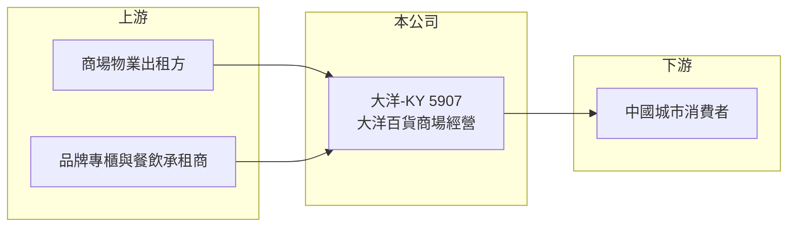

# 5907 大洋-KY

> 上市｜[[產業索引-貿易百貨業|貿易百貨業]]｜上市（櫃）日期 2012/06/06

# 第一章：企業模式與商業藍圖

> [!info] 撰寫說明
> 精簡版，由 Claude 依公開資料整理，架構比照 [[2330台積電]] 的四章研究，資料截至 2026-10-08。財務數字來源：MoneyDJ 年度財務比率頁、聯合新聞網 2025 年 12 月益航處分股權報導、證交所開放資料（基本資料、2026 年第二季資產負債與綜合損益、營益分析、股利、每月營收）。門店城市分布有部分憑記憶整理，已標「待校對」；歷年營收為依淨利率與成長率回推。#待校對

大洋-KY（股票代號：5907）是在台上市、經營中國百貨商場的公司，旗下為「大洋百貨」。它的故事反映了中國傳統百貨在電商與消費降級下的長期衰退，以及公司從聯營轉向收租、從購物轉向餐飲的求生過程。

## 一、核心定位：中國二三線城市的百貨商場

- **公司基本面：** 大洋-KY 註冊於開曼群島，2006 年成立、2012 年在台上市，實收資本額約 19.6 億元，董事長為 LEE ENG LEONG。作為 [[KY股]]，營運據點都在中國，門店主要位於福建、湖北等地的二三線城市（待校對）。
- **股權變化：** 原大股東益航（[[2601益航]]）持股約 58.62%，2025 年 4 月董事會通過出售 30%，持股降到約 28.62%；2025 年 12 月再出售約 1,889 萬股給策略投資人 Trinity Gold Limited，每股 5.25 元，益航預估處分損失約 1.35 億元。益航說明目的是讓集團免受百貨事業虧損的影響。

## 二、經營模式的轉變：從聯營到收租、從購物到餐飲

- **收租化：** 依聯合新聞網 2025 年 12 月報導，大洋百貨改為收取固定租金以保障營運現金流，租金收入已占業務約 50%。毛利率從 2019 年的 73.56% 升到 2025 年的 85.3%（MoneyDJ），正反映收入由[[專櫃抽成]]轉向租金。
- **餐飲化：** 餐飲占業務比重從約 30% 提高到約 50%。傳統百貨的服飾與化妝品被電商大量取代，餐飲與體驗型消費成為吸引人潮的主力。
- **效果有限：** 2025 年前三季來客數雖有兩位數成長，但提袋率並未改善，營收仍年減約 14.6%、稅後虧損約 5.9 億元，公司歸因於中國消費者的保守心態。

## 三、長期方向

公司計畫縮減部分營運，並以租金優惠留住承租商。長期而言，大洋百貨的出路在於把商場轉型為以餐飲、娛樂與生活服務為主的社區型商業空間，同時縮減虧損門店。大股東持續減持，也代表集團對這項事業的支持度下降。

# 第二章：護城河深度與競爭優勢

大洋百貨曾經擁有地方型百貨的地位，但在中國消費結構改變後，護城河已明顯侵蝕。

## 一、殘存的競爭條件

- **地方商圈地段：** 門店多位於城市的傳統商業區，具有一定的人流基礎，這是轉型為餐飲與生活服務商場的條件。
- **營運經驗：** 在中國經營百貨超過二十年，熟悉當地招商與商場管理（待校對）。
- **限制：** 新型購物中心在中國大量開設，商圈重心移往新區，傳統百貨的地段優勢逐漸消失。

## 二、主要競爭對手

| 對手 | 定位 | 對大洋的威脅 |
|---|---|---|
| 萬達廣場等大型購物中心 | 一站式購物中心 | 面積大、業態完整，吸走人潮 |
| 天貓、京東、抖音等電商 | 線上購物 | 取代百貨的服飾與化妝品消費 |
| 地方百貨與商場 | 同業 | 在同一城市競爭承租商與消費者 |

## 三、守得住與守不住

- **守得住：** 位於核心商圈、以餐飲與生活服務為主的門店。
- **守不住：** 以服飾、化妝品為主的傳統百貨業態。
- **觀察重點：** 租金收入比重、門店調整與關閉進度、虧損是否收斂，以及新大股東的經營方向。

# 第三章：財務體質與盈利規模

資料日期：2026-10-08，表格是撰寫當時的快照；最新月營收、毛利率、累計 EPS 由自動排程寫在本筆記的屬性欄位（月營收、毛利率、累計EPS 等）。#待校對

大洋-KY 的財務數字呈現營收連年衰退、虧損擴大與負債比上升的惡化軌跡。

## 一、多年度財務表

| 年度 | 營收（新台幣） | [[毛利率]] | [[營業利益率]] | EPS（元） | [[ROE]] |
|---|---|---|---|---|---|
| 2019 | 約 66.4 億（推算） | 73.56% | 19.37% | 3.10 | 6.44% |
| 2020 | 約 47.9 億（推算） | 67.15% | 5.14% | -0.53 | -1.19% |
| 2021 | 約 51.6 億（推算） | 72.22% | 8.31% | -1.19 | -2.81% |
| 2022 | 約 41.5 億（推算） | 81.74% | 0.67% | -4.26 | -10.89% |
| 2023 | 約 38.2 億（推算） | 83.21% | -6.28% | -10.66 | -33.81% |
| 2024 | 約 32.4 億（推算） | 85.00% | -3.75% | -2.62 | -10.38% |
| 2025 | 約 27.5 億（推算） | 85.30% | -8.66% | -4.55 | -20.69% |
| 2026 上半年 | 14.2 億 | 85.07% | -3.43% | -2.03 | 未查得 |

註：2019 至 2025 年比率取自 MoneyDJ；營收以 2025 年稅後淨損約 8.9 億元（證交所股利資料）除以淨利率 32.36% 得到約 27.5 億元，再依各年營收成長率回推，皆為推算（2025 年前三季營收 20.4 億元，與推算一致）。2026 上半年取自證交所開放資料。

- **營收趨勢：** 2019 至 2025 年營收年複合成長率約 -14%（推算），六年間營收縮小到約四成。
- **毛利率上升但營業虧損：** 毛利率上升是收租化的結果，並不代表經營改善；營業費用（含商場折舊與租金相關成本）無法隨營收同步下降，營業利益率由正轉負。
- **業外損失沉重：** 2026 年上半年營業損失約 0.49 億元，業外損失卻約 3.23 億元，推估主要是[[租賃負債]]的利息費用與資產減損（未逐項查證）。

## 二、ROE 與資本結構

2021 至 2025 年平均 ROE 約 -15.7%（推算）。2026 年第二季底總資產約 206.1 億元、負債約 169.5 億元，負債比約 82%（證交所開放資料），其中非流動負債約 104.5 億元，推估以商場長期租約認列的租賃負債為主。權益約 36.6 億元、每股淨值約 18.72 元，股價淨值比約 0.25 倍。由於有大量長期租約，即使營收下滑，租金負擔仍在，這是百貨業虧損難以快速收斂的原因。2025 年度未配發股利。

## 三、[[ROIC]] 與 [[WACC]]

**ROIC 推算：** 2025 年營業損失約 2.38 億元（27.5 億元 × -8.66%，推算），虧損年度不計稅盾。投入資本以權益約 36.6 億元，加上假設約 120 億元的有息負債與租賃負債（推估），合計約 157 億元，ROIC 約 -1.5%（推算）。

**WACC 推算：** 公債殖利率 1.75%、市場風險溢酬 6%、β 取中國消費類 KY 股常見值 1.0，再加計約 2% 的中國與財務風險溢酬，股東權益成本約 9.75%；負債成本（含租賃隱含利率）假設 4.5%，稅後 3.6%；權益約占 23%、負債約占 77%，WACC 約 5%（推算）。

**結論：** 大洋-KY 自 2023 年起 ROIC 為負，遠低於資金成本，代表商場資產持續消耗價值。高負債與長期租約限制了調整空間，股價深度低於淨值，反映市場對資產價值可回收性的疑慮。

# 第四章：總體風險與地緣政治

大洋-KY 的風險以中國消費、百貨業結構衰退與高槓桿為主。

## 一、產業結構

- **中國百貨業的結構性衰退：** 電商、直播與購物中心持續取代傳統百貨，這是長期趨勢而非短期景氣循環。
- **中國消費信心：** 房地產下行與就業壓力使消費者趨於保守，來客增加但提袋率不升，正是消費降級的表現。

## 二、營運風險

- **長期租約負擔：** 大量商場以長期租約經營，營收下滑時租金成本無法同步減少，關店也可能需要支付違約成本。
- **資產減損：** 虧損門店的使用權資產與設備可能需要提列減損，使帳面淨值進一步下降。
- **承租商流失：** 收租模式依賴承租商穩定，若承租商營運不佳而撤櫃，租金收入也會下降。

## 三、其他風險

- **大股東變動：** 益航持續減持，新策略投資人的經營方向與支持程度仍不明朗。
- **KY 公司治理與匯率：** 營運在中國，資產查核、盈餘匯回與人民幣匯率都會影響台灣股東的權益。
- **持續經營與財務結構：** 負債比超過八成，若虧損持續，可能需要增資、減資或處分資產（推估）。

# 專有名詞解析

## 金融

- **[[KY股]]**：在開曼群島等地註冊、在台灣上市櫃的外國公司股票，主要營運多在海外。
- **[[租賃負債]]**：企業租用門市、廠房等資產，依會計準則把未來租金折現後認列在資產負債表上的負債。
- **[[ROIC]]**：投入資本報酬率，稅後營業利益除以股東權益與有息負債的合計，衡量本業對所有資金提供者的報酬。
- **[[WACC]]**：加權平均資金成本，依股東權益與負債的比重加權計算的資金成本，ROIC 高於它才代表創造價值。

## 產業

- **[[專櫃抽成]]**：百貨公司向品牌專櫃收取營業額一定比例作為收入的聯營模式，收入隨營業額波動。

# 核心供應鏈

## 1. 上游：物業與承租商
- 商場物業出租方（長期租約）
- 品牌專櫃、餐飲與生活服務承租商

## 2. 本公司與股東
- 大洋-KY：大洋百貨
- 原大股東：[[2601益航]]（2025 年起持續減持）

## 3. 下游與同業
- 中國城市消費者
- 同業：萬達廣場等購物中心、中國地方百貨

## 最新新聞
<!-- news:start -->
<!-- news:end -->

## 相關連結
- [公開資訊觀測站](https://mopsov.twse.com.tw/mops/web/t05st03?step=1&firstin=1&co_id=5907)
- [Goodinfo](https://goodinfo.tw/tw/StockDetail.asp?STOCK_ID=5907)
- [Yahoo 股市](https://tw.stock.yahoo.com/quote/5907)
- [鉅亨網新聞](https://www.cnyes.com/twstock/5907/news)
