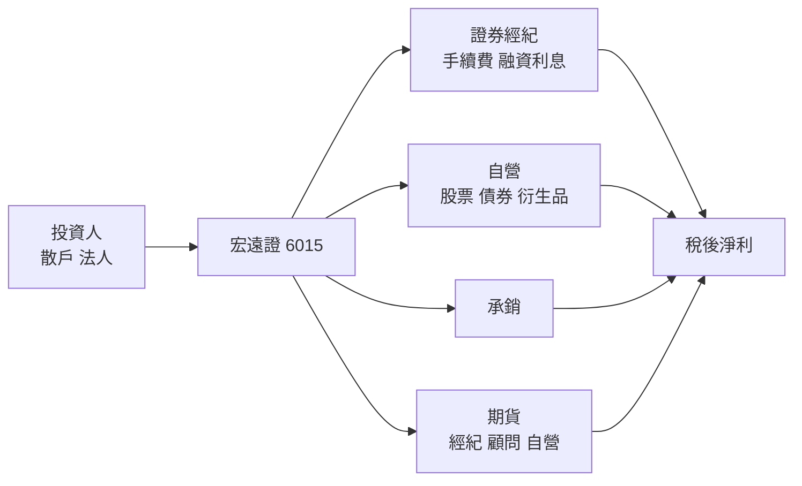
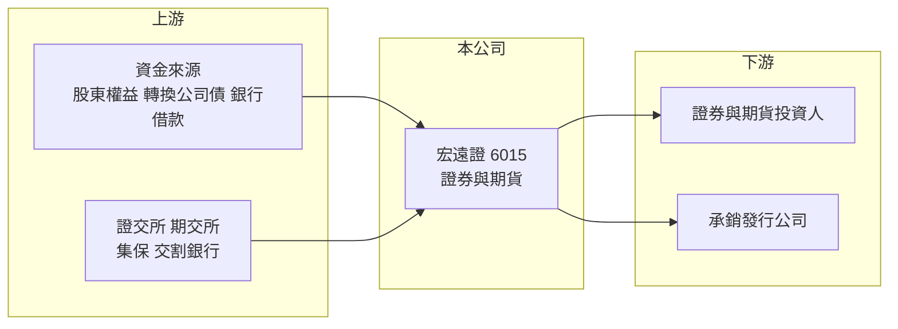

# 6015 宏遠證

> 上櫃｜[[產業索引-金融保險業|金融保險業]]｜上市（櫃）日期 1996/07/25

# 第一章：企業模式與商業藍圖

> [!info] 撰寫說明
> 精簡版，由 Claude 依公開資料整理，架構比照 [[2330台積電]] 的四章研究，資料截至 2026-10-08。財務數字來源：Goodinfo 年度經營績效頁、HiStock（公司基本資料與公告）、櫃買中心開放資料（基本資料、本益比殖利率）；業務占比、市占率、據點與股東背景未查得，公開資料有限。#待校對

本章說明宏遠證券（股票代號：6015，以下簡稱宏遠證）的商業模式：一家兼營證券與期貨業務的中小型綜合券商，獲利跟著台股成交量與自營表現大幅擺動。

- **核心業務：** 依櫃買中心資料，宏遠證的登記成立日期為 1961 年，1996 年上櫃（成立日期早於台灣證券業開放新設券商的 1988 年，推估為沿用前身公司的設立登記，待校對），董事長為姜克勤、總經理為林禎民。業務包括證券[[經紀業務]]、[[自營業務]]與[[承銷]]，並在公司內兼營期貨經紀、期貨顧問與期貨自營。
- **營收結構：** 各業務營收與獲利比重未查得。從 Goodinfo 的年度數字看，營收在 2021 年達 26.4 億元、2022 年驟降到 6.82 億元，波動幅度遠大於成交量的變化，推估自營損益占獲利的比重高（推估）。
- **營運據點：** 總公司位於台北市信義路四段，分公司家數未查得。實收資本額約 40.4 億元。
- **長期方向：** 公開資料未查得具體的長期策略。宏遠證曾發行[[可轉換公司債]]籌資，第一次無擔保轉換公司債已於 2026 年到期償還，第二次轉換公司債（宏遠證二）仍在流通，顯示公司會以轉債作為補充資本的工具。

# 第二章：護城河深度與競爭優勢

本章分析宏遠證的競爭位置。中小型券商在經紀市占、資本與品牌上都難以和金控券商抗衡，通常只能在特定客群或自營操作上尋找空間。

- **競爭優勢：** 宏遠證的優勢不明顯，屬於「無明顯護城河」的中小型券商。可能的差異化來源包括兼營期貨業務，讓證券與期貨客戶可以在同一家公司開戶交易；以及長期經營的分公司客群（推估）。
- **主要對手：** 經紀市場由 [[2885元大金]] 旗下元大證券、[[2881富邦金]]、[[2883凱基金]]、[[2890永豐金]] 旗下券商與 [[6005群益證]] 主導；期貨業務要面對 [[6023元大期]]、[[6024群益期]] 等專業期貨商。規模相近的同業包括 [[6016康和證]]、[[6020大展證]]、[[5864致和證]]、[[6026福邦證]]、[[6021美好證]]。
- **觀察重點：** 自營部位的風險控管、轉換公司債轉換後的股本稀釋，以及在券商整併趨勢下的經營權動向（推估）。

| 對手 | 定位 | 對宏遠證的影響 |
|---|---|---|
| 金控券商 | 市占高、銀行通路 | 壓縮手續費與客源 |
| 專業期貨商 | 期貨經紀市占高 | 期貨業務難以擴大 |
| 中小型券商 | 經紀加自營 | 經營模式相近，競爭同一批散戶 |

# 第三章：財務體質與盈利規模

資料日期：2026-10-08，表格是撰寫當時的快照；最新月營收、累計 EPS 由自動排程寫在本筆記的屬性欄位（月營收、累計EPS 等）。#待校對

券商不適用毛利率，本章以營業收入、稅後淨利、[[ROE]]、[[ROA]] 與股利檢視宏遠證的獲利品質。

| 年度 | 營業收入（新台幣） | 稅後淨利 | EPS（元） | [[ROE]] | [[ROA]] |
|---|---|---|---|---|---|
| 2020 | 13.1 億 | 4.15 億 | 1.24 | 10.3% | 2.92% |
| 2021 | 26.4 億 | 12.4 億 | 3.74 | 26.1% | 7.43% |
| 2022 | 6.82 億 | -2.20 億 | -0.63 | -4.46% | -1.66% |
| 2023 | 12.2 億 | 1.80 億 | 0.51 | 3.88% | 1.41% |
| 2024 | 15.2 億 | 3.37 億 | 0.91 | 6.63% | 2.29% |
| 2025 | 15.3 億 | 2.99 億 | 0.76 | 5.43% | 1.95% |

註：取自 Goodinfo 合併報表。

- **營收規模：** 2020 至 2025 年營收從 13.1 億元增至 15.3 億元，年複合成長率約 3.2%（推算），但 2021 年高峰與 2022 年低谷相差近四倍。
- **獲利：** 2021 年 ROE 高達 26.1%，2022 年轉為虧損，2023 至 2025 年 ROE 只有 4% 至 7%。2021 至 2025 年平均 ROE 約 7.5%（推算），且有逐漸降低的趨勢：2024 至 2025 年台股成交量大增，宏遠證的獲利卻沒有同步放大，代表經紀與自營的競爭力相對同業偏弱（推估）。
- **自營與經紀結構：** 經紀市占率與自營、承銷損益結構未查得。ROA 約 2%，與 ROE 相差約三倍，財務槓桿屬於券商中等水準。
- **股利：** 櫃買中心資料顯示最近一次每股股利約 0.55 元，配息率約 72%（推算，0.55 ÷ 0.76）。

**ROE 與權益資金成本：** 券商的負債多屬營業性質，[[ROIC]] 與 [[WACC]] 不適用，改以 ROE 對比 [[CAPM]] 推算的權益資金成本。假設 β 取 1.2（中小型券商推估值，非來源數字）、台灣 10 年期公債殖利率 1.75%、市場風險溢酬 6%，權益資金成本約 1.75% ＋ 1.2 × 6% ＝ 8.95%（推算）。宏遠證 2021 至 2025 年平均 ROE 約 7.5%，低於權益成本，若扣除 2021 年的特殊高點，平均更只有 3% 左右，代表長期並未替股東創造超額價值。櫃買中心資料顯示股價淨值比約 1.05 倍。

# 第四章：總體風險與地緣政治

本章分析宏遠證面對的市場週期與營運風險。

- **產業週期：** 券商獲利跟著台股成交量、指數漲跌與 IPO 熱度擺動，自營比重高的中小型券商波動更大，2021 年與 2022 年的落差就是典型例子。
- **營運風險：** 自營部位若操作失利，可能在單一年度抹去多年獲利；經紀業務規模小、手續費折讓競爭激烈，難以提供穩定的基本收入。轉換公司債若轉換為股票，會增加股本、稀釋 EPS。
- **其他風險：** 主管機關對券商資本、自營與期貨業務的規範變動；資安與法遵成本上升對小型券商的負擔相對較重；券商產業整併時，中小型券商可能成為併購對象，經營方向會隨之改變。

# 專有名詞解析

## 金融

- **[[經紀業務]]**：券商替投資人買賣股票並收取手續費的業務，收入與市場成交量高度相關。
- **[[自營業務]]**：券商以自有資金投資股票、債券與衍生性商品，獲利隨市場波動。
- **[[承銷]]**：券商協助企業發行新股、債券並銷售給投資人，收取承銷費用。
- **[[可轉換公司債]]**：持有人可在約定期間依轉換價格換成發行公司股票的公司債，轉換後會增加股本。
- **[[ROA]]**：資產報酬率，稅後淨利除以總資產，金融業因槓桿高，ROA 通常偏低。
- **[[CAPM]]**：資本資產定價模型，以無風險利率加上 β 乘以市場風險溢酬，推估股東要求的報酬率。
- **[[ROIC]]**：投入資本報酬率，稅後營業利益除以股東權益加有息負債，衡量本業運用資本的效率；不適用於銀行、保險與券商。
- **[[WACC]]**：加權平均資金成本，依股權與負債比重加權的資金成本，是判斷 ROIC 是否創造價值的門檻。

# 核心供應鏈

- 上游：股東權益、可轉換公司債與銀行借款等資金來源；證交所、期交所、集保與交割銀行提供交易基礎設施。
- 下游／客戶：證券與期貨投資人、委託承銷的發行公司。
- 同業：[[6016康和證]]、[[6020大展證]]、[[5864致和證]]、[[6026福邦證]]、[[6021美好證]]；大型券商 [[6005群益證]]、[[2885元大金]]；期貨商 [[6023元大期]]、[[6024群益期]]。

## 最新新聞
<!-- news:start（自動產生，請勿手動編輯此範圍） -->
- 2026-10-07 🏛️ 重訊 15:13｜公告本公司自行結算一一五年九月份合併損益｜[觀測站](https://mops.twse.com.tw/mops/#/web/t05st01)

完整紀錄：[[6015宏遠證 新聞]]
<!-- news:end -->

## 相關連結
- [公開資訊觀測站](https://mopsov.twse.com.tw/mops/web/t05st03?step=1&firstin=1&co_id=6015)
- [Goodinfo](https://goodinfo.tw/tw/StockDetail.asp?STOCK_ID=6015)
- [Yahoo 股市](https://tw.stock.yahoo.com/quote/6015)
- [鉅亨網新聞](https://www.cnyes.com/twstock/6015/news)
