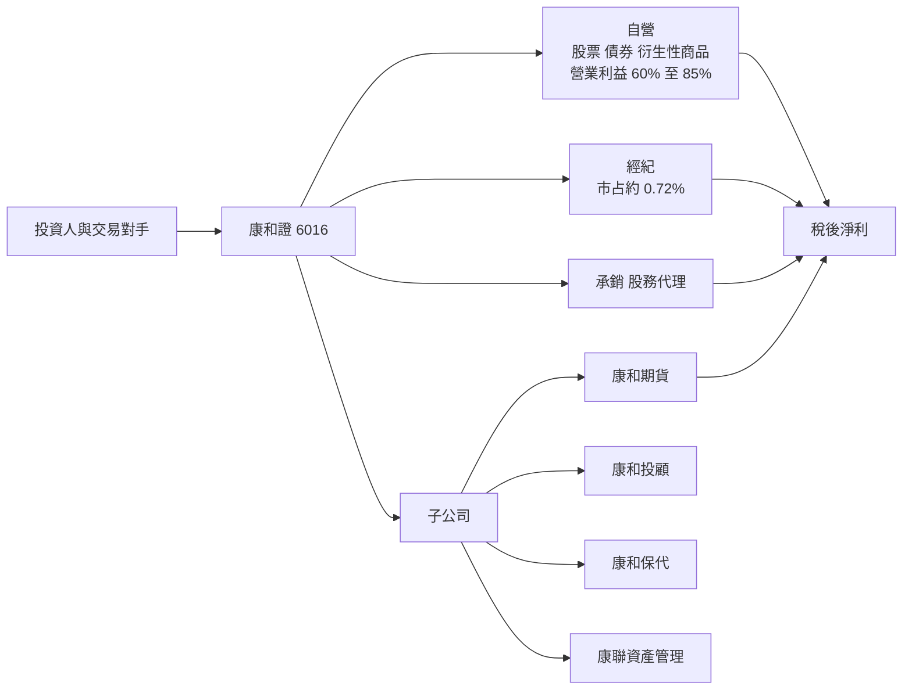
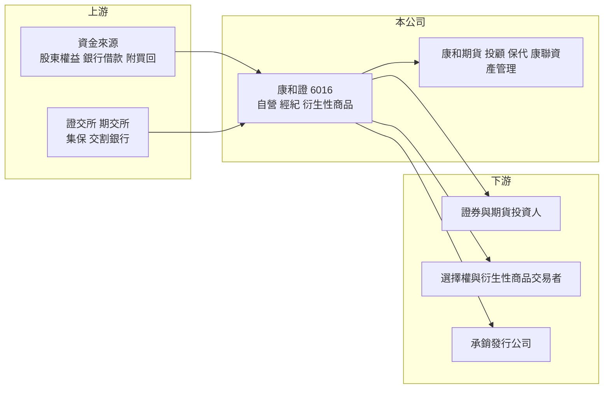

# 6016 康和證

> 上櫃｜[[產業索引-金融保險業|金融保險業]]｜上市（櫃）日期 1996/12/04

# 第一章：企業模式與商業藍圖

> [!info] 撰寫說明
> 精簡版，由 Claude 依公開資料整理，架構比照 [[2330台積電]] 的四章研究，資料截至 2026-10-08。財務數字來源：Goodinfo 年度經營績效頁、富果研究（康和證 2026 年 6 月法說會備忘錄）、櫃買中心開放資料（基本資料、本益比殖利率）；股東背景與據點數未查得，部分描述為整理性內容。#待校對

本章說明康和綜合證券（股票代號：6016，以下簡稱康和證）的商業模式：一家經紀市占不到 1%、卻以自營與衍生性商品為主要獲利來源的中型券商，並透過期貨、投顧、保代等子公司形成小型金融集團。

- **核心業務：** 康和證成立於 1990 年，1996 年上櫃，董事長為鄭大宇、總經理為陳志豪。業務涵蓋證券[[經紀業務]]、[[自營業務]]、[[承銷]]、債券、新金融商品與股務代理，並透過康和期貨、康和投顧、康和保險代理人與康聯資產管理提供期貨、投顧、保險與資產管理服務。
- **營收結構：** 依法說會資料，2023 至 2025 年營業利益中自營約占 60% 至 71%、經紀約占 30% 至 41%；2026 年第一季自營占比更升到 85%（約 14.4 億元），經紀只占 15%。這個結構說明康和證的獲利引擎是自營與衍生性商品，而不是經紀手續費。
- **營運據點：** 總公司位於台北市基隆路，分公司家數未查得。2026 年第一季經紀市占率 0.72%、融資市占率 1.80%，但[[股票選擇權]]的市占率高達 53.9%，顯示它在選擇權造市與交易領域有特殊地位（造市角色待校對）。2026 年第一季總資產 594 億元、每股淨值 18.03 元。
- **長期方向：** 公司以自營與經紀為兩大獲利主軸，搭配更完整的服務範圍；重視資安（康和期貨核心交易系統納入 ISO 27001:2022 驗證）與人才文化。法說會未提供具體的財務目標。

# 第二章：護城河深度與競爭優勢

本章分析康和證的護城河。在經紀市場規模有限的情況下，康和證的競爭力集中在衍生性商品與自營交易的專業能力。

- **競爭優勢：** 第一是衍生性商品的專業地位，股票選擇權市占率超過五成，這類業務需要報價系統、避險模型與風控能力，新進者難以快速複製。第二是集團化的產品線，期貨、投顧、保代與資產管理讓康和證能提供較完整的服務。第三是自營團隊在多頭年度的獲利能力。整體屬於「窄護城河」，優勢集中在專業交易領域，但也讓獲利高度依賴市場行情。
- **主要對手：** 經紀市場由 [[2885元大金]]、[[2881富邦金]]、[[2883凱基金]]、[[2890永豐金]] 旗下券商與 [[6005群益證]] 主導；權證與衍生性商品發行要面對元大、凱基、群益等大型發行商；期貨業務要面對 [[6023元大期]]、[[6024群益期]]。規模相近的同業包括 [[2855統一證]]、[[6015宏遠證]]、[[6020大展證]]。
- **觀察重點：** 自營獲利占比是否持續升高（代表波動加大）、經紀與子公司能否提供更穩定的基本獲利，以及資本規模擴大後能否維持 ROE。

| 對手 | 定位 | 對康和證的影響 |
|---|---|---|
| 金控券商 | 經紀市占高、銀行通路 | 經紀業務難以擴大 |
| 大型衍生性商品發行商 | 權證與選擇權規模大 | 在報價與避險能力上直接競爭 |
| 專業期貨商 | 期貨經紀市占高 | 壓縮康和期貨的成長空間 |

# 第三章：財務體質與盈利規模

資料日期：2026-10-08，表格是撰寫當時的快照；最新月營收、累計 EPS 由自動排程寫在本筆記的屬性欄位（月營收、累計EPS 等）。#待校對

券商不適用毛利率，本章以營業收入、稅後淨利、[[ROE]]、[[ROA]] 與自營、經紀的獲利結構檢視康和證的獲利品質。

| 年度 | 營業收入（新台幣） | 稅後淨利 | EPS（元） | [[ROE]] | [[ROA]] |
|---|---|---|---|---|---|
| 2020 | 33.4 億 | 10.8 億 | 1.83 | 14.0% | 3.56% |
| 2021 | 43.0 億 | 13.9 億 | 2.33 | 16.2% | 3.71% |
| 2022 | 20.6 億 | -1.49 億 | -0.25 | -1.71% | -0.38% |
| 2023 | 34.2 億 | 10.0 億 | 1.68 | 11.9% | 2.64% |
| 2024 | 39.4 億 | 10.9 億 | 1.75 | 11.7% | 2.58% |
| 2025 | 40.0 億 | 13.6 億 | 1.98 | 13.0% | 2.79% |

註：取自 Goodinfo 合併報表。2026 年第一季營收 23.43 億元、稅後淨利 11.33 億元、EPS 1.65 元，前一年同期為虧損 4.04 億元，季度波動很大。

- **營收規模：** 2020 至 2025 年營收從 33.4 億元增至 40.0 億元，年複合成長率約 3.7%（推算），2022 年腰斬到 20.6 億元。
- **獲利：** 除 2022 年小幅虧損外，ROE 大多在 12% 至 16% 之間，2021 至 2025 年平均約 10.2%（推算）。相較其他中小型券商，康和證在 2023 至 2025 年的獲利恢復較快，與自營與衍生性商品團隊的貢獻有關。
- **自營與經紀結構：** 2023 至 2025 年自營占營業利益 60% 至 71%，2026 年第一季 85%；經紀市占 0.72%、融資市占 1.80%。ROA 約 2.6% 至 2.8%，ROE 約為 ROA 的 4.5 倍，槓桿比小型純經紀券商高，與衍生性商品部位需要的資產規模一致。
- **股利：** 2025 年度擬配發股利每股 1.405 元，配發率約 71%（推算，1.405 ÷ 1.98）。實收資本額從 2026 年第一季的 68.66 億元增加到約 77.2 億元，推估含股票股利（推估）。

**ROE 與權益資金成本：** 券商的負債多屬營業性質，[[ROIC]] 與 [[WACC]] 不適用，改以 ROE 對比 [[CAPM]] 推算的權益資金成本。康和證以自營為主，假設 β 取 1.2（自營型券商推估值，非來源數字）、台灣 10 年期公債殖利率 1.75%、市場風險溢酬 6%，權益資金成本約 8.95%（推算）。2021 至 2025 年平均 ROE 約 10.2%，高於權益成本約 1.3 個百分點；扣除 2022 年後的 2023 至 2025 年平均約 12.2%，利差約 3 個百分點。整體屬於小幅創造價值，但高度依賴市場行情。櫃買中心資料顯示股價淨值比約 1.12 倍。

# 第四章：總體風險與地緣政治

本章分析康和證面對的市場週期、衍生性商品與營運風險。

- **產業週期：** 自營占營業利益六成以上，使康和證的獲利對台股與利率走勢非常敏感。2025 年第一季虧損 4.04 億元、2026 年第一季卻賺 11.33 億元，同一季度在不同年份可以差出十幾億元。
- **營運風險：** 衍生性商品與選擇權業務需要動態避險，極端行情（例如跳空大跌、波動率急升）可能讓避險失效，造成單次大額損失。經紀市占不到 1%，經紀業務無法在自營不佳時提供足夠的獲利支撐。
- **其他風險：** 主管機關對自營、衍生性商品與資本的規範變動會直接影響業務規模；子公司康和期貨的增資與營運也需要母公司資本支持。資安事件在交易系統上的影響尤其嚴重，公司已將資安列為核心營運重點。

# 專有名詞解析

## 金融

- **[[經紀業務]]**：券商替投資人買賣股票並收取手續費的業務，收入與市場成交量高度相關。
- **[[自營業務]]**：券商以自有資金投資股票、債券與衍生性商品，獲利隨市場波動。
- **[[承銷]]**：券商協助企業發行新股、債券並銷售給投資人，收取承銷費用。
- **[[股票選擇權]]**：以個股為標的、在期交所交易的選擇權契約，券商常擔任造市者提供報價並賺取價差。
- **[[ROA]]**：資產報酬率，稅後淨利除以總資產，金融業因槓桿高，ROA 通常偏低。
- **[[CAPM]]**：資本資產定價模型，以無風險利率加上 β 乘以市場風險溢酬，推估股東要求的報酬率。
- **[[ROIC]]**：投入資本報酬率，稅後營業利益除以股東權益加有息負債，衡量本業運用資本的效率；不適用於銀行、保險與券商。
- **[[WACC]]**：加權平均資金成本，依股權與負債比重加權的資金成本，是判斷 ROIC 是否創造價值的門檻。

# 核心供應鏈

- 上游：股東權益、銀行借款與附買回交易等資金來源；證交所、期交所、集保與交割銀行提供交易基礎設施。
- 下游／客戶：證券與期貨投資人、股票選擇權與衍生性商品交易者、委託承銷的發行公司。
- 同業：[[2855統一證]]、[[6015宏遠證]]、[[6020大展證]]、[[5864致和證]]、[[6026福邦證]]；大型券商 [[6005群益證]]、[[2885元大金]]；期貨商 [[6023元大期]]、[[6024群益期]]。

## 最新新聞
<!-- news:start（自動產生，請勿手動編輯此範圍） -->
- 2026-10-08 📰 媒體 10:04｜康和證獲國家級肯定 拿下玉山獎「傑出企業領導人」、「傑出企業」｜[鉅亨網](https://news.cnyes.com/news/id/6624583)
- 2026-10-07 🏛️ 重訊 14:12｜公告本公司115年9月份合併自結損益｜[觀測站](https://mops.twse.com.tw/mops/#/web/t05st01)

完整紀錄：[[6016康和證 新聞]]
<!-- news:end -->

## 相關連結
- [公開資訊觀測站](https://mopsov.twse.com.tw/mops/web/t05st03?step=1&firstin=1&co_id=6016)
- [Goodinfo](https://goodinfo.tw/tw/StockDetail.asp?STOCK_ID=6016)
- [Yahoo 股市](https://tw.stock.yahoo.com/quote/6016)
- [鉅亨網新聞](https://www.cnyes.com/twstock/6016/news)
