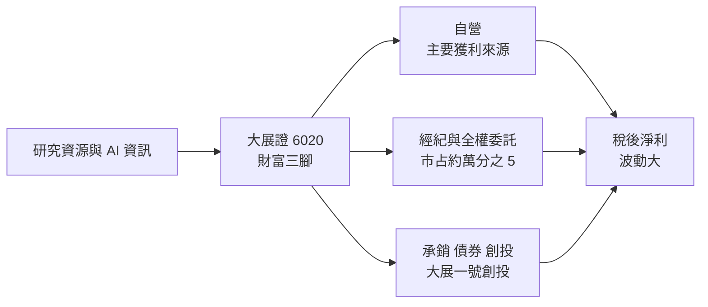
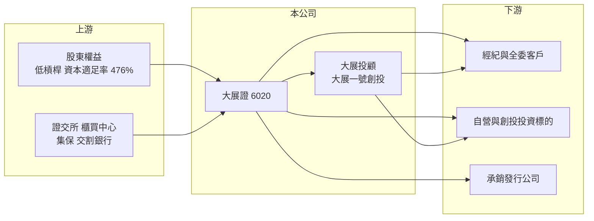

# 6020 大展證

> 上櫃｜[[產業索引-金融保險業|金融保險業]]｜上市（櫃）日期 2003/01/23

# 第一章：企業模式與商業藍圖

> [!info] 撰寫說明
> 精簡版，由 Claude 依公開資料整理，架構比照 [[2330台積電]] 的四章研究，資料截至 2026-10-08。財務數字來源：Goodinfo 年度經營績效頁、富果研究（大展證 2026 年 7 月法說會備忘錄）、櫃買中心開放資料（基本資料、本益比殖利率）；據點數與股東背景未查得，公開資料有限。#待校對

本章說明大展證券（股票代號：6020，以下簡稱大展證）的商業模式：一家經紀市占只有萬分之五的小型券商，資本充裕、槓桿很低，獲利主要取決於自營與創投投資的表現。

- **核心業務：** 大展證成立於 1988 年，正是台灣開放新設券商的那一年，2003 年上櫃，董事長為李玉萍，總經理由林嘉俊擔任（法說會時原總經理退休、由執行副總經理暫代，人事安排待校對）。業務包括[[經紀業務]]、[[自營業務]]與[[承銷]]，並透過子公司大展證券投資顧問與大展一號創業投資經營投顧[[全權委託]]與創投。
- **營收結構：** 各業務比重未查得，但法說會資料顯示 2026 年上半年自營是最主要的獲利來源，營收年增 1,525%；創投投資收益約 1.5 億元；承銷完成 4 件主協辦案件、收入年增 218%；經紀業務 2026 年第二季累計市占率約萬分之 5.01，融資平均餘額 8.47 億元。自營加創投才是決定年度獲利的關鍵。
- **營運據點：** 總公司位於台北市大同區承德路，分公司家數未查得。實收資本額約 25.2 億元。投顧全權委託規模截至 2026 年 6 月底約 4,000 萬元，仍在起步階段。
- **長期方向：** 公司提出「建立大展財富三腳」，以研究資源與 AI 資訊為基礎，發展三大支柱：一是自營，二是經紀結合全權委託，三是承銷、債券與創投。這代表大展證希望降低對單一自營部位的依賴，把研究能力轉化為更多元的收入。

# 第二章：護城河深度與競爭優勢

本章分析大展證的競爭位置。小型券商在經紀市場幾乎沒有規模可言，存在價值主要在於資本運用與投資研究能力。

- **競爭優勢：** 第一是資本充裕，2026 年上半年資本適足率（券商的自有資本適足比率）476%，遠高於法規要求的 150% 與同業平均約 200%，代表公司有足夠空間承擔自營與創投風險，財務安全性高。第二是研究導向的投資能力，自營與創投在多頭年度能帶來數倍於平常的獲利。整體屬於「無明顯護城河」：經紀規模太小，投資績效又難以保證可持續。
- **主要對手：** 經紀市場由 [[2885元大金]]、[[2881富邦金]]、[[2883凱基金]] 等金控券商與 [[6005群益證]] 主導；規模相近、同樣以自營為主的小型券商包括 [[5864致和證]]、[[6015宏遠證]]、[[6021美好證]]、[[6026福邦證]]。
- **觀察重點：** 自營與創投收益能否在非多頭年度維持正數、全權委託規模能否擴大成為經常性收入，以及總經理人選確定後的策略延續性。

| 對手 | 定位 | 對大展證的影響 |
|---|---|---|
| 金控券商 | 市占高、系統與通路完整 | 大展證經紀業務難以擴大 |
| 小型自營型券商 | 經紀加自營 | 經營模式相近，競爭投資人才與承銷案件 |
| 投顧與資產管理業者 | 全權委託與基金 | 與大展證新發展的全委業務競爭 |

# 第三章：財務體質與盈利規模

資料日期：2026-10-08，表格是撰寫當時的快照；最新月營收、累計 EPS 由自動排程寫在本筆記的屬性欄位（月營收、累計EPS 等）。#待校對

券商不適用毛利率，本章以營業收入、稅後淨利、[[ROE]]、[[ROA]] 與資本適足檢視大展證的獲利品質。

| 年度 | 營業收入（新台幣） | 稅後淨利 | EPS（元） | [[ROE]] | [[ROA]] |
|---|---|---|---|---|---|
| 2020 | 4.51 億 | 2.60 億 | 1.03 | 6.37% | 3.99% |
| 2021 | 12.6 億 | 8.58 億 | 3.40 | 18.9% | 11.6% |
| 2022 | -1.23 億 | -2.70 億 | -1.07 | -6.00% | -3.89% |
| 2023 | 5.32 億 | 3.26 億 | 1.29 | 7.50% | 4.72% |
| 2024 | 3.88 億 | 1.82 億 | 0.72 | 3.87% | 2.46% |
| 2025 | 2.60 億 | 0.99 億 | 0.39 | 2.03% | 1.28% |

註：取自 Goodinfo 合併報表。2022 年營業收入為負值，是因為自營評價損失直接抵減營收。2026 年上半年稅後淨利 7.9 億元、EPS 3.16 元、ROE 14.51%（法說會資料）。

- **營收規模：** 2020 至 2025 年營收從 4.51 億元降到 2.60 億元，年複合成長率約 -10.4%（推算），但這個數字意義有限，因為營收主要由自營損益決定，2021 年 12.6 億元與 2022 年負 1.23 億元的落差說明了一切。
- **獲利：** 2021 至 2025 年平均 ROE 約 5.3%（推算）。值得注意的是 2024 至 2025 年台股成交量大增，大展證獲利卻連續下滑，2025 年 ROE 只有 2.03%，直到 2026 年上半年自營大幅獲利才翻轉，顯示獲利取決於特定投資部位，而非市場整體熱度（推估）。
- **自營與經紀結構：** 經紀市占約萬分之 5，自營與創投是獲利主體。ROA 與 ROE 的差距很小（約 1.5 倍），代表財務槓桿極低，資本大多以自有資金投入投資部位；資本適足率 476%。
- **股利：** 櫃買中心資料顯示最近一次每股股利約 0.27 元，配息率約 70%（推算，0.27 ÷ 0.39）。

**ROE 與權益資金成本：** 券商的負債多屬營業性質，[[ROIC]] 與 [[WACC]] 不適用，改以 ROE 對比 [[CAPM]] 推算的權益資金成本。大展證獲利主要來自股票自營與創投，假設 β 取 1.2（自營型小券商推估值，非來源數字）、台灣 10 年期公債殖利率 1.75%、市場風險溢酬 6%，權益資金成本約 8.95%（推算）。2021 至 2025 年平均 ROE 約 5.3%，明顯低於權益成本，五年中只有 2021 年超過門檻。資本雖然充足，但大量閒置或低槓桿的資本拉低了 ROE，櫃買中心資料顯示股價淨值比約 0.94 倍，與長期未創造超額價值的判斷一致。

# 第四章：總體風險與地緣政治

本章分析大展證面對的市場週期、投資集中與營運風險。

- **產業週期：** 大展證的獲利對台股與特定投資標的的敏感度極高，多頭年度 ROE 可達 15% 至 19%，平淡或空頭年度則可能接近零或虧損。投資人不宜用單一年度的 EPS 推估長期獲利。
- **營運風險：** 自營與創投部位若集中於少數標的，單一投資的漲跌就足以決定全年損益。經紀市占極小，無法在投資表現不佳時提供穩定收入；全權委託與承銷業務仍在發展初期。總經理交接期間的策略延續性也需要觀察。
- **其他風險：** 主管機關對券商自營、創投與資本的規範變動；地緣政治與全球景氣造成的台股大幅修正；以及小型券商在資安與法遵上的固定成本負擔。券商產業整併時，資本充裕、股價淨值比低於 1 倍的小型券商也可能成為併購對象（推估）。

# 專有名詞解析

## 金融

- **[[經紀業務]]**：券商替投資人買賣股票並收取手續費的業務，收入與市場成交量高度相關。
- **[[自營業務]]**：券商以自有資金投資股票、債券與衍生性商品，獲利隨市場波動。
- **[[承銷]]**：券商協助企業發行新股、債券並銷售給投資人，收取承銷費用。
- **[[全權委託]]**：投資人把資金交給投顧或投信，由專業經理人在約定範圍內代為操作投資。
- **[[ROA]]**：資產報酬率，稅後淨利除以總資產，金融業因槓桿高，ROA 通常偏低。
- **[[CAPM]]**：資本資產定價模型，以無風險利率加上 β 乘以市場風險溢酬，推估股東要求的報酬率。
- **[[ROIC]]**：投入資本報酬率，稅後營業利益除以股東權益加有息負債，衡量本業運用資本的效率；不適用於銀行、保險與券商。
- **[[WACC]]**：加權平均資金成本，依股權與負債比重加權的資金成本，是判斷 ROIC 是否創造價值的門檻。

# 核心供應鏈

- 上游：股東權益是主要資金來源；證交所、櫃買中心、集保與交割銀行提供交易基礎設施。
- 下游／客戶：經紀與全權委託客戶、自營與創投投資標的、委託承銷的發行公司。
- 同業：[[5864致和證]]、[[6015宏遠證]]、[[6016康和證]]、[[6021美好證]]、[[6026福邦證]]；大型券商 [[6005群益證]]、[[2885元大金]]。

## 最新新聞
<!-- news:start（自動產生，請勿手動編輯此範圍） -->
- 2026-10-06 🏛️ 重訊 15:03｜公告本公司一一五年九月份合併營運情形｜[觀測站](https://mops.twse.com.tw/mops/#/web/t05st01)

完整紀錄：[[6020大展證 新聞]]
<!-- news:end -->

## 相關連結
- [公開資訊觀測站](https://mopsov.twse.com.tw/mops/web/t05st03?step=1&firstin=1&co_id=6020)
- [Goodinfo](https://goodinfo.tw/tw/StockDetail.asp?STOCK_ID=6020)
- [Yahoo 股市](https://tw.stock.yahoo.com/quote/6020)
- [鉅亨網新聞](https://www.cnyes.com/twstock/6020/news)
