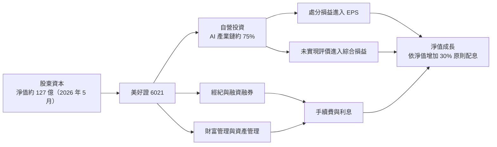
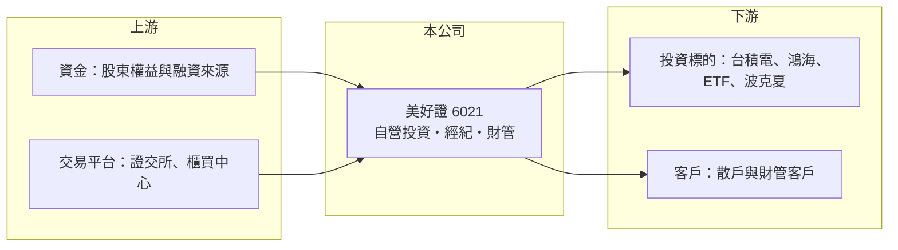

# 6021 美好證

> 上櫃｜[[產業索引-金融保險業|金融保險業]]｜上市（櫃）日期 2003/04/21

# 第一章：企業模式與商業藍圖

> [!info] 撰寫說明
> 本文由 Claude 依公開資料整理，架構比照 [[2330台積電]] 的四章研究，資料截至 2026-10-08。財務數字來源：Goodinfo 年度經營績效頁、富果研究（美好證 2026 年 6 月法說會整理）、櫃買中心開放資料（基本資料、每月營收、本益比）；公開資料有限，業務占比多為定性描述，產業描述為整理性內容，尚未逐條比對原始文件。#待校對

在評估單一個股的長期投資價值時，首要步驟是拆解企業的底層獲利邏輯。本章說明美好證券（股票代號：6021，以下簡稱美好證）這家小型券商，為何獲利主要不是來自經紀手續費，而是來自公司自有資金的長期投資。

## 一、核心定位：以自有資金投資為主軸的小型券商

美好證成立於 1988 年 7 月，2003 年 4 月在櫃買中心掛牌，2026 年實收資本額約 31.2 億元，董事長為黃谷涵、總經理為莊達修。依 2026 年股東會相關報導，現任經營團隊入主約七年，期間淨值成長 133%（報導標題數字，入主年份與前身名稱以公司年報為準）。#待校對

一般券商的核心是[[經紀業務]]，也就是替投資人下單收手續費，獲利跟著成交量起伏。美好證的經紀規模很小，真正決定損益的是[[自營業務]]：公司把大部分淨值投入股票與 ETF 的長期部位，並且把投資當作主業經營。這讓美好證更像一家「掛著券商牌照的投資公司」，股東實際上是在跟著經營團隊的選股眼光走。

* **集中投資：** 依 2026 年法說會整理，約 75% 的投資資金配置在 AI 產業鏈，主要持股包括 [[2330台積電]]、[[2317鴻海]]、0050、0051 與波克夏（Berkshire Hathaway）。2026 年第一季投資部位市值約 110 億元。
* **不平滑盈餘：** 管理層明言不採用平滑 EPS 的做法，內部期望長期年化報酬率約 15%。這代表損益會隨持股市值大幅波動，投資人應以「淨值成長」而不是「單年 EPS」評價這家公司。

## 二、業務板塊：投資、經紀與資產管理

* **自營投資：** 是最主要的獲利來源。部分持股列為透過其他綜合損益按公允價值衡量的金融資產，股價上漲時先反映在綜合損益與淨值，處分時才進入損益表，因此 EPS 和綜合損益常常相差很大。2025 年稅後淨利 11.58 億元，綜合損益卻達 20.25 億元。
* **經紀與[[融資融券]]：** 規模小，公司計畫以較低槓桿擴大融資業務，並把營業員團隊從約 120 人擴增至 200 至 300 人，目的是讓經紀收入成為投資以外的穩定現金來源。
* **財富管理與資產管理：** 2026 年第一季財管資產規模約 172.5 億元。公司把自己定位成「財管、資管的投資銀行」，希望把選股能力延伸成對外服務。

## 三、長期方向

美好證提出投資、產品、顧問、科技四大面向的發展框架，核心邏輯是先用自有資金證明投資能力，再把這套能力變成財富管理與資產管理的收入。這條路若走得通，獲利來源會從單一的投資部位，逐步分散到手續費型收入；走不通的話，公司仍是一家高度集中於科技股的投資公司，長期報酬取決於 AI 產業鏈的景氣。

# 第二章：護城河深度與競爭優勢

在長期價值投資中，「護城河」指企業抵禦競爭、維持超額利潤的保護機制。美好證的優勢不在規模，而在經營者的投資紀律，本章分析這種護城河的性質與限制。

## 一、護城河的組成

* **經營者的資本配置能力：** 美好證的核心資產是經營團隊的選股與部位管理。2024 至 2025 年 ROE 從 6.28% 升到 12.8%，主要來自集中持有 AI 供應鏈龍頭的報酬。這種優勢可以很強，但高度依賴少數決策者，屬於「人」的護城河，而不是制度或規模的護城河。
* **小資本的靈活度：** 股本約 31 億元，部位調整不受大型券商的組織層級牽制，可以把淨值集中在少數看好的標的。這是大型綜合券商做不到的，也是美好證在多頭時報酬率能超越同業的原因。
* **券商牌照：** 證券商執照讓公司可以兼營經紀、融資與財管，這是一般投資公司沒有的業務延伸空間。

## 二、競爭對手格局

| 類型 | 代表 | 與美好證的關係 |
|---|---|---|
| 金控旗下大型券商 | [[2885元大金]]（元大證券）、[[2883凱基金]]（凱基證券） | 在經紀、承銷與財管全面領先，美好證不在同一個規模競爭 |
| 獨立綜合券商 | [[6005群益證]]、[[2855統一證]] | 經紀與自營兼具，獲利來源較分散 |
| 小型券商 | [[6015宏遠證]]、[[6016康和證]]、[[6020大展證]] | 同樣規模小，但多數以經紀為主，美好證以投資為主 |

## 三、守得住與守不住的地方

* **守得住：** 只要經營團隊維持紀律，集中投資在競爭力強的龍頭企業，長期淨值成長率可以高於一般券商。公司把配息與「淨值增加的 30%」掛鉤，也讓股東能分享投資成果。
* **守不住：** 經紀與財管規模太小，手續費收入無法抵銷投資虧損的年份；一旦 AI 產業鏈修正，美好證沒有其他業務能緩衝。
* **觀察重點：** 財管與資管規模能否持續擴大、營業員擴編是否帶來經紀收入成長，以及投資組合的集中度是否下降。

# 第三章：財務體質與盈利規模

資料日期：2026-10-08。數字取自 Goodinfo 年度經營績效頁、富果研究法說會整理與櫃買中心開放資料，表格是撰寫當時的快照；最新月營收、累計 EPS 由自動排程寫在本筆記的屬性欄位（月營收、累計EPS 等）。#待校對

財務報表是檢驗護城河是否真實存在的最終標準。證券業不適用一般產業的毛利率分析，本章改用營收、稅後淨利、[[ROE]] 與 ROA 檢視美好證的獲利品質。

## 一、多年度獲利

| 年度 | 營收（新台幣） | 稅後淨利 | EPS（元） | [[ROE]] | ROA |
|---|---|---|---|---|---|
| 2020 | 7.3 億 | 1.06 億 | 0.34 | 2.2% | 1.01% |
| 2021 | 13.1 億 | 3.21 億 | 1.05 | 6.08% | 2.13% |
| 2022 | 8.69 億 | 0.52 億 | 0.17 | 1.03% | 0.37% |
| 2023 | 10.2 億 | 1.06 億 | 0.35 | 2.06% | 0.78% |
| 2024 | 16 億 | 4.41 億 | 1.44 | 6.28% | 2.28% |
| 2025 | 21.7 億 | 11.6 億 | 3.76 | 12.8% | 4.13% |

註：證券業沒有[[毛利率]]與[[營業利益率]]的意義，表中改列 ROA。2026 年 1 至 5 月自結營收 27.57 億元、稅後淨利 21.1 億元、EPS 6.9 元，綜合損益 36 億元（富果整理）；櫃買中心資料顯示 2026 年 1 至 8 月累計營收 32.4 億元，年增約 238%。

* **營收規模：** 2020 至 2025 年營收從 7.3 億元增至 21.7 億元，年複合成長率約 24%（推算），但成長主要來自投資處分與股利收入，不是經紀規模擴大。
* **獲利波動：** 2022 年 EPS 只有 0.17 元，2025 年升到 3.76 元，2026 年前五個月就超過 2025 年全年。這是投資型券商的典型樣貌：多頭年份獲利倍增，空頭年份可能接近零。
* **淨值成長：** 2025 年底每股淨值 31.7 元，2026 年 5 月底升至 41.3 元，股東權益約 127.5 億元。2025 年以綜合損益計算的 ROE 達 22.4%（公司數字），明顯高於只用稅後淨利計算的 12.8%。評估美好證時，綜合損益與淨值變化比 EPS 更有參考價值。

## 二、長期指標

* **平均 ROE：** 2021 至 2025 年平均 ROE 約 5.7%（推算），其中 2025 年一年就貢獻了大部分；2024 年以前的 ROE 長期偏低。
* **股利：** 公司以「淨值增加的 30%」作為配息原則，並表示 2026 年 10 月可能進行第二次配息，需董事會決議。櫃買中心資料顯示近一期每股股利約 2.0 元。配息金額會隨淨值變化大幅波動，不適合當作穩定收息股看待。
* **自由現金流：** 券商的現金流受客戶款項與投資部位進出影響，傳統的自由現金流概念不適用，未查得可比較的數字。

## 三、ROE 與權益資金成本：價值創造利差

**為什麼不用 ROIC：** [[ROIC]] 以有息負債加股東權益為投入資本、以 [[WACC]] 為門檻。券商的融資資金與客戶款項屬於營業本身，負債無法和營運分開，因此和 [[6005群益證]] 相同，直接比較 ROE 與權益資金成本。

**權益資金成本推算：** 以 [[CAPM]] 估算，假設台灣 10 年期公債殖利率 1.75%、市場風險溢酬 6%。美好證集中持有科技股，β 取 1.2（依持股集中於科技股推估，非來源數字），權益成本約 1.75% ＋ 1.2 × 6% ＝ 8.95%（推算）。

**比較：** 2021 至 2024 年 ROE 介於 1% 至 6.3%，都低於權益成本；2025 年 ROE 12.8%（綜合損益口徑 22.4%）才明顯超過。結論是，美好證過去多數年份並未創造超額報酬，近兩年的價值創造來自 AI 多頭與集中持股。長期能否維持在權益成本之上，取決於經營團隊能否在空頭年份控制回檔。櫃買中心資料顯示其股價淨值比約 1.03 倍，市場大致以淨值評價這家公司。

# 第四章：總體風險與地緣政治

任何企業都無法脫離宏觀環境獨立存在。美好證的風險集中在投資部位，本章依市場、經營與法規三個面向說明。

## 一、市場與集中度風險

* **產業集中：** 約 75% 投資資金押在 AI 產業鏈，若 AI 資本支出循環反轉，淨值可能在短時間內大幅縮水。這是美好證最大的單一風險，也是投資人必須先接受的前提。
* **台股地緣溢價：** 主要持股都是台灣科技股，兩岸情勢升溫時，持股與台股成交量會同時下跌，經紀與投資兩邊都受衝擊。
* **匯率：** 持有波克夏等海外部位，新台幣升值時會產生匯兌損失。

## 二、經營風險

* **關鍵人物風險：** 投資決策高度集中在經營者，人事變動或判斷失誤都會直接反映在淨值上。
* **擴張執行：** 營業員擴編與財管業務需要時間與成本，若收入成長跟不上費用，會拉低本業獲利。
* **會計口徑：** 大部分評價利益放在其他綜合損益，EPS 與淨值變化可能長期背離，投資人若只看 EPS，容易誤判公司表現。

## 三、法規風險

* **資本適足：** 法說會提到曾為降低風險係數而減碼個股，代表持股集中會占用[[資本適足率]]的空間，法規對自營部位的風險計算若趨嚴，投資規模會受限。
* **券商監理：** 證券商自營業務受部位限額與風險管理規範約束，法規調整可能影響公司「以投資為主業」的模式。

# 專有名詞解析

## 金融

- **[[經紀業務]]**：券商替投資人買賣股票並收取手續費的業務，收入與市場成交量高度相關。
- **[[自營業務]]**：券商以自有資金投資股票、債券與衍生性商品，獲利隨市場波動。
- **[[融資融券]]**：券商借錢給投資人買股票（融資）或借股票給投資人賣出（融券），券商可賺取利息與費用。
- **[[資本適足率]]**：證券商的合格自有資本除以經營風險約當金額的比率，法規設有下限，用來限制券商承擔的風險。
- **[[CAPM]]**：資本資產定價模型，以無風險利率加上 β 乘以市場風險溢酬，推估股東要求的報酬率。
- **[[ROIC]]**：投入資本報酬率，稅後營業利益除以股東權益加有息負債，衡量本業運用資本的效率；不適用於金融業。

# 核心供應鏈

## 1. 上游：資金與交易基礎設施
- 證券交易所、櫃買中心、集保結算所（非上市公司）
- 往來銀行與融資資金來源

## 2. 本公司與同業
- 小型券商同業：[[6015宏遠證]]、[[6016康和證]]、[[6020大展證]]、[[6026福邦證]]
- 綜合券商：[[6005群益證]]、[[2855統一證]]、[[2885元大金]]（元大證券）

## 3. 下游：投資標的與客戶
- 主要持股：[[2330台積電]]、[[2317鴻海]]、0050、0051、波克夏
- 經紀與財富管理客戶

## 最新新聞
<!-- news:start（自動產生，請勿手動編輯此範圍） -->
- 2026-10-08 🏛️ 重訊 15:05｜公告本公司115年09月份合併自結損益｜[觀測站](https://mops.twse.com.tw/mops/#/web/t05st01)

完整紀錄：[[6021美好證 新聞]]
<!-- news:end -->

## 相關連結
- [公開資訊觀測站](https://mopsov.twse.com.tw/mops/web/t05st03?step=1&firstin=1&co_id=6021)
- [Goodinfo](https://goodinfo.tw/tw/StockDetail.asp?STOCK_ID=6021)
- [Yahoo 股市](https://tw.stock.yahoo.com/quote/6021)
- [鉅亨網新聞](https://www.cnyes.com/twstock/6021/news)
