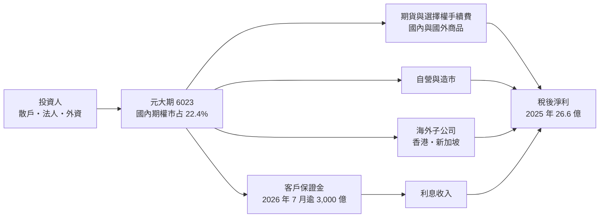
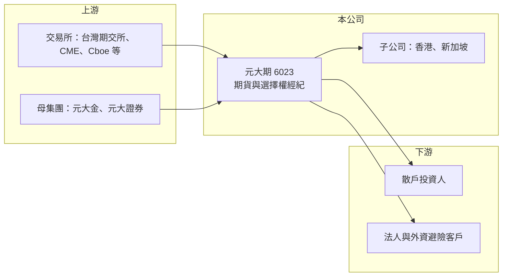

# 6023 元大期

> 上櫃｜[[產業索引-金融保險業|金融保險業]]｜上市（櫃）日期 2007/11/28

# 第一章：企業模式與商業藍圖

> [!info] 撰寫說明
> 本文由 Claude 依公開資料整理，架構比照 [[2330台積電]] 的四章研究，資料截至 2026-10-08。財務數字來源：Goodinfo 年度經營績效頁、富果研究（元大期 2026 年 9 月法說會整理）、櫃買中心開放資料（基本資料、每月營收、本益比）；產業描述為整理性內容，尚未逐條比對原始文件。#待校對

在評估單一個股的長期投資價值時，首要步驟是拆解企業的底層獲利邏輯。本章說明元大期貨（股票代號：6023，以下簡稱元大期）作為台灣最大的期貨商，如何同時靠交易手續費與龐大的客戶保證金賺錢。

## 一、核心定位：台灣期貨業龍頭

元大期成立於 1997 年 4 月，2007 年 11 月在櫃買中心掛牌，母公司體系為 [[2885元大金]]（透過元大證券持股，持股比例未查得）。2026 年董事長為林添富、總經理為高毅瑞。依 2026 年法說會整理，元大期上半年國內期貨與選擇權市占率 22.4%、國外期權市占率 23.1%、個股期貨市占率 31.2%，經紀手續費收入占全體專營[[期貨經紀商]]的 26.2%，是名副其實的龍頭。

期貨商的生意可以拆成兩塊：

* **手續費：** 投資人每交易一口期貨或選擇權，期貨商收取手續費。收入與市場波動和交易量連動，台股大漲大跌時交易最熱絡。
* **保證金利息：** 期貨交易需要先存入[[客戶保證金]]，這筆錢存放在期貨商的專戶，產生的利息是期貨商另一個主要收入。2026 年 7 月元大期的客戶保證金突破 3,000 億元，保證金市占率 28.6%。利率越高、保證金越多，這部分收入越大。

## 二、業務板塊

* **國內期權經紀：** 台指期、台指選擇權與個股期貨是最核心的商品，元大期憑藉元大證券的龐大客戶基礎與分公司網路取得高市占。
* **國外期權經紀：** 台灣投資人交易美股指數、商品與匯率期貨的需求逐年增加，國外期貨手續費較高，是公司明確要搶的高毛利市場。依法說會，元大期獨家上架 Cboe 美股選擇權。
* **海外據點：** 香港子公司負責串聯區域市場，新加坡子公司於 2025 年開業，作為拓展東南亞的基地。
* **自營與其他：** 包括期貨自營、造市與顧問業務，規模相對小（占比未查得）。

## 三、長期方向

公司以「穩固核心業務、擴張成長業務、拓展新興業務」為三大主軸，目標是成為亞洲區的領導期貨商。資訊系統是期貨商的核心生產設備，2026 年資訊資本支出擴大至 3.7 億元。為了支應保證金規模成長對淨資本的需求，2026 年辦理現金增資約 58.8 億元，實收資本額由 36.8 億元增至 44.8 億元（法說會整理），這是近年改變公司資本結構最重要的一件事。

# 第二章：護城河深度與競爭優勢

在長期價值投資中，「護城河」指企業抵禦競爭、維持超額利潤的保護機制。本章分析元大期的龍頭地位從何而來，以及這個地位能守住多少。

## 一、護城河的組成

* **集團通路：** 元大證券是台灣經紀市占最大的券商，期貨客戶多數由證券客戶延伸而來。這種交叉銷售讓元大期取得客戶的成本遠低於獨立期貨商，是市占能長期維持在兩成以上的根本原因。
* **保證金規模的規模經濟：** 保證金越多，利息收入越多，而系統與人力成本相對固定。保證金市占率 28.6% 高於交易量市占率，代表元大期吸引到的是資金較大的客戶，利息收入的穩定度也較高。
* **商品與系統：** 期貨交易高度依賴下單速度與系統穩定性，元大期每年投入資訊支出，並率先上架海外商品。客戶一旦習慣某家期貨商的平台與帳戶設定，轉換意願通常不高。

## 二、競爭對手格局

| 對手 | 定位 | 對元大期的影響 |
|---|---|---|
| [[6024群益期]] | 母公司為 [[6005群益證]]，2025 年市占排名第三並上升 | 選擇權市占成長快，是最直接的競爭者 |
| 凱基期貨、富邦期貨、統一期貨等 | 金控或券商體系期貨商 | 依附母集團通路搶客 |
| 券商兼營期貨 | 綜合券商的期貨部門 | 以證券客戶就近轉介 |

## 三、守得住與守不住的地方

* **守得住：** 國內期權與保證金的市占，依靠的是元大集團的客戶基礎，短期內不易被撼動。
* **守不住：** 手續費率的價格競爭。期貨手續費本來就低，網路下單普及後，同業常以折扣搶大戶，單位收入長期有下滑壓力。
* **觀察重點：** 國外期權占比能否提高、新加坡與香港子公司能否獲利，以及增資後 ROE 能否回到 14% 以上。

# 第三章：財務體質與盈利規模

資料日期：2026-10-08。數字取自 Goodinfo 年度經營績效頁、富果研究法說會整理與櫃買中心開放資料，表格是撰寫當時的快照；最新月營收、累計 EPS 由自動排程寫在本筆記的屬性欄位（月營收、累計EPS 等）。#待校對

財務報表是檢驗護城河是否真實存在的最終標準。期貨業不適用毛利率分析，本章改用營收、稅後淨利、[[ROE]] 與 ROA 檢視元大期的獲利品質。

## 一、多年度獲利

| 年度 | 營收（新台幣） | 稅後淨利 | EPS（元） | [[ROE]] | ROA |
|---|---|---|---|---|---|
| 2019 | 29.2 億 | 11.4 億 | 4.89 | 13.3% | 1.54% |
| 2020 | 38.4 億 | 10.7 億 | 4.23 | 10.3% | 1.25% |
| 2021 | 38.9 億 | 8.6 億 | 2.97 | 7.11% | 0.88% |
| 2022 | 40.0 億 | 11.5 億 | 3.95 | 9.08% | 1.09% |
| 2023 | 34.7 億 | 18.5 億 | 6.39 | 13.5% | 1.65% |
| 2024 | 40.2 億 | 21.7 億 | 7.47 | 14.2% | 1.57% |
| 2025 | 36.6 億 | 26.6 億 | 8.45 | 15.0% | 1.52% |

註：期貨業沒有[[毛利率]]與[[營業利益率]]的意義，表中改列 ROA。2026 年上半年稅後淨利 15.44 億元、EPS 4.19 元，半年 ROE 7.83%（富果整理）；櫃買中心資料顯示 2026 年 1 至 8 月累計營收 33.4 億元，年增約 42%。

* **營收持平、淨利倍增：** 2020 至 2025 年營收大致在 35 億至 40 億元之間，稅後淨利卻從 10.7 億元增至 26.6 億元。主要原因推估是利率上升後，客戶保證金的利息收入大幅增加（利息收入在報表上的分類未查得），說明保證金規模是元大期近年獲利成長的真正引擎。
* **低 ROA 高 ROE：** ROA 只有 1.5% 左右，因為帳上資產大部分是客戶保證金；ROE 卻能維持 13% 至 15%，這是期貨商的典型結構。
* **股本擴大：** 2026 年增資後股本增加約 22%，2026 年 EPS 會被稀釋，ROE 也會因淨值擴大而短期下降。

## 二、長期指標

* **平均 ROE：** 2021 至 2025 年平均約 11.8%（推算），並呈逐年上升趨勢。
* **股利：** 櫃買中心資料顯示近一期每股股利 5.5 元，殖利率約 6.5%。以 2025 年 EPS 8.45 元計算，[[配息率]]約 65%（推算）。
* **自由現金流：** 期貨商的現金流受客戶保證金進出影響，傳統自由現金流概念不適用。

## 三、ROE 與權益資金成本：價值創造利差

**為什麼不用 ROIC：** 期貨商的負債主要是客戶保證金，屬於營業本身，無法區分有息負債與營運負債，因此不適用 [[ROIC]] 與 [[WACC]]，改比較 ROE 與權益資金成本。

**權益資金成本推算：** 以 [[CAPM]] 估算，假設台灣 10 年期公債殖利率 1.75%、市場風險溢酬 6%，期貨商收入與市場波動連動但有保證金利息支撐，β 取 1.0（同業常見值，非來源數字），權益成本約 7.75%（推算）；β 若為 0.9 至 1.1，權益成本約 7.15% 至 8.35%。

**比較：** 2023 至 2025 年 ROE 13.5% 至 15%，高於權益成本約 6 至 7 個百分點；2021 年 ROE 7.11% 則略低於權益成本。整體而言，元大期在多數年份為股東創造超額報酬，屬於穩定的價值創造者。增資後能否把新增資本轉化為同等報酬，是未來幾年的檢驗重點。

# 第四章：總體風險與地緣政治

任何企業都無法脫離宏觀環境獨立存在。本章分析元大期必須面對的市場、利率與法規風險。

## 一、市場與利率風險

* **交易量週期：** 期貨交易量在市場劇烈波動時最大，盤整期則明顯萎縮。手續費收入因此具有週期性，但與現貨市場的多空方向不完全同步。
* **利率下行：** 保證金利息是近年獲利成長的主因，若央行降息，利息收入會直接下降，獲利可能回到 2020 至 2022 年的水準。
* **極端行情：** 市場急跌時客戶可能發生超額損失，期貨商需先代墊，再向客戶追討，形成信用風險。

## 二、營運風險

* **手續費競爭：** 同業以折扣搶客，單位手續費長期下滑。
* **淨資本壓力：** 保證金規模越大，風險調整後淨資本要求越高。2026 年以次順位債與現金增資因應，代表成長需要持續的資本投入。
* **海外擴張：** 新加坡與香港子公司面對國際大型期貨商競爭，能否獲利仍待觀察。

## 三、法規與地緣政治

* **監理規範：** 保證金比例、槓桿限制與商品上架規範由主管機關決定，政策變動會直接影響交易量。
* **兩岸風險：** 台股期貨是外資避險工具，地緣政治升溫時交易量可能先增後減，市場信心受損則長期不利。

# 專有名詞解析

## 金融

- **[[期貨經紀商]]**：接受客戶委託買賣期貨與選擇權並收取手續費的業者，客戶交易前須先存入保證金。
- **[[客戶保證金]]**：投資人交易期貨前存放在期貨商專戶的履約擔保資金，期貨商可藉此賺取利息收入。
- **[[配息率]]**：股利占每股盈餘的比例，反映公司把多少獲利分給股東。
- **[[CAPM]]**：資本資產定價模型，以無風險利率加上 β 乘以市場風險溢酬，推估股東要求的報酬率。
- **[[ROIC]]**：投入資本報酬率，稅後營業利益除以股東權益加有息負債，衡量本業運用資本的效率；不適用於金融業。
- **[[WACC]]**：加權平均資金成本，依股權與負債比重加權的資金成本，是判斷 ROIC 是否創造價值的門檻。

# 核心供應鏈

## 1. 上游：交易所與母集團
- 台灣期貨交易所、海外交易所（CME、Cboe 等）
- 母集團：[[2885元大金]]（元大證券）

## 2. 本公司與同業
- 期貨同業：[[6024群益期]]
- 券商體系：[[6005群益證]]、[[2855統一證]]、[[2883凱基金]]、[[2881富邦金]]

## 3. 下游：客戶
- 散戶期貨與選擇權交易人
- 法人、外資與避險需求客戶

## 最新新聞
<!-- news:start（自動產生，請勿手動編輯此範圍） -->
- 2026-10-08 🏛️ 重訊 13:50｜元大期貨公告115年9月份營運概況｜[觀測站](https://mops.twse.com.tw/mops/#/web/t05st01)

完整紀錄：[[6023元大期 新聞]]
<!-- news:end -->

## 相關連結
- [公開資訊觀測站](https://mopsov.twse.com.tw/mops/web/t05st03?step=1&firstin=1&co_id=6023)
- [Goodinfo](https://goodinfo.tw/tw/StockDetail.asp?STOCK_ID=6023)
- [Yahoo 股市](https://tw.stock.yahoo.com/quote/6023)
- [鉅亨網新聞](https://www.cnyes.com/twstock/6023/news)
