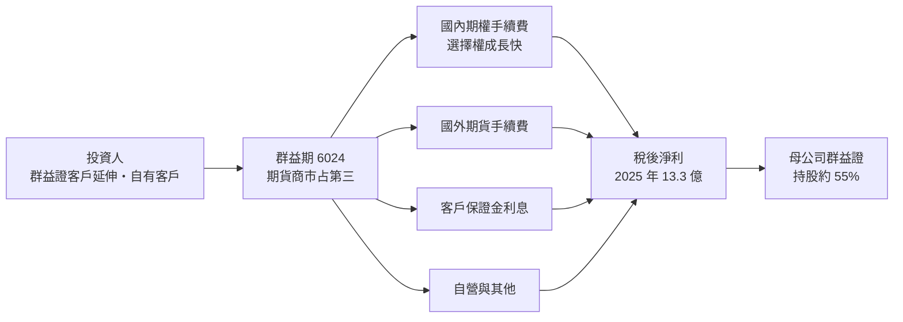
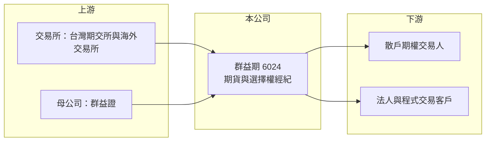

# 6024 群益期

> 上市｜[[產業索引-金融保險業|金融保險業]]｜上市（櫃）日期 2017/10/16

# 第一章：企業模式與商業藍圖

> [!info] 撰寫說明
> 本文由 Claude 依公開資料整理，架構比照 [[2330台積電]] 的四章研究，資料截至 2026-10-08。財務數字來源：Goodinfo 年度經營績效頁、工商時報（2026 年 1 月期貨商市占排行報導）、理財周刊（群益證持股整理，引用自本庫 [[6005群益證]] 筆記）、證交所開放資料（基本資料、股利、每月營收、本益比）；公開資料有限，業務占比未查得，產業描述為整理性內容，尚未逐條比對原始文件。#待校對

在評估單一個股的長期投資價值時，首要步驟是拆解企業的底層獲利邏輯。本章說明群益期貨（股票代號：6024，以下簡稱群益期）作為群益集團的期貨子公司，如何以選擇權交易與客戶保證金建立穩定的獲利模式。

## 一、核心定位：券商集團旗下的大型期貨商

群益期成立於 1997 年 2 月，證交所資料的上市日期為 2017 年 10 月，2026 年實收資本額約 26.7 億元，董事長為賈中道、總經理為毛振華。母公司 [[6005群益證]] 持股約 55.46%，群益期的獲利會併入群益證的合併報表，2025 年群益期稅後淨利 13.3 億元，是群益證本業以外最重要的獲利來源之一。

依工商時報 2026 年 1 月的期貨商市占排行，群益期在前 15 大期貨經紀商中排名第三，並且是 2025 年市占率上升的業者之一，成長主要來自選擇權。

[[期貨經紀商]]有兩個主要收入來源：

* **手續費：** 投資人交易期貨與選擇權時收取的費用，與市場波動和交易量連動。
* **保證金利息：** 客戶交易前存入的[[客戶保證金]]放在期貨商專戶產生利息。利率越高，這部分收入越多。

## 二、業務板塊

* **國內期權經紀：** 台指期與台指選擇權是主力，群益期近年在選擇權的市占成長明顯，帶動整體排名。
* **國外期貨經紀：** 提供海外指數、商品與匯率期貨交易，手續費率高於國內商品（占比未查得）。
* **保證金利息與自營：** 利率走高時利息收入增加，自營規模相對小。各業務的收入占比未查得。

## 三、長期方向

群益期的長期成長取決於三件事：台灣期權交易人口是否持續擴大、能否從母公司群益證的證券客戶中轉化更多期貨客戶，以及海外商品與電子下單平台的競爭力。由於母公司是獨立券商而非金控，群益集團的資源配置相對集中，期貨業務在集團中的地位重要，不易被邊緣化。

# 第二章：護城河深度與競爭優勢

在長期價值投資中，「護城河」指企業抵禦競爭、維持超額利潤的保護機制。本章分析群益期在龍頭元大期之後，如何維持第二梯隊的領先位置。

## 一、護城河的組成

* **母集團通路：** 群益證在全台有 50 多家分公司，證券客戶就近轉介成為期貨客戶，獲客成本低。這和 [[6023元大期]] 依附元大證券的模式相同，只是規模較小。
* **交易平台：** 期貨交易人重視下單速度與系統穩定，群益集團長期經營電子下單平台，在積極的散戶與程式交易族群中有一定口碑（推估）。
* **規模經濟：** 期貨商的系統與人事成本相對固定，交易量與保證金越多，利潤率越高。群益期 2024 年 ROE 16% 高於元大期的 14.2%，顯示中型規模下仍能維持很好的資本效率。

## 二、競爭對手格局

| 對手 | 定位 | 對群益期的影響 |
|---|---|---|
| [[6023元大期]] | 國內期權市占約 22%，保證金市占約 29% | 龍頭，規模與通路都領先 |
| 凱基期貨、富邦期貨、統一期貨等 | 金控或券商體系期貨商 | 依附母集團通路，在中段排名競爭 |
| 網路折扣期貨商 | 以低手續費吸引大戶與程式交易者 | 壓縮手續費率 |

## 三、守得住與守不住的地方

* **守得住：** 選擇權交易人與群益證既有客戶的黏著度，以及在排名第三附近的市場地位。
* **守不住：** 手續費率的價格戰。期貨大戶對手續費非常敏感，同業折扣會持續壓縮單位收入。
* **觀察重點：** 選擇權市占能否持續上升、保證金規模是否隨台股交易人口成長，以及 2026 年營收下滑後的獲利韌性。

# 第三章：財務體質與盈利規模

資料日期：2026-10-08。數字取自 Goodinfo 年度經營績效頁與證交所開放資料，表格是撰寫當時的快照；最新月營收、累計 EPS 由自動排程寫在本筆記的屬性欄位（月營收、累計EPS 等）。#待校對

財務報表是檢驗護城河是否真實存在的最終標準。期貨業不適用毛利率分析，本章改用營收、稅後淨利、[[ROE]] 與 ROA 檢視群益期的獲利品質。

## 一、多年度獲利

| 年度 | 營收（新台幣） | 稅後淨利 | EPS（元） | [[ROE]] | ROA |
|---|---|---|---|---|---|
| 2019 | 19.2 億 | 6.0 億 | 3.40 | 11.9% | 1.47% |
| 2020 | 24.3 億 | 6.22 億 | 3.07 | 10.9% | 1.42% |
| 2021 | 24.4 億 | 4.9 億 | 2.33 | 7.73% | 1.05% |
| 2022 | 27.8 億 | 7.82 億 | 3.72 | 12.0% | 1.62% |
| 2023 | 22.1 億 | 10.1 億 | 4.80 | 14.5% | 2.03% |
| 2024 | 26.4 億 | 11.9 億 | 5.66 | 16.0% | 2.14% |
| 2025 | 29 億 | 13.3 億 | 5.48 | 14.6% | 1.96% |

註：期貨業沒有[[毛利率]]與[[營業利益率]]的意義，表中改列 ROA。證交所資料顯示 2025 年本期淨利 13.31 億元；2026 年 1 至 8 月累計營收 17.5 億元，年減約 13%。

* **獲利穩定成長：** 2021 年以後稅後淨利從 4.9 億元連續成長到 13.3 億元，2023 年營收下降但淨利反而增加，推估與利率上升後的保證金利息收入有關（收入明細未查得）。
* **EPS 被股票股利稀釋：** 2025 年淨利成長但 EPS 從 5.66 元降到 5.48 元，原因是公司長期搭配發放[[股票股利]]，股本逐年擴大。
* **營收年複合成長率：** 2020 至 2025 年約 3.6%（推算），淨利年複合成長率約 16%（推算），淨利成長明顯快於營收。

## 二、長期指標

* **平均 ROE：** 2021 至 2025 年平均約 13%（推算），在台灣金融業中屬於前段。
* **股利：** 2025 年度配發現金股利 2.8 元與股票股利 0.67 元，現金[[配息率]]約 51%、含股票約 63%（推算，以 EPS 5.48 元計）。公司章程規定現金股利不低於股利總額的 10%，並須提列 20% 特別盈餘公積，這是期貨業特有的規定，使實際可分配比率低於一般企業。
* **自由現金流：** 期貨商的現金流受客戶保證金進出影響，傳統自由現金流概念不適用。

## 三、ROE 與權益資金成本：價值創造利差

**為什麼不用 ROIC：** 期貨商的負債主要是客戶保證金，屬於營業本身，無法區分有息負債與營運負債，因此不適用 [[ROIC]] 與 [[WACC]]，改比較 ROE 與權益資金成本。

**權益資金成本推算：** 以 [[CAPM]] 估算，假設台灣 10 年期公債殖利率 1.75%、市場風險溢酬 6%，β 取 1.0（同業常見值，非來源數字），權益成本約 7.75%（推算）；β 若為 0.9 至 1.1，權益成本約 7.15% 至 8.35%。

**比較：** 2022 至 2025 年 ROE 12% 至 16%，高於權益成本約 4 至 8 個百分點；只有 2021 年 7.73% 與權益成本大致持平。群益期在完整週期中持續創造超額報酬。證交所資料顯示其股價淨值比約 1.38 倍、殖利率約 5.8%，市場給予的溢價並不高。

# 第四章：總體風險與地緣政治

任何企業都無法脫離宏觀環境獨立存在。本章分析群益期必須面對的市場、利率與法規風險。

## 一、市場與利率風險

* **交易量週期：** 期貨與選擇權交易在市場劇烈波動時最熱絡，盤整期萎縮。2026 年 1 至 8 月營收年減約 13%，說明即使台股熱絡，期貨交易量也不一定同步成長。
* **利率下行：** 保證金利息收入對近年獲利貢獻大，降息會直接壓縮獲利。
* **客戶違約：** 極端行情下客戶保證金不足，期貨商需先承擔損失再追討。

## 二、營運風險

* **手續費競爭：** 大戶與程式交易者對費率敏感，同業折扣持續存在。
* **股本膨脹：** 持續發放股票股利使股本擴大，若獲利成長放緩，EPS 會被稀釋。
* **母公司策略：** 群益期的經營方向受群益證影響，母公司若調整集團資源配置，群益期的發展空間會跟著改變。

## 三、法規風險

* **監理規範：** 保證金比例、槓桿限制、新商品上架都由主管機關決定。
* **特別盈餘公積：** 期貨商須提列特別盈餘公積，限制了可分配盈餘的比例。

# 專有名詞解析

## 金融

- **[[期貨經紀商]]**：接受客戶委託買賣期貨與選擇權並收取手續費的業者，客戶交易前須先存入保證金。
- **[[客戶保證金]]**：投資人交易期貨前存放在期貨商專戶的履約擔保資金，期貨商可藉此賺取利息收入。
- **[[股票股利]]**：公司以發放新股代替現金分配盈餘，可把資金留在公司內部，但會使股本擴大、稀釋每股盈餘。
- **[[配息率]]**：股利占每股盈餘的比例，反映公司把多少獲利分給股東。
- **[[CAPM]]**：資本資產定價模型，以無風險利率加上 β 乘以市場風險溢酬，推估股東要求的報酬率。
- **[[ROIC]]**：投入資本報酬率，稅後營業利益除以股東權益加有息負債，衡量本業運用資本的效率；不適用於金融業。

# 核心供應鏈

## 1. 上游：交易所與母公司
- 台灣期貨交易所、海外期貨交易所
- 母公司：[[6005群益證]]（持股約 55.46%）

## 2. 本公司與同業
- 期貨同業：[[6023元大期]]
- 券商體系期貨商：[[2883凱基金]]、[[2881富邦金]]、[[2855統一證]] 旗下期貨子公司

## 3. 下游：客戶
- 散戶期貨與選擇權交易人
- 法人、避險與程式交易客戶

## 最新新聞
<!-- news:start（自動產生，請勿手動編輯此範圍） -->
- 2026-10-08 🏛️ 重訊 14:03｜代子公司群益期貨(香港)有限公司公告更換會計師事務所 及簽證會計師｜[觀測站](https://mops.twse.com.tw/mops/#/web/t05st01)
- 2026-10-07 🏛️ 重訊 14:23｜公告本公司自行結算115年9月份獲利情形｜[觀測站](https://mops.twse.com.tw/mops/#/web/t05st01)

完整紀錄：[[6024群益期 新聞]]
<!-- news:end -->

## 相關連結
- [公開資訊觀測站](https://mopsov.twse.com.tw/mops/web/t05st03?step=1&firstin=1&co_id=6024)
- [Goodinfo](https://goodinfo.tw/tw/StockDetail.asp?STOCK_ID=6024)
- [Yahoo 股市](https://tw.stock.yahoo.com/quote/6024)
- [鉅亨網新聞](https://www.cnyes.com/twstock/6024/news)
