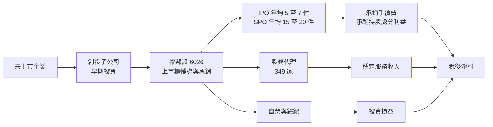
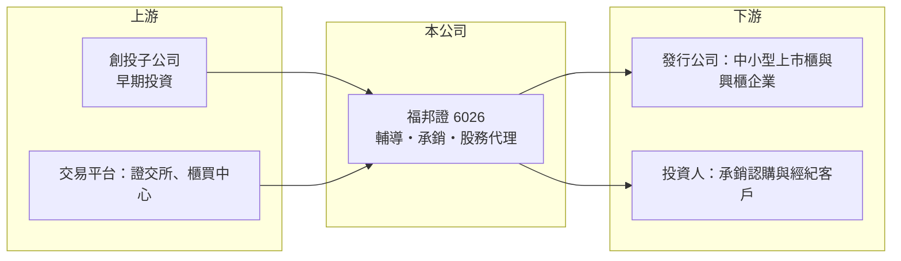

# 6026 福邦證

> 上櫃｜[[產業索引-金融保險業|金融保險業]]｜上市（櫃）日期 2016/01/27

# 第一章：企業模式與商業藍圖

> [!info] 撰寫說明
> 本文由 Claude 依公開資料整理，架構比照 [[2330台積電]] 的四章研究，資料截至 2026-10-08。財務數字來源：Goodinfo 年度經營績效頁、工商時報（福邦證 2026 年 7 月法說會報導）、經濟日報（2025 年法說會報導標題）、櫃買中心開放資料（基本資料、每月營收、本益比）；公開資料有限，業務收入占比未查得，產業描述為整理性內容，尚未逐條比對原始文件。#待校對

在評估單一個股的長期投資價值時，首要步驟是拆解企業的底層獲利邏輯。本章說明福邦證券（股票代號：6026，以下簡稱福邦證）這家小型券商，如何避開經紀業務的規模競賽，改以承銷、股務代理與創投建立特色。

## 一、核心定位：以投資銀行業務為主的小型券商

福邦證成立於 1989 年 9 月，2016 年 1 月在櫃買中心掛牌，2026 年實收資本額約 39.6 億元，董事長為黃炳鈞、總經理為陳松正。公司強調不依賴銀行借款、風控要求高，經營風格偏保守。

福邦證的商業模式和大型券商不同。大型券商靠龐大的分公司網路做[[經紀業務]]；福邦證規模小，經紀不是強項，獲利重心放在[[承銷]]：輔導中小企業上市櫃、替已上市櫃公司辦理現金增資與可轉換公司債，再搭配[[股務代理]]與創投，形成「陪企業從未上市走到上市」的完整服務鏈。

* **承銷：** 依 2026 年法說會報導，過去五年承辦的 IPO 案件全數完成，年均約 5 至 7 件；SPO（上市櫃後的現金增資等）每年約 15 至 20 件。承銷收入來自手續費，也來自承銷時認購並持有的股票。
* **股務代理：** 簽約家數 349 家，服務股東數可達 700 萬人。股務代理收入穩定，和市場多空關係較小，是福邦證的「基本盤」。
* **資產管理與創投：** 設有投顧、創投與創業投資管理顧問三家百分之百持股子公司，2026 年 6 月總資產管理部位逾 2.07 億美元（約新台幣 60 億元）。

## 二、業務板塊

* **承銷與自營的連動：** 承銷商在 IPO 時通常需要認購部分股票，新股上市後股價表現好，福邦證就能認列處分或評價利益。這讓承銷業務的獲利高度依賴 IPO 市場的熱度。
* **創投的接力：** 福邦證的創投子公司投資早期企業，等企業成熟後由福邦證輔導上市櫃，創投部位在上市後獲利了結。例如倍利生技創投基金（福邦創管顧持股 23.51%）已於 2025 年 12 月 9 日登錄[[興櫃]]；2026 年 6 月募集的福企創投基金規模 6.25 億元，預計 2027 年擴大至 12.5 億元。近年創投基金陸續到期，公司正轉向永續型基金。

## 三、長期方向

福邦證的長期價值在於「中小企業資本市場顧問」的定位。台灣每年有一批中小企業從興櫃走向上櫃、上市，這個市場由大型券商主導大案、小型券商承接中小案。福邦證以不借錢、低槓桿的方式經營，追求的是穩定配息，而非規模擴張。

# 第二章：護城河深度與競爭優勢

在長期價值投資中，「護城河」指企業抵禦競爭、維持超額利潤的保護機制。本章分析福邦證在承銷市場的利基，以及小型券商的天然限制。

## 一、護城河的組成

* **承銷專業與客戶關係：** IPO 輔導通常需要兩到三年，承銷商要陪企業整理財務、內控與法遵。一旦建立信任，企業後續的增資、可轉債與股務代理多半繼續交給同一家券商，形成長期的客戶關係。
* **股務代理的轉換成本：** 更換股務代理機構需要重新移轉股東資料與作業流程，上市櫃公司通常不會輕易更換。349 家客戶構成穩定的年費收入。
* **創投到承銷的閉環：** 早期投資讓福邦證比同業更早接觸潛力企業，取得承銷案的機會較高（推估）。

## 二、競爭對手格局

| 對手 | 定位 | 對福邦證的影響 |
|---|---|---|
| [[2885元大金]]（元大證券）、[[2883凱基金]]（凱基證券） | 承銷市占前段的大型券商 | 主導大型 IPO 與增資案 |
| [[6016康和證]]、[[6015宏遠證]]、[[6020大展證]] | 小型券商 | 在中小型承銷與經紀業務競爭 |
| [[6005群益證]]、[[2855統一證]] | 獨立綜合券商 | 承銷、股代與經紀兼具 |

## 三、守得住與守不住的地方

* **守得住：** 中小型 IPO 與股務代理的客戶關係，以及無負債經營帶來的財務穩健度。
* **守不住：** 大型承銷案與經紀市占。福邦證的資本規模限制了能承接的案件大小與承銷時能吸收的部位。
* **觀察重點：** 每年 IPO 與 SPO 件數是否維持、創投基金轉型為永續型後的獲利模式，以及承銷持股在新股表現不佳年份的損失控制。

# 第三章：財務體質與盈利規模

資料日期：2026-10-08。數字取自 Goodinfo 年度經營績效頁、工商時報法說會報導與櫃買中心開放資料，表格是撰寫當時的快照；最新月營收、累計 EPS 由自動排程寫在本筆記的屬性欄位（月營收、累計EPS 等）。#待校對

財務報表是檢驗護城河是否真實存在的最終標準。證券業不適用毛利率分析，本章改用營收、稅後淨利、[[ROE]] 與 ROA 檢視福邦證的獲利品質。

## 一、多年度獲利

| 年度 | 營收（新台幣） | 稅後淨利 | EPS（元） | [[ROE]] | ROA |
|---|---|---|---|---|---|
| 2019 | 6.32 億 | 2.44 億 | 1.00 | 7.87% | 5.19% |
| 2020 | 6.83 億 | 2.57 億 | 1.05 | 8.08% | 4.46% |
| 2021 | 23.1 億 | 14.1 億 | 5.00 | 33.8% | 14.6% |
| 2022 | 2.31 億 | -2.65 億 | -0.73 | -5.33% | -2.25% |
| 2023 | 13.7 億 | 6.26 億 | 1.61 | 12.1% | 5.37% |
| 2024 | 11.5 億 | 4.38 億 | 1.11 | 7.67% | 3.45% |
| 2025 | 11.4 億 | 6.83 億 | 1.72 | 11.5% | 5.01% |

註：證券業沒有[[毛利率]]與[[營業利益率]]的意義，表中改列 ROA。2026 年上半年 EPS 1.06 元，較去年同期成長逾 2 倍（工商時報）；櫃買中心資料顯示 2026 年 1 至 8 月累計營收 12.2 億元，年增約 170%。

* **高 ROA、低槓桿：** 福邦證 ROA 常在 3% 至 5%，遠高於一般券商的 1% 至 2%，因為公司幾乎不借錢，資產多數就是股東權益。代價是 ROE 也難以靠槓桿放大。
* **極端的年度波動：** 2021 年 IPO 熱潮帶來 ROE 33.8%，2022 年市場修正時轉為虧損，營收只剩 2.31 億元。這反映承銷持股與自營部位的評價損益，對年度獲利影響極大。
* **長期成長：** 2020 至 2025 年營收年複合成長率約 10.8%（推算），但起點與終點都受市場影響，趨勢判讀需保守。

## 二、長期指標

* **平均 ROE：** 2021 至 2025 年平均約 11.9%（推算）；若排除 2021 年的高峰，2022 至 2025 年平均約 6.5%（推算）。
* **股利：** 櫃買中心資料顯示近一期每股股利約 1.36 元，殖利率約 8.6%；董事長在 2026 年法說會表示當年獲利與配息將大幅優於前一年。以 2025 年 EPS 1.72 元計算，[[配息率]]約 79%（推算）。
* **財務結構：** 不依賴銀行借款，資本適足的空間充裕（具體比率未查得）。

## 三、ROE 與權益資金成本：價值創造利差

**為什麼不用 ROIC：** 券商的負債多屬營業本身（客戶款項、附買回等），福邦證雖然幾乎沒有銀行借款，但產業慣例仍以 ROE 與權益成本比較，不使用 [[ROIC]] 與 [[WACC]]。

**權益資金成本推算：** 以 [[CAPM]] 估算，假設台灣 10 年期公債殖利率 1.75%、市場風險溢酬 6%，β 取 1.1（證券業常見值，非來源數字），權益成本約 8.35%（推算）。

**比較：** 2023 年與 2025 年 ROE 分別為 12.1% 與 11.5%，高於權益成本約 3 至 4 個百分點；2022 年與 2024 年則低於權益成本。五年平均 ROE 約 11.9% 高於權益成本，但主要靠 2021 年拉高。結論是福邦證屬於「依賴資本市場熱度的週期性價值創造者」，IPO 市場熱絡時能大幅超越資金成本，冷清時則難以達標。櫃買中心資料顯示其股價淨值比約 1.0 倍，市場大致以淨值評價。

# 第四章：總體風險與地緣政治

任何企業都無法脫離宏觀環境獨立存在。本章分析福邦證必須面對的市場、業務與法規風險。

## 一、市場風險

* **IPO 景氣：** 承銷收入與承銷持股的評價利益都依賴新股市場熱度。台股修正時，IPO 延後、新股破發，承銷與自營會同時受損，2022 年的虧損就是例子。
* **創投部位：** 創投投資的早期企業失敗率高，基金到期時若無法順利出場，可能認列損失。
* **股市地緣溢價：** 兩岸情勢升溫時，台股資金與承銷案量都會下降。

## 二、業務風險

* **規模限制：** 小型券商難以爭取大型承銷案，案源集中在中小企業，案件品質與數量的波動較大。
* **人才：** 承銷業務仰賴少數資深承銷人員，人員流動會影響客戶關係。
* **轉型風險：** 創投基金由封閉型轉向永續型，管理模式與獲利認列時點都會改變，成效需數年才能驗證。

## 三、法規風險

* **承銷制度：** 主管機關對承銷商認購比例、價格決定方式與輔導責任的規範調整，會直接影響承銷利潤。
* **承銷商責任：** 若輔導或承銷的公司發生財報不實，承銷商可能面臨連帶責任與監理處分。

# 專有名詞解析

## 金融

- **[[經紀業務]]**：券商替投資人買賣股票並收取手續費的業務，收入與市場成交量高度相關。
- **[[承銷]]**：券商協助企業發行股票或債券並向投資人銷售，收取承銷手續費，有時須認購部分股票。
- **[[股務代理]]**：替上市櫃公司處理股東名簿、股東會、配息配股等股務作業的業務。
- **[[興櫃]]**：上市櫃前的過渡市場，企業在此交易一段時間後才能申請上櫃或上市，由推薦券商報價。
- **[[配息率]]**：股利占每股盈餘的比例，反映公司把多少獲利分給股東。
- **[[CAPM]]**：資本資產定價模型，以無風險利率加上 β 乘以市場風險溢酬，推估股東要求的報酬率。

# 核心供應鏈

## 1. 上游：資本與案源
- 子公司：福邦投顧、福邦創投、福邦創業投資管理顧問
- 創投基金：倍利生技創投、福企創投

## 2. 本公司與同業
- 小型券商：[[6016康和證]]、[[6015宏遠證]]、[[6020大展證]]、[[6021美好證]]
- 大型承銷商：[[2885元大金]]（元大證券）、[[2883凱基金]]（凱基證券）

## 3. 下游：客戶
- 準備上市櫃的中小企業、辦理增資的上市櫃公司
- 股務代理客戶 349 家

## 最新新聞
<!-- news:start -->
<!-- news:end -->

## 相關連結
- [公開資訊觀測站](https://mopsov.twse.com.tw/mops/web/t05st03?step=1&firstin=1&co_id=6026)
- [Goodinfo](https://goodinfo.tw/tw/StockDetail.asp?STOCK_ID=6026)
- [Yahoo 股市](https://tw.stock.yahoo.com/quote/6026)
- [鉅亨網新聞](https://www.cnyes.com/twstock/6026/news)
