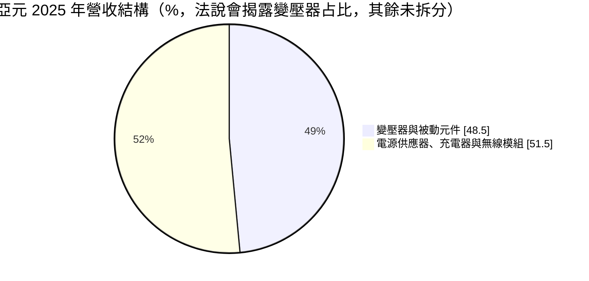
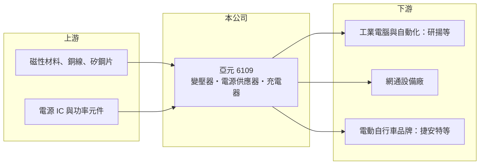

# 6109 亞元

> 上櫃｜[[產業索引-通信網路業|通信網路業]]｜上市（櫃）日期 2001/07/26

# 第一章：企業模式與商業藍圖

> [!info] 撰寫說明
> 精簡版，由 Claude 依公開資料整理，架構比照 [[2330台積電]] 的四章研究，資料截至 2026-10-08。來源：富果研究（亞元 2025 年 10 月法說會整理）、Goodinfo 年度經營績效、櫃買中心開放資料（基本資料、綜合損益、資產負債、每月營收、本益比）。產業描述為整理性內容，尚未逐條比對原始文件。#待校對

本章說明亞元科技（股票代號：6109，以下簡稱亞元）的商業模式：一家以變壓器、電源供應器與電池充電器為主的電源零組件廠，大股東為工業電腦廠研揚。

- **核心業務：** 亞元成立於 1990 年，2001 年在櫃買中心掛牌，總部設在台北研揚大樓。公司產品分為四條線：變壓器與被動元件、[[電源供應器]]、電池充電器與藍牙無線模組。依富果整理的 2025 年法說會資料，大股東 [[6579研揚]] 持股約 37%，屬泛華碩集團成員，但財務與營運獨立。這個股權背景讓亞元在工業電腦與網通電源上有天然的合作管道。
- **營收結構：** 變壓器與被動元件占營收 48.5%，應用在工業自動化 [[PLC]] 控制板、5G 終端 CPE 與伺服器電源零組件。電源供應器主要供應網通設備與工業電腦，並切入智慧建築的客製化 Open Frame 電源。充電器業務來自 2020 年併購的量子能科技（QQE），其中電動自行車約占充電器業務七成，捷安特為歐洲電動自行車市場的主要客戶之一。
- **營運據點：** 生產集中在中國，湖北宜昌生產被動元件，廣東東莞生產電源供應器與充電器。工廠都在中國，代表成本有優勢，但面對美國關稅與客戶「中國以外產地」要求時，調整彈性有限。
- **長期方向：** 公司策略是鞏固寬頻網通與工業自動化 PLC 的市占，並開發 Edge AI Box 電源、[[PoE]] 電源、Wi-Fi 放大器等利基產品，同時嘗試切入 AI 伺服器與資料中心電源市場。對一家年營收不到 10 億元的公司而言，多元化的目的是降低對單一市場（例如歐洲電動自行車）的依賴，但也意味研發資源被分散。

# 第二章：護城河深度與競爭優勢

本章評估亞元在電源零組件市場的競爭地位。從營業利益率多數年度為負來看，亞元的護城河很窄。

- **競爭優勢：** 亞元的優勢來自客製化與集團關係。變壓器與電源供應器多半需要依客戶電路板規格客製，一旦通過驗證，在產品生命週期內不易被替換；研揚集團的工業電腦客戶也提供穩定的基本訂單。電動自行車充電器則需要配合電池管理系統與歐盟安規認證，進入門檻高於一般消費電源。
- **主要對手：** 電源供應器領域的大廠包括 [[2308台達電]]、[[6282康舒]]、[[2457飛宏]]、[[6412群電]]，規模都是亞元的數十倍以上；變壓器與被動元件則面對大量中國廠商的價格競爭（對手名單為產業常識整理，待校對）。規模差距讓亞元很難在標準品上取得成本優勢，只能在小量多樣的利基市場生存。
- **觀察重點：** 第一，電動自行車市場在 2023 至 2024 年庫存調整後，需求能否回到穩定成長。第二，AI 伺服器電源零組件與 PoE 電源等新產品能否形成實質營收。第三，營業費用（2025 年第二季單季約 6,000 萬元）能否被營收規模覆蓋，讓本業轉為獲利。

# 第三章：財務體質與盈利規模

資料日期：2026-10-08。數字取自 Goodinfo 年度經營績效與櫃買中心開放資料，表格是撰寫當時的快照；最新月營收、毛利率、累計 EPS 由自動排程寫在本筆記的屬性欄位（月營收、毛利率、累計EPS 等）。#待校對

亞元的財務數字顯示營收規模小、毛利率在 15% 至 27% 之間擺盪，多數年度本業虧損。

| 年度 | 營收（新台幣） | [[毛利率]] | [[營業利益率]] | EPS（元） | [[ROE]] |
|---|---|---|---|---|---|
| 2020 | 9.62 億 | 19.9% | -1.57% | -0.15 | -1.42% |
| 2021 | 12.2 億 | 16.4% | -5.03% | -1.39 | -14.1% |
| 2022 | 13.2 億 | 24.0% | 4.62% | 1.17 | 10.2% |
| 2023 | 10.1 億 | 27.1% | 2.55% | 0.28 | 2.47% |
| 2024 | 7.17 億 | 14.8% | -16.5% | -1.65 | -15.9% |
| 2025 | 7.78 億 | 21.8% | -6.99% | -0.94 | -10.3% |
| 2026 上半年 | 4.27 億 | 21.7% | -8.2% | -0.70 | 未查得 |

註：2020 至 2025 年取自 Goodinfo 合併報表；2026 上半年取自櫃買中心開放資料（毛利率、營業利益率依開放資料推算）。

- **營收規模：** 2020 至 2025 年營收年複合成長率約 -4.2%（推算），高點是 2022 年的 13.2 億元，之後隨電動自行車與網通庫存調整下滑。2026 年 1 至 8 月累計營收 5.71 億元，較去年同期 4.76 億元成長約 20%，顯示需求已從谷底回升。
- **獲利：** 六年中只有 2022 與 2023 年本業獲利，2021 至 2025 年平均 ROE 約 -5.5%（推算）。2026 年上半年營收回升，但營業損失 0.35 億元、歸屬母公司淨損 0.54 億元，每股虧損 0.70 元，費用結構仍高於目前營收能支撐的水準。
- **財務特色：** 依櫃買中心資料，2026 年第二季底資產總計 10.96 億元、負債 3.44 億元、歸屬母公司權益 7.53 億元，每股淨值 8.57 元，保留盈餘為 -1.24 億元。實收資本額 8.78 億元。累積虧損下近年未配發股利，Goodinfo 統計的歷年平均現金股利僅 0.23 元。
- **[[ROIC]] 與 [[WACC]]：** 以 2025 年營業損失約 0.54 億元（7.78 億元 × -6.99%，虧損不計稅盾）計算，投入資本以歸屬母公司權益 7.53 億元加非流動負債 0.42 億元（代替有息負債，短期借款未查得）約 7.95 億元，ROIC 約 -6.8%（推算）；只有 2022 年營業利益約 0.61 億元時，ROIC 才約 6% 上下（推算，資本以近期數字代替）。WACC 以 CAPM 推估：無風險利率 1.75%、市場風險溢酬 6%、β 取 1.1（推估，中小型電子零組件股常見值），權益成本約 8.35%；負債比重低，WACC 約 8%（推算）。ROIC 長期低於 WACC，代表亞元目前仍在消耗股東資本，轉機取決於新產品能否把營收拉回 12 億元以上的損益兩平區間（推估）。

# 第四章：總體風險與地緣政治

本章整理亞元面對的長期風險，主要來自規模不足與終端市場集中。

- **產業週期：** 電動自行車、工業自動化與網通設備都有明顯的庫存週期。2022 年缺料期間客戶超額下單，2023 至 2024 年去化庫存時營收從 13.2 億元降到 7.17 億元，是典型的[[長鞭效應]]。
- **營運風險：** 營收規模小、產品線多，研發與管理費用相對營收偏高，營收只要下滑一成就可能由盈轉虧。充電器業務集中在歐洲電動自行車品牌，單一市場與少數客戶的需求變化會直接影響獲利。
- **其他風險：** 生產基地都在中國，美國關稅、出口管制與客戶要求產地轉移，可能增加成本或流失訂單。產品以美元、歐元計價，匯率波動影響毛利；銅、矽鋼片等原物料價格也會影響變壓器成本。累積虧損下若需籌資，可能稀釋股權。

# 專有名詞解析

## 金融

- **[[長鞭效應]]**：終端需求的小幅變動，沿供應鏈往上游傳遞時被逐級放大，造成上游庫存與訂單劇烈波動。
- **[[ROIC]]**：投入資本報酬率，稅後營業利益除以股東權益與有息負債的合計，衡量本業對所有資金提供者的報酬。
- **[[WACC]]**：加權平均資金成本，依股東權益與負債的比重加權計算的資金成本，ROIC 高於它才代表創造價值。

## 產業

- **[[電源供應器]]**：把市電轉換成電子設備所需穩定直流電的裝置，網通設備、工業電腦與伺服器都需要。
- **[[PLC]]**：可程式邏輯控制器，工廠自動化中控制機器動作的工業電腦，需要穩定的變壓器與電源零件。
- **[[PoE]]**：乙太網路供電，用同一條網路線同時傳輸資料與電力，常用於監視器、無線基地台。

# 核心供應鏈

- 上游：磁性材料、銅線與矽鋼片等原物料，電源 IC 與功率元件（供應商名稱本次未查得）。
- 下游／客戶：大股東 [[6579研揚]] 等工業電腦廠、網通設備廠、歐洲電動自行車品牌（含捷安特）；智慧電表與瓦斯表等物聯網客戶。
- 同業：[[2308台達電]]、[[6282康舒]]、[[2457飛宏]]、[[6412群電]]。

## 最新新聞
<!-- news:start -->
<!-- news:end -->

## 相關連結
- [公開資訊觀測站](https://mopsov.twse.com.tw/mops/web/t05st03?step=1&firstin=1&co_id=6109)
- [Goodinfo](https://goodinfo.tw/tw/StockDetail.asp?STOCK_ID=6109)
- [Yahoo 股市](https://tw.stock.yahoo.com/quote/6109)
- [鉅亨網新聞](https://www.cnyes.com/twstock/6109/news)
