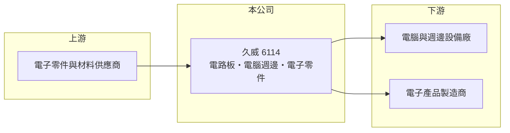

# 6114 久威

> 上櫃｜[[產業索引-電子零組件業|電子零組件業]]｜上市（櫃）日期 2001/09/27

# 第一章：企業模式與商業藍圖

> [!info] 撰寫說明
> 精簡版，由 Claude 依公開資料整理，架構比照 [[2330台積電]]，資料截至 2026-10-08。來源：櫃買中心開放資料快照（基本資料、2026 年第二季資產負債與損益、本益比殖利率）、Goodinfo 經營績效頁、nStock 公司簡介。公開資料有限，產品比重、客戶與生產據點均未查得。#待校對

久威國際（以下簡稱久威）是一家成立四十多年的電子零組件公司，營業範圍涵蓋電路板、電腦週邊與電子零件的製造與買賣。理解久威的關鍵在於：本業規模不大、利潤薄，但公司累積了相當厚的保留盈餘，獲利有很大一部分來自[[業外收入]]。

- **核心業務：** 久威成立於 1982 年，2001 年在櫃買中心掛牌，2015 年更名為「久威國際」。依公開資料，主要營業項目為 [[PCB]]、電腦週邊裝置及電子零件的製造、加工與買賣。這種同時涵蓋製造與貿易的經營方式，常見於老牌電子零件公司，營收穩定性取決於代理或供貨關係，而不是單一技術。
- **營收結構：** 產品別、地區別與客戶別比重公開資料未查得。營收從 2019 年的 21.5 億元一路降到 2025 年的 8.74 億元，2026 年 1 至 9 月累計營收約 6.42 億元、年減約 8%。營收持續縮小，代表原有產品線的需求或供貨關係正在減少。
- **營運據點：** 總部位於台北內湖，董事長與總經理均由湯慧芳擔任，生產據點未查得。公司與子公司合稱集團，但子公司名稱與業務公開資料未列出。
- **長期方向：** 公開資料未見公司說明明確的轉型或擴產計畫。從財務數字看，公司近年採取的是縮小營收規模、保留高毛利業務的路線：2024、2025 年毛利率約 14.6%，高於 2021 至 2023 年的 10% 至 12%。這個方向能否帶來成長，需要查閱年報確認。

# 第二章：護城河深度與競爭優勢

久威的護城河相當有限，比較像一家財務保守、靠累積資產與業外收益維持獲利的老牌公司。

- **競爭優勢：** 久威經營超過四十年，累積的客戶關係與供應商網絡是它持續接單的基礎。公司保留盈餘約 10 億元，是股本 4.39 億元的兩倍多，財務緩衝很厚，使它能在景氣低迷時撐住而不需要對外籌資。但這種優勢屬於財務面，而非產品或技術面的護城河。
- **主要對手：** 由於產品細項未查得，難以精確列出對手。電路板領域的台灣同業眾多，例如 [[2313華通]]、[[3037欣興]]，電腦週邊與電子零件貿易領域也有大量中小型業者。久威的規模在這些領域都偏小。
- **觀察重點：** 長期最該追蹤的是本業營業利益能否擴大，以及業外收益的來源與持續性。2025 年 EPS 2.66 元，但營業利益率只有 4.63%，換算本業貢獻遠低於稅後淨利，獲利品質較依賴業外。投資人需要了解業外收益是來自投資收益、租金或一次性處分，才能判斷獲利是否可持續。

# 第三章：財務體質與盈利規模

資料日期：2026-10-08，表格是撰寫當時的快照；最新月營收、毛利率、累計 EPS 由自動排程寫在本筆記的屬性欄位（月營收、毛利率、累計EPS 等）。#待校對

久威的財務特徵是：營收逐年縮小、本業利潤薄，但淨值厚、負債低，EPS 受業外收益影響大。

| 年度 | 營收（億元） | [[毛利率]] | [[營業利益率]] | EPS（元） | [[ROE]] |
|---|---|---|---|---|---|
| 2021 | 20.3 | 11.8% | 3.63% | 0.33 | 1.18% |
| 2022 | 16.2 | 11.6% | 1.74% | 2.64 | 9.15% |
| 2023 | 11.9 | 10.4% | 3.46% | -0.63 | -2.15% |
| 2024 | 9.16 | 14.6% | 5.93% | 2.52 | 8.35% |
| 2025 | 8.74 | 14.6% | 4.63% | 2.66 | 7.88% |

（來源：Goodinfo 經營績效頁；2019 年營收 21.5 億元、EPS 4.15 元，2020 年營收 18.4 億元、EPS 0.53 元。）

- **營收規模：** 2019 至 2025 年營收由 21.5 億元降到 8.74 億元，年複合成長率約 -14%（推算），是這段期間最明顯的趨勢。2026 年上半年營收約 4.17 億元，仍未止跌。
- **獲利：** 近五年平均 ROE 約 4.9%（推算），起伏很大。2022 年營業利益率只有 1.74%，EPS 卻有 2.64 元；2026 年上半年營業利益約 0.20 億元，業外收入卻有約 0.54 億元，稅後 EPS 1.16 元。兩個例子都顯示業外收益是獲利的主要來源（性質未查得）。
- **財務特色：** 依 2026 年第二季資料，總資產約 22.8 億元，負債僅約 6.7 億元，股東權益約 16.1 億元，負債比約 29%，每股淨值 36.62 元。2024 與 2025 年度現金股利各為每股 0.5 元，相對 EPS 約 2.5 元，配息率約兩成，公司傾向保留現金。自由現金流是否長期為正未查得。
- **[[ROIC]] 與 [[WACC]]：** 以 2025 年營業利益約 0.40 億元（8.74 億元 × 4.63%）、稅率 20% 計算，稅後營業利益約 0.32 億元；有息負債未查得，投入資本以股東權益 16.1 億元到「權益加全部負債」22.8 億元為區間，本業 ROIC 約 1.4% 至 2.0%（推算）。WACC 以 CAPM 推估：無風險利率 1.75%、市場風險溢酬 6%、β 假設 0.8（小型零組件股常見值），權益成本約 6.6%；負債多為營運性負債，假設稅後負債成本 2%、占一成，WACC 約 6.1%（推算）。本業 ROIC 明顯低於 WACC，代表公司大量資本並未投入高報酬的本業；若把業外收益計入，整體報酬（ROE 約 8%）才勉強接近資金成本。

# 第四章：總體風險與地緣政治

久威的風險主要來自本業持續萎縮、獲利依賴業外，以及資訊揭露有限。

- **產業週期：** 電路板、電腦週邊與電子零件的需求跟著 PC 與消費性電子的景氣循環起伏。久威營收七年內縮小超過一半，代表它在原有市場的份額持續下降，若沒有新產品或新客戶，本業可能繼續萎縮。
- **營運風險：** 獲利依賴業外收益，業外項目若屬一次性（例如資產處分），未來 EPS 可能大幅下滑。公司公開揭露的產品、客戶與據點資訊很少，外部投資人難以評估客戶集中度與經營策略。[[股價淨值比]]偏低（約 0.6 倍）反映市場對資產運用效率的疑慮。
- **其他風險：** 電子零件貿易受匯率與供應商政策影響，若主要代理或供貨關係終止，營收會直接受衝擊。銅、塑膠等原料價格與中國同業的價格競爭，也會壓縮製造業務的毛利。

# 專有名詞解析

## 金融

- **[[業外收入]]**：本業營運以外的收入，例如利息、投資收益、處分資產利益，持續性通常低於本業獲利。
- **[[股價淨值比]]**：股價除以每股淨值，低於 1 倍代表市價低於帳面淨值，常反映市場對資產報酬率的疑慮。

## 產業

- **[[PCB]]**：印刷電路板，用銅線路連接電子元件的基板，是所有電子產品的骨架。

# 核心供應鏈

- 上游：電子零件、電路板材料與電腦週邊零組件供應商，具體名單未查得。
- 下游／客戶：電腦與週邊設備廠、電子產品製造商，具體客戶名稱公開資料未點名（#待校對）。
- 同業：[[2313華通]]、[[3037欣興]] 等電路板廠，以及電子零件製造與貿易業者。

## 最新新聞
<!-- news:start -->
<!-- news:end -->

## 相關連結
- [公開資訊觀測站](https://mopsov.twse.com.tw/mops/web/t05st03?step=1&firstin=1&co_id=6114)
- [Goodinfo](https://goodinfo.tw/tw/StockDetail.asp?STOCK_ID=6114)
- [Yahoo 股市](https://tw.stock.yahoo.com/quote/6114)
- [鉅亨網新聞](https://www.cnyes.com/twstock/6114/news)
