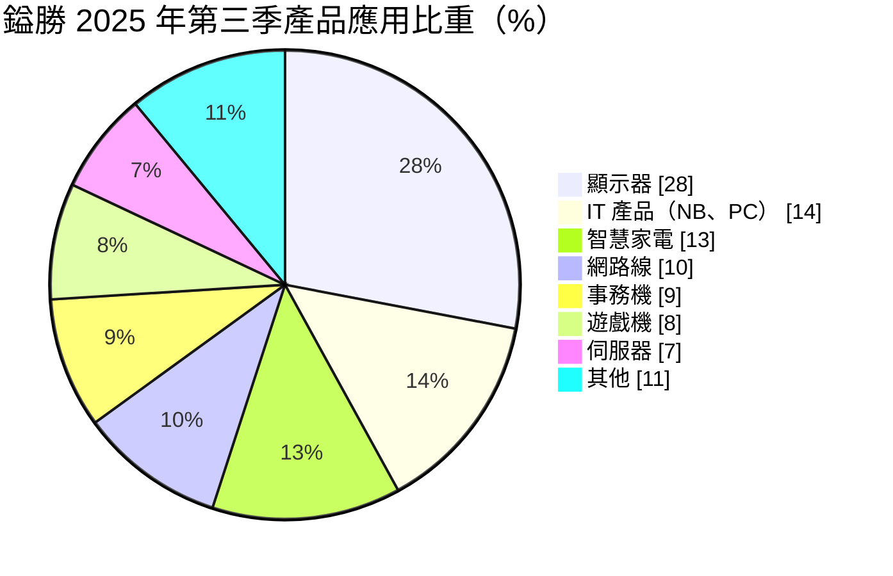
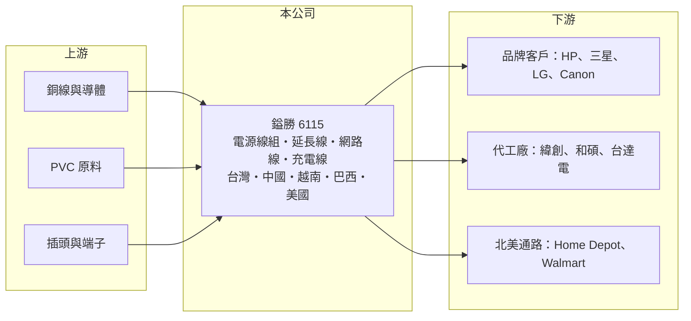

# 6115 鎰勝

> 上市｜[[產業索引-電子零組件業|電子零組件業]]｜上市（櫃）日期 2004/07/19

# 第一章：企業模式與商業藍圖

> [!info] 撰寫說明
> 精簡版，由 Claude 依公開資料整理，架構比照 [[2330台積電]]，資料截至 2026-10-08。來源：證交所開放資料快照（基本資料、2026 年第二季資產負債與損益、營益分析、股利）、Goodinfo 經營績效頁、富果 2025 年 12 月法說會摘要。#待校對

鎰勝工業（以下簡稱鎰勝）是全球主要的[[電源線]]組製造商之一，產品是顯示器、電腦、家電與事務機出貨時附上的那條電源線。理解鎰勝的關鍵在於：電源線技術門檻看似不高，但各國安規認證、全球多點生產與大客戶關係，讓它在這個低調的產業中維持了穩定獲利與高配息。

- **核心業務：** 鎰勝成立於 1986 年，2004 年上市，主要產品是電源線及電源線組、橡膠線、延長線、網路線，並自產 PVC 膠粒，另有電動車充電線。電源線必須符合各國插頭規格與電壓，並取得當地安規認證（例如北美的 [[UL 認證]]），鎰勝的產品取得約 40 至 50 國的認證，這是新進者難以短期複製的基礎。
- **營收結構：** 依 2025 年第三季法說會資料，應用以顯示器 28% 最高，其次為 IT 產品 14%、智慧家電 13%、網路線 10%、事務機 9%、遊戲機 8%、[[AI 伺服器]]等伺服器 7%。銷售地區以中國 45% 最高，越南 20%、北美 15%、歐洲 15%。主要客戶包括 HP、[[005930三星電子]]、LG、Canon、[[3231緯創]]、[[4938和碩]]、[[2308台達電]] 與美國通路商 Home Depot。
- **營運據點：** 全球共 8 個主要生產基地，分布於台灣、中國（深圳、崑山、東莞）、越南（河內、平陽）、巴西與美國新墨西哥州。美國廠 2023 年設立、2024 年底量產，主要服務北美通路；外銷美國的訂單已幾乎全數轉往越南廠。集團月產能上限約為電源線組 3,000 萬條、PVC 電源線 1,500 噸、電動車充電線 66 萬條。
- **長期方向：** 鎰勝的長期策略是供應鏈重組與[[垂直整合]]：把產能從中國分散到越南與美國，因應美中貿易衝突；東莞廠自產 PVC 膠粒以控制成本。成長面看好 AI 伺服器與網通產品的線材需求，美國廠也規劃再投資約 420 萬美元擴充延長線產能，因應 2026 年北美訂單。

# 第二章：護城河深度與競爭優勢

鎰勝的護城河來自認證、規模與全球產能布局，屬於「窄而穩」的類型。

- **競爭優勢：** 第一是認證門檻，電源線屬於安全零件，取得數十國認證並維持品質紀錄需要長年累積，品牌客戶不會輕易更換供應商。第二是規模與成本，鎰勝月產能達數千萬條，加上自產 PVC 膠粒，採購與生產成本具優勢。第三是多國生產，越南、美國與巴西據點讓客戶可依關稅與在地化需求安排出貨，這在貿易壁壘升高後成為接單賣點。
- **主要對手：** 台灣同業有 [[2462良得電]]、[[3501維熹]]、[[6290良維]] 等電源線與線材廠，中國則有大量在地電源線廠以低價競爭。鎰勝的規模在台灣同業中居前，但產品同質性高，價格競爭始終存在。
- **觀察重點：** 長期最該追蹤的是毛利率能否維持在 15% 以上，以及伺服器、充電線等較高附加價值產品的比重能否提升。2019 至 2025 年鎰勝的營業利益率穩定在 8% 至 14% 之間，在線材業中屬於高水準。美國與越南據點的獲利表現，則決定供應鏈重組是否值得。

# 第三章：財務體質與盈利規模

資料日期：2026-10-08，表格是撰寫當時的快照；最新月營收、毛利率、累計 EPS 由自動排程寫在本筆記的屬性欄位（月營收、毛利率、累計EPS 等）。#待校對

鎰勝的財務特徵是：營收規模 60 至 80 億元、獲利穩定，而且把大部分盈餘以現金股利發給股東。

| 年度 | 營收（億元） | [[毛利率]] | [[營業利益率]] | EPS（元） | [[ROE]] |
|---|---|---|---|---|---|
| 2021 | 77.3 | 15.3% | 8.81% | 2.70 | 10.5% |
| 2022 | 72.5 | 16.9% | 9.49% | 4.27 | 15.8% |
| 2023 | 63.3 | 17.2% | 9.45% | 2.82 | 9.98% |
| 2024 | 73.6 | 15.1% | 8.19% | 3.63 | 12.6% |
| 2025 | 75.5 | 16.3% | 10.3% | 2.85 | 9.84% |

（來源：Goodinfo 經營績效頁；2019 年營收 65.4 億元、EPS 3.06 元，2020 年營收 61.7 億元、EPS 2.58 元。）

- **營收規模：** 2019 至 2025 年營收由 65.4 億元增至 75.5 億元，年複合成長率約 2.4%（推算），成長緩慢但穩定，反映電源線是成熟產業。2026 年上半年營收約 40.2 億元，毛利率 14.9%、營業利益率 9.05%，稅後 EPS 1.48 元。
- **獲利：** 近五年平均 ROE 約 11.7%（推算），且七年來每年都獲利，在電子零組件中屬於穩定型。獲利波動主要來自匯率與原料銅價，例如 2025 年前三季獲利下滑主因是匯兌損失。
- **財務特色：** 依 2026 年第二季資料，總資產約 86.3 億元，負債約 34.6 億元，股東權益約 51.8 億元，負債比約 40%，每股淨值 27.3 元。2025 年度每股配發現金股利 2.8 元，配息率約 98%（推算）。依法說會說法，近五年股利多維持在 3 元以上，獲利不足時公司可能動用資本公積維持股利，股利穩定度高。自由現金流是否長期為正未查得，但長期高配息推估現金流相當充裕（推估）。
- **[[ROIC]] 與 [[WACC]]：** 以 2025 年營業利益約 7.78 億元（75.5 億元 × 10.3%）、稅率 20% 計算，稅後營業利益約 6.22 億元；有息負債未查得，投入資本以股東權益 51.8 億元到「權益加全部負債」86.3 億元為區間，ROIC 約 7.2% 至 12.0%（推算）。WACC 以 CAPM 推估：無風險利率 1.75%、市場風險溢酬 6%、β 假設 0.8（穩定型零組件股常見值），權益成本約 6.6%；稅後負債成本假設 2%、負債占兩成，WACC 約 5.6%（推算）。ROIC 穩定高於 WACC，代表鎰勝長期在創造經濟價值，雖然利差不大，但勝在穩定。

# 第四章：總體風險與地緣政治

鎰勝的風險主要來自成熟產業的價格競爭、匯率與原料，以及地緣政治帶來的產能調整。

- **產業週期：** 電源線需求跟著顯示器、PC、家電與事務機的出貨量起伏，這些終端多數屬於成熟市場，成長有限。消費性電子景氣下行時，客戶會壓低庫存並要求降價。伺服器與充電線的成長能否抵銷傳統應用的停滯，是長期關鍵。
- **營運風險：** 產能分布在多國，管理複雜度高，新據點（美國、越南）初期的良率與成本控制會影響獲利。客戶集中在大型品牌與代工廠，議價能力強。若為維持股利而動用資本公積，長期可能削弱財務彈性。
- **其他風險：** 銅與 PVC 是主要原料，價格波動直接影響毛利；營收以美元為主，新台幣升值會造成匯損。中國據點占比仍高，美國關稅與出口管制政策的變化，可能迫使公司持續調整產能配置。

# 專有名詞解析

## 應用

- **[[UL 認證]]**：美國 UL 機構的產品安全認證，電源線與電器產品進入北美市場通常必須取得。
- **[[AI 伺服器]]**：搭載 GPU 等加速晶片、用於 AI 訓練與推論的伺服器，功耗高，對電源與被動元件規格要求也高。

## 產業

- **[[電源線]]**：連接電器與插座的交流電線組，需依各國電壓、插頭規格與安規認證製造。
- **[[垂直整合]]**：同一集團掌握上下游多個生產環節，以穩定供料並降低成本。

# 核心供應鏈

- 上游：銅線導體與 PVC 原料供應商（鎰勝東莞廠自產 PVC 膠粒），以及插頭、端子零件。
- 下游／客戶：HP、[[005930三星電子]]、LG、Canon 等品牌，[[3231緯創]]、[[4938和碩]]、[[2308台達電]] 等代工與電源廠，以及 Home Depot、Walmart 等北美通路。
- 同業：[[2462良得電]]、[[3501維熹]]、[[6290良維]]，以及中國在地電源線廠。

## 最新新聞
<!-- news:start -->
<!-- news:end -->

## 相關連結
- [公開資訊觀測站](https://mopsov.twse.com.tw/mops/web/t05st03?step=1&firstin=1&co_id=6115)
- [Goodinfo](https://goodinfo.tw/tw/StockDetail.asp?STOCK_ID=6115)
- [Yahoo 股市](https://tw.stock.yahoo.com/quote/6115)
- [鉅亨網新聞](https://www.cnyes.com/twstock/6115/news)
