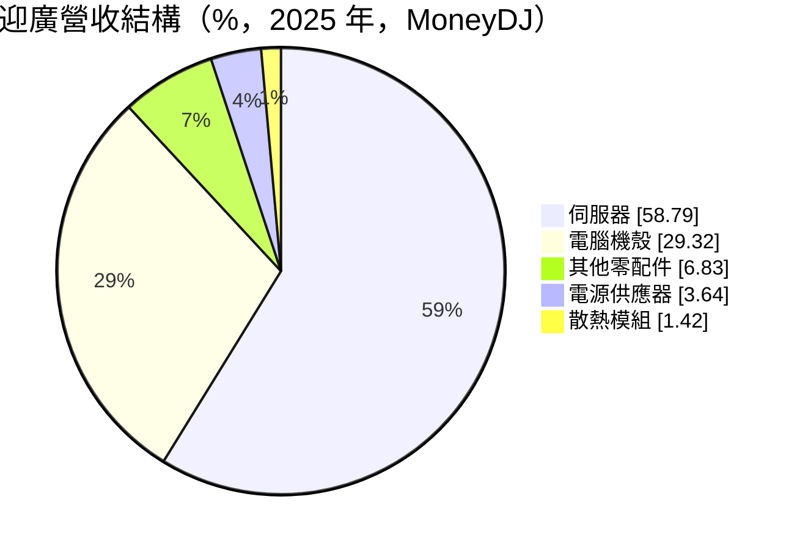
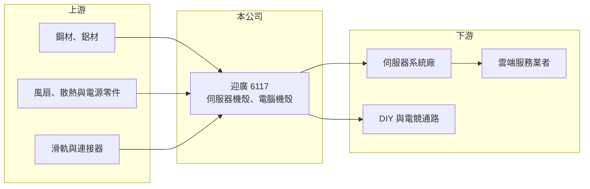

# 6117 迎廣

> 上市｜[[產業索引-電腦及週邊設備業|電腦及週邊設備業]]｜上市（櫃）日期 2003/08/25

# 第一章：企業模式與商業藍圖

> [!info] 撰寫說明
> 精簡版，由 Claude 依公開資料整理，架構比照 [[2330台積電]]，資料截至 2026-10-08。來源：證交所開放資料快照（基本資料、2026 年上半年財報、股利、每月營收）、Goodinfo 經營績效年度表與公告列表、MoneyDJ 個股基本資料（2025 年營收比重、歷年股利）。自有品牌 In Win 與電競機殼的描述為記憶內容；伺服器客戶與工廠位置未查得。#待校對

迎廣原本以電腦機殼與自有品牌聞名，近年伺服器產品已成為最大營收來源，本章說明這個轉型。

- **核心業務：** 迎廣設計製造電腦機殼與[[伺服器機殼]]，並供應電源、散熱模組與零配件。早年以自有品牌 In Win 的 DIY 與電競機殼為主（待校對），近年把機構設計能力延伸到伺服器，承接伺服器機殼與系統組裝相關訂單。伺服器機殼要配合機櫃標準、散熱風道與熱插拔設計，技術門檻與單價都高於一般桌機機殼。
- **營收結構：** 依 MoneyDJ，2025 年伺服器占 58.8%、電腦機殼 29.3%、其他零配件 6.8%、電源供應器 3.6%、散熱模組 1.4%。伺服器比重過半，代表公司已由消費性產品轉為以企業與資料中心需求為主。
- **營運據點：** 公司 1985 年成立，2001 年首次掛牌，2003 年轉為上市公司，2026 年第二季實收資本額約 9.3 億元。依 Goodinfo 公告，公司目前有兩檔[[可轉換公司債]]流通，顯示近年有以發債籌資擴充產能的動作（用途細節待校對）。
- **長期方向：** [[AI 伺服器]]機櫃功率高、重量大，對機構件的散熱與承重設計要求持續提高。迎廣若能在新一代伺服器平台持續取得設計案，就能讓營收從桌機的成熟市場轉到資料中心的長期成長市場。

# 第二章：護城河深度與競爭優勢

機殼產業的護城河通常不深，迎廣的差異在於它把消費性產品的設計能力轉移到伺服器，本章說明其競爭位置。

- **競爭優勢：** 伺服器機殼一旦被設計進某一代平台，整個平台的生命週期都由同一家供應，客戶不輕易更換。迎廣長年做品牌機殼累積的工業設計、模具與散熱設計能力，有助於爭取客製化程度高的伺服器案子。毛利率從 2018 年 12.4% 提升到 2025 年 31.1%，反映產品組合明顯改善。
- **主要對手：** 伺服器機殼與機構件同業有 [[8210勤誠]]、[[3013晟銘電]]、[[3693營邦]]、[[2059川湖]]（滑軌），以及 [[2317鴻海]]、[[6669緯穎]] 等系統廠自製機構件。電腦機殼方面則與 [[5465富驊]] 和眾多中國品牌競爭。
- **觀察重點：** 長期要看伺服器比重與毛利率能否維持在高檔，以及新產能與可轉債籌資能否轉化為穩定的營業利益成長，而不是增加股本稀釋。

# 第三章：財務體質與盈利規模

資料日期：2026-10-08，表格是撰寫當時的快照；最新月營收、毛利率、累計 EPS 由自動排程寫在本筆記的屬性欄位（月營收、毛利率、累計EPS 等）。#待校對

迎廣在 2018 至 2021 年本業連年虧損，2023 年後隨伺服器業務放量才轉為穩定獲利，財務數字呈現清楚的轉型軌跡。

| 年度 | 營收（億元） | [[毛利率]] | [[營業利益率]] | EPS（元） | [[ROE]] |
|---|---|---|---|---|---|
| 2021 | 23.1 | 16.8% | -3.60% | -0.98 | -9.0% |
| 2022 | 24.0 | 19.8% | 0.49% | 0.62 | 4.29% |
| 2023 | 23.7 | 23.4% | 4.89% | 1.02 | 7.5% |
| 2024 | 28.8 | 29.7% | 12.1% | 4.12 | 23.9% |
| 2025 | 32.2 | 31.1% | 14.5% | 3.77 | 16.9% |

- **營收規模：** 2020 年營收 22.0 億元、2025 年 32.2 億元，五年年複合成長率約 7.9%（推算）。2026 年上半年營收 16.5 億元、毛利率 34.1%、營業利益率 14.3%、EPS 1.81 元，1 至 8 月累計營收年增約 5%。
- **獲利：** 2021 至 2025 年平均 ROE 約 8.7%（推算），但後兩年已達 17% 至 24%，轉型後的獲利水準明顯高於過去。2017 年 EPS 3.20 元主要來自約 6.3 億元業外收益，不代表本業。股利方面，2019 至 2023 年度停發，之後恢復為 2.17 元與 2.00 元，其中 2025 年度的 2 元包含盈餘 0.5 元與資本公積 1.5 元（證交所股利資料）。
- **財務特色：** 2026 年第二季末總資產 65.9 億元、總負債 43.7 億元，負債比約 66%，非流動負債 19.9 億元主要應為可轉債與長期借款（推估）；股東權益 22.2 億元，每股淨值 23.95 元。負債比在同業中偏高，是轉型擴產期的代價。
- **[[ROIC]] 與 [[WACC]]：** 2025 年營業利益約 4.67 億元，稅後約 3.74 億元；有息負債未逐項查得，假設約 20 億元（以非流動負債估），投入資本約 42 億元，ROIC 約 8.9%（推算）；2026 年上半年年化稅後營業利益約 3.78 億元，ROIC 約 9%（推算）。WACC 以 CAPM 推估：無風險利率 1.75%、市場風險溢酬 6%、β 取 1.3（AI 伺服器題材股常見值），股東權益成本 9.55%；負債占資本約 45%、可轉債與借款稅後成本約 1.6%，WACC 約 6.0%（推算）。轉型後 ROIC 已高於 WACC，代表伺服器業務開始替股東創造價值，但這依賴低成本的可轉債融資，轉換後股本擴大會稀釋每股報酬。

# 第四章：總體風險與地緣政治

迎廣的成長高度連結 AI 與資料中心投資，本章整理長期風險。

- **產業週期：** 伺服器需求跟著雲端業者與企業的資本支出起伏，一旦 AI 投資放緩，訂單與稼動率會快速下降。電腦機殼則屬成熟市場，長期只能維持現狀。
- **營運風險：** 伺服器客戶集中在少數系統廠或雲端業者，單一平台的得失影響很大。系統廠自製機構件的比例若提高，專業機殼廠的空間會被壓縮。負債比偏高，若獲利下滑，財務彈性有限。
- **其他風險：** 鋼材與鋁材價格影響成本；可轉債轉換造成股本稀釋；美國關稅與供應鏈移轉可能要求在台灣或東南亞新增產能。

# 專有名詞解析

## 應用

- **[[AI 伺服器]]**：搭載 GPU 或 AI 加速器、用於模型訓練與推論的伺服器，功耗與散熱需求遠高於一般伺服器。

## 金融

- **[[可轉換公司債]]**：持有人可在約定期間依轉換價格把債券換成公司股票的公司債，票面利率通常很低。
- **[[ROIC]]**：投入資本報酬率，稅後營業利益除以股東權益加有息負債，衡量本業運用資本的效率。
- **[[WACC]]**：加權平均資金成本，股東權益成本與負債成本依資本結構加權，是 ROIC 必須超越的門檻。

## 產業

- **[[伺服器機殼]]**：容納伺服器主機板、硬碟與電源的金屬機箱，需要配合機櫃規格與散熱風道設計。

# 核心供應鏈

- 上游：鋼材與鋁材、風扇與散熱零件、電源零件、滑軌與連接器。
- 下游／客戶：伺服器系統廠與雲端服務業者，以及 DIY 與電競通路（實際客戶未查得）。
- 同業：[[8210勤誠]]、[[3013晟銘電]]、[[3693營邦]]、[[5465富驊]]；滑軌 [[2059川湖]]。

## 最新新聞
<!-- news:start（自動產生，請勿手動編輯此範圍） -->
- 2026-10-13 📰 媒體 11:50｜〈焦點股〉迎廣Q3營收9億元寫近18年單季新高 一度亮燈漲停｜[鉅亨網](https://news.cnyes.com/news/id/6629291)

完整紀錄：[[6117迎廣 新聞]]
<!-- news:end -->

## 相關連結
- [公開資訊觀測站](https://mopsov.twse.com.tw/mops/web/t05st03?step=1&firstin=1&co_id=6117)
- [Goodinfo](https://goodinfo.tw/tw/StockDetail.asp?STOCK_ID=6117)
- [Yahoo 股市](https://tw.stock.yahoo.com/quote/6117)
- [鉅亨網新聞](https://www.cnyes.com/twstock/6117/news)
