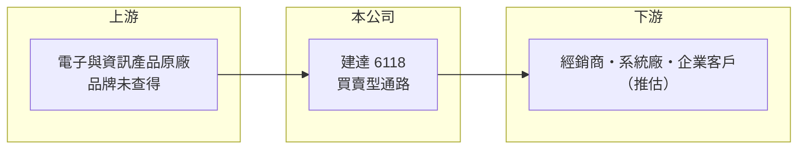

# 6118 建達

> 上櫃｜[[產業索引-電子通路業|電子通路業]]｜上市（櫃）日期 2001/10/25

# 第一章：企業模式與商業藍圖

> [!info] 撰寫說明
> 精簡版，由 Claude 依公開資料整理，架構比照 [[2330台積電]]，資料截至 2026-10-08。來源：櫃買中心開放資料（基本資料、2026 年第二季財報、月營收）、Goodinfo 經營績效頁、MoneyDJ 基本資料（2025 年營收比重）。公開資料有限，代理品牌與產品類別未查得。#待校對

建達國際是一家年營收約 100 億元、毛利率約 5%、營業利益率接近零的通路商，董事長為王雪紅。它的財務特徵說明了一件事：通路業若沒有規模或技術附加價值，營收再大也難以轉化為股東報酬。

- **核心業務：** 建達成立於 1995 年，2001 年上櫃，總部在新北市新店。2025 年營收中商品銷售占 99.94%、服務收入僅 0.06%，屬於幾乎純買賣型的[[電子通路]]業務。
- **集團關係：** 董事長王雪紅同時是 [[2498宏達電]] 的董事長，建達與王雪紅相關企業之間可能存在產品或通路合作（推估，具體關係未查得）。集團背景有助於取得原廠信任，但也可能讓營收受特定集團產品的興衰影響。
- **營收結構：** 代理品牌與產品類別未查得。依毛利率 4% 至 5% 判斷，主力為標準化程度高、價格透明的電子或資訊產品（推估）。
- **長期方向：** 2020 至 2025 年營收在 84 億到 100 億元之間，2025 年首次達到 100 億元。長期而言，建達需要找到附加價值更高的產品線或服務，才能讓營業利益率擺脫 0.5% 以下的水準。

# 第二章：護城河深度與競爭優勢

純買賣型通路商的護城河很淺，建達的競爭位置主要建立在原廠關係與資金規模上。

- **競爭優勢：** 建達經營通路三十年，具有支撐約 100 億元年營收的[[營運資金]]調度能力與原廠授權。王雪紅集團的背景，可能在原廠合作與企業信用上提供加分（推估）。
- **主要對手：** 資訊與電子產品通路的 [[2347聯強]]、[[6776展碁國際]]、[[2414精技]]、5410國眾，以及半導體通路的 [[3702大聯大]]、[[3036文曄]]。這些同業規模更大或技術服務更完整，建達在價格與服務上都難以拉開差距。
- **觀察重點：** 營業利益率長期在 0.04% 至 0.48% 之間，代表毛利幾乎全被營業費用吃掉。觀察重點在於公司是否能提高服務收入比重，或透過產品組合調整讓毛利率持續提升。

# 第三章：財務體質與盈利規模

資料日期：2026-10-08，表格是撰寫當時的快照；最新月營收、毛利率、累計 EPS 由自動排程寫在本筆記的屬性欄位（月營收、毛利率、累計EPS 等）。#待校對

建達的財務呈現「營收穩定、獲利微薄」的特徵，近 6 年 EPS 都在 0.6 元以下。

| 年度 | 營收（億元） | [[毛利率]] | [[營業利益率]] | EPS（元） | [[ROE]] |
|---|---|---|---|---|---|
| 2020 | 85.1 | 4.34% | 0.37% | 0.40 | 3.74% |
| 2021 | 94.4 | 4.38% | 0.46% | 0.60 | 5.37% |
| 2022 | 97.0 | 4.21% | 0.48% | 0.37 | 3.20% |
| 2023 | 84.3 | 4.37% | 0.04% | 0.23 | 1.99% |
| 2024 | 90.6 | 4.83% | 0.32% | 0.39 | 3.23% |
| 2025 | 100 | 5.02% | 0.44% | 0.40 | 3.21% |
| 2026 上半年 | 48.2 | 4.92% | 0.03% | -0.12 | 未查得 |

- **營收規模：** 2020 至 2025 年營收年複合成長率約 3.3%（推算）。2026 年前 8 個月營收約 69 億元，年增約 7%（櫃買中心月營收）。
- **獲利：** 近 5 年平均 ROE 約 3.4%（推算），遠低於一般估計的股權成本。2026 年上半年營業利益僅 136 萬元，稅後虧損 1,117 萬元，顯示在費用不變下，毛利率些微下滑就會轉為虧損。
- **財務特色：** 2026 年第二季總資產 37.3 億元、負債 26.0 億元、權益 11.3 億元，負債比約 70%。保留盈餘約 1.5 億元，櫃買中心本益比資料顯示最近一年度未配發現金股利。

**[[ROIC]] 與 [[WACC]]：** 2025 年營業利益約 4,400 萬元，稅後約 3,500 萬元；以權益 11.3 億元加有息負債（以負債總額 40% 估約 10.4 億元）計算，ROIC 約 1.6%，2026 年上半年年化約 0.1%（推算）。WACC 以 CAPM 推估：無風險利率 1.75%、市場風險溢酬 6%、β 取 0.8（低波動通路股常見值），股權成本 6.55%；稅後負債成本 2%，股權占比約 52%，WACC 約 4.4%（推算）。ROIC 長期低於 WACC，代表目前的經營模式並未替股東創造超額價值。

# 第四章：總體風險與地緣政治

建達的風險主要來自極薄的利潤率，任何費用或價格變動都可能讓公司由盈轉虧。

- **產業週期：** 電子與資訊產品需求有景氣循環，2023 年營收從 97 億元降到 84 億元，營業利益率同步降到 0.04%。在利潤率接近零的情況下，景氣下行時的虧損風險比同業更高。
- **營運風險：** 代理權若被原廠收回或轉移到大型通路商，營收會立即下滑；存貨跌價或應收帳款呆帳，也可能一次抵銷全年獲利。
- **其他風險：** 進貨以外幣計價時，匯率變動會影響毛利；若營收與王雪紅相關企業連動，集團事業的策略調整也會間接影響建達（推估）。

# 專有名詞解析

## 金融

- **[[營運資金]]**：存貨加應收帳款減應付帳款，是企業營運需要先墊付的資金，通路商營收成長時需求會同步增加。

## 產業

- **[[電子通路]]**：替半導體原廠向系統廠銷售零組件、備庫存並提供技術支援的中間商，賺取買賣價差與服務價值。
- **[[代理權]]**：原廠授權通路商銷售其產品的權利，可能因原廠策略調整或併購而被收回。

# 核心供應鏈

- 上游：電子與資訊產品原廠（品牌未查得）。
- 下游／客戶：經銷商、系統廠與企業客戶（推估）。
- 關係企業：董事長王雪紅同時擔任 [[2498宏達電]] 董事長。
- 同業：[[2347聯強]]、[[6776展碁國際]]、[[2414精技]]、5410國眾、[[3702大聯大]]、[[3036文曄]]。

## 最新新聞
<!-- news:start -->
<!-- news:end -->

## 相關連結
- [公開資訊觀測站](https://mopsov.twse.com.tw/mops/web/t05st03?step=1&firstin=1&co_id=6118)
- [Goodinfo](https://goodinfo.tw/tw/StockDetail.asp?STOCK_ID=6118)
- [Yahoo 股市](https://tw.stock.yahoo.com/quote/6118)
- [鉅亨網新聞](https://www.cnyes.com/twstock/6118/news)
