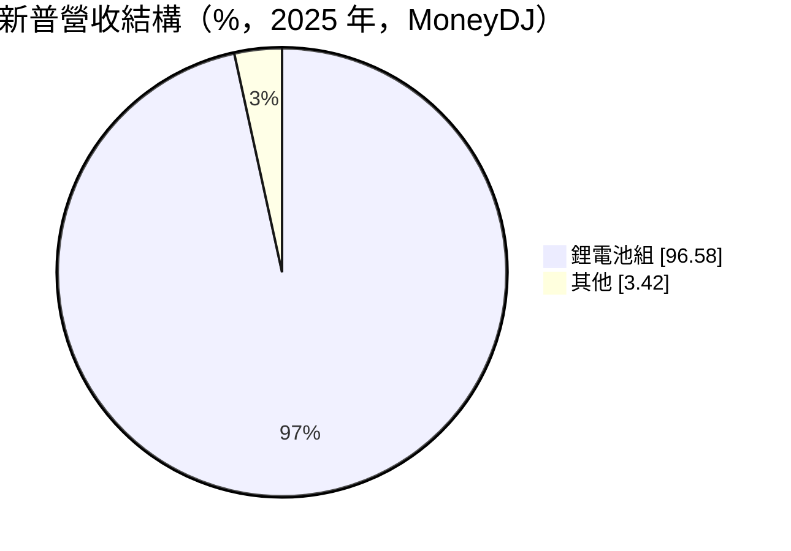
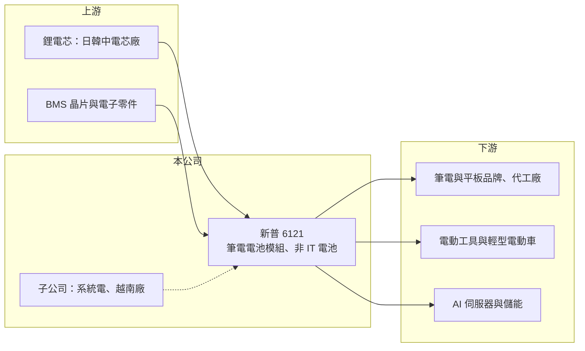

# 6121 新普

> 上櫃｜[[產業索引-電腦及週邊設備業|電腦及週邊設備業]]｜上市（櫃）日期 2001/11/27

# 第一章：企業模式與商業藍圖

> [!info] 撰寫說明
> 精簡版，由 Claude 依公開資料整理，架構比照 [[2330台積電]]，資料截至 2026-10-08。來源：櫃買中心開放資料快照（基本資料、2026 年上半年財報、每月營收）、Goodinfo 經營績效年度表與公告列表、MoneyDJ 個股基本資料（2025 年營收比重、歷年股利）。新普與 [[5309系統電]]、[[6781AES-KY]] 的持股關係、筆電電池市占與 BBU 進展為記憶或新聞標題內容。#待校對

新普是全球最大的筆電電池模組廠之一，本章說明它的商業模式，以及如何從筆電延伸到其他電池應用。

- **核心業務：** 新普生產[[鋰電池模組]]，向日韓中電芯廠採購電芯，加上電池管理系統（[[BMS]]）、保護電路與外殼，組成可直接裝進筆電、平板與其他設備的電池包。模組廠的價值在於電路與安全設計、通過品牌與安規認證，以及全球大量交貨的能力。
- **營收結構：** 依 MoneyDJ，2025 年鋰電池組占營收 96.6%，其他 3.4%。產品應用以筆電與平板為主，並逐步擴大到電動工具、輕型電動車、儲能與伺服器 [[BBU]] 等非 IT 領域（比重未查得，待校對）。
- **營運據點：** 公司 1992 年成立，2001 年於櫃買中心掛牌，2026 年第二季實收資本額約 18.5 億元。依 Goodinfo 公告，董事會通過增資越南子公司 SIMPLO TECHNOLOGY (VIETNAM)，顯示公司正把產能分散到中國以外。合併報表約 80 億元的非控制權益，來自持股未達百分之百的子公司，包括 [[5309系統電]]（待校對）。
- **長期方向：** 筆電市場成熟，新普的長期成長來源是非 IT 電池：AI 伺服器的 BBU、儲能與電動交通工具。依新聞標題，新普已採用三星 SDI 電芯供應 BBU 模組（年份未查得，待校對）。把筆電電池的規模與安全認證經驗移植到這些新應用，是未來十年的主軸。

# 第二章：護城河深度與競爭優勢

電池模組是代工性質的行業，新普靠規模與客戶關係維持領先，本章分析它的護城河。

- **競爭優勢：** 新普長期供應全球主要筆電品牌，規模經濟讓它在電芯採購上有議價力，也能分攤安全認證與研發成本。電池涉及起火風險，品牌廠傾向把訂單集中在少數有長期紀錄的供應商，新普的品質與交貨紀錄就是它最重要的無形資產。
- **主要對手：** 筆電電池主要對手是 [[3211順達]]，兩家長期占台灣筆電電池模組大部分市場，另有中國的欣旺達、德賽電池；非 IT 領域則有 [[3323加百裕]]、4931新盛力，BBU 另有 [[2308台達電]]、[[2301光寶科]]。
- **觀察重點：** 毛利率從 2017 年 8.8% 提升到 2025 年 15.4%、2026 年上半年 18.1%，說明產品組合持續往較高附加價值移動。長期要看非 IT 比重能否明顯提高，以及越南等新產能能否順利承接客戶的移轉需求。

# 第三章：財務體質與盈利規模

資料日期：2026-10-08，表格是撰寫當時的快照；最新月營收、毛利率、累計 EPS 由自動排程寫在本筆記的屬性欄位（月營收、毛利率、累計EPS 等）。#待校對

新普營收在 2021 至 2022 年達到 956 億元高峰後回落，但毛利率與 ROE 維持穩定，是現金流與配息都相當可靠的公司。

| 年度 | 營收（億元） | [[毛利率]] | [[營業利益率]] | EPS（元） | [[ROE]] |
|---|---|---|---|---|---|
| 2021 | 956 | 14.2% | 9.72% | 34.50 | 22.6% |
| 2022 | 956 | 16.0% | 11.0% | 39.12 | 22.7% |
| 2023 | 848 | 13.8% | 8.18% | 30.67 | 16.6% |
| 2024 | 800 | 14.2% | 8.02% | 28.88 | 15.2% |
| 2025 | 821 | 15.4% | 9.41% | 30.60 | 16.0% |

- **營收規模：** 2017 年營收 583 億元、2025 年 821 億元，八年年複合成長率約 4.4%（推算）；若從 2020 年 855 億元起算，五年約 -0.8%（推算），反映疫情後筆電需求回落。2026 年上半年營收 393.9 億元、毛利率 18.1%、營業利益率 11.5%、EPS 15.89 元。
- **獲利：** 2021 至 2025 年平均 ROE 約 18.6%（推算）。依 MoneyDJ，2019 至 2025 年度現金股利每年約 14.5 元至 27.6 元，採半年配息，配息率多在七成左右（推算），股利政策長期穩定。
- **財務特色：** 2026 年第二季末總資產 838.6 億元、總負債 361.4 億元，負債比約 43%，負債以應付帳款等營運負債為主（推估）；權益總額 477.2 億元，歸屬母公司 397.0 億元，每股淨值 214.65 元。流動資產 696.1 億元，帳上營運資金充裕。
- **[[ROIC]] 與 [[WACC]]：** 2025 年營業利益約 77.3 億元，稅後約 61.8 億元；有息負債未逐項查得、推估不高，以權益總額約 477 億元加假設有息負債 20 億元計算，ROIC 約 12.4%（推算）；2026 年上半年年化稅後營業利益約 72.4 億元，ROIC 約 14.6%（推算）。若扣除帳上大量現金，實際營運資本報酬更高。WACC 以 CAPM 推估：無風險利率 1.75%、市場風險溢酬 6%、β 取 0.9（成熟電子代工股常見值），股東權益成本 7.15%，負債比重低，WACC 約 7.0%（推算）。ROIC 長期高於 WACC，代表新普在低毛利的代工產業中仍穩定創造價值。

# 第四章：總體風險與地緣政治

新普的主要風險在於筆電市場成熟與電池產業的安全、成本壓力，本章整理長期風險。

- **產業週期：** 筆電電池需求跟著 PC 換機週期，2023 至 2024 年營收連續下滑即反映疫情後的需求回落。非 IT 應用如儲能與 BBU 則受能源政策與資料中心投資影響，同樣具有週期性。
- **營運風險：** 客戶集中在少數筆電品牌，品牌份額變化會直接影響新普出貨。電池安全事故可能造成召回與商譽損失。非 IT 領域的對手包括電源大廠與中國電池廠，價格競爭激烈。
- **其他風險：** 電芯價格與供應由日韓中大廠主導，成本波動難以完全轉嫁；營收以美元計價為主，匯率影響毛利；中國產能比重若仍高，需面對美國關稅與供應鏈移轉壓力（推估）。

# 專有名詞解析

## 金融

- **[[ROIC]]**：投入資本報酬率，稅後營業利益除以股東權益加有息負債，衡量本業運用資本的效率。
- **[[WACC]]**：加權平均資金成本，股東權益成本與負債成本依資本結構加權，是 ROIC 必須超越的門檻。

## 產業

- **[[鋰電池模組]]**：把多顆鋰電芯加上保護電路、電池管理系統與外殼組成的電池包，供筆電、工具機或伺服器使用。
- **[[BMS]]**：電池管理系統，監控每顆電芯的電壓、溫度與電量，避免過充過放並延長壽命。
- **[[BBU]]**：備援電池單元，AI 伺服器機櫃在市電中斷時的短時供電裝置，可避免運算中斷。

# 核心供應鏈

- 上游：日本、韓國與中國的鋰電芯廠（依新聞標題包含三星 SDI，其他實際採購對象待校對），BMS 晶片與被動元件。
- 下游／客戶：筆電與平板品牌及其代工廠，例如 [[2357華碩]]、[[2353宏碁]]、[[2382廣達]]、[[2324仁寶]]（實際客戶名單待校對）；電動工具、輕型電動車、伺服器與儲能客戶。
- 同業：[[3211順達]]、[[3323加百裕]]、4931新盛力、[[6781AES-KY]]；BBU 另有 [[2308台達電]]、[[2301光寶科]]。

## 最新新聞
<!-- news:start -->
<!-- news:end -->

## 相關連結
- [公開資訊觀測站](https://mopsov.twse.com.tw/mops/web/t05st03?step=1&firstin=1&co_id=6121)
- [Goodinfo](https://goodinfo.tw/tw/StockDetail.asp?STOCK_ID=6121)
- [Yahoo 股市](https://tw.stock.yahoo.com/quote/6121)
- [鉅亨網新聞](https://www.cnyes.com/twstock/6121/news)
