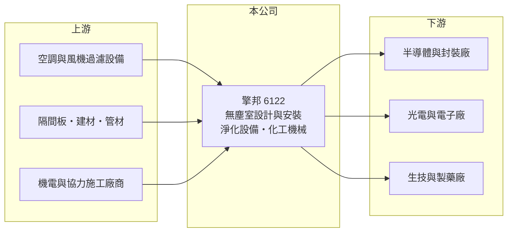

# 6122 擎邦

> 上櫃｜[[產業索引-電機機械|電機機械]]｜上市（櫃）日期 2000/07/14

# 第一章：企業模式與商業藍圖

> [!info] 撰寫說明
> 精簡版，由 Claude 依公開資料整理，架構比照 [[2330台積電]]，資料截至 2026-10-08。來源：櫃買中心開放資料快照（基本資料、2026 年第二季資產負債與損益、本益比殖利率、每月營收）、Goodinfo 歷年經營績效表、nStock 公司簡介。各業務營收比重、主要客戶與專案內容公開資料未查得，相關描述已標待校對。公開資料有限。#待校對

擎邦國際科技工程（以下簡稱擎邦）是以[[無塵室]]設計與安裝為核心的工程公司，理解它的關鍵在於：雖然被歸在電機機械類股，它的商業模式其實是接專案、按工程進度認列營收的工程業，毛利率低但資本需求輕，營收與獲利跟著高科技廠房的建廠週期大幅波動。

- **核心業務：** 擎邦創立於 1982 年，原名擎邦機械工業，1997 年更名，2000 年 7 月在櫃買中心上櫃。依官方資料，業務包括化工機械、無菌無塵設備的設計及安裝、高科技淨化設備的生產銷售與安裝維修，另有土木建築、建材買賣與住宅大樓開發租售等項目。工程業務是營收主體，客戶以需要高潔淨度廠房的半導體、光電、生技與製藥業為主（待校對）。
- **營收結構：** 各業務營收比重未查得。營收由 2021 年的 18.0 億元跳升到 2023 年的 53.1 億元，2024 至 2025 年維持在 41 億至 42 億元，顯示公司在這段期間承接了規模明顯較大的專案，推估與半導體與高科技廠擴建有關（待校對）。
- **營運據點：** 總部位於台北市內湖區，工程團隊依專案派駐客戶廠區。工程業的主要資產是人員、施工管理經驗與協力廠商網絡，而非廠房設備，因此固定資產占比低，2026 年第二季非流動資產僅約 5.7 億元。
- **長期方向：** 台灣與海外的半導體、先進封裝與 AI 相關廠房持續擴建，是無塵室與[[廠務工程]]業者的長期需求來源。擎邦的長期課題是在大型專案中維持毛利率、持續取得新案以平滑營收，並決定是否跟隨客戶到海外承接工程（具體規劃未查得）。

# 第二章：護城河深度與競爭優勢

擎邦的護城河在於工程實績與客戶信任，但工程業的進入門檻有限、價格競爭激烈，屬於窄護城河。

- **競爭優勢：** 無塵室工程牽涉潔淨度、溫濕度、氣流與震動控制，業主通常只把大型專案交給有實績的承包商，過去完成的工程是最重要的資格證明。擎邦毛利率由 2020 年的 5% 左右提高到 2025 年的 14.7%、營業利益率由 1.7% 提高到 11.4%，代表接案品質與成本控制明顯改善，營業費用率極低也是工程業的特色。
- **主要對手：** 國內無塵室與廠務工程主要業者包括 [[2404漢唐]]、[[6139亞翔]]、[[5536聖暉]]、[[6196帆宣]] 等，規模多數大於擎邦。大型半導體廠的主要工程多由這些大廠承攬，擎邦較可能承接中型專案或分包工程（待校對）。
- **觀察重點：** 長期應追蹤新接訂單與在手工程金額能否維持營收在 40 億元以上，以及毛利率能否守住一成以上。工程業的獲利取決於每個專案的估價與執行，單一專案虧損就可能抹去全年獲利，因此毛利率的穩定度比營收成長更重要。

# 第三章：財務體質與盈利規模

資料日期：2026-10-08，表格是撰寫當時的快照；最新月營收、毛利率、累計 EPS 由自動排程寫在本筆記的屬性欄位（月營收、毛利率、累計EPS 等）。#待校對

擎邦的財務特色是低毛利、低費用、高資產周轉，以及以客戶預收款為主的高負債比率，ROE 在 2023 年後躍升到兩成上下。

| 年度 | 營收（億元） | [[毛利率]] | [[營業利益率]] | EPS（元） | [[ROE]] |
|---|---|---|---|---|---|
| 2020 | 18.4 | 4.95% | 1.73% | 0.23 | 1.4% |
| 2021 | 18.0 | 7.27% | 3.48% | 0.79 | 4.8% |
| 2022 | 24.6 | 8.94% | 5.50% | 1.79 | 10.6% |
| 2023 | 53.1 | 11.3% | 8.76% | 5.25 | 27.1% |
| 2024 | 41.3 | 12.8% | 9.73% | 4.41 | 20.0% |
| 2025 | 41.9 | 14.7% | 11.4% | 4.78 | 19.7% |
| 2026 上半年 | 18.8 | 14.3% | 10.9% | 2.19 | 未查得 |

（來源：Goodinfo 歷年經營績效表；2026 上半年取自櫃買中心綜合損益開放資料計算。）

- **營收規模：** 2020 至 2025 年營收年複合成長率約 17.9%（推算），主要來自 2023 年的跳升。2026 年 1 至 9 月累計營收 30.65 億元、年增約 2%，大致維持 2025 年的水準。
- **獲利：** 2021 至 2025 年平均 ROE 約 16.4%（推算），但前後差異很大：2020 至 2021 年不到 5%，2023 至 2025 年約 20% 至 27%。工程業營業費用占營收比例低（2026 年上半年約 3.4%），毛利率每提高一個百分點，大部分都直接反映在營業利益上。
- **財務特色：** 依 2026 年第二季資料，總資產 48.2 億元、負債 30.7 億元、權益 17.5 億元，負債比率約 64%；其中流動負債 29.1 億元，推估多為工程[[合約負債]]（客戶預付款）與應付協力廠商款項，而非銀行借款（推估，明細未查得）。資本公積僅約 0.1 億元，公司持有約 156 萬股庫藏股。近四季現金股利 3.4 元，以 2025 年 EPS 4.78 元計，[[配息率]]約 71%。自由現金流會隨工程收款時點大幅波動，是否長期為正未查得。
- **[[ROIC]] 與 [[WACC]]：** 2025 年營業利益約 4.78 億元（41.9 億元 × 11.4%），稅後營業利益約 3.82 億元；有息負債未查得，投入資本以權益 17.5 億元到權益加總負債 48.2 億元為區間，ROIC 約 7.9% 至 21.9%（推算）。若負債多為預收款而非借款，實際 ROIC 應接近區間上緣。WACC 以 CAPM 推估：無風險利率 1.75%、市場風險溢酬 6%、β 假設 1.2（工程股隨建廠循環波動的常見值），權益成本約 9.0%；稅後負債成本約 2%、有息負債權重假設 10%，WACC 約 8.3%（推算）。2023 年以來 ROIC 明顯高於 WACC，但 2022 年以前則低於資金成本，說明擎邦的價值創造高度依賴大型專案的取得。

# 第四章：總體風險與地緣政治

擎邦的風險主要來自建廠週期、專案執行與客戶集中。

- **產業週期：** 無塵室工程需求來自半導體、光電與生技廠的擴廠計畫，客戶資本支出縮減時，新案會快速減少；工程業營收在專案完工後若沒有新案接續，可能出現斷崖式下滑，2024 年營收較 2023 年減少約 22% 即反映專案起伏。
- **營運風險：** 工程以固定總價承攬時，若材料、人力成本上漲或工期延誤，損失由承包商自行吸收，可能讓單一專案出現虧損。營收規模在大型專案後放大，客戶集中度可能偏高（未查得，待校對）。營建工人與工程師短缺也是台灣工程業的長期問題。
- **其他風險：** 業務項目還包括土木建築與住宅開發，若投入不動產開發，將面臨房市與法規風險（實際投入規模未查得）。若跟隨客戶前往海外施工，則需面對當地法規、勞工與匯率風險。

# 專有名詞解析

## 金融

- **[[合約負債]]**：客戶預先支付但公司尚未交貨的款項，設備業的合約負債增加通常代表在手訂單增加。
- **[[配息率]]**：現金股利占當年度每股盈餘的比例，反映公司把獲利分給股東的程度。

## 產業

- **[[無塵室]]**：控制空氣中微粒、溫濕度與氣流的密閉空間，半導體、面板與製藥廠的生產都需要在無塵室內進行。
- **[[廠務工程]]**：晶圓廠的無塵室、氣體化學品供應、水處理與機電系統等建置工程，隨晶圓廠擴產需求而起伏。

# 核心供應鏈

- 上游：空調、風機過濾機組（FFU）與淨化設備，隔間板、建材與管材，機電與協力施工廠商（具體供應商未查得）。
- 下游／客戶：半導體、封裝、光電、電子與生技製藥廠（具體客戶未查得，#待校對）。
- 同業：[[2404漢唐]]、[[6139亞翔]]、[[5536聖暉]]、[[6196帆宣]]。

## 最新新聞
<!-- news:start -->
<!-- news:end -->

## 相關連結
- [公開資訊觀測站](https://mopsov.twse.com.tw/mops/web/t05st03?step=1&firstin=1&co_id=6122)
- [Goodinfo](https://goodinfo.tw/tw/StockDetail.asp?STOCK_ID=6122)
- [Yahoo 股市](https://tw.stock.yahoo.com/quote/6122)
- [鉅亨網新聞](https://www.cnyes.com/twstock/6122/news)
