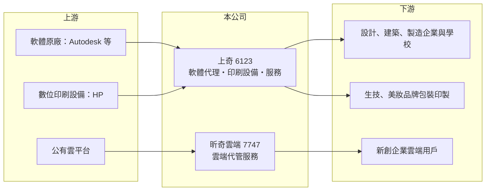

# 6123 上奇

> 上櫃｜[[產業索引-資訊服務業|資訊服務業]]｜上市（櫃）日期 2002/01/23

# 第一章：企業模式與商業藍圖

> [!info] 撰寫說明
> 精簡版，由 Claude 依公開資料整理，架構比照 [[2330台積電]] 的四章研究，資料截至 2026-10-08。來源：櫃買中心開放資料快照（基本資料、2026 年第二季資產負債與綜合損益、本益比殖利率）、Goodinfo 經營績效頁（2020 至 2025 年）、科技新報 2026 年 8 月上奇集團報導（節錄版）與 2022 年 12 月報導標題。公開資料有限，各事業營收比重未查得，代理品牌現況待校對。#待校對

上奇科技（股票代號 6123）是台灣老牌的[[軟體代理商]]，把國外的設計與工程軟體引進台灣銷售與支援。理解上奇，重點在於代理商如何面對原廠改走[[訂閱制]]、直接接觸客戶的威脅，以及上奇如何靠數位印刷設備與雲端服務找到第二、第三條成長曲線。

## 一、核心定位：設計軟體代理起家的科技服務集團

- **核心業務：** 上奇由許承強於 1991 年創立，2002 年上櫃。創業初期引進 Autodesk、Adobe 等數位設計軟體，依科技新報報導，五年內就成為台灣最大的軟體代理商。代理商的價值在於替原廠在當地做銷售通路、教育訓練與技術支援，原廠不必在每個市場自建團隊。
- **事業延伸：** 約 2010 年起，上奇代理 HP 數位印刷機，主攻生技、美妝等品牌的包裝印製，提供設備安裝、材料建議、機台校正與維護。2017 年成立雲端服務子公司 [[7747昕奇雲端]]，提供雲端租用、帳務管理與流量監控，客戶九成以上是新創企業。這三條業務線的共同點是「替國外技術在台灣提供落地服務」。
- **營收結構：** 這次未查得各事業的營收比重。2025 年合併營收 50.6 億元，但[[毛利率]]只有 13.9%，顯示營收中有相當比重是轉售性質、毛利較薄的軟體授權與雲端資源（推估）。

## 二、長期方向：從代理權到服務能力

- **原廠轉型的衝擊：** 2013 年 Adobe 改為雲端訂閱制，部分終端客戶可以直接向原廠訂閱，代理商的角色被壓縮。依科技新報 2022 年報導標題，上奇在當時的「前年」失去合作 20 多年的 Adobe 台灣代理權（推估約 2020 年，待校對）。這說明純粹依賴[[代理權]]的商業模式並不穩固，原廠隨時可能收回或改變通路策略。
- **雲端服務成為第二支柱：** 昕奇雲端屬於[[雲端代管服務商]]，替企業採購與管理公有雲資源。依科技新報報導，昕奇的營業利益率長期約 8% 至 10%，人力精簡，五、六名研發人員就能服務大量客戶。雲端用量按月計費，帶來類似[[經常性收入]]的穩定性，是上奇近年獲利的重要來源。
- **長期穩定獲利：** 科技新報報導指出上奇自 2005 年以來每一季都獲利。對代理商而言，連續二十年不虧損代表公司能在原廠政策變動與景氣循環中及時調整產品組合。

# 第二章：護城河深度與競爭優勢

代理商的護城河通常不深，因為核心技術屬於原廠。上奇能長期獲利，靠的是服務能力、客戶關係與多元化的代理組合。本章分析它的優勢與限制。

## 一、護城河組成

- **在地技術支援與客戶關係：** 設計與工程軟體的導入需要教育訓練、版本升級與疑難排解，建築、製造、設計等企業客戶重視長期的在地服務。上奇經營超過三十年，累積大量企業與學校客戶，這些關係讓原廠在台灣更換通路時也需要考量轉換成本。
- **設備與耗材的長尾收入：** 數位印刷機賣出後，後續的耗材、維修與校正服務會持續多年。這種「設備加服務」的模式比單純轉售軟體更不容易被原廠直接取代。
- **雲端代管的規模經濟：** 昕奇雲端的帳務管理與監控工具可以重複使用，客戶越多，每位客戶分攤的成本越低。新創客戶規模成長時，雲端用量也會同步成長。
- **限制：** 上奇的產品技術都來自原廠，最大的風險是原廠收回代理權或改走直營，失去 Adobe 代理權就是前例。因此它的護城河屬於「窄護城河」，必須不斷尋找新的代理品牌與服務。

## 二、主要對手

| 對手 | 定位 | 與上奇的關係 |
|---|---|---|
| [[3570大塚]] | 設計與工程軟體代理 | 在 CAD 與工程軟體市場直接競爭 |
| [[6214精誠]] | 大型資訊服務與軟體代理集團 | 規模較大，在企業資訊服務與雲端服務重疊 |
| [[3029零壹]] | 資訊產品與資安軟體代理 | 在企業軟體代理通路競爭 |
| [[6811宏碁資訊]]、[[6561是方]] | 雲端與資料中心服務 | 在企業雲端服務市場重疊 |

## 三、觀察重點

- **代理品牌的穩定度：** 主要代理品牌的合約續約情況，是判斷上奇營收穩定度的第一指標。
- **獲利率趨勢：** 2021 年[[營業利益率]] 8.36%，2025 年降到 5.41%，代表本業的利潤空間在縮小。未來能否靠雲端與服務業務把營業利益率拉回，是觀察重點。

# 第三章：財務體質與盈利規模

資料日期：2026-10-08，表格是撰寫當時的快照；最新月營收、毛利率、累計 EPS 由自動排程寫在本筆記的屬性欄位（月營收、毛利率、累計EPS 等）。#待校對

上奇是低毛利、低資本、高周轉的通路型公司，所以要用 ROE 與現金回饋來評估，而不是只看毛利率。本章檢視它近幾年的獲利趨勢與資本報酬。

## 一、多年度財務

| 年度 | 營收（億元） | [[毛利率]] | [[營業利益率]] | EPS（元） | [[ROE]] |
|---|---|---|---|---|---|
| 2020 | 50.5 | 14.8% | 6.08% | 4.25 | 23.3% |
| 2021 | 49.4 | 17.3% | 8.36% | 4.87 | 27.7% |
| 2022 | 52.9 | 16.6% | 8.09% | 5.49 | 25.6% |
| 2023 | 52.1 | 15.9% | 6.93% | 3.95 | 18.1% |
| 2024 | 55.4 | 14.6% | 6.08% | 3.65 | 16.8% |
| 2025 | 50.6 | 13.9% | 5.41% | 2.73 | 12.2% |

- **營收停滯：** 2020 至 2025 年營收維持在 49 億至 55 億元之間，年複合成長率約 0%（推算）。營收沒有成長，但組合持續在變，失去 Adobe 代理權的缺口大致由其他代理品牌與雲端服務補上。
- **獲利下滑：** EPS 從 2022 年高點 5.49 元降到 2025 年的 2.73 元，毛利率與營業利益率同步下滑。可能原因包括轉售性質的低毛利營收比重上升，以及設計軟體市場競爭加劇（推估）。
- **長期 ROE：** 近 5 年（2021 至 2025）平均 ROE 約 20.1%（推算），在台股中屬於高水準，但呈現逐年下滑趨勢，從 27.7% 降到 12.2%。

## 二、資產負債與股利

- **通路型資產結構：** 2026 年第二季資產總計 42.2 億元、權益總計 22.2 億元，其中非控制權益 6.4 億元，代表昕奇雲端等子公司有相當比重的外部股東。負債 20 億元幾乎都是流動負債，推估以應付帳款為主，屬於通路商先收貨、後付款的營運資金結構，有息負債未查得。
- **高配息：** 依櫃買中心本益比殖利率資料，最近年度每股股利 3.6 元，對照 2025 年 EPS 2.73 元，配發率超過 100%（推算，可能涉及跨年度或資本公積發放，待校對）。Goodinfo 統計的歷年平均現金股利約 2.1 元。上奇資本支出需求低，獲利多數以現金回饋股東，自由現金流的長期資料這次未查得。

## 三、[[ROIC]] 與 [[WACC]]

- **ROIC（推算）：** 以 2025 年營收 50.6 億元 × 營業利益率 5.41% ≈ 營業利益 2.74 億元，×（1－20%）＝稅後營業利益約 2.19 億元；除以 2026 年第二季權益總計 22.2 億元加有息負債（未查得，暫以 0 計算），ROIC 約 9.9%（推算）。若以相同資本基礎套用 2021 至 2022 年較高的營業利益率，ROIC 約 15%（推算）。
- **WACC（推算）：** 假設台灣 10 年期公債殖利率 1.75%、市場風險溢酬 6%、β 取資訊服務同業常見值 0.8，股東權益成本約 6.6%；負債比重低，WACC 約 6.5% 至 7%（推算）。
- **價值創造判讀：** 上奇的 ROIC 長期高於 WACC，2025 年利差約 3 個百分點，代表輕資產的代理與服務模式仍在創造價值。不過利差隨獲利率下滑而縮小，若營業利益率持續往 4% 以下走，價值創造能力會明顯減弱。

# 第四章：總體風險與地緣政治

代理商的風險主要來自原廠，其次才是景氣與匯率。本章整理上奇長期需要面對的風險。

## 一、產業結構風險

- **原廠直營化：** 軟體原廠普遍轉向訂閱制與線上直售，代理商的角色從「唯一通路」變成「加值服務商」。失去 Adobe 台灣代理權已證明這個風險真實存在，其他代理品牌也可能出現類似變化。
- **雲端平台政策：** 雲端代管服務商的利潤來自原廠給予的折扣與回饋，若公有雲業者調整合作夥伴政策，昕奇雲端的毛利可能受影響。

## 二、營運風險

- **客戶集中於新創：** 昕奇雲端的客戶九成以上是新創企業，新創募資環境轉差時，雲端用量與付款能力可能同步下降，帳款回收風險也會升高。
- **數位印刷設備景氣：** 印刷設備屬於資本支出，品牌客戶在景氣不佳時會延後採購，讓這條業務線的營收波動較大。
- **子公司持股結構：** 非控制權益占比不低，代表子公司獲利有一部分屬於外部股東，母公司 EPS 的成長幅度可能小於合併營收與獲利的成長。

## 三、其他風險

- **匯率：** 代理的軟體、設備與雲端資源多以美元計價，新台幣貶值會提高採購成本，若無法即時轉嫁給客戶，毛利率會被壓縮。
- **AI 對設計軟體的影響：** 生成式 AI 可能改變設計與工程軟體的使用方式與定價，原廠的產品策略改變，也會連帶影響代理商的銷售模式。

# 專有名詞解析

## 應用

- **[[雲端代管服務商]]**：替企業採購、建置與管理公有雲資源的服務商，常提供帳務整合與監控服務。

## 金融

- **[[經常性收入]]**：按月或按年持續產生的收入，例如訂閱費與維護費，可預測性高於一次性銷售。

## 產業

- **[[軟體代理商]]**：取得國外軟體原廠授權，在特定地區負責銷售、教育訓練與技術支援的公司。
- **[[代理權]]**：原廠授予代理商在特定地區銷售其產品的權利，可能因合約到期或原廠策略改變而收回。
- **[[訂閱制]]**：使用者按月或按年付費取得軟體或服務的使用權，取代一次性買斷，讓營收更穩定可預測。
- **[[數位印刷]]**：不需製版、直接由電腦檔案輸出的印刷方式，適合少量多樣的包裝與標籤印製。

# 核心供應鏈

- 上游：設計與工程軟體原廠 Autodesk 等（現行代理品牌待校對）；數位印刷設備原廠 HP；公有雲平台如 [[AMZN亞馬遜]]、[[GOOGL谷歌]]、[[MSFT微軟]]（昕奇實際合作的雲端平台待校對）。
- 下游／客戶：設計、建築、製造業企業與學校；生技、美妝等品牌的包裝印製；以新創為主的雲端用戶。
- 同業：[[3570大塚]]、[[6214精誠]]、[[3029零壹]]、[[6811宏碁資訊]]、[[6561是方]]；子公司 [[7747昕奇雲端]]。

## 最新新聞
<!-- news:start -->
<!-- news:end -->

## 相關連結
- [公開資訊觀測站](https://mopsov.twse.com.tw/mops/web/t05st03?step=1&firstin=1&co_id=6123)
- [Goodinfo](https://goodinfo.tw/tw/StockDetail.asp?STOCK_ID=6123)
- [Yahoo 股市](https://tw.stock.yahoo.com/quote/6123)
- [鉅亨網新聞](https://www.cnyes.com/twstock/6123/news)
