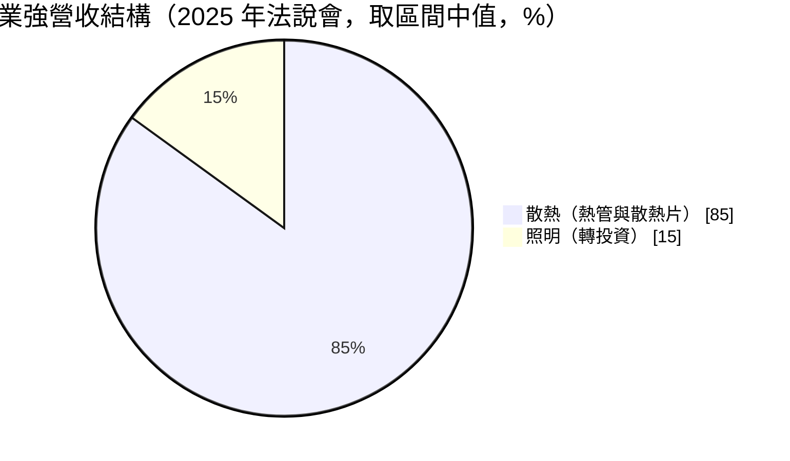
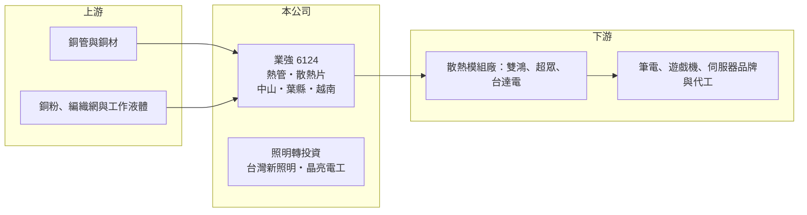

# 6124 業強

> 上櫃｜[[產業索引-電子零組件業|電子零組件業]]｜上市（櫃）日期 2002/03/19

# 第一章：企業模式與商業藍圖

> [!info] 撰寫說明
> 精簡版，由 Claude 依公開資料整理，架構比照 [[2330台積電]]，資料截至 2026-10-08。來源：櫃買中心開放資料快照（基本資料、2026 年第二季資產負債與損益、本益比殖利率）、Goodinfo 經營績效頁、富果 2025 年 11 月法說會摘要。#待校對

業強科技（以下簡稱業強）是替[[散熱模組]]廠供應[[熱管]]與散熱片的零組件廠，另透過轉投資經營照明事業。理解業強的關鍵在於：它位於散熱供應鏈的上游，客戶高度集中在台灣兩大散熱模組廠，而傳統熱管被中國同業殺價，使公司 2023 至 2025 年連續虧損。

- **核心業務：** 業強成立於 1994 年，2002 年在櫃買中心掛牌，主力是散熱導管與散熱片，應用於筆電、遊戲機、高階電競筆電、手機與伺服器。熱管是把熱量從晶片快速帶到散熱鰭片的金屬管，是風冷散熱模組的核心零件。依法說會，傳統熱管約占散熱業務 60%、毛利率低，超薄管與編織網管約占 40%、毛利率較高。
- **營收結構：** 散熱業務約占營收 80% 至 90%，照明業務約占 10% 至 20%；照明包括持股 100% 的台灣新照明（「旭光」品牌）與持股 60% 的晶亮電工（智慧照明、交通號誌與路燈工程）。客戶以台灣散熱模組廠為主，[[3324雙鴻]]與[[6230尼得科超眾]]合計占營收逾 60%，[[2308台達電]]也是主要客戶之一；台灣客戶約占七成以上，中國客戶不到一成。
- **營運據點：** 總部位於台北南港，生產基地在中國廣東中山與河南葉縣（子公司平頂山業強科技）。為因應客戶產能外移與關稅，公司在越南廣寧省下龍市投資約 1,800 萬美元設立新廠，服務東南亞客戶。
- **長期方向：** 公司正從低毛利的傳統熱管轉向超薄管等高附加價值產品，並規劃切入 [[AI 伺服器]]的[[液冷散熱]]。依 2025 年 11 月法說會，公司自 2025 年第四季起引進台灣水冷散熱人才，但研發與設備投資計畫仍處於初期，目標客戶尚未確定。

# 第二章：護城河深度與競爭優勢

業強的護城河偏窄，主要建立在長期客戶關係與量產經驗，但面對中國同業的價格競爭時防禦力有限。

- **競爭優勢：** 業強長年供應雙鴻、超眾等散熱模組大廠，熟悉筆電與遊戲機散熱的量產要求，超薄管與編織網管等產品需要較高的製程能力，毛利也較好。客戶在新機種設計時就需要熱管廠配合開發，形成一定的合作黏著度。但傳統熱管技術已相當成熟，中國廠商可以用更低價格供貨。
- **主要對手：** 散熱模組廠本身也有自製熱管能力，例如 [[3017奇鋐]]、[[6230尼得科超眾]]，這讓業強同時面對「客戶自製」的壓力；此外還有大量中國熱管與散熱片廠以低價競爭。在液冷領域，[[3324雙鴻]]、[[3017奇鋐]]、[[3653健策]]、8996高力 等廠商已領先布局，業強屬於後進者。
- **觀察重點：** 長期最該追蹤的是毛利率能否回到兩位數，以及超薄管等高毛利產品的比重。業強毛利率從 2020 年的 25.9% 一路降到 2024 年的 -1.62%，顯示傳統產品的價格壓力極大。液冷布局能否實際取得客戶訂單，是公司能否擺脫低價競爭的關鍵。

# 第三章：財務體質與盈利規模

資料日期：2026-10-08，表格是撰寫當時的快照；最新月營收、毛利率、累計 EPS 由自動排程寫在本筆記的屬性欄位（月營收、毛利率、累計EPS 等）。#待校對

業強的財務呈現「從穩定獲利滑落到虧損，2026 年才開始回升」的軌跡，核心原因是傳統熱管的價格競爭。

| 年度 | 營收（億元） | [[毛利率]] | [[營業利益率]] | EPS（元） | [[ROE]] |
|---|---|---|---|---|---|
| 2021 | 25.6 | 22.6% | 11.9% | 1.29 | 6.85% |
| 2022 | 20.9 | 12.2% | 0.11% | 0.46 | 2.38% |
| 2023 | 18.2 | 8.09% | -6.84% | -0.47 | -2.31% |
| 2024 | 17.9 | -1.62% | -17.0% | -1.19 | -6.18% |
| 2025 | 18.2 | 6.97% | -6.66% | -0.99 | -5.45% |

（來源：Goodinfo 經營績效頁；2019 年營收 22.5 億元、EPS 1.22 元，2020 年營收 26.8 億元、EPS 1.50 元。）

- **營收規模：** 2019 至 2025 年營收由 22.5 億元降到 18.2 億元，年複合成長率約 -3.5%（推算），2020 年的 26.8 億元是近年高點。2026 年上半年營收約 9.47 億元，毛利率約 14.8%，較 2025 年明顯改善。
- **獲利：** 近五年平均 ROE 約 -0.9%（推算）。2024 年虧損擴大，原因是中國同業低價競爭，加上下半年承接低毛利的遊戲機訂單；2025 年第二季新台幣大幅升值又造成匯損。2026 年上半年營業利益約 0.21 億元，加上業外收入約 0.48 億元，稅後歸屬母公司淨利約 0.55 億元、EPS 0.30 元，本業已轉為小幅獲利。
- **財務特色：** 依 2026 年第二季資料，總資產約 46.7 億元，負債約 14.5 億元，股東權益約 32.2 億元，負債比約 31%，財務結構保守。非流動資產約 25.1 億元，比重偏高，含中國廠房與長期投資。連續虧損期間未配發現金股利，Goodinfo 統計的歷年平均現金股利約 0.31 元，配息不穩定。自由現金流是否長期為正未查得。
- **[[ROIC]] 與 [[WACC]]：** 2025 年營業損失約 1.21 億元（18.2 億元 × -6.66%），稅後營業利益為負；有息負債未查得，投入資本以股東權益 32.2 億元到「權益加全部負債」46.7 億元為區間，ROIC 約 -3.8% 至 -2.6%（推算）。2019 至 2021 年營業利益率 11% 至 15% 時，以當時營業利益與現今投入資本規模粗估，ROIC 約 4% 至 9%（推算）。WACC 以 CAPM 推估：無風險利率 1.75%、市場風險溢酬 6%、β 假設 1.0（散熱零組件股常見值），權益成本約 7.75%；稅後負債成本假設 2%、負債占一成五，WACC 約 6.9%（推算）。近年 ROIC 為負，遠低於 WACC，代表公司正在毀損價值；即使在過去的好年，ROIC 也只是與資金成本相當。

# 第四章：總體風險與地緣政治

業強的風險主要來自客戶集中、中國價格競爭，以及液冷轉型的不確定性。

- **產業週期：** 散熱零件需求跟著筆電、遊戲機與伺服器的出貨週期起伏，消費性電子景氣下行時，客戶會先壓縮上游零件價格。AI 伺服器帶動的散熱需求正從風冷轉向液冷，傳統熱管在高階伺服器上的用量可能被取代，這是結構性而非週期性的風險。
- **營運風險：** 兩大客戶合計占營收逾六成，一旦客戶轉單或擴大自製，營收會直接受衝擊。越南新廠初期的折舊與人力成本會先壓低毛利；液冷產品仍在初期，研發投入可能長時間沒有回報。
- **其他風險：** 熱管主要原料是銅，銅價上漲會壓縮毛利；營收以美元計價，2025 年已示範新台幣升值造成的匯損。主要產能在中國，美國關稅政策與客戶「中國以外」的要求，可能迫使公司加速移轉產能。

# 專有名詞解析

## 應用

- **[[AI 伺服器]]**：搭載 GPU 等加速晶片、用於訓練與推論 AI 模型的伺服器，對散熱與電源規格要求很高。

## 產業

- **[[熱管]]**：內含工作液體的密封金屬管，藉液體蒸發與凝結快速傳遞熱量，是風冷散熱模組的核心零件。
- **[[液冷散熱]]**：以液體流經冷板帶走晶片熱量的散熱方式，散熱效率高於氣冷，是高功耗 AI 伺服器的主流方向。
- **[[散熱模組]]**：由熱管、鰭片、風扇或冷板組成的散熱組件，裝在筆電、伺服器與遊戲機中帶走晶片熱量。

# 核心供應鏈

- 上游：銅管與銅材、銅粉、編織網與工作液體供應商，具體名單未查得。
- 下游／客戶：散熱模組廠 [[3324雙鴻]]、[[6230尼得科超眾]]、[[2308台達電]]，再往下是筆電、遊戲機與伺服器的品牌與代工廠。
- 同業：[[3017奇鋐]]、[[6230尼得科超眾]]（兼具熱管自製能力），以及中國熱管與散熱片廠；液冷領域的 [[3653健策]]、8996高力。

## 最新新聞
<!-- news:start（自動產生，請勿手動編輯此範圍） -->
- 2026-10-13 🏛️ 重訊 13:59｜公告本公司法人董事代表人異動｜[觀測站](https://mops.twse.com.tw/mops/#/web/t05st01)

完整紀錄：[[6124業強 新聞]]
<!-- news:end -->

## 相關連結
- [公開資訊觀測站](https://mopsov.twse.com.tw/mops/web/t05st03?step=1&firstin=1&co_id=6124)
- [Goodinfo](https://goodinfo.tw/tw/StockDetail.asp?STOCK_ID=6124)
- [Yahoo 股市](https://tw.stock.yahoo.com/quote/6124)
- [鉅亨網新聞](https://www.cnyes.com/twstock/6124/news)
