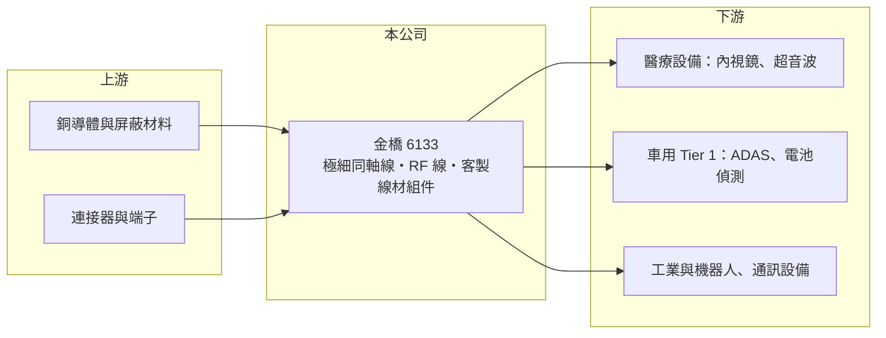

# 6133 金橋

> 上市｜[[產業索引-電子零組件業|電子零組件業]]｜上市（櫃）日期 2003/08/15

# 第一章：企業模式與商業藍圖

> [!info] 撰寫說明
> 精簡版，由 Claude 依公開資料整理，架構比照 [[2330台積電]]，資料截至 2026-10-08。來源：證交所開放資料快照（基本資料、2026 年第二季資產負債與損益、營益分析、股利）、Goodinfo 經營績效頁、富果 2025 年 12 月法說會摘要。公開資料有限，營收比重、客戶與生產據點細節未查得。#待校對

金橋科技（以下簡稱金橋）是一家做客製化線材組件的老牌公司，產品包括[[極細同軸線]]與射頻（RF）線，應用在醫療、車用、工業與通訊設備。理解金橋的關鍵在於：它正從低價的標準線材，轉向少量多樣、高度客製的醫療與車用線材，近兩年毛利率的提升就是這個轉型的成果。

- **核心業務：** 金橋成立於 1976 年，2003 年上市，總部位於新北深坑。核心產品是各類線材組件，包括極細同軸線與 RF 線，財經媒體常把它歸類為高頻高速線材供應商。線材組件是把導線、屏蔽層與連接器組成可直接裝進設備的成品，高階產品的難度在於訊號完整性與在狹小空間中的可靠度。
- **營收結構：** 依 2025 年 12 月法說會，主要應用包括醫療（內視鏡與超音波線）、車用（[[ADAS]] 與電池包偵測系統）、工業（部分產品已切入機器人相關應用），以及通訊與消費性電子；各應用的營收比重未查得。2025 年營收 14.1 億元，為近七年新高。
- **營運據點：** 公司在東南亞設有產能，可望受惠於供應鏈區域化帶來的轉單，但具體廠區位置與產能數字法說會摘要未揭露。公司持續擴增自動化產線，以降低人力依賴並提升品質。
- **長期方向：** 金橋在法說會提出七大方向，核心是降低低階標準線材比重、強化少量多樣的快速打樣能力，並在[[車用電子]]領域與 [[Tier 1]] 供應商共同開發新產品以鎖定後續訂單。醫療與車用線材需要長時間認證，一旦導入通常可以穩定供貨多年，這是公司選擇這條路的主要理由。

# 第二章：護城河深度與競爭優勢

金橋的護城河來自高度客製化與長認證週期的利基市場，規模不大但轉換成本相對高。

- **競爭優勢：** 醫療內視鏡與超音波線材對線徑、柔軟度與可靠度要求極高，且醫療設備需要法規認證，客戶不會輕易換線材供應商。車用 ADAS 與電池偵測線材同樣需要通過車規驗證，與 Tier 1 共同開發的模式讓金橋在設計階段就被綁進供應鏈。少量多樣的快速打樣能力，則讓它能服務大廠不願接的中小批量訂單。
- **主要對手：** 台灣同業包括 [[3665貿聯-KY]]、[[3023信邦]]（醫療與車用線束規模大）、[[6290良維]]、[[8103瀚荃]]、[[6197佳必琪]] 等，國際上則有日本與歐美的醫療線材專業廠。多數對手規模遠大於金橋，金橋的生存空間在於更細分的客製化應用。
- **觀察重點：** 長期最該追蹤的是毛利率能否維持在 20% 以上，以及醫療與車用的營收比重。金橋毛利率從 2021 年的 11.8% 提升到 2025 年的 24.0%、2026 年上半年的 25.5%，營業利益率也從負值升到 10% 以上，顯示產品組合轉型已見成效。下一步要看的是營收規模能否同步擴大。

# 第三章：財務體質與盈利規模

資料日期：2026-10-08，表格是撰寫當時的快照；最新月營收、毛利率、累計 EPS 由自動排程寫在本筆記的屬性欄位（月營收、毛利率、累計EPS 等）。#待校對

金橋的財務特徵是：營收規模約 10 至 14 億元，近年毛利率與營業利益率明顯改善，但稅後獲利仍受業外與稅負影響。

| 年度 | 營收（億元） | [[毛利率]] | [[營業利益率]] | EPS（元） | [[ROE]] |
|---|---|---|---|---|---|
| 2021 | 10.7 | 11.8% | -5.98% | -0.48 | -4.31% |
| 2022 | 13.8 | 19.8% | 5.89% | 0.78 | 7.45% |
| 2023 | 10.1 | 19.4% | 0.89% | 0.09 | 0.95% |
| 2024 | 12.0 | 21.0% | 4.55% | 0.65 | 6.50% |
| 2025 | 14.1 | 24.0% | 10.5% | 0.72 | 5.98% |

（來源：Goodinfo 經營績效頁；2019 年營收 11.5 億元、EPS 0.19 元，2020 年營收 9.47 億元、EPS 0.02 元。）

- **營收規模：** 2019 至 2025 年營收由 11.5 億元增至 14.1 億元，年複合成長率約 3.5%（推算）。2026 年上半年營收約 6.94 億元，毛利率 25.5%、營業利益率 11.5%，稅後 EPS 0.50 元。
- **獲利：** 近五年平均 ROE 約 3.3%（推算），偏低。2025 年營業利益約 1.48 億元，但稅後淨利只有約 0.85 億元，代表業外損失與所得稅吃掉了相當比例的本業獲利；2025 年前三季的淨利甚至較前一年衰退，與匯率等業外因素有關。
- **財務特色：** 依 2026 年第二季資料，總資產約 24.8 億元，負債約 9.5 億元（幾乎都是流動負債），股東權益約 15.3 億元，負債比約 38%，每股淨值 13.04 元。2025 年度每股配發現金股利 1 元，高於當年 EPS 0.72 元，配息率約 139%（推算），部分動用以前年度盈餘。自由現金流是否長期為正未查得。
- **[[ROIC]] 與 [[WACC]]：** 以 2025 年營業利益約 1.48 億元（14.1 億元 × 10.5%）、稅率 20% 計算，稅後營業利益約 1.18 億元；有息負債未查得，投入資本以股東權益 15.3 億元到「權益加全部負債」24.8 億元為區間，ROIC 約 4.8% 至 7.7%（推算）。WACC 以 CAPM 推估：無風險利率 1.75%、市場風險溢酬 6%、β 假設 0.9（中小型零組件股常見值），權益成本約 7.2%；稅後負債成本假設 2%、負債占兩成，WACC 約 6.1%（推算）。2025 年 ROIC 大致與 WACC 相當，是近年第一次接近創造價值的水準；2021 至 2023 年則明顯低於資金成本。

# 第四章：總體風險與地緣政治

金橋的風險主要來自規模小、轉型成果能否延續，以及業外與匯率對獲利的侵蝕。

- **產業週期：** 通訊與消費性電子線材跟著終端景氣起伏，醫療與車用則相對穩定但成長較慢。車用電子的需求受全球車市與電動車滲透率影響，景氣下行時 Tier 1 客戶也會調整庫存。金橋 2023 年營收從 13.8 億元降到 10.1 億元，顯示它仍無法完全擺脫週期。
- **營運風險：** 少量多樣的經營模式需要大量工程與打樣資源，若訂單規模無法擴大，費用會侵蝕利潤。醫療與車用認證週期長，新產品從開發到量產可能需要數年。公司規模小，關鍵客戶的進出就可能影響全年營收。
- **其他風險：** 外銷以美元計價，匯率波動曾明顯影響稅後獲利；銅等原料價格上漲會壓縮毛利。生產據點分散於東南亞等地，地緣政治與關稅政策會影響客戶的產能配置與轉單方向。

# 專有名詞解析

## 應用

- **[[ADAS]]**：先進駕駛輔助系統，例如自動緊急煞車、車道維持，需要大量感測器與穩定的訊號連接。
- **[[車用電子]]**：汽車上的電子控制與感測系統，零件需通過車規驗證，驗證期長、轉換成本高。

## 產業

- **[[極細同軸線]]**：線徑極細、外有屏蔽層的同軸訊號線，用於筆電螢幕、手機天線與相機模組的高頻訊號傳輸。
- **[[Tier 1]]**：直接供貨給汽車品牌的一階供應商，負責整合系統與模組，再向下游零件廠採購。

# 核心供應鏈

- 上游：銅導體、絕緣與屏蔽材料，以及連接器與端子供應商，具體名單未查得。
- 下游／客戶：醫療設備廠（內視鏡、超音波）、車用 Tier 1 供應商、工業自動化與機器人業者、通訊設備廠，具體客戶名稱公開資料未點名（#待校對）。
- 同業：[[3665貿聯-KY]]、[[3023信邦]]、[[6290良維]]、[[8103瀚荃]]、[[6197佳必琪]]。

## 最新新聞
<!-- news:start -->
<!-- news:end -->

## 相關連結
- [公開資訊觀測站](https://mopsov.twse.com.tw/mops/web/t05st03?step=1&firstin=1&co_id=6133)
- [Goodinfo](https://goodinfo.tw/tw/StockDetail.asp?STOCK_ID=6133)
- [Yahoo 股市](https://tw.stock.yahoo.com/quote/6133)
- [鉅亨網新聞](https://www.cnyes.com/twstock/6133/news)
