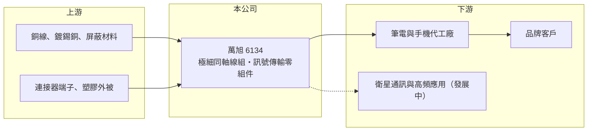

# 6134 萬旭

> 上櫃｜[[產業索引-電子零組件業|電子零組件業]]｜上市（櫃）日期 2002/01/08

# 第一章：企業模式與商業藍圖

> [!info] 撰寫說明
> 精簡版，由 Claude 依公開資料整理，架構比照 [[2330台積電]]，資料截至 2026-10-08。來源：櫃買中心開放資料（基本資料、2026 年上半年財報）、Goodinfo 經營績效頁、nStock 公司簡介。公開資料有限，產品應用與據點描述部分憑記憶整理，已標待校對。#待校對

本章說明萬旭電業（6134）如何以[[極細同軸線]]組為核心，替筆電與行動裝置做訊號傳輸零組件，以及它為什麼在多年虧損後重新嘗試轉型。

- **核心業務：** 萬旭成立於 1987 年，總部在新北五股工業區，2002 年在櫃買中心掛牌。依公司簡介，主要業務是製造銷售極細同軸線組，並買賣電子零組件與電腦周邊。極細同軸線是線徑極細、具屏蔽層的訊號線，用來連接筆電螢幕與主機板、或連接[[天線]]與無線模組，重點在於高頻訊號不失真、又能在轉軸處反覆彎折。
- **營收結構：** 本次查得的資料沒有公布產品別營收比重。依過去公開資訊，萬旭的產品以筆電與行動裝置用的線組及天線相關產品為主（待校對），因此營收高度跟隨 PC 與手機的出貨週期。
- **營運據點：** 台灣總部負責研發與業務，量產主要在中國工廠進行（待校對）。2026 年第二季資產負債表出現非控制權益，代表集團內有非全資持股的子公司。
- **長期方向：** 公司近年把重心從標準化的筆電線材，轉向單價較高的高頻傳輸與衛星通訊相關應用（待校對，媒體曾報導打入手機直連衛星供應鏈，但本次未取得有年份的原始資料）。這類產品若能放量，才可能改變過去「營收規模不大、毛利率偏低」的結構。

# 第二章：護城河深度與競爭優勢

本章分析萬旭的競爭位置。極細同軸線組屬於技術門檻中等、但非常依賴客戶認證與交期配合的零組件，護城河較窄。

- **競爭優勢：** 萬旭的優勢在於投入極細同軸線多年，熟悉筆電與手機品牌、代工廠的認證流程與客製化設計。線組必須配合每一款機種的機構與轉軸設計，打入供應鏈後在該機種的生命週期內不易被替換，這是萬旭維持訂單的主要基礎。
- **主要對手：** 線材與線組領域的同業包括 [[6290良維]]、[[6197佳必琪]]、[[3665貿聯-KY]] 等台廠，以及大量中國線材廠（同業定位為整理性描述，待校對）。中國廠商的成本優勢使一般筆電線組長期面臨降價壓力，這也是萬旭 2021 至 2023 年連續營業虧損的背景。
- **觀察重點：** 長期要看兩件事。第一，毛利率能否維持在 2023 年以來約 24% 至 26% 的水準，而不是回到 2021 年的 16%；第二，衛星通訊、高頻傳輸等新應用能否讓營收穩定站上 20 億元以上，讓費用被規模攤薄、營業利益率真正轉正並擴大。

# 第三章：財務體質與盈利規模

資料日期：2026-10-08，表格是撰寫當時的快照；最新月營收、毛利率、累計 EPS 由自動排程寫在本筆記的屬性欄位（月營收、毛利率、累計EPS 等）。#待校對

本章用多年度數字檢視萬旭的獲利品質：營收規模小、營業利益率長期在零附近，是一家仍在轉型中的公司。

| 年度 | 營收（億元） | [[毛利率]] | [[營業利益率]] | EPS（元） | [[ROE]] |
|---|---|---|---|---|---|
| 2020 | 15.7 | 18.3% | -1.5% | 0.32 | 2.9% |
| 2021 | 16.7 | 16.2% | -4.1% | -0.54 | -5.1% |
| 2022 | 14.5 | 16.9% | -8.1% | -0.91 | -7.8% |
| 2023 | 11.2 | 25.6% | -6.4% | -0.67 | -5.9% |
| 2024 | 15.6 | 24.6% | -1.5% | 0.24 | 1.1% |
| 2025 | 19.1 | 23.6% | 0.7% | 0.12 | 0.4% |

- **營收規模：** 2020 至 2025 年營收年複合成長率約 4%（推算），但中間經歷 2023 年跌到 11.2 億元的低谷。2026 年上半年營收 12.1 億元，已接近 2023 年全年，顯示新產品帶動規模回升。
- **獲利：** 2023 年起毛利率由 17% 左右跳升到 24% 以上，代表產品組合往較高附加價值移動；但營業費用率偏高，營業利益率直到 2025 年才轉正。2026 年上半年營業利益 0.50 億元、EPS 0.42 元，是近年最好的半年。
- **財務特色：** 近 5 年（2021 至 2025）平均 ROE 約 -3.5%（推算），長期沒有替股東賺到合理報酬。2026 年第二季股東權益 12.95 億元、負債 14.39 億元，負債比約 53%，以流動負債為主。依 nStock，2024 與 2025 年度各配發現金股利 0.2 元，配息規模小、不具穩定性。
- **[[ROIC]] 與 [[WACC]]：** 2025 年營業利益約 0.14 億元（19.1 億 × 0.72%），稅後約 0.11 億元；以股東權益 12.95 億元為投入資本，ROIC 不到 1%，若把全部負債也算入更低（推算，有息負債金額未查得）。以 2026 年上半年營業利益年化約 1.0 億元計算，ROIC 約 6%（推算）。WACC 以 [[CAPM]] 推估：無風險利率 1.75%、市場風險溢酬 6%、β 假設 1.0（中小型零組件常見值），股東權益成本約 7.75%；負債成本假設稅後 2%、負債占資本 20%（假設），WACC 約 6.6%（推算）。過去五年 ROIC 明顯低於 WACC，代表公司長期在消耗股東價值；2026 年的改善若能持續，才有機會首次接近資金成本。

# 第四章：總體風險與地緣政治

本章整理萬旭長期要面對的風險。

- **產業週期：** 筆電與手機零組件跟著消費性電子的換機週期起伏，2022 至 2023 年的庫存調整讓營收萎縮超過三成。萬旭規模小、固定費用占比高，景氣下行時很容易由盈轉虧。
- **營運風險：** 客戶集中在少數品牌與代工廠，單一機種的得失就會明顯影響營收。新應用（例如衛星通訊）在量產初期良率與訂單穩定度都不確定，若推進不如預期，獲利可能再回到虧損。
- **其他風險：** 生產集中在中國（待校對），面臨關稅、供應鏈移轉與當地人工成本上升的壓力。銅材價格與匯率也會影響毛利；2026 年上半年其他綜合損益達 1.9 億元，代表匯率或投資評價對權益的波動不小。

# 專有名詞解析

## 金融

- **[[ROIC]]**：投入資本報酬率，衡量公司用股東與債權人投入的資本，每年能賺回多少稅後營業利益。
- **[[WACC]]**：加權平均資金成本，依股東權益與負債的比重，加權計算公司取得資金的平均成本。
- **[[CAPM]]**：資本資產定價模型，以無風險利率加上 β 乘以市場風險溢酬，推估股東要求的報酬率。

## 產業

- **[[極細同軸線]]**：線徑極細、外有屏蔽層的同軸訊號線，用於筆電螢幕、手機天線與相機模組的高頻訊號傳輸。
- **[[天線]]**：把電訊號轉成電磁波收發的元件，筆電、手機與衛星通訊裝置都需要依機構客製設計。

# 核心供應鏈

- 上游：銅導線、屏蔽編織與鍍層材料、微型連接器端子與塑膠外被材料，具名供應商未查得。
- 下游／客戶：筆電與手機的代工廠與品牌客戶，具名客戶未查得；衛星通訊為發展中的新應用（待校對）。
- 同業：[[6290良維]]、[[6197佳必琪]]、[[3665貿聯-KY]] 等線材與線組廠，以及中國線材廠（待校對）。

## 最新新聞
<!-- news:start -->
<!-- news:end -->

## 相關連結
- [公開資訊觀測站](https://mopsov.twse.com.tw/mops/web/t05st03?step=1&firstin=1&co_id=6134)
- [Goodinfo](https://goodinfo.tw/tw/StockDetail.asp?STOCK_ID=6134)
- [Yahoo 股市](https://tw.stock.yahoo.com/quote/6134)
- [鉅亨網新聞](https://www.cnyes.com/twstock/6134/news)
