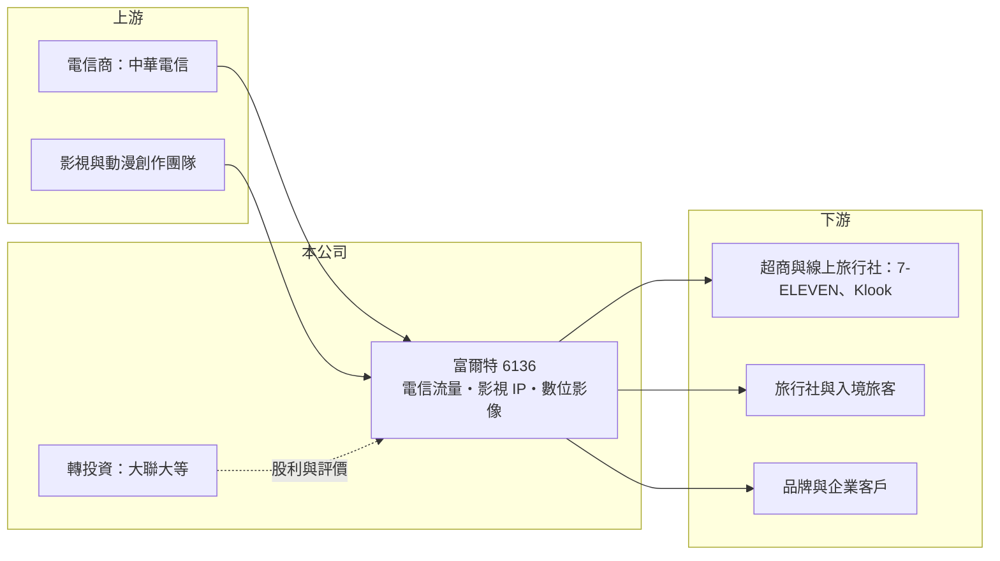

# 6136 富爾特

> 上市｜[[產業索引-通信網路業|通信網路業]]｜上市（櫃）日期 2003/08/25

# 第一章：企業模式與商業藍圖

> [!info] 撰寫說明
> 精簡版，由 Claude 依公開資料整理，架構比照 [[2330台積電]] 的四章研究，資料截至 2026-10-08。來源：富果研究（富爾特 2026 年 9 月法說會整理）、Goodinfo 年度經營績效、證交所開放資料（基本資料、綜合損益、資產負債、營益分析、股利、每月營收、本益比）。公開資料有限，本次未取得產品別營收比重。#待校對

本章說明富爾特科技（股票代號：6136，以下簡稱富爾特）的商業模式：帳面歸類在通信網路業，實際上是「電信流量服務加影視 IP」的小型營運本業，搭配一筆規模遠大於本業的半導體通路股權投資。

- **核心業務：** 富爾特成立於 1992 年，2003 年上市，總部位於新北市新店。依 2026 年 9 月法說會整理，本業分為三塊：電信流量（中華電信入境觀光卡、國人預付卡、國際漫遊與 Hami Video 等行動加值服務）、影視娛樂與整合行銷（格帝控股旗下紅杉娛樂、森川動漫等 IP 事業）、數位影像（原創圖庫品牌 IMAGEMORE）。三塊業務合計年營收約 5 至 6 億元，規模不大。
- **營收結構：** 公司未揭露各事業的營收比重。電信流量業務透過 7-ELEVEN iBon、Klook、街口支付、亞洲主要線上旅行社與大型旅行社銷售 SIM 卡、[[eSIM]] 與預付卡，2025 年成立香港酷遊聯動以拓展國際業務。這類業務屬於電信門號與流量的「轉售與通路」，毛利由電信商的批發價與通路分潤決定。
- **投資部位：** 富爾特真正的價值核心是轉投資 [[3702大聯大]] 的股權。法說會資料指出，權益總額從 2025 年底的 32.7 億元增至 2026 年 6 月底的 45.9 億元，主要來自大聯大股票[[公允價值]]上升。其他轉投資包括萬里雲（CloudMile）、曙客（funNow）與利達數位影音。
- **長期方向：** 電信流量業務朝 S2B2C 模式深化（透過企業通路觸及消費者），影視業務以原創 IP 發展動畫、漫畫、遊戲等整合事業並拓展歐美市場，數位影像則導入 AI 創作工具。對投資人而言，富爾特的長期價值更取決於大聯大的股價與股利，而不是本業的成長。

# 第二章：護城河深度與競爭優勢

本章評估富爾特的競爭地位。本業規模小、多年營業虧損，談不上護城河；公司的抗跌能力主要來自投資部位。

- **競爭優勢：** 富爾特在入境旅客 SIM 卡與預付卡領域，與中華電信合作多年，並建立了超商、旅行社與線上旅行社的通路網。這類通路關係需要時間累積，新進者不容易一次談齊。不過電信商隨時可以自己經營或改找其他代理商，議價能力在電信商手上。
- **主要對手：** 入境 SIM 卡與 eSIM 市場的對手包括各家電信商自營通路、[[6170統振]] 等預付卡通路商，以及 Airalo 等國際 eSIM 平台（對手名單為產業常識整理，待校對）。eSIM 普及後，旅客可以在出國前直接線上購買，實體 SIM 卡通路的價值會下降。
- **觀察重點：** 第一，S2B2C 模式的前期投入何時轉為獲利；2026 年上半年營業費用年增 41%，營業損失 0.18 億元。第二，大聯大股價與股利的變化，這決定富爾特的淨值與業外收入。第三，公司是否調整投資部位，例如處分股票實現獲利。

# 第三章：財務體質與盈利規模

資料日期：2026-10-08。數字取自 Goodinfo 年度經營績效、富果法說會整理與證交所開放資料，表格是撰寫當時的快照；最新月營收、毛利率、累計 EPS 由自動排程寫在本筆記的屬性欄位（月營收、毛利率、累計EPS 等）。#待校對

富爾特的財務特徵是「本業虧損、業外獲利」，EPS 多年為正，主要來自轉投資的股利與收益。

| 年度 | 營收（新台幣） | [[毛利率]] | [[營業利益率]] | EPS（元） | [[ROE]] |
|---|---|---|---|---|---|
| 2020 | 6.53 億 | 16.5% | -5.19% | 0.48 | 2.14% |
| 2021 | 6.01 億 | 15.0% | -7.41% | 1.23 | 5.01% |
| 2022 | 5.00 億 | 15.1% | -8.34% | 0.83 | 3.26% |
| 2023 | 5.06 億 | 19.1% | -6.92% | 0.90 | 3.08% |
| 2024 | 4.93 億 | 21.2% | -6.67% | 0.90 | 2.82% |
| 2025 | 6.39 億 | 25.7% | -9.19% | 0.89 | 2.49% |
| 2026 上半年 | 3.34 億 | 29.60% | -5.49% | -0.04 | 未查得 |

註：2020 至 2025 年取自 Goodinfo 合併報表；2026 上半年取自證交所營益分析與綜合損益資料。

- **營收規模：** 2020 至 2025 年營收年複合成長率約 -0.4%（推算），長期停留在 5 至 6.5 億元。2026 年 1 至 8 月累計營收 4.62 億元，較去年同期 3.91 億元成長約 18%。毛利率從 2020 年的 16.5% 逐步提高到 2026 年上半年的 29.6%，反映產品組合往較高毛利的服務移動。
- **獲利：** 營業利益率六年都是負值，但 EPS 都為正，代表本業虧損由業外收入彌補。2026 年上半年業外收入 0.12 億元不足以抵銷營業損失，歸屬母公司淨損 0.05 億元；由於大聯大通常在下半年發放股利，全年數字需看下半年（推估）。
- **財務特色：** 2026 年第二季底資產總計 49.97 億元、負債僅 4.08 億元、歸屬母公司權益 45.03 億元，每股淨值 38.97 元，負債比約 8%。證交所資料顯示股價淨值比約 0.64 倍，市場對持股部位給予控股公司常見的折價。2025 年度配發現金股利 0.81 元（證交所資料；富果整理寫 1.16 元，口徑待校對），2025 年本期淨利約 1.03 億元。
- **[[ROIC]] 與 [[WACC]]：** 本業 ROIC 為負：2025 年營業損失約 0.59 億元（6.39 億元 × -9.19%），即使只計入本業使用的少量資本，結果仍為負值（推算）。若把投資部位一起算，以 2025 年 ROE 2.49% 衡量整體股東資本報酬，也遠低於權益成本。WACC 以 CAPM 推估：無風險利率 1.75%、市場風險溢酬 6%、β 取 1.0（推估，控股型公司常見值），權益成本約 7.75%；幾乎沒有負債，WACC 約等於 7.75%（推算）。帳面報酬長期低於資金成本，但這是因為大聯大股權以公允價值計入權益、只有股利進入損益；股東的實際報酬更大程度取決於大聯大的股價變動。

# 第四章：總體風險與地緣政治

本章整理富爾特面對的長期風險，核心是本業規模小與投資部位集中。

- **產業週期：** 入境 SIM 卡與預付卡和觀光人潮直接連動，2020 至 2022 年疫情期間國際旅遊停擺即是例子。投資部位則跟隨半導體通路景氣循環，大聯大的獲利與股價會隨 IC 庫存週期波動，間接放大富爾特的淨值起伏。
- **營運風險：** 電信流量業務依附在電信商的批發條件上，電信商調整分潤或改變代理政策，就可能影響毛利。影視 IP 業務投入大、回收不確定，需要持續資金投入。eSIM 普及可能削弱實體 SIM 卡通路的價值。
- **其他風險：** 權益有相當比重集中在單一上市公司股票，股價下跌會直接侵蝕淨值。公司治理方面，投資控股型公司的資本配置決策（持有、處分或再投資）對股東報酬影響很大，但外部投資人較難預測。

# 專有名詞解析

## 應用

- **[[eSIM]]**：內建在手機中的數位 SIM 卡，使用者可以線上下載門號設定，不必插入實體卡片。

## 金融

- **[[公允價值]]**：資產在市場上可以交易的價格，上市股票投資依股價重新評價，變動可能直接計入股東權益。
- **[[ROIC]]**：投入資本報酬率，稅後營業利益除以股東權益與有息負債的合計，衡量本業對所有資金提供者的報酬。
- **[[WACC]]**：加權平均資金成本，依股東權益與負債的比重加權計算的資金成本，ROIC 高於它才代表創造價值。

# 核心供應鏈

- 上游：[[2412中華電]]（入境觀光卡、預付卡、國際漫遊與 Hami Video 合作），影視與動漫內容創作團隊。
- 下游／客戶：7-ELEVEN iBon、Klook、街口支付、亞洲線上旅行社與大型旅行社，最終客戶為入境旅客與國人消費者；影像授權與整合行銷的企業客戶。
- 轉投資：[[3702大聯大]]、萬里雲（CloudMile）、曙客（funNow）、利達數位影音。
- 同業：[[6170統振]]（預付卡通路）。

## 最新新聞
<!-- news:start -->
<!-- news:end -->

## 相關連結
- [公開資訊觀測站](https://mopsov.twse.com.tw/mops/web/t05st03?step=1&firstin=1&co_id=6136)
- [Goodinfo](https://goodinfo.tw/tw/StockDetail.asp?STOCK_ID=6136)
- [Yahoo 股市](https://tw.stock.yahoo.com/quote/6136)
- [鉅亨網新聞](https://www.cnyes.com/twstock/6136/news)
