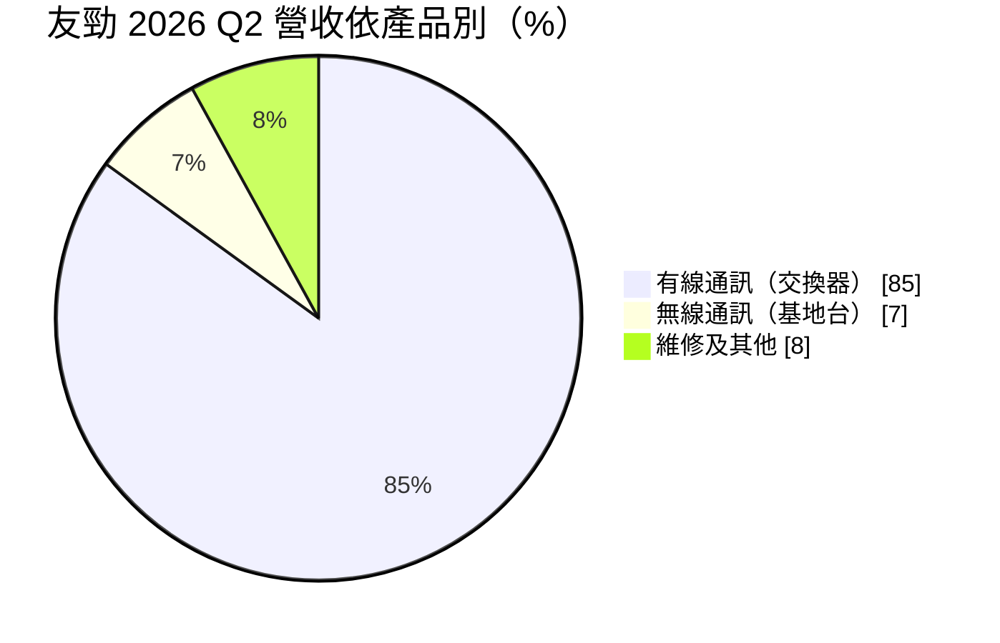
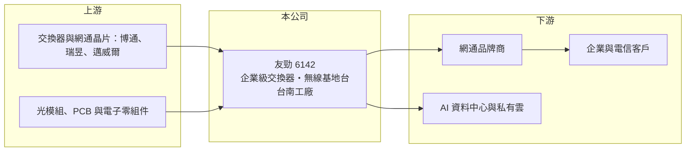

# 6142 友勁

> 上市｜[[產業索引-通信網路業|通信網路業]]｜上市（櫃）日期 2003/08/04

# 第一章：企業模式與商業藍圖

> [!info] 撰寫說明
> 精簡版，由 Claude 依公開資料整理，架構比照 [[2330台積電]] 的四章研究，資料截至 2026-10-08。來源：富果研究（友勁 2026 年 9 月法說會整理）、Goodinfo 年度經營績效、證交所開放資料（基本資料、綜合損益、資產負債、營益分析、每月營收、本益比）。與友訊集團的淵源依記憶整理。#待校對

本章說明友勁科技（股票代號：6142，以下簡稱友勁）的商業模式：從消費性網通代工轉向企業級[[交換器]]的台灣網通廠，目前正處於轉型期。

- **核心業務：** 友勁成立於 1991 年，2003 年上市，總部在台北內湖，早年與 [[2332友訊]]（D-Link）集團關係密切，以消費性網通產品代工為主（待校對）。目前公司定位為企業級網路通訊產品的研發、設計與代工製造，產品包括企業級網管型交換器（核心匯聚與邊際交換器）與企業級智慧型無線基地台。
- **營收結構：** 2026 年第二季有線通訊占營收 85%、無線通訊 7%、維修及其他 8%。地區別為亞洲（含中國大陸、日本）61%、歐洲 20%、美洲 14%、其他 4%。產品高度集中在交換器，代表友勁的成敗幾乎綁在企業網路與資料中心交換器的世代更替上。
- **營運據點：** 營運總部在台北，研發中心分布在台北、新竹與蘇州，製造工廠在台南。公司在法說會強調「台灣製造」，對需要非中國產地的美國與歐洲客戶是一項賣點。
- **長期方向：** 公司策略是放棄低毛利消費性產品，聚焦企業級與 AI 資料中心所需的高速網路設備。25G 核心匯聚交換器已量產出貨，100G/400G AI 高速光交換器開發中，公司預期 2027 年會有更多新機種量產；無線產品規劃導入 Wi-Fi 7 並搭配網管平台。產品世代從 1G/10G 升級到 25G/100G/400G，是友勁能否擺脫虧損的關鍵。

# 第二章：護城河深度與競爭優勢

本章評估友勁在企業網通市場的競爭地位。從營業利益率連續多年為負來看，友勁的護城河尚未建立，轉型成果仍待驗證。

- **競爭優勢：** 友勁的優勢是長期累積的交換器軟硬體整合能力與台灣自有工廠。企業級網管交換器需要穩定的韌體與網管軟體，客戶導入後通常沿用整個產品世代，具一定的轉換成本。台南工廠讓友勁可以提供非中國產地，符合部分歐美客戶的供應鏈要求。
- **主要對手：** 白牌與[[ODM]]交換器領域有 [[2345智邦]]、[[3380明泰]]、[[6285啟碁]]、[[5388中磊]] 等規模更大的台灣廠，品牌端則有 [[CSCO思科]]、HPE Aruba 等（對手名單為產業常識整理，待校對）。智邦已在 400G/800G 資料中心交換器建立領先地位，友勁要在高速交換器分一杯羹，面對的是規模與技術都領先的對手。
- **觀察重點：** 第一，毛利率能否站穩 15% 以上；2026 年第二季為 15%，第一季僅 6%。第二，100G/400G 光交換器能否在 2027 年如期量產並取得客戶。第三，營業費用（2026 年第二季約 0.88 億元）在增加研發的同時，能否被營收成長覆蓋。

# 第三章：財務體質與盈利規模

資料日期：2026-10-08。數字取自 Goodinfo 年度經營績效、富果法說會整理與證交所開放資料，表格是撰寫當時的快照；最新月營收、毛利率、累計 EPS 由自動排程寫在本筆記的屬性欄位（月營收、毛利率、累計EPS 等）。#待校對

友勁的財務數字顯示營收從 30 億元以上縮小到 20 億元以下，毛利率長期偏低，本業連年虧損。

| 年度 | 營收（新台幣） | [[毛利率]] | [[營業利益率]] | EPS（元） | [[ROE]] |
|---|---|---|---|---|---|
| 2020 | 32.9 億 | 2.28% | -15.3% | -1.89 | -20.4% |
| 2021 | 24.9 億 | 1.21% | -25.3% | 1.23 | 15.3% |
| 2022 | 33.8 億 | 8.59% | -2.66% | 0.29 | 2.98% |
| 2023 | 25.4 億 | 6.81% | -7.46% | -0.11 | -1.16% |
| 2024 | 11.8 億 | 1.62% | -27.8% | -0.50 | -5.32% |
| 2025 | 18.0 億 | 9.37% | -10.6% | -0.26 | -2.85% |
| 2026 上半年 | 9.21 億 | 10.78% | -7.31% | -0.28 | 未查得 |

註：2020 至 2025 年取自 Goodinfo 合併報表；2026 上半年取自證交所營益分析與綜合損益資料。2021 年營業虧損但 EPS 為正，推估來自處分資產或轉投資的業外利益，原因本次未查得。

- **營收規模：** 2020 至 2025 年營收年複合成長率約 -11.4%（推算），2024 年一度降到 11.8 億元。2026 年 1 至 8 月累計營收 13.1 億元，較去年同期 12.65 億元成長約 3.6%，回升力道有限。
- **獲利：** 毛利率長期在 1% 至 10% 之間，遠低於網通同業常見的 15% 至 20%，代表過去的產品組合以低價代工為主，連固定費用都難以覆蓋。2026 年上半年營業損失 0.67 億元、淨損 0.94 億元。2021 至 2025 年平均 ROE 約 1.8%（推算），主要靠 2021 年的業外收益拉高。
- **財務特色：** 2026 年第二季底資產總計 39.81 億元、負債 11.62 億元、歸屬母公司權益 28.20 億元，每股淨值 8.52 元，保留盈餘為 -3.60 億元；帳上現金約 6.54 億元，現金循環天數 149 天（富果整理）。開放資料的股本 33.08 億元高於基本資料的實收資本額 30.42 億元，推估近期有增資或私募，待校對。2025 年度未配發股利。
- **[[ROIC]] 與 [[WACC]]：** 以 2025 年營業損失約 1.91 億元（18.0 億元 × -10.6%，虧損不計稅盾）計算，投入資本以歸屬母公司權益 28.20 億元加非流動負債 4.02 億元（代替有息負債）約 32.2 億元，ROIC 約 -5.9%（推算）。WACC 以 CAPM 推估：無風險利率 1.75%、市場風險溢酬 6%、β 取 1.2（推估，轉型中網通股波動較大），權益成本約 8.95%；稅前負債成本假設 2.5%，以約八比二的權益與負債比重加權，WACC 約 7.5%（推算）。ROIC 長期低於 WACC，代表友勁仍在消耗資本；高速交換器若能把毛利率拉到 20% 以上，才有機會讓本業轉正。

# 第四章：總體風險與地緣政治

本章整理友勁面對的長期風險，主要來自轉型執行與規模劣勢。

- **產業週期：** 企業網通設備隨企業 IT 支出與資料中心建置週期波動。2022 年缺料期間客戶超額下單、2023 至 2024 年庫存調整，友勁營收從 33.8 億元降到 11.8 億元，呈現明顯的[[長鞭效應]]。
- **營運風險：** 產品集中在交換器、客戶數有限，單一客戶訂單變化就可能讓營收大幅波動。轉型高速交換器需要持續投入研發，若新機種量產延後或客戶導入不如預期，虧損期會拉長。
- **其他風險：** 研發據點包含蘇州，美中科技管制與資安規範可能影響產品在美國的銷售資格。產品以美元計價，新台幣升值壓縮毛利；主要晶片向少數供應商採購，缺料時議價能力弱。持續虧損下若需再籌資，可能稀釋股權。

# 專有名詞解析

## 金融

- **[[長鞭效應]]**：終端需求的小幅變動，沿供應鏈往上游傳遞時被逐級放大，造成上游庫存與訂單劇烈波動。
- **[[ROIC]]**：投入資本報酬率，稅後營業利益除以股東權益與有息負債的合計，衡量本業對所有資金提供者的報酬。
- **[[WACC]]**：加權平均資金成本，依股東權益與負債的比重加權計算的資金成本，ROIC 高於它才代表創造價值。

## 產業

- **[[交換器]]**：在資料中心或企業網路中轉送資料封包的網路設備，AI 資料中心需要 800G、1.6T 等高速規格。
- **[[ODM]]**：原廠委託設計製造，代工廠可提出設計方案並負責生產，與客戶綁定較深，議價能力較高。
- **[[Wi-Fi 7]]**：IEEE 802.11be 無線網路標準，支援更寬頻道與多連結傳輸，速度與延遲都優於 Wi-Fi 6。

# 核心供應鏈

- 上游：交換器與網通晶片 [[AVGO博通]]、[[2379瑞昱]]、[[MRVL邁威爾]]，光模組、PCB 與電子零組件（實際供應商未公開，待校對）。
- 下游／客戶：網通品牌商（客戶名稱本次未查得），終端為企業網路、電信與 AI 資料中心；地區以亞洲 61%、歐洲 20%、美洲 14% 為主（2026 Q2）。
- 同業：[[2345智邦]]、[[3380明泰]]、[[6285啟碁]]、[[5388中磊]]、[[2332友訊]]、[[6216居易]]。

## 最新新聞
<!-- news:start -->
<!-- news:end -->

## 相關連結
- [公開資訊觀測站](https://mopsov.twse.com.tw/mops/web/t05st03?step=1&firstin=1&co_id=6142)
- [Goodinfo](https://goodinfo.tw/tw/StockDetail.asp?STOCK_ID=6142)
- [Yahoo 股市](https://tw.stock.yahoo.com/quote/6142)
- [鉅亨網新聞](https://www.cnyes.com/twstock/6142/news)
