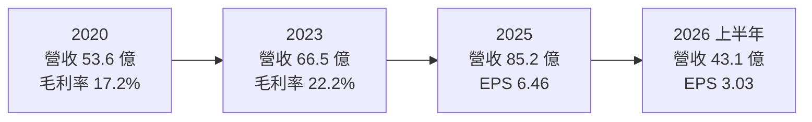
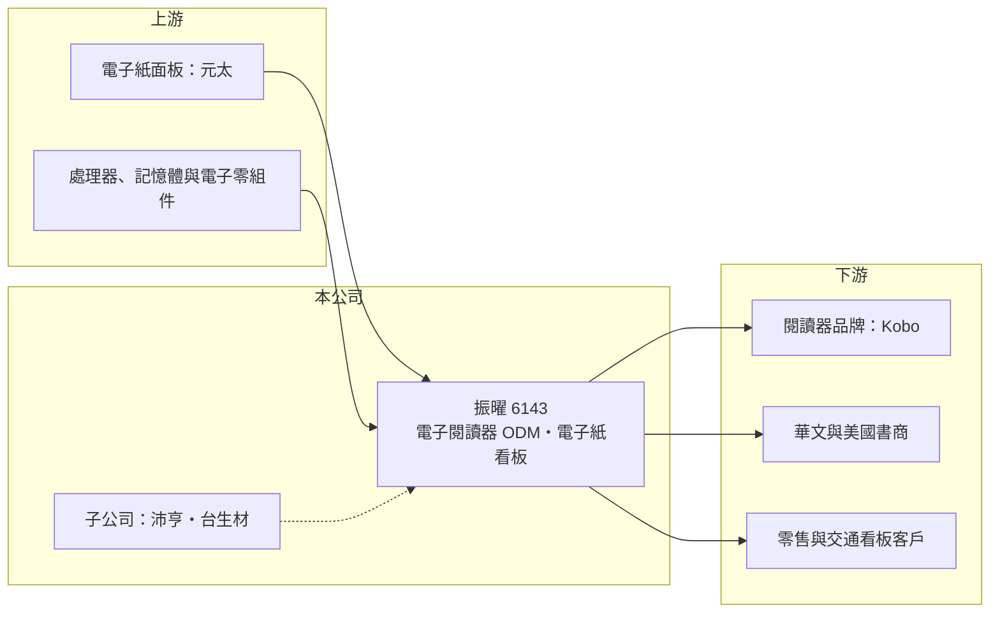

# 6143 振曜

> 上櫃｜[[產業索引-通信網路業|通信網路業]]｜上市（櫃）日期 2002/01/28

# 第一章：企業模式與商業藍圖

> [!info] 撰寫說明
> 精簡版，由 Claude 依公開資料整理，架構比照 [[2330台積電]] 的四章研究，資料截至 2026-10-08。來源：富果研究（振曜 2025 年 11 月法說會整理）、Goodinfo 年度經營績效、櫃買中心開放資料（基本資料、綜合損益、資產負債、每月營收、本益比）。產業描述為整理性內容，尚未逐條比對原始文件。#待校對

本章說明振曜科技（股票代號：6143，以下簡稱振曜）的商業模式：全球主要的[[電子閱讀器]] [[ODM]] 之一，並以子公司延伸到類比 IC 與生醫材料。

- **核心業務：** 振曜成立於 1997 年，2002 年在櫃買中心掛牌，總部位於新竹縣竹北。電子閱讀器是公司最大的營收來源，主打彩色[[電子紙]]機種；依 2025 年 11 月法說會整理，2025 年總出貨量預估超過 200 萬台、年增約三成，其中彩色機種出貨占比七成以上，黑白機種每年約 60 萬台的穩定需求。新興業務是 31.5 吋至 55 吋的電子紙廣告看板（ePoster），2025 年營收占比約 1%，公司目標 2026 年提升到 8% 至 10%。
- **營收結構與客戶：** 公司未揭露完整的產品別比重。主要客戶為樂天旗下的 Kobo，並開發博客來等華文市場與美國中小型書商；子公司 [[6291沛亨]]（類比與電源 IC，延伸到 AI 高速光纖傳輸與軍工應用）與 [[6649台生材]]（生醫材料，產品取得美國 FDA 認證）約貢獻集團營收與獲利的 20% 至 30%。客戶高度集中在單一閱讀器品牌，是振曜最需要留意的結構特徵。
- **營運據點：** 生產據點包括中國揚州廠、2025 年 8 月開始生產的台灣廠、越南與美國。把產能分散到中國以外，是因應美國關稅與客戶供應鏈要求的布局。
- **長期方向：** 振曜與電子紙面板龍頭 [[8069元太]] 合作開發下一代全彩電子紙，新產品最快 2026 年第四季量產；同時把電子紙從閱讀器延伸到零售與交通看板。集團則以沛亨、台生材發展光通訊與生醫，作為閱讀器之外的成長曲線。長期毛利率目標是朝 25% 邁進。

# 第二章：護城河深度與競爭優勢

本章評估振曜的護城河。從近五年 ROE 都在 12% 以上來看，振曜在利基市場建立了窄而實在的競爭優勢。

- **競爭優勢：** 電子閱讀器是小眾但穩定的市場，全球主要品牌只有亞馬遜 Kindle、Kobo 等少數幾家，而電子紙面板幾乎由元太獨家供應。振曜長期與 Kobo 合作，熟悉電子紙驅動、低功耗設計與彩色電子紙的光學調校，這些經驗需要多個產品世代才能累積。彩色電子紙每一代都需要與元太同步開發，先取得新面板並調好畫質的 ODM，就能先拿到品牌的新機種。
- **主要對手：** 電子閱讀器代工主要對手為 [[2312金寶]] 等大型電子代工廠，以及中國的閱讀器品牌與代工廠（對手名單為產業常識整理，待校對）。亞馬遜 Kindle 的代工體系與振曜不同，振曜的市場主要是 Kindle 以外的品牌。
- **觀察重點：** 第一，對 Kobo 的依賴能否透過美國中小書商與華文市場客戶逐步降低。第二，電子紙看板能否從 2025 年約 1% 的營收比重放大，成為第二支柱。第三，元太新一代全彩電子紙的量產進度與良率。

# 第三章：財務體質與盈利規模

資料日期：2026-10-08。數字取自 Goodinfo 年度經營績效、富果法說會整理與櫃買中心開放資料，表格是撰寫當時的快照；最新月營收、毛利率、累計 EPS 由自動排程寫在本筆記的屬性欄位（月營收、毛利率、累計EPS 等）。#待校對

振曜的財務數字顯示營收穩定成長、毛利率逐年提高，是本批網通電子公司中獲利品質最好的之一。

| 年度 | 營收（新台幣） | [[毛利率]] | [[營業利益率]] | EPS（元） | [[ROE]] |
|---|---|---|---|---|---|
| 2020 | 53.6 億 | 17.2% | 6.02% | 2.97 | 11.2% |
| 2021 | 55.5 億 | 17.8% | 6.54% | 3.33 | 12.4% |
| 2022 | 62.7 億 | 19.1% | 6.77% | 4.20 | 15.5% |
| 2023 | 66.5 億 | 22.2% | 10.9% | 4.31 | 16.4% |
| 2024 | 74.1 億 | 21.0% | 10.1% | 7.33 | 17.7% |
| 2025 | 85.2 億 | 22.2% | 11.9% | 6.46 | 15.8% |
| 2026 上半年 | 43.12 億 | 21.1% | 10.5% | 3.03 | 未查得 |

註：2020 至 2025 年取自 Goodinfo 合併報表；2026 上半年取自櫃買中心開放資料（毛利率、營業利益率依開放資料推算）。

- **營收規模：** 2020 至 2025 年營收年複合成長率約 9.7%（推算），六年沒有一年衰退，對消費電子 ODM 而言相當少見。2026 年 1 至 8 月累計營收 57.09 億元，較去年同期 51.21 億元成長約 11.5%。成長動能來自彩色電子閱讀器換機潮與子公司貢獻。
- **獲利：** 毛利率從 2020 年的 17.2% 提升到 2025 年的 22.2%，營業利益率從 6% 提升到 11.9%，顯示彩色機種的產品組合升級確實反映在獲利上。2021 至 2025 年平均 ROE 約 15.6%（推算）。2026 年上半年歸屬母公司淨利 2.60 億元，EPS 3.03 元。
- **財務特色：** 2026 年第二季底資產總計 82.92 億元、負債 35.95 億元、歸屬母公司權益 28.30 億元，每股淨值 32.88 元；權益總計約 46.97 億元，其中非控制權益約 18.7 億元（推算），反映沛亨、台生材等子公司的外部股東。依櫃買中心資料，最近一次現金股利 6 元，以 2025 年 EPS 6.46 元計算[[配息率]]約 93%（推算），配息相當大方。
- **[[ROIC]] 與 [[WACC]]：** 以 2025 年營業利益約 10.14 億元（85.2 億元 × 11.9%）扣 20% 稅後約 8.11 億元，投入資本以權益總計 46.97 億元加非流動負債 1.59 億元約 48.6 億元計算，ROIC 約 16.7%（推算；流動負債中的短期借款未查得，若計入，ROIC 會略低）。WACC 以 CAPM 推估：無風險利率 1.75%、市場風險溢酬 6%、β 取 1.1（推估，中型電子代工股常見值），權益成本約 8.35%；負債比重低，WACC 約 8%（推算）。ROIC 高於 WACC 約 8 個百分點以上，代表振曜在利基市場持續創造價值；能否維持取決於客戶集中度與彩色電子紙的技術領先。

# 第四章：總體風險與地緣政治

本章整理振曜面對的長期風險，主要來自客戶與供應商的雙重集中。

- **產業週期：** 電子閱讀器屬於成熟的小眾消費電子，成長主要靠彩色化與換機週期，一旦換機潮結束，出貨可能回到持平。電子紙看板則受零售與交通業者的資本支出影響，需求尚在培養期。
- **營運風險：** 營收高度依賴 Kobo 單一品牌，客戶轉單或閱讀器策略改變，對營收影響很大。電子紙面板幾乎由元太獨家供應，面板供給與價格直接影響振曜的出貨與毛利。子公司的生醫與光通訊業務與本業差異大，資本配置是否有效仍需觀察。
- **其他風險：** 中國揚州廠仍是重要產能，美國關稅與地緣政治會影響生產布局成本。營收以美元計價為主，新台幣升值壓縮毛利。電子書閱讀器面臨平板與手機閱讀的替代，長期市場規模有天花板。

# 專有名詞解析

## 應用

- **[[電子閱讀器]]**：以電子紙為螢幕、專門用來閱讀電子書的裝置，耗電極低、不傷眼，代表品牌為 Kindle、Kobo。
- **[[電子紙]]**：靠反射環境光顯示、只有在換頁時耗電的顯示技術，主要供應商為元太。

## 金融

- **[[配息率]]**：股利占每股盈餘的比例，反映公司把多少獲利分給股東。
- **[[ROIC]]**：投入資本報酬率，稅後營業利益除以股東權益與有息負債的合計，衡量本業對所有資金提供者的報酬。
- **[[WACC]]**：加權平均資金成本，依股東權益與負債的比重加權計算的資金成本，ROIC 高於它才代表創造價值。

## 產業

- **[[ODM]]**：原廠委託設計製造，代工廠可提出設計方案並負責生產，與客戶綁定較深，議價能力較高。

# 核心供應鏈

- 上游：電子紙面板 [[8069元太]]，處理器、記憶體與電子零組件（供應商名稱本次未查得）。
- 下游／客戶：Kobo（樂天）、博客來等華文市場客戶、美國中小型書商，電子紙看板的零售與交通客戶。
- 集團子公司：[[6291沛亨]]、[[6649台生材]]。
- 同業：[[2312金寶]]。

## 最新新聞
<!-- news:start -->
<!-- news:end -->

## 相關連結
- [公開資訊觀測站](https://mopsov.twse.com.tw/mops/web/t05st03?step=1&firstin=1&co_id=6143)
- [Goodinfo](https://goodinfo.tw/tw/StockDetail.asp?STOCK_ID=6143)
- [Yahoo 股市](https://tw.stock.yahoo.com/quote/6143)
- [鉅亨網新聞](https://www.cnyes.com/twstock/6143/news)
