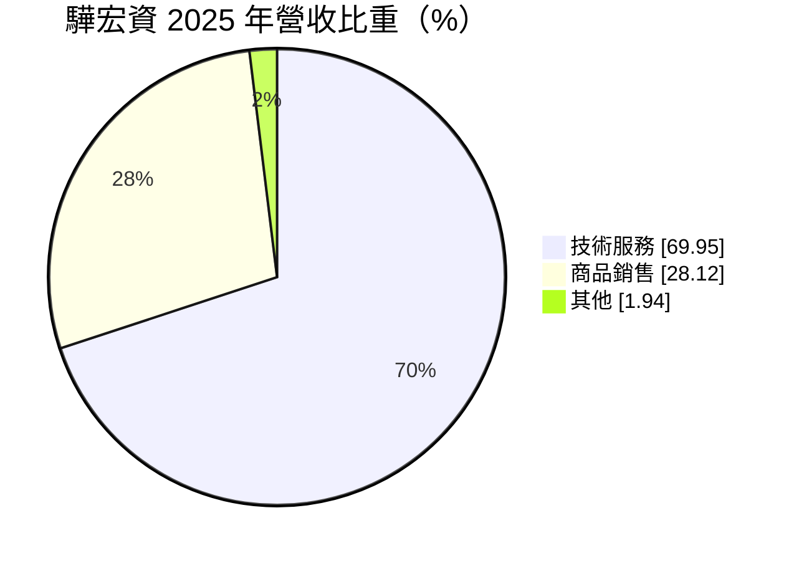
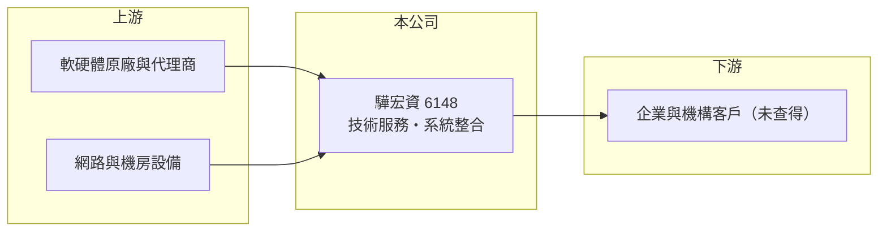

# 6148 驊宏資

> 上櫃｜[[產業索引-資訊服務業|資訊服務業]]｜上市（櫃）日期 2002/02/01

# 第一章：企業模式與商業藍圖

> [!info] 撰寫說明
> 精簡版，由 Claude 依公開資料整理，架構比照 [[2330台積電]]，資料截至 2026-10-08。來源：Goodinfo 經營績效年表（2019 至 2025 年）；富邦 e 點通（MoneyDJ）公司基本資料（2025 年營收比重）；櫃買中心開放資料快照（基本資料、2026 年第二季資產負債與上半年損益、每月營收、股利）。公司具體服務內容與客戶名單在可連上的來源中揭露有限，業務描述部分屬整理性推估，公開資料有限。#待校對

驊宏資（公司全名驊宏資通）成立於 1991 年 12 月、2002 年 2 月上櫃，總部在台北市中正區北平東路，實收資本額約 4.66 億元。它是一家以技術服務為主的中小型資訊服務公司，2025 年營收約 9 億元，屬於台股資訊服務類股中規模偏小、以專案為主要收入來源的業者。

- **核心業務：** 依 2025 年營收比重，驊宏資約七成營收來自技術服務、近三成來自商品銷售。技術服務一般包括系統建置、網路與機房工程、上線後的維運支援，商品銷售則是隨專案一起交付的硬體與軟體。這種組合代表公司的價值主要在「把設備和系統整合起來並維持運作」，也就是[[系統整合]]，而不是自有產品。具體服務領域與主要客戶未查得（待校對）。
- **營收結構：** 技術服務比重高，對毛利率是好事，因為人力與專業的附加價值高於單純轉賣硬體。但驊宏資的營收在 2019 至 2025 年間在 5 億到 9 億元之間來回擺動，2022 年一度降到 5.04 億元、2023 年又跳到 8.85 億元，顯示收入高度依賴大型專案的認列時點，而不是穩定的年費。
- **營運據點與治理：** 總部在台北，董事長由法人「皮卡比熊股份有限公司」擔任，總經理為廖文鐸。法人董事代表公司的經營權掌握在特定投資公司手中，長期研究時要留意大股東結構與經營團隊是否穩定。
- **長期方向：** 公開資料未揭露明確的中長期策略。對這類以專案為主的資訊服務公司，長期價值取決於能否把一次性的建置案延伸成多年期的維運合約，讓[[經常性收入]]比重上升，降低營收的大起大落。

# 第二章：護城河深度與競爭優勢

驊宏資的護城河偏窄，主要來自既有客戶的系統熟悉度與維運關係，而非技術或規模優勢。

- **競爭優勢：** 資訊系統一旦上線，原建置廠商最了解系統架構，後續的擴充、維修與升級往往會優先交給原廠商，這就是系統整合業的轉換成本。驊宏資近年[[毛利率]]維持在 22% 至 30%，高於單純硬體經銷商，代表技術服務確實帶來一定的附加價值。
- **主要對手：** 台灣系統整合市場參與者眾多，大型業者如 [[6214精誠]]、[[2480敦陽科]]、[[2453凌群]]、[[8099大世科]]，中小型業者則有 [[6221晉泰]]、[[6590普鴻]] 等。驊宏資規模較小，在大型標案上較難與大廠正面競爭，較可能在特定領域或既有客戶中深耕。
- **觀察重點：** 第一，營收能否擺脫專案週期，穩定在 9 億元以上；第二，[[營業利益率]]能否從 5% 至 10% 的區間往上走，證明規模經濟；第三，大股東與經營層的資本配置習慣，例如是否把現金用於配息或轉投資新事業。

# 第三章：財務體質與盈利規模

資料日期：2026-10-08，表格是撰寫當時的快照；最新月營收、毛利率、累計 EPS 由自動排程寫在本筆記的屬性欄位（月營收、毛利率、累計EPS 等）。#待校對

驊宏資的財務呈現典型專案型資訊服務公司的樣貌：毛利率尚可、營業利益率薄、營收隨專案波動。

| 年度 | 營收（億元） | [[毛利率]] | [[營業利益率]] | EPS（元） | [[ROE]] |
|---|---|---|---|---|---|
| 2019 | 7.07 | 14.8% | 2.98% | 0.60 | 5.45% |
| 2020 | 7.38 | 21.9% | 6.57% | 1.11 | 9.77% |
| 2021 | 6.32 | 25.5% | 5.78% | 0.98 | 8.13% |
| 2022 | 5.04 | 29.7% | 5.19% | 0.83 | 7.00% |
| 2023 | 8.85 | 26.6% | 9.63% | 1.64 | 13.5% |
| 2024 | 7.55 | 23.3% | 7.04% | 1.54 | 12.0% |
| 2025 | 9.04 | 22.5% | 6.90% | 1.36 | 10.5% |
| 2026 上半年 | 2.42 | 25.7% | 3.4% | 0.17 | 未查得 |

註：2019 至 2025 年取自 Goodinfo；2026 年上半年取自櫃買中心開放資料推算（營業毛利 0.62 億元、營業利益 0.08 億元）。

- **長期指標：** 2020 至 2025 年營收年複合成長率約 4.1%（推算），2021 至 2025 年平均 ROE 約 10.2%（推算）。櫃買中心快照顯示最近一年度現金股利約 1.23 元，相對 2025 年 EPS 1.36 元，配息率約九成（推算），代表公司沒有大量再投資需求，傾向把盈餘發還股東。2026 年 1 至 8 月累計營收較去年同期減少約 35%，再次反映專案認列的波動。
- **[[ROIC]] 與 [[WACC]]：** 2025 年營業利益約 0.62 億元（9.04 億 × 6.90%），稅後約 0.50 億元；2026 年第二季股東權益 5.56 億元，有息負債未查得，假設約 1 億元，投入資本約 6.56 億元，ROIC 約 7.6%（推算）。若以 2026 年上半年年化營業利益 0.16 億元計算，ROIC 只有約 2%（推算）。WACC 以無風險利率 1.75%、市場風險溢酬 6%、β 1.0（資訊服務中小型股常見值）推得權益成本 7.75%，負債約占 15%、稅後負債成本約 2%，WACC 約 6.9%（推算）。正常年度 ROIC 只略高於 WACC，專案淡年則低於 WACC，代表公司創造的經濟價值有限，關鍵在營收規模能否穩定放大。
- **財務特色：** 2026 年第二季總資產 11.9 億元、負債比率約 53%，[[每股淨值]] 11.94 元。負債比率在資訊服務業中不算低，推估包含專案預收款與應付設備款，屬營運性負債。

# 第四章：總體風險與地緣政治

驊宏資的風險集中在專案依賴與規模劣勢，這兩點會讓獲利穩定度明顯低於大型同業。

- **產業週期：** 企業與政府的資訊支出跟著景氣與預算走，景氣轉弱時新建專案容易延後。系統整合業的週期不像半導體那樣劇烈，但對小型業者來說，少一兩個大案就可能讓全年營收大幅下滑。
- **營運風險：** 專案型收入的毛利取決於估價與執行，若工程延誤或成本超支，利潤會被侵蝕。人才是資訊服務業最主要的成本，工程師薪資上漲會直接壓縮營業利益率，小公司在人才競爭上也較吃虧。
- **其他風險：** 經營權集中在法人董事，若大股東改變策略，公司方向可能隨之調整。商品銷售部分以進口軟硬體為主，匯率與原廠價格變動會影響毛利。

# 專有名詞解析

## 應用

- **[[系統整合]]**：把不同廠牌的硬體、軟體與網路整合成可運作的資訊系統，並負責建置與後續維護的服務。

## 金融

- **[[經常性收入]]**：每年固定重複發生的收入，例如維運年約、訂閱費，能讓營收比一次性專案更穩定。
- **[[每股淨值]]**：股東權益除以流通股數，代表每股在帳上的價值。
- **[[ROIC]]**：投入資本報酬率，稅後營業利益除以股東權益加有息負債，衡量本業運用資本的效率。
- **[[WACC]]**：加權平均資金成本，股東與債權人要求報酬率的加權平均，是 ROIC 要超越的門檻。

# 核心供應鏈

- 上游：國內外軟硬體原廠與代理商，具體名單未查得。
- 下游／客戶：企業與機構客戶，具體名單未查得。
- 同業：[[6214精誠]]、[[2480敦陽科]]、[[2453凌群]]、[[8099大世科]]、[[6221晉泰]]、[[6590普鴻]]。

## 最新新聞
<!-- news:start -->
<!-- news:end -->

## 相關連結
- [公開資訊觀測站](https://mopsov.twse.com.tw/mops/web/t05st03?step=1&firstin=1&co_id=6148)
- [Goodinfo](https://goodinfo.tw/tw/StockDetail.asp?STOCK_ID=6148)
- [Yahoo 股市](https://tw.stock.yahoo.com/quote/6148)
- [鉅亨網新聞](https://www.cnyes.com/twstock/6148/news)
