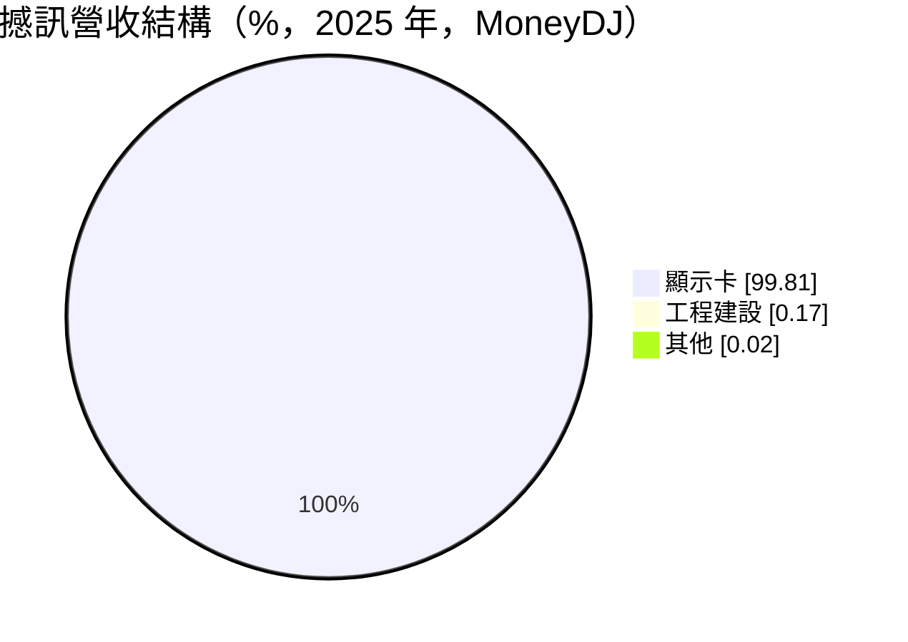
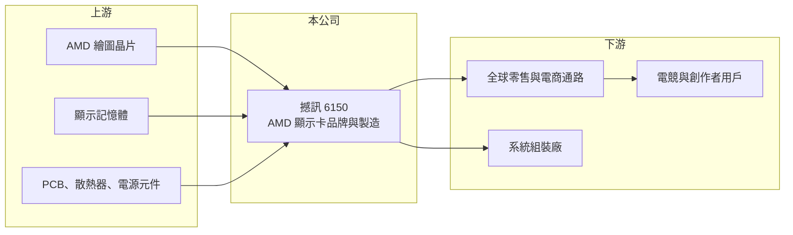

# 6150 撼訊

> 上櫃｜[[產業索引-電腦及週邊設備業|電腦及週邊設備業]]｜上市（櫃）日期 2002/03/11

# 第一章：企業模式與商業藍圖

> [!info] 撰寫說明
> 精簡版，由 Claude 依公開資料整理，架構比照 [[2330台積電]]，資料截至 2026-10-08。來源：櫃買中心開放資料快照（基本資料、2026 年上半年財報、每月營收）、Goodinfo 經營績效年度表、MoneyDJ 個股基本資料（2025 年營收比重、歷年股利）。PowerColor 品牌、只採用 AMD 晶片與 2021 年加密貨幣挖礦需求的描述為記憶內容。#待校對

撼訊是以 AMD 繪圖晶片為核心的[[顯示卡]]廠商，本章說明這種「單一晶片供應商」的商業模式。

- **核心業務：** 撼訊向 [[AMD超微]] 採購繪圖處理器（GPU），搭配記憶體、電源與散熱設計，製成顯示卡後以自有品牌 PowerColor 等銷售到全球通路（品牌描述待校對）。這類廠商在業界稱為 AIB 板卡廠，核心能力在於散熱與電路設計、通路經營與庫存管理，而不是晶片本身。
- **營收結構：** 依 MoneyDJ，2025 年顯示卡占營收 99.8%，工程建設約 0.2%，其他不到 0.1%。營收幾乎完全來自顯示卡，產品線非常集中。
- **營運據點：** 公司 1997 年成立，2002 年於櫃買中心掛牌，2026 年第二季實收資本額約 4.8 億元，股本小但營收規模達數十億元，屬於高周轉、低毛利的貿易製造型態。生產據點未查得。
- **長期方向：** 顯示卡需求來自電競、內容創作，以及近年的 AI 運算與工作站。撼訊的長期成長幾乎取決於 AMD 每一代 GPU 的市場競爭力，以及公司能否把產品延伸到 AI 加速卡或工作站等較高毛利的應用。

# 第二章：護城河深度與競爭優勢

顯示卡板卡廠的護城河很窄，獲利主要由上游晶片週期決定，本章說明撼訊的競爭位置。

- **競爭優勢：** 撼訊長期專注 AMD 平台，與晶片原廠的合作關係與配貨順位是它最重要的資產。在 AMD 新產品推出時，能早期取得晶片並推出特色散熱款式的板卡廠，才能在新品期賺到較好的價差。
- **主要對手：** 同時銷售 AMD 與輝達顯示卡的大廠包括 [[2357華碩]]、[[2377微星]]、[[2376技嘉]]，另有藍寶石（Sapphire）、XFX 等 AMD 專屬品牌，以及 [[2399映泰]]、[[2465麗臺]] 等台灣同業。大廠產品線廣、品牌力強，撼訊必須以價格與特定型號取勝。
- **觀察重點：** 過去九年毛利率在 3% 至 21% 之間劇烈擺盪，說明公司幾乎沒有定價能力，獲利高低取決於 GPU 供需。長期要看 AMD 在消費與 AI 市場的份額變化，以及公司在晶片跌價時控制庫存損失的能力。

# 第三章：財務體質與盈利規模

資料日期：2026-10-08，表格是撰寫當時的快照；最新月營收、毛利率、累計 EPS 由自動排程寫在本筆記的屬性欄位（月營收、毛利率、累計EPS 等）。#待校對

撼訊的財務數字呈現極端的景氣循環，2021 年 EPS 高達 24 元，之後連續三年虧損。

| 年度 | 營收（億元） | [[毛利率]] | [[營業利益率]] | EPS（元） | [[ROE]] |
|---|---|---|---|---|---|
| 2021 | 87.9 | 21.2% | 15.5% | 24.00 | 66.3% |
| 2022 | 49.3 | 4.16% | -2.00% | -1.78 | -4.22% |
| 2023 | 54.1 | 3.22% | -3.06% | -2.84 | -8.25% |
| 2024 | 47.0 | 3.99% | -4.20% | -4.10 | -12.9% |
| 2025 | 75.7 | 8.30% | 2.69% | 2.63 | 8.31% |

- **營收規模：** 2020 年營收 37.8 億元、2025 年 75.7 億元，五年年複合成長率約 14.9%（推算），但年度間起伏很大。2021 年的高峰與當時加密貨幣挖礦帶動的顯示卡缺貨有關（記憶內容，待校對）。2026 年上半年營收 25.9 億元、毛利率 14.9%、營業利益率 6.7%、EPS 2.46 元，1 至 8 月累計營收年減約 27%，但毛利率明顯回升。
- **獲利：** 2021 至 2025 年平均 ROE 約 9.8%（推算），但幾乎全部來自 2021 年，其他年份多為虧損。現金股利跟著獲利大起大落：2021 年度配發 11 元，2022 至 2024 年度停發，2025 年度恢復 0.6 元，不適合以穩定配息的角度看待。
- **財務特色：** 2026 年第二季末總資產 38.4 億元、總負債 21.3 億元（幾乎都是流動負債），負債比約 55%；股東權益 17.1 億元，每股淨值 35.26 元。流動負債高反映公司以短期資金支應晶片採購與庫存，景氣反轉時存貨跌價是主要的財務風險。
- **[[ROIC]] 與 [[WACC]]：** 2025 年營業利益約 2.04 億元，稅後約 1.63 億元；有息負債未逐項查得，假設約 10 億元短期借款，投入資本約 26 億元，ROIC 約 6.3%（推算）；2026 年上半年年化稅後營業利益約 2.78 億元，ROIC 約 10%（推算）；2022 至 2024 年則為負值。WACC 以 CAPM 推估：無風險利率 1.75%、市場風險溢酬 6%、β 取 1.4（高波動的板卡股常見值），股東權益成本 10.15%；負債占資本約 35%、稅後成本 2%，WACC 約 7.3%（推算）。ROIC 只在景氣高峰年度高於 WACC，跨整個週期來看價值創造並不穩定。

# 第四章：總體風險與地緣政治

撼訊的命運與上游晶片廠和終端需求緊密綁在一起，本章整理長期風險。

- **產業週期：** 顯示卡需求受遊戲、挖礦、AI 等不同因素輪流推動，每一波熱潮退去後都可能出現庫存過剩與價格崩跌。2022 至 2024 年的連續虧損就是週期反轉的結果。
- **營運風險：** 只依賴 AMD 單一晶片供應商，若 AMD 新產品競爭力不足或配貨減少，撼訊沒有替代來源。品牌與通路規模小於大廠，議價能力有限，庫存管理一旦失誤，損失會吃掉多年獲利。
- **其他風險：** 記憶體等零件價格波動影響成本；營收以美元計價，匯率影響毛利；美國對 AI 晶片的出口管制與關稅政策可能限制部分產品的銷售市場。

# 專有名詞解析

## 金融

- **[[ROIC]]**：投入資本報酬率，稅後營業利益除以股東權益加有息負債，衡量本業運用資本的效率。
- **[[WACC]]**：加權平均資金成本，股東權益成本與負債成本依資本結構加權，是 ROIC 必須超越的門檻。

## 產業

- **[[顯示卡]]**：搭載繪圖處理器（GPU）的擴充卡，負責電腦的影像輸出與平行運算，用於遊戲、繪圖與 AI 運算。

# 核心供應鏈

- 上游：[[AMD超微]] 繪圖晶片、顯示記憶體（例如 [[005930三星電子]]，實際採購對象待校對）、PCB 與散熱器。
- 下游／客戶：全球零售與電商通路、系統組裝廠，終端為電競玩家與內容創作者。
- 同業：[[2357華碩]]、[[2377微星]]、[[2376技嘉]]、[[2399映泰]]、[[2465麗臺]]，以及藍寶石、XFX。

## 最新新聞
<!-- news:start -->
<!-- news:end -->

## 相關連結
- [公開資訊觀測站](https://mopsov.twse.com.tw/mops/web/t05st03?step=1&firstin=1&co_id=6150)
- [Goodinfo](https://goodinfo.tw/tw/StockDetail.asp?STOCK_ID=6150)
- [Yahoo 股市](https://tw.stock.yahoo.com/quote/6150)
- [鉅亨網新聞](https://www.cnyes.com/twstock/6150/news)
