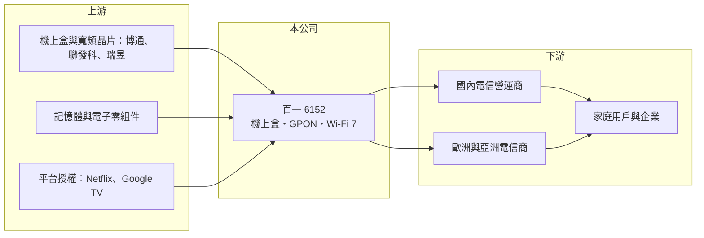

# 6152 百一

> 上市｜[[產業索引-通信網路業|通信網路業]]｜上市（櫃）日期 2009/12/08

# 第一章：企業模式與商業藍圖

> [!info] 撰寫說明
> 精簡版，由 Claude 依公開資料整理，架構比照 [[2330台積電]] 的四章研究，資料截至 2026-10-08。來源：富果研究（百一 2025 年 6 月法說會整理）、Goodinfo 年度經營績效、證交所開放資料（基本資料、綜合損益、資產負債、營益分析、股利、每月營收、本益比）。公開資料有限，本次未取得產品別營收比重。#待校對

本章說明百一電子（股票代號：6152，以下簡稱百一）的商業模式：以電信營運商為主要客戶的[[機上盒]]設計製造商，正嘗試延伸到寬頻設備與軟體服務。

- **核心業務：** 百一成立於 1995 年，2009 年上市，總部位於桃園中壢。機上盒是最主要的營收來源，公司已取得 Netflix 自助認證資格與 Google TV 授權，可以替電信商與有線電視業者提供整合串流服務的機上盒。依 2025 年 6 月法說會整理，公司正延伸到寬頻產品，包括 [[GPON]] 光纖終端與 [[Wi-Fi 7]] 設備，並與合作夥伴把 AI 模組整合進機上盒，發展居家健康監控與智慧總機等應用。
- **營收結構：** 公司未揭露機上盒與寬頻產品的營收比重；法說會當時寬頻產品尚未真正出貨。客戶以電信營運商為主，包括國內電信商的 GPON 加 Wi-Fi 標案、義大利電信商的 Wi-Fi 7 訂單，以及採用其軟體加值服務的馬來西亞與日本客戶。營運商客戶的訂單多以標案形式取得，因此營收容易隨標案時程大起大落。
- **營運據點：** 總部與研發在桃園中壢，生產據點本次未查得（待校對）。
- **長期方向：** 百一的策略是從純硬體供應商轉型為軟硬體整合服務商，利用既有的營運商客戶交叉銷售寬頻與 AI 應用產品，另外配合國家太空中心計畫發展海事用的多軌道衛星地面接收裝置。機上盒市場隨串流影音普及而萎縮，寬頻與軟體服務能否接棒，是百一長期存續的關鍵。

# 第二章：護城河深度與競爭優勢

本章評估百一的競爭地位。從營業利益率多數年度為負來看，百一的護城河很窄，主要依賴與營運商的長期合作關係。

- **競爭優勢：** 機上盒需要整合條件接收系統、串流平台認證與營運商的後台系統，每家營運商的規格都不同，導入週期長。百一取得 Netflix 與 Google TV 授權，並累積多國營運商的客製經驗，這是新進者短期難以複製的門檻。營運商一旦採用，通常會延續到下一代產品。
- **主要對手：** 國際上有 Sagemcom、Technicolor（現為 Vantiva）、Humax 與中國的創維、九聯等機上盒大廠；台灣寬頻設備則有 [[3596智易]]、[[5388中磊]]、[[6285啟碁]] 等（對手名單為產業常識整理，待校對）。在 GPON 與 Wi-Fi 設備上，百一的規模遠小於這些對手。
- **觀察重點：** 第一，寬頻產品出貨後的毛利率與營收比重。第二，營運商標案的續約與新客戶取得。第三，2026 年營收大幅成長後，本業能否由虧轉盈；2026 年上半年營業利益率仍為 -1.62%。

# 第三章：財務體質與盈利規模

資料日期：2026-10-08。數字取自 Goodinfo 年度經營績效與證交所開放資料，表格是撰寫當時的快照；最新月營收、毛利率、累計 EPS 由自動排程寫在本筆記的屬性欄位（月營收、毛利率、累計EPS 等）。#待校對

百一的財務數字顯示營收從 2022 年高點腰斬，2025 年出現大額虧損，2026 年隨客戶需求回升而改善。

| 年度 | 營收（新台幣） | [[毛利率]] | [[營業利益率]] | EPS（元） | [[ROE]] |
|---|---|---|---|---|---|
| 2020 | 30.5 億 | 17.7% | -1.77% | 0.13 | 1.74% |
| 2021 | 37.9 億 | 14.8% | -1.19% | 0.05 | 0.82% |
| 2022 | 39.4 億 | 15.0% | 0.59% | 0.81 | 9.5% |
| 2023 | 21.9 億 | 18.7% | -4.88% | -0.12 | -1.45% |
| 2024 | 22.7 億 | 16.5% | -7.53% | -0.23 | -2.69% |
| 2025 | 15.7 億 | 13.2% | -19.5% | -1.47 | -17.8% |
| 2026 上半年 | 9.57 億 | 26.93% | -1.62% | 0.27 | 未查得 |

註：2020 至 2025 年取自 Goodinfo 合併報表；2026 上半年取自證交所營益分析與綜合損益資料。

- **營收規模：** 2020 至 2025 年營收年複合成長率約 -12.4%（推算）。2026 年 1 至 8 月累計營收 15.71 億元，較去年同期 10.07 億元成長約 56%，公司說明主因為客戶需求增加，已接近 2025 年全年水準。
- **獲利：** 六年中只有 2022 年本業小幅獲利，2025 年營業利益率 -19.5%、每股虧損 1.47 元，2021 至 2025 年平均 ROE 約 -2.3%（推算）。2026 年上半年毛利率升到 26.9%，營業損失縮小到 0.15 億元，加上業外收入 0.61 億元，歸屬母公司淨利 0.45 億元。
- **財務特色：** 2026 年第二季底資產總計 35.90 億元、負債 22.43 億元（其中流動負債 21.74 億元）、歸屬母公司權益 13.30 億元，每股淨值 7.93 元，保留盈餘為 -3.59 億元，負債比約 62%，較 2025 年 3 月底的 46% 明顯升高，推估是營收成長帶動應付帳款與短期借款增加（推估）。2025 年度本期淨損約 2.46 億元，未配發股利。
- **[[ROIC]] 與 [[WACC]]：** 以 2025 年營業損失約 3.06 億元（15.7 億元 × -19.5%，虧損不計稅盾）計算，投入資本以歸屬母公司權益 13.30 億元加非流動負債 0.69 億元（短期借款未查得，未計入）約 14.0 億元，ROIC 約 -22%（推算）；以 2026 年上半年營業損失年化約 -0.31 億元計算，ROIC 約 -2%（推算），虧損大幅收斂但仍為負。WACC 以 CAPM 推估：無風險利率 1.75%、市場風險溢酬 6%、β 取 1.2（推估，虧損中小型電子股波動較大），權益成本約 8.95%；稅前負債成本假設 2.5%，WACC 約 7% 至 8%（推算）。ROIC 長期低於 WACC，百一需要先讓本業穩定獲利，才談得上創造價值。

# 第四章：總體風險與地緣政治

本章整理百一面對的長期風險，主要來自產品市場萎縮與客戶集中。

- **產業週期：** 機上盒需求跟隨營運商的設備汰換與標案週期，並非每年平均分布；2022 年營收 39.4 億元、2025 年僅 15.7 億元，顯示標案空窗期的衝擊很大。串流平台直接在智慧電視上提供服務，使傳統機上盒市場長期萎縮。
- **營運風險：** 營收集中在少數電信營運商，單一標案得失就可能改變全年損益。轉型寬頻與 AI 應用需要研發投入，且面對規模更大的寬頻設備對手，價格競爭激烈。
- **其他風險：** 負債比升到六成以上，短期資金需求增加，若營收再度下滑，財務彈性有限。歐洲客戶以歐元計價、其他多以美元計價，匯率波動影響損益，2025 年第一季即有約 1,200 萬元匯兌損失。晶片與記憶體價格上漲會壓縮硬體毛利。

# 專有名詞解析

## 應用

- **[[機上盒]]**：接在電視上、接收有線電視、IPTV 或串流訊號並解碼的裝置，主要由電信與有線電視營運商採購。
- **[[GPON]]**：十億位元級被動光纖網路，光纖到府常用的技術標準，用戶端需要光纖終端設備。

## 金融

- **[[ROIC]]**：投入資本報酬率，稅後營業利益除以股東權益與有息負債的合計，衡量本業對所有資金提供者的報酬。
- **[[WACC]]**：加權平均資金成本，依股東權益與負債的比重加權計算的資金成本，ROIC 高於它才代表創造價值。

## 產業

- **[[Wi-Fi 7]]**：IEEE 802.11be 無線網路標準，支援更寬頻道與多連結傳輸，速度與延遲都優於 Wi-Fi 6。

# 核心供應鏈

- 上游：機上盒與寬頻晶片 [[AVGO博通]]、[[2454聯發科]]、[[2379瑞昱]]（實際採用比重未公開，待校對），記憶體與電子零組件，Netflix 與 [[GOOGL谷歌]] 的平台授權。
- 下游／客戶：國內電信營運商、義大利電信商、馬來西亞與日本營運商，終端為家庭用戶與企業。
- 同業：[[3596智易]]、[[5388中磊]]、[[6285啟碁]]、[[3062建漢]]。

## 最新新聞
<!-- news:start（自動產生，請勿手動編輯此範圍） -->
- 2026-10-08 📰 媒體 18:21｜營收速報 - 百一(6152)9月營收1.92億元年增率高達76.8％｜[鉅亨網](https://news.cnyes.com/news/id/6625186)
- 2026-10-08 🏛️ 重訊 15:33｜係因本公司有價證券於集中市場達公布注意交易資訊標準， 故公布相關財務業務等重大訊息，以利投資人區別瞭解。｜[觀測站](https://mops.twse.com.tw/mops/#/web/t05st01)
- 2026-10-05 📰 媒體 17:30｜低軌衛星股全面起飛！昇達科(3491)、華通(2313)、百一(6152)攻漲停，誰真正吃得到Starlink訂單？｜[鉅亨網](https://news.cnyes.com/news/id/6621808)

完整紀錄：[[6152百一 新聞]]
<!-- news:end -->

## 相關連結
- [公開資訊觀測站](https://mopsov.twse.com.tw/mops/web/t05st03?step=1&firstin=1&co_id=6152)
- [Goodinfo](https://goodinfo.tw/tw/StockDetail.asp?STOCK_ID=6152)
- [Yahoo 股市](https://tw.stock.yahoo.com/quote/6152)
- [鉅亨網新聞](https://www.cnyes.com/twstock/6152/news)
