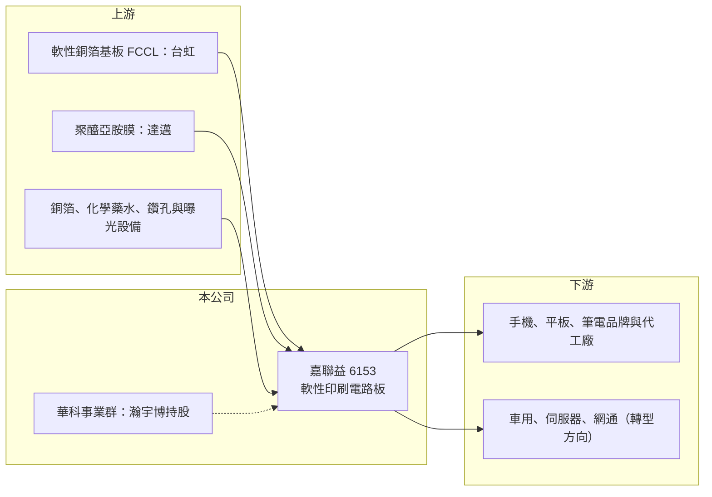

# 6153 嘉聯益

> 上市｜[[產業索引-電子零組件業|電子零組件業]]｜上市（櫃）日期 2008/01/21

# 第一章：企業模式與商業藍圖

> [!info] 撰寫說明
> 精簡版，由 Claude 依公開資料整理，架構比照 [[2330台積電]]，資料截至 2026-10-08。來源：證交所開放資料（基本資料、2026 年上半年財報、2025 年度股利）、Goodinfo 經營績效頁、優分析 2026 年 2 月報導。客戶結構與轉型方向部分憑記憶整理，已標待校對。#待校對

本章說明嘉聯益科技（6153）的[[軟板]]事業，以及它如何從蘋果供應鏈的主力軟板廠，走到連續多年虧損、由華科事業群入主重整的局面。

- **核心業務：** 嘉聯益成立於 1992 年，總部在新北樹林，2008 年在證交所上市。主要產品是軟性印刷電路板，也就是可以彎折、做成很薄的電路板，用來連接手機、平板、筆電內部的螢幕、相機、電池與主機板。軟板是行動裝置輕薄化的關鍵零件，但也是製程複雜、良率決定獲利的產業。
- **營收結構：** 本次未查得產品別比重。過去嘉聯益的營收高度集中在美系手機與平板品牌（市場普遍認為是 [[AAPL蘋果]]，待校對），2023 年起主要客戶訂單大幅流失，營收由 2020 年的 160 億元降到 2025 年的 54 億元，萎縮約三分之二。
- **營運據點：** 生產基地分布在台灣與中國（待校對）。2025 年第四季公司認列資產減損 5.28 億元，反映部分產能已無法回收投資成本。
- **長期方向：** 華科事業群入主後（年份待校對，依媒體報導旗下 5469瀚宇博 持有嘉聯益約 27.64% 股權，時點待校對），公司透過現金增資與私募引進資金，私募股數約 8,883 萬股（證交所基本資料）。轉型方向是降低對單一手機客戶的依賴，轉向車用、伺服器與網通等應用（待校對），這些市場量小但驗證期長、客戶較分散。

# 第二章：護城河深度與競爭優勢

本章分析嘉聯益的競爭位置。軟板產業的護城河主要來自大客戶的認證與量產良率，一旦失去主力客戶，護城河會迅速消失。

- **競爭優勢：** 嘉聯益累積三十多年軟板製程經驗，曾長期進入國際一線手機品牌的供應鏈，具備細線路、多層軟板與軟硬結合板的量產能力。這類經驗在車用與伺服器等新應用中仍有價值，加上華科事業群（被動元件與 PCB 集團）的客戶與資源支持，是重整的主要籌碼（待校對）。
- **主要對手：** 全球軟板龍頭 [[4958臻鼎-KY]] 規模遠大於嘉聯益，另有 [[6269台郡]]、[[3321同泰]] 等台廠，以及日本 Nippon Mektec 與韓國、中國軟板廠。手機軟板市場成熟後產能過剩，台系軟板廠普遍面臨價格競爭與獲利下滑，嘉聯益因客戶集中而受傷最重。
- **觀察重點：** 長期要看毛利率能否由負轉正。2025 年毛利率 -21.7%，2026 年上半年改善到 -4.9%，代表減損與裁減產能後成本結構正在改善，但仍未回到能支撐費用的水準。新應用營收能否在 2027 年前填補流失的手機訂單，決定公司能否脫離連年虧損。

# 第三章：財務體質與盈利規模

資料日期：2026-10-08，表格是撰寫當時的快照；最新月營收、毛利率、累計 EPS 由自動排程寫在本筆記的屬性欄位（月營收、毛利率、累計EPS 等）。#待校對

本章用多年度數字檢視嘉聯益：營收連續萎縮、毛利率轉負，是一家處於重整期的公司。

| 年度 | 營收（億元） | [[毛利率]] | [[營業利益率]] | EPS（元） | [[ROE]] |
|---|---|---|---|---|---|
| 2020 | 160 | 11.6% | 2.6% | 1.18 | 4.3% |
| 2021 | 147 | 7.5% | -2.7% | -0.88 | -3.2% |
| 2022 | 147 | 11.7% | 1.2% | 0.80 | 3.0% |
| 2023 | 98.3 | -9.6% | -23.7% | -6.04 | -24.6% |
| 2024 | 72.8 | -12.0% | -27.7% | -4.41 | -23.1% |
| 2025 | 54.1 | -21.7% | -41.4% | -4.38 | -28.5% |

- **營收規模：** 2020 至 2025 年營收年複合成長率約 -19.5%（推算）。2026 年上半年營收 27.3 億元，與 2025 年下半年相近，萎縮速度已趨緩。
- **獲利：** 即使在 2020 年營收 160 億元的高峰，毛利率也只有 11.6%，顯示手機軟板本來就是薄利的代工生意。2023 年主力訂單流失後，固定成本無法被攤提，毛利率轉為負值。2025 年稅後淨損 27.65 億元，為連續第三年虧損，董事會決議不配發股利。
- **財務特色：** 近 5 年（2021 至 2025）平均 ROE 約 -15.3%（推算）。2026 年第二季股東權益 85.5 億元、負債 77.8 億元，負債比約 48%；保留盈餘已轉為 -5.4 億元，每股淨值 13.44 元。公司以現金增資、私募與出售瀚宇博持股等方式補充資金，股本擴大到 63.6 億元，代表過去的虧損已由股東增資承擔。
- **[[ROIC]] 與 [[WACC]]：** 2025 年營業損失約 22.4 億元（54.1 億 × -41.4%）。以股東權益 85.5 億元為投入資本，ROIC 約 -26%；把全部負債 77.8 億元也算入約 -14%（推算，有息負債金額未查得，實際值在兩者之間）。2026 年上半年營業損失 6.6 億元，年化後 ROIC 約 -8% 至 -15%（推算）。WACC 以 [[CAPM]] 推估：無風險利率 1.75%、市場風險溢酬 6%、β 假設 1.2（虧損、高波動的 PCB 廠常見值），股東權益成本約 9%；負債成本假設稅後 2.4%、負債占資本 40%（假設），WACC 約 6.4%（推算）。ROIC 為負、遠低於 WACC，代表公司目前每年都在侵蝕資本；虧損公司的 ROIC 只能說明重整的急迫性，而不是長期價值。

# 第四章：總體風險與地緣政治

本章整理嘉聯益長期要面對的風險。

- **產業週期：** 軟板需求跟著手機與平板的出貨週期起伏，品牌廠每年調整供應商比重，造成訂單大幅波動。手機市場成熟後總量成長有限，產能過剩時價格競爭會持續壓縮毛利。
- **營運風險：** 最大的風險是轉型速度。車用、伺服器等新應用驗證期長，在新訂單放量前，公司仍需承擔折舊與人事成本。若虧損持續，可能需要再次增資或處分資產，稀釋既有股東權益。
- **其他風險：** 原料銅箔基板與聚醯亞胺膜的價格、新台幣匯率，以及中國產能的地緣政治與關稅風險（待校對），都會影響成本。集團持股結構與經營團隊變動（2026 年 6 月股東會全面改選董事），也會影響長期策略的延續性。

# 專有名詞解析

## 金融

- **[[ROIC]]**：投入資本報酬率，衡量公司用股東與債權人投入的資本，每年能賺回多少稅後營業利益。
- **[[WACC]]**：加權平均資金成本，依股東權益與負債的比重，加權計算公司取得資金的平均成本。
- **[[CAPM]]**：資本資產定價模型，以無風險利率加上 β 乘以市場風險溢酬，推估股東要求的報酬率。

## 產業

- **[[軟板]]**：軟性印刷電路板，以聚醯亞胺等可彎折材料製成，用於手機、平板、筆電與車用電子的內部連接。
- **[[PCB]]**：印刷電路板，承載並連接電子元件的基板，是所有電子產品的基礎零件。

# 核心供應鏈

- 上游：軟性銅箔基板廠 [[8039台虹]]、聚醯亞胺膜廠 [[3645達邁]]，以及銅箔、化學藥水與製程設備（嘉聯益的具體供應商未查得）。
- 下游／客戶：手機、平板與筆電的品牌與組裝廠（主要客戶待校對），以及轉型中的車用、伺服器與網通客戶。
- 同業：[[4958臻鼎-KY]]、[[6269台郡]]、[[3321同泰]]，以及日系 Nippon Mektec 與中韓軟板廠。
- 集團：5469瀚宇博（媒體報導持股約 27.64%，待校對）。

## 最新新聞
<!-- news:start -->
<!-- news:end -->

## 相關連結
- [公開資訊觀測站](https://mopsov.twse.com.tw/mops/web/t05st03?step=1&firstin=1&co_id=6153)
- [Goodinfo](https://goodinfo.tw/tw/StockDetail.asp?STOCK_ID=6153)
- [Yahoo 股市](https://tw.stock.yahoo.com/quote/6153)
- [鉅亨網新聞](https://www.cnyes.com/twstock/6153/news)
