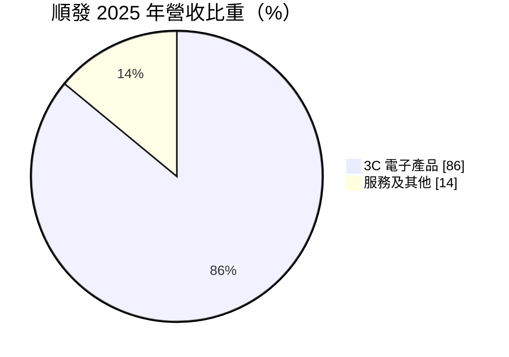
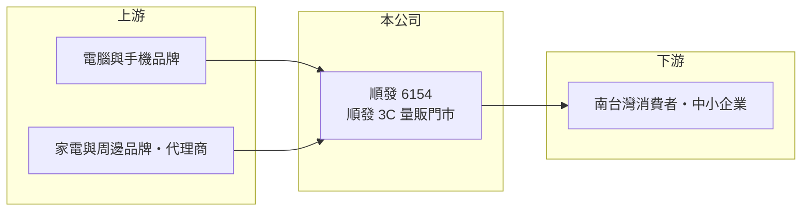

# 6154 順發

> 上櫃｜[[產業索引-電子通路業|電子通路業]]｜上市（櫃）日期 2002/02/18

# 第一章：企業模式與商業藍圖

> [!info] 撰寫說明
> 精簡版，由 Claude 依公開資料整理，架構比照 [[2330台積電]]，資料截至 2026-10-08。來源：櫃買中心開放資料（基本資料、2026 年第二季財報、月營收、本益比殖利率）、Goodinfo 經營績效頁、MoneyDJ 基本資料（2025 年營收比重）。門市數與區域分布未查得。#待校對

順發電腦是以高雄為根據地的 [[3C量販]]零售商，經營「順發 3C」連鎖賣場。它雖然被歸在電子通路業，但商業模式其實是面對消費者的實體零售，獲利邏輯與上游零組件通路商完全不同。

- **核心業務：** 順發成立於 1995 年，2002 年上櫃，總部位於高雄市三民區建國二路。公司以大型 3C 賣場銷售電腦、手機、家電與周邊商品，並提供維修、組裝與售後服務。
- **營收結構：** 2025 年 3C 電子產品占 86%、服務及其他占 14%。服務收入比重明顯高於一般通路商，反映零售業者在組裝、維修、延長保固與會員服務上的附加收入。

- **營運據點：** 以南台灣為主要市場，門市數量未查得。區域型零售商的優勢在於在地品牌知名度與物流效率，限制則是成長空間受區域人口與消費力影響。
- **長期方向：** 3C 零售面臨電商與品牌直營的長期競爭，實體賣場的價值逐漸轉向「體驗、即時取貨與售後服務」。順發的長期課題，是在營收停滯的環境下提高服務收入與坪效。

# 第二章：護城河深度與競爭優勢

3C 零售的護城河不深，主要依賴區域品牌、地點與服務，順發的競爭位置也受到電商與全國性連鎖的擠壓。

- **競爭優勢：** 順發在高雄經營近三十年，累積南部消費者的品牌認知；大型賣場的組裝維修服務與即時取貨，是純電商難以完全取代的價值。毛利率長期維持在 15% 至 16.7%，比上游通路商高得多，反映零售端的定價空間。
- **主要對手：** 全國性 3C 連鎖如 [[2430燦坤]]、全國電子，以及 momo、PChome 等電商平台；手機與電腦品牌的直營門市與官網也直接與零售商競爭。
- **觀察重點：** 營業利益率從 2021 年的 3.44% 降到 2025 年的 1.16%，代表租金、人事等固定費用在營收停滯時壓縮了獲利。觀察重點在於服務收入能否持續成長，以及門市是否有整併或轉型計畫。

# 第三章：財務體質與盈利規模

資料日期：2026-10-08，表格是撰寫當時的快照；最新月營收、毛利率、累計 EPS 由自動排程寫在本筆記的屬性欄位（月營收、毛利率、累計EPS 等）。#待校對

順發的財務呈現「毛利率穩定、費用率高、營收停滯」的零售業特徵，2021 年是近年獲利高點。

| 年度 | 營收（億元） | [[毛利率]] | [[營業利益率]] | EPS（元） | [[ROE]] |
|---|---|---|---|---|---|
| 2020 | 40.9 | 15.1% | 1.46% | 0.56 | 3.72% |
| 2021 | 51.3 | 15.1% | 3.44% | 1.76 | 11.3% |
| 2022 | 43.8 | 15.5% | 2.14% | 1.11 | 6.87% |
| 2023 | 37.3 | 16.4% | 1.24% | 0.73 | 4.53% |
| 2024 | 37.1 | 16.7% | 1.21% | 0.50 | 3.15% |
| 2025 | 39.3 | 16.5% | 1.16% | 0.51 | 3.26% |
| 2026 上半年 | 20.1 | 19.38% | 3.70% | 0.75 | 未查得 |

- **營收規模：** 2020 至 2025 年營收年複合成長率約 -0.8%（推算），2021 年遠距工作與學習帶動電腦需求後，營收回到 37 億至 39 億元。2026 年前 8 個月營收約 27.9 億元，年增約 6%（櫃買中心月營收）。
- **獲利：** 近 5 年平均 ROE 約 5.8%（推算）。2026 年上半年毛利率升到 19.38%、營業利益率 3.70%，EPS 0.75 元已超過 2025 年全年，顯示產品組合或服務收入改善。
- **財務特色：** 2026 年第二季總資產 20.3 億元、負債 7.5 億元、權益 12.8 億元，負債比約 37%，財務保守。最近一次現金股利每股 0.51 元，與 2025 年 EPS 相當，配發率接近 100%；股價淨值比約 0.88 倍。

**[[ROIC]] 與 [[WACC]]：** 2025 年營業利益約 4,600 萬元，稅後約 3,600 萬元；以權益 12.8 億元加有息負債（以負債總額 40% 估約 3.0 億元）計算，ROIC 約 2.3%；2026 年上半年營業利益 7,433 萬元年化，ROIC 約 7.5%（推算）。WACC 以 CAPM 推估：無風險利率 1.75%、市場風險溢酬 6%、β 取 0.7（零售業低波動常見值），股權成本 5.95%；稅後負債成本 2%，股權占比約 81%，WACC 約 5.2%（推算）。2022 至 2025 年 ROIC 低於 WACC，2026 年上半年的改善若能維持全年，才有機會轉為創造價值。

# 第四章：總體風險與地緣政治

順發的風險主要來自零售業的結構性變化，以及消費景氣。

- **產業週期：** 3C 產品需求跟隨換機週期與消費景氣，2021 年遠距需求帶動高峰後，2022 至 2024 年營收連續下滑。AI PC 或新一代手機換機潮能帶來短期需求，但難以改變長期趨勢。
- **營運風險：** 實體門市的租金與人事成本固定，營收下滑時獲利會被放大壓縮；電商平台與品牌直營持續分食市場，區域型零售商的議價力有限。
- **其他風險：** 進口 3C 產品的價格受匯率與品牌定價策略影響；最低工資調整推升人事費用；區域集中在南部，地方人口與消費力變化直接影響營收。

# 專有名詞解析

## 金融

- **[[坪效]]**：每坪營業面積產生的營收，是衡量實體零售門市經營效率的指標。
- **[[股價淨值比]]**：股價除以每股淨值，低於 1 倍代表市場價值低於公司帳面淨值。

## 產業

- **[[3C量販]]**：以大型賣場集中銷售電腦（Computer）、通訊（Communication）與消費性電子（Consumer Electronics）產品的零售業態。

# 核心供應鏈

- 上游：電腦、手機、家電品牌與代理商，例如 [[AAPL蘋果]]、[[2357華碩]]，以及資訊產品通路 [[2347聯強]]（推估）。
- 下游／客戶：以南台灣消費者與中小企業為主。
- 同業：[[2430燦坤]]、全國電子；電商平台 momo、PChome。

## 最新新聞
<!-- news:start -->
<!-- news:end -->

## 相關連結
- [公開資訊觀測站](https://mopsov.twse.com.tw/mops/web/t05st03?step=1&firstin=1&co_id=6154)
- [Goodinfo](https://goodinfo.tw/tw/StockDetail.asp?STOCK_ID=6154)
- [Yahoo 股市](https://tw.stock.yahoo.com/quote/6154)
- [鉅亨網新聞](https://www.cnyes.com/twstock/6154/news)
