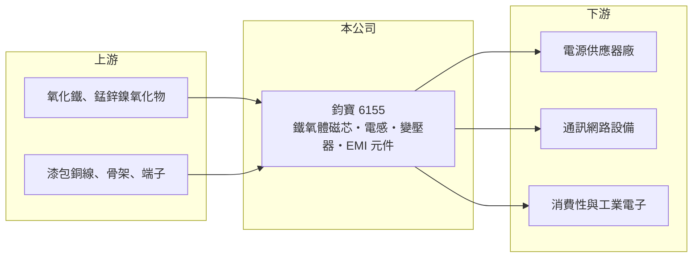

# 6155 鈞寶

> 上市｜[[產業索引-電子零組件業|電子零組件業]]｜上市（櫃）日期 2006/08/18

# 第一章：企業模式與商業藍圖

> [!info] 撰寫說明
> 精簡版，由 Claude 依公開資料整理，架構比照 [[2330台積電]]，資料截至 2026-10-08。來源：證交所開放資料（基本資料、2026 年上半年財報、2025 年度股利）、Goodinfo 經營績效頁、nStock 公司簡介。公開資料有限，產品比重、客戶與海外據點未查得。#待校對

本章說明鈞寶電子（6155）的磁性[[被動元件]]事業：從上游的軟磁[[鐵氧體]]材料，一路做到[[電感]]、變壓器與抗電磁干擾元件。

- **核心業務：** 鈞寶成立於 1986 年，總部在桃園平鎮，2002 年上櫃、2006 年轉上市。產品線包括軟磁鐵氧體磁芯、磁芯變壓器、共模扼流圈、晶片電感、晶片磁珠、陶瓷高頻晶片電感、通訊用電感與 [[EMI]] 對策元件。這些元件負責電路中的儲能、濾波與抑制雜訊，是所有電源與通訊電路都需要的基本零件。
- **營收結構：** 本次查得資料沒有公布產品別或應用別比重。從產品線看，鈞寶同時供應磁芯材料與成品元件，應用涵蓋電源供應器、通訊網路設備與消費性電子（依產品性質推估）。
- **營運據點：** 台灣平鎮為總部與主要營運基地，海外生產據點與產能資訊本次未查得。公司規模不大，2025 年營收約 6.3 億元，股本 8.8 億元。
- **長期方向：** 磁性元件的長期需求來自電源轉換效率要求提高、車用與伺服器電源增加，以及通訊設備對抗干擾的要求。鈞寶從材料做起的垂直整合，是它在高頻、高功率磁性元件上與一般組裝廠區隔的基礎。

# 第二章：護城河深度與競爭優勢

本章分析鈞寶的競爭位置。磁性元件市場分散、客製化程度高，小廠能靠材料配方與快速打樣生存，但很難取得定價權。

- **競爭優勢：** 鈞寶自製軟磁鐵氧體磁芯，等於掌握了電感與變壓器最關鍵的材料。磁芯的配方與燒結條件決定元件在高頻下的損耗與溫度特性，自製材料讓鈞寶能依客戶需求調整規格，這是只做繞線組裝的同業較難做到的。
- **主要對手：** 國際大廠有 TDK、村田製作所等日系廠，台灣同業有 [[2327國巨]]（整合奇力新後的電感事業）、[[6284佳邦]] 等，中國也有大量磁材與電感廠（同業定位為整理性描述，待校對）。在晶片電感等標準品上，鈞寶的規模遠小於這些對手，因此主要以利基規格與客製化產品競爭。
- **觀察重點：** 鈞寶的營業利益率在 2023 至 2024 年只有約 1.3% 至 1.4%，2025 年回升到 4.9%，2026 年上半年進一步到 8.9%。長期要看這個改善是否來自產品組合往高功率、車用與伺服器應用移動，而不只是景氣回升；本業能否穩定賺錢，比業外收益更重要。

# 第三章：財務體質與盈利規模

資料日期：2026-10-08，表格是撰寫當時的快照；最新月營收、毛利率、累計 EPS 由自動排程寫在本筆記的屬性欄位（月營收、毛利率、累計EPS 等）。#待校對

本章用多年度數字檢視鈞寶的獲利品質：本業利潤偏薄，EPS 有相當比例來自業外。

| 年度 | 營收（億元） | [[毛利率]] | [[營業利益率]] | EPS（元） | [[ROE]] |
|---|---|---|---|---|---|
| 2020 | 6.07 | 25.4% | 7.0% | 0.39 | 2.4% |
| 2021 | 8.00 | 31.4% | 16.0% | 0.93 | 5.7% |
| 2022 | 7.70 | 26.6% | 9.1% | 2.19 | 12.9% |
| 2023 | 5.45 | 21.5% | 1.3% | 0.85 | 4.9% |
| 2024 | 5.70 | 22.9% | 1.4% | 0.97 | 5.3% |
| 2025 | 6.32 | 24.4% | 4.9% | 0.74 | 3.9% |

- **營收規模：** 2020 至 2025 年營收年複合成長率約 0.8%（推算），規模在 5.5 億至 8 億元之間，跟著被動元件景氣循環起伏。2026 年上半年營收 3.74 億元，比去年同期明顯成長。
- **獲利：** 2022 年營業利益約 0.7 億元，EPS 卻達 2.19 元，2023 至 2024 年營業利益率僅 1% 多、EPS 仍有 0.85 至 0.97 元，代表業外收益（投資收益等）占獲利很大比重。2026 年上半年營業利益 0.33 億元、業外收入 0.48 億元，EPS 0.82 元，結構相同。
- **財務特色：** 近 5 年（2021 至 2025）平均 ROE 約 6.5%（推算）。2026 年第二季股東權益 16.3 億元、負債 7.4 億元，負債比約 31%，非流動負債極少，財務保守。現金股利 2024 年度 1.0 元、2025 年度 0.8 元，配息率約在 100% 上下，公司傾向把盈餘幾乎全數發放。
- **[[ROIC]] 與 [[WACC]]：** 2025 年營業利益約 0.31 億元（6.32 億 × 4.9%），稅後約 0.25 億元；以股東權益 16.3 億元為投入資本，ROIC 約 1.5%，把全部負債也算入約 1.1%（推算，有息負債金額未查得）。以 2026 年上半年營業利益年化計算約 3.3%（推算）。WACC 以 [[CAPM]] 推估：無風險利率 1.75%、市場風險溢酬 6%、β 假設 0.9（被動元件中小廠常見值），股東權益成本約 7.15%；負債多為營業性流動負債，假設有息負債占資本 10%、稅後成本 2%，WACC 約 6.6%（推算）。本業 ROIC 長期低於 WACC，股東報酬主要靠業外投資撐起，本業尚未證明能長期創造價值。

# 第四章：總體風險與地緣政治

本章整理鈞寶長期要面對的風險。

- **產業週期：** 被動元件是典型的景氣循環產業，需求旺時客戶重複下單、景氣轉弱時大幅去化庫存。鈞寶 2021 年營收 8 億元、2023 年降到 5.45 億元，波動幅度約三成，營業利益率也隨之由 16% 掉到 1%。
- **營運風險：** 公司規模小、產品標準化程度高的部分容易受到大廠與中國廠價格競爭。獲利依賴業外收益，若投資收益減少，EPS 可能大幅下降，股利政策也會受影響。
- **其他風險：** 鐵氧體的原料（氧化鐵、錳、鋅、鎳等金屬氧化物）與銅線價格波動會影響成本；燒結製程耗電，電價上漲也會壓縮毛利。新台幣匯率變化同樣影響外銷產品的獲利。

# 專有名詞解析

## 金融

- **[[ROIC]]**：投入資本報酬率，衡量公司用股東與債權人投入的資本，每年能賺回多少稅後營業利益。
- **[[WACC]]**：加權平均資金成本，依股東權益與負債的比重，加權計算公司取得資金的平均成本。
- **[[CAPM]]**：資本資產定價模型，以無風險利率加上 β 乘以市場風險溢酬，推估股東要求的報酬率。

## 產業

- **[[被動元件]]**：不需外加電源就能運作的電子元件，主要是電容、電阻與電感，負責儲能、濾波與穩壓。
- **[[電感]]**：以線圈儲存磁能的被動元件，用於電源轉換、濾波與抑制雜訊。
- **[[鐵氧體]]**：以氧化鐵為主、加入錳鋅或鎳鋅燒結而成的磁性陶瓷，是電感與變壓器磁芯的主要材料。
- **[[EMI]]**：電磁干擾，電子設備發出的雜訊會干擾其他電路，需要磁珠、共模扼流圈等元件抑制。

# 核心供應鏈

- 上游：氧化鐵與錳、鋅、鎳等金屬氧化物（磁芯原料），以及漆包銅線、骨架與端子，具名供應商未查得。
- 下游／客戶：電源供應器、通訊網路設備與消費性、工業電子廠，具名客戶未查得。
- 同業：[[2327國巨]]、[[6284佳邦]]，以及 TDK、村田製作所與中國磁性元件廠。

## 最新新聞
<!-- news:start -->
<!-- news:end -->

## 相關連結
- [公開資訊觀測站](https://mopsov.twse.com.tw/mops/web/t05st03?step=1&firstin=1&co_id=6155)
- [Goodinfo](https://goodinfo.tw/tw/StockDetail.asp?STOCK_ID=6155)
- [Yahoo 股市](https://tw.stock.yahoo.com/quote/6155)
- [鉅亨網新聞](https://www.cnyes.com/twstock/6155/news)
