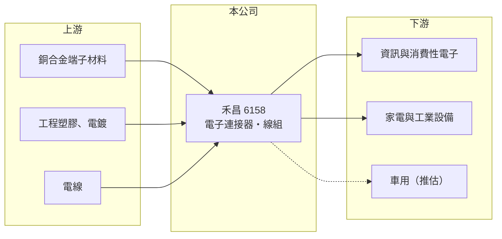

# 6158 禾昌

> 上櫃｜[[產業索引-電子零組件業|電子零組件業]]｜上市（櫃）日期 2002/02/19

# 第一章：企業模式與商業藍圖

> [!info] 撰寫說明
> 精簡版，由 Claude 依公開資料整理，架構比照 [[2330台積電]]，資料截至 2026-10-08。來源：櫃買中心開放資料（基本資料、2026 年上半年財報）、Goodinfo 經營績效頁、nStock 公司簡介。公開資料有限，產品比重、應用、客戶與生產據點未查得，相關描述為依產業性質推估。#待校對

本章說明禾昌興業（6158）的[[連接器]]事業，以及這家中小型連接器廠如何在客製化訂單與大廠競爭之間找到位置。

- **核心業務：** 禾昌成立於 1986 年，總部在桃園龜山工業區，2002 年在櫃買中心掛牌。公司簡介把本業定義為「產銷各類電子連接器」。連接器是讓電路板、模組與線材之間能插拔、傳輸電力與訊號的零件，看似簡單，但每一種產品都要配合客戶的機構、電流與耐久度要求客製開發。
- **營收結構：** 本次查得的資料沒有公布產品別與應用別比重。連接器廠通常同時銷售單體連接器與組裝好的[[線束]]或線組，應用遍及資訊、家電、工業與車用，禾昌的實際組合待校對。
- **營運據點：** 台灣龜山為總部，量產據點與產能本次未查得（推估與多數台系連接器廠相同，以中國或東南亞工廠生產為主，待校對）。
- **長期方向：** 連接器產業的長期成長來自電動車、工業自動化、伺服器高速傳輸等新應用，這些市場對可靠度與認證的要求高、價格也較好。禾昌能否把產品組合往這些應用移動，是營收停滯近十年後能否重新成長的關鍵。

# 第二章：護城河深度與競爭優勢

本章分析禾昌的競爭位置。連接器市場由國際大廠主導，中小型台廠多半依靠特定客戶與客製化能力生存。

- **競爭優勢：** 禾昌經營連接器超過三十年，毛利率長期維持在 24% 至 30% 之間，在連接器同業中屬於中等水準，代表產品有一定的客製化程度，而非純標準品。長期合作的客戶在既有機種上不容易更換供應商，提供了穩定的基本訂單。
- **主要對手：** 國際龍頭有 TE Connectivity、安費諾（Amphenol）、Molex 等，台灣同業包括 [[3533嘉澤]]、[[3023信邦]]、[[6279胡連]]、[[6197佳必琪]]、[[6290良維]] 等，各自專注在不同應用（同業定位為整理性描述，待校對）。與這些對手相比，禾昌規模較小、研發與自動化投資的能量有限。
- **觀察重點：** 營業利益率由 2020 至 2021 年約 7.8% 降到 2025 年的 -1.3%，2026 年上半年營業損失擴大到營收的 8%。毛利率還在 15% 至 24%，但營業費用相對營收過高，長期要看公司能否調整費用結構或找到新的成長產品，讓本業重新獲利。

# 第三章：財務體質與盈利規模

資料日期：2026-10-08，表格是撰寫當時的快照；最新月營收、毛利率、累計 EPS 由自動排程寫在本筆記的屬性欄位（月營收、毛利率、累計EPS 等）。#待校對

本章用多年度數字檢視禾昌：營收大致持平，但本業獲利能力在 2022 年後明顯轉弱。

| 年度 | 營收（億元） | [[毛利率]] | [[營業利益率]] | EPS（元） | [[ROE]] |
|---|---|---|---|---|---|
| 2020 | 20.3 | 28.7% | 7.8% | 2.61 | 16.0% |
| 2021 | 22.0 | 29.2% | 7.7% | 3.09 | 17.2% |
| 2022 | 19.6 | 25.3% | 1.4% | 1.20 | 6.5% |
| 2023 | 17.6 | 27.8% | 1.9% | 1.43 | 7.4% |
| 2024 | 19.2 | 29.9% | 4.0% | 1.26 | 5.9% |
| 2025 | 18.0 | 24.4% | -1.3% | 0.11 | 0.5% |

- **營收規模：** 2020 至 2025 年營收年複合成長率約 -2.4%（推算），規模在 17.6 億至 22 億元之間。2026 年上半年營收 8.97 億元，與過去相近，沒有明顯成長。
- **獲利：** 2022 年起營業利益率由 7% 以上掉到 1% 至 4%，2025 年轉為營業虧損，EPS 只剩 0.11 元，主要靠業外收入撐住。2026 年上半年毛利率降到約 15.5%、營業損失 0.73 億元、EPS -1.25 元，是近年最弱的表現。
- **財務特色：** 近 5 年（2021 至 2025）平均 ROE 約 7.5%（推算），但呈逐年下滑。2026 年第二季股東權益 11.2 億元、負債 12.3 億元，負債比約 52%；保留盈餘 5.7 億元仍為正數，並持有庫藏股 80 萬股。依 nStock，2024 年度配發現金股利 1.01 元（配息率約 81%），2025 年度未配息，過去穩定配息的傳統出現中斷。
- **[[ROIC]] 與 [[WACC]]：** 2025 年營業損失約 0.23 億元（18.0 億 × -1.28%），ROIC 為負，約 -1% 至 -2%（推算，投入資本以股東權益 11.2 億元至加計全部負債 23.5 億元計算）。對照 2020 至 2021 年，營業利益約 1.6 億元、稅後約 1.3 億元，ROIC 曾在 10% 上下（推算）。WACC 以 [[CAPM]] 推估：無風險利率 1.75%、市場風險溢酬 6%、β 假設 0.9（連接器中小廠常見值），股東權益成本約 7.15%；負債成本假設稅後 2%、有息負債占資本 25%（假設），WACC 約 5.9%（推算）。禾昌在 2021 年以前 ROIC 高於 WACC，2022 年後已低於資金成本，目前本業處於價值減損狀態。

# 第四章：總體風險與地緣政治

本章整理禾昌長期要面對的風險。

- **產業週期：** 連接器需求跟著資訊、家電與工業設備的景氣起伏，客戶庫存調整時訂單會明顯縮減。禾昌營收 2021 年 22 億元、2023 年 17.6 億元，波動約兩成。
- **營運風險：** 本業連續轉弱，若費用結構無法調整，虧損可能延續並侵蝕保留盈餘。規模小也限制了在電動車、伺服器等高門檻市場的研發與認證投入，可能被大廠與中國廠兩面夾擊。
- **其他風險：** 銅、塑膠原料價格與人工成本上升會壓縮毛利；生產若集中在中國（待校對），將面臨關稅、供應鏈移轉與匯率風險。2026 年上半年其他綜合損益 0.73 億元，抵銷了大部分淨損，代表匯率或投資評價對權益的影響不小。

# 專有名詞解析

## 金融

- **[[ROIC]]**：投入資本報酬率，衡量公司用股東與債權人投入的資本，每年能賺回多少稅後營業利益。
- **[[WACC]]**：加權平均資金成本，依股東權益與負債的比重，加權計算公司取得資金的平均成本。
- **[[CAPM]]**：資本資產定價模型，以無風險利率加上 β 乘以市場風險溢酬，推估股東要求的報酬率。

## 產業

- **[[連接器]]**：讓電路板、模組與線材之間能插拔並傳輸電力與訊號的零件，需依客戶機構與規格客製開發。
- **[[線束]]**：把多條電線、端子與連接器組裝成一束的配線組件，用於汽車、家電與工業設備內部配線。

# 核心供應鏈

- 上游：銅合金端子材料、工程塑膠、電鍍加工與電線，具名供應商未查得。
- 下游／客戶：資訊、家電、工業設備等電子廠（應用比重與具名客戶未查得，車用為推估）。
- 同業：[[3533嘉澤]]、[[3023信邦]]、[[6279胡連]]、[[6197佳必琪]]、[[6290良維]]，以及 TE Connectivity、Amphenol、Molex。

## 最新新聞
<!-- news:start -->
<!-- news:end -->

## 相關連結
- [公開資訊觀測站](https://mopsov.twse.com.tw/mops/web/t05st03?step=1&firstin=1&co_id=6158)
- [Goodinfo](https://goodinfo.tw/tw/StockDetail.asp?STOCK_ID=6158)
- [Yahoo 股市](https://tw.stock.yahoo.com/quote/6158)
- [鉅亨網新聞](https://www.cnyes.com/twstock/6158/news)
