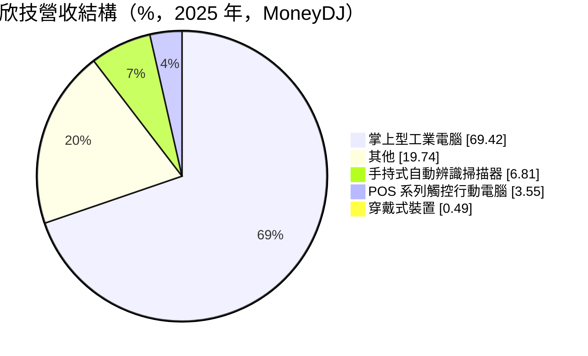
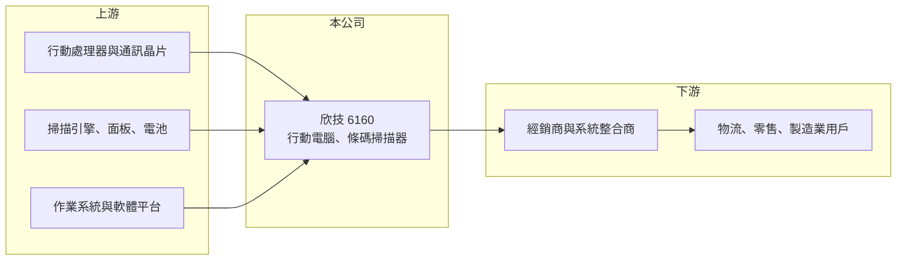

# 6160 欣技

> 上櫃｜[[產業索引-電腦及週邊設備業|電腦及週邊設備業]]｜上市（櫃）日期 2002/03/01

# 第一章：企業模式與商業藍圖

> [!info] 撰寫說明
> 精簡版，由 Claude 依公開資料整理，架構比照 [[2330台積電]]，資料截至 2026-10-08。來源：櫃買中心開放資料快照（基本資料、2026 年上半年財報、每月營收）、Goodinfo 經營績效年度表與新聞標題（2026 年 8 月）、MoneyDJ 個股基本資料（2025 年營收比重、歷年股利）。CipherLab 品牌與國際對手的描述為記憶內容。公開資料有限。#待校對

欣技是自有品牌的[[行動電腦]]與條碼掃描設備廠，本章說明它在物流與零售自動化中的角色。

- **核心業務：** 欣技設計並銷售掌上型工業電腦（行動電腦）、手持式自動辨識掃描器與觸控式 POS 行動裝置，品牌為 CipherLab（待校對）。這些設備用在倉儲盤點、物流配送、零售收銀與工廠追溯，現場人員用它掃描條碼、輸入資料並即時連回企業系統。產品要耐摔、防水、續航長，還要搭配作業系統與企業軟體，屬於硬體加軟體的整合產品。
- **營收結構：** 依 MoneyDJ，2025 年掌上型工業電腦約占 69.4%，其他約 19.7%，手持式掃描器約 6.8%，POS 系列觸控行動電腦約 3.6%，穿戴式裝置約 0.5%。行動電腦是絕對主力。
- **營運據點：** 公司 1988 年成立，2002 年於櫃買中心掛牌，2026 年第二季實收資本額約 6.9 億元。銷售以海外經銷商與系統整合商為主（推估），各地區比重未查得。
- **長期方向：** 依 2026 年 8 月 Goodinfo 所列新聞標題，公司以新品、AI 與軟體服務作為三大成長方向。若能從賣硬體轉為提供裝置管理與軟體服務，就能增加經常性收入、降低硬體換機週期造成的營收波動，這是欣技長期轉型的關鍵。

# 第二章：護城河深度與競爭優勢

欣技的毛利率接近四成，但規模遠小於國際大廠，本章分析它的競爭位置。

- **競爭優勢：** 自有品牌讓欣技維持 35% 至 40% 的毛利率，明顯高於一般代工廠。企業客戶導入行動電腦後，會在上面開發倉儲或零售應用程式，換品牌需要重寫軟體與重新訓練員工，因此有一定的轉換成本。
- **主要對手：** 全球市場由美國的 Zebra 與 Honeywell 主導，另有義大利 Datalogic 與多家中國品牌；台灣相關廠商有條碼印表機的 [[3611鼎翰]]，以及強固型裝置的 [[3005神基]]。欣技規模小，研發與通路投資難以和國際大廠相比，主要在中小型客戶與特定區域市場競爭。
- **觀察重點：** 毛利率雖高，但營業費用占營收比重更高，導致本業多年虧損。長期要看營收能否擴大到足以支撐研發與行銷費用，以及軟體服務能否形成穩定收入。

# 第三章：財務體質與盈利規模

資料日期：2026-10-08，表格是撰寫當時的快照；最新月營收、毛利率、累計 EPS 由自動排程寫在本筆記的屬性欄位（月營收、毛利率、累計EPS 等）。#待校對

欣技的毛利率穩定，但營收規模長期停在 10 億至 16 億元，費用負擔讓本業難以穩定獲利。

| 年度 | 營收（億元） | [[毛利率]] | [[營業利益率]] | EPS（元） | [[ROE]] |
|---|---|---|---|---|---|
| 2021 | 14.2 | 35.2% | 2.99% | 0.52 | 4.69% |
| 2022 | 12.6 | 37.5% | 2.11% | 0.47 | 3.92% |
| 2023 | 13.6 | 36.7% | -0.73% | -0.06 | -0.62% |
| 2024 | 12.9 | 38.9% | -4.44% | -0.57 | -5.25% |
| 2025 | 11.9 | 39.1% | -6.21% | -1.19 | -11.7% |

- **營收規模：** 2017 年營收 12.4 億元、2025 年 11.9 億元，八年幾乎沒有成長；2020 年 10.3 億元至 2025 年的五年年複合成長率約 2.9%（推算）。2026 年上半年營收 5.14 億元、毛利率 35.9%、營業利益率 -12.2%、EPS -0.82 元，1 至 8 月累計營收年減約 20%。
- **獲利：** 2021 至 2025 年平均 ROE 約 -1.8%（推算），且虧損逐年擴大。依 MoneyDJ，近七個年度只有 2021 與 2022 年度發放 0.35 元與 0.60 元現金股利，其餘年度未配息。
- **財務特色：** 2026 年第二季末總資產 11.3 億元、總負債 5.4 億元，負債比約 48%；股東權益 5.9 億元，每股淨值 8.60 元，已低於面額 10 元，保留盈餘為 -1.0 億元，代表累積虧損已侵蝕資本。若虧損持續，公司可能需要減資或增資來改善財務結構。
- **[[ROIC]] 與 [[WACC]]：** 2025 年營業損失約 0.74 億元，2026 年上半年營業損失 0.63 億元；以股東權益約 6 億元加假設有息負債 2 億元計，ROIC 約 -9% 至 -16%（推算，虧損年度不計稅盾）。WACC 以 CAPM 推估：無風險利率 1.75%、市場風險溢酬 6%、β 取 1.0（小型電子品牌股常見值），股東權益成本 7.75%；負債占資本約 25%、稅後成本 2%，WACC 約 6.3%（推算）。ROIC 為負且遠低於 WACC，表示目前本業正在消耗股東資本，扭轉虧損是首要課題。

# 第四章：總體風險與地緣政治

欣技面對的是國際大廠主導、規模決定成本的市場，本章整理長期風險。

- **產業週期：** 行動電腦需求跟著物流、零售與製造業的資本支出起伏，企業在景氣不佳時會延後換機。2026 年前八個月營收衰退兩成，說明需求變化對小廠的衝擊更大。
- **營運風險：** 國際大廠擁有完整產品線與全球服務網，在大型標案中優勢明顯；中國品牌則以低價競爭。欣技營收規模停滯，研發與行銷費用卻必須維持，虧損可能延續。淨值已低於面額，財務彈性有限。
- **其他風險：** 晶片與面板等零件成本波動、匯率變化影響毛利；Android 作業系統與安全更新的支援成本持續上升；智慧型手機搭配掃描配件的低價方案，可能侵蝕專用行動電腦的市場。

# 專有名詞解析

## 金融

- **[[ROIC]]**：投入資本報酬率，稅後營業利益除以股東權益加有息負債，衡量本業運用資本的效率。
- **[[WACC]]**：加權平均資金成本，股東權益成本與負債成本依資本結構加權，是 ROIC 必須超越的門檻。

## 產業

- **[[行動電腦]]**：強固型的手持電腦，整合條碼掃描、無線通訊與觸控螢幕，用於倉儲、物流與零售現場作業。

# 核心供應鏈

- 上游：行動處理器與無線通訊晶片（例如 [[QCOM高通]]，實際採購對象待校對）、掃描引擎、觸控面板與電池、Android 作業系統。
- 下游／客戶：海外經銷商與系統整合商，終端為物流、零售、製造與醫療業者。
- 同業：[[3611鼎翰]]、[[3005神基]]，以及 Zebra、Honeywell、Datalogic。

## 最新新聞
<!-- news:start -->
<!-- news:end -->

## 相關連結
- [公開資訊觀測站](https://mopsov.twse.com.tw/mops/web/t05st03?step=1&firstin=1&co_id=6160)
- [Goodinfo](https://goodinfo.tw/tw/StockDetail.asp?STOCK_ID=6160)
- [Yahoo 股市](https://tw.stock.yahoo.com/quote/6160)
- [鉅亨網新聞](https://www.cnyes.com/twstock/6160/news)
