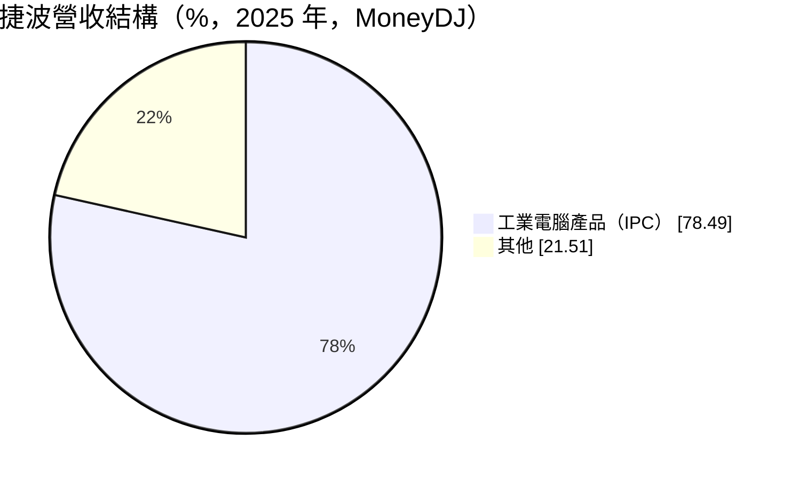
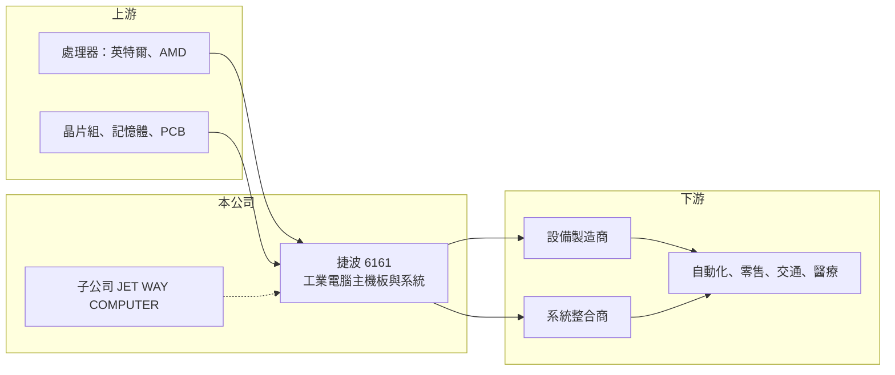

# 6161 捷波

> 上櫃｜[[產業索引-電腦及週邊設備業|電腦及週邊設備業]]｜上市（櫃）日期 2002/03/01

# 第一章：企業模式與商業藍圖

> [!info] 撰寫說明
> 精簡版，由 Claude 依公開資料整理，架構比照 [[2330台積電]]，資料截至 2026-10-08。來源：櫃買中心開放資料快照（基本資料、2026 年上半年財報、每月營收）、Goodinfo 經營績效年度表與公告列表、MoneyDJ 個股基本資料（2025 年營收比重、歷年股利）。Jetway 品牌、早年以消費性主機板起家的描述為記憶內容；「其他」營收的內容未查得。公開資料有限。#待校對

捷波是以工業電腦為主力的中小型廠商，本章說明它從主機板廠轉為工控廠的商業模式。

- **核心業務：** 捷波設計製造[[工業電腦]]主機板、嵌入式系統與工控整機，品牌為 Jetway（待校對）。工業電腦用在工廠自動化、自助服務機台、數位看板、交通與醫療設備，要求長期供貨、寬溫與穩定運作，產品生命週期常達 5 至 10 年。早年捷波生產消費性主機板，後來轉向量少樣多、毛利較高的工控市場（待校對）。
- **營收結構：** 依 MoneyDJ，2025 年工業電腦產品（IPC）約占 78.5%，其他約 21.5%（內容未查得）。工控產品是公司主要的獲利來源。
- **營運據點：** 公司 1986 年成立，2002 年於櫃買中心掛牌，2026 年第二季實收資本額約 5.6 億元。依 Goodinfo 公告，JET WAY COMPUTER CORP. 是公司的重要子公司，負責部分海外營運（所在地與業務範圍待校對）。
- **長期方向：** 工廠自動化、智慧零售與[[邊緣 AI]] 都需要在現場放置穩定的運算設備，工業電腦的長期需求隨各產業數位化而增加。捷波的成長空間取決於能否從主機板供應商升級為提供整機與特定產業解決方案的廠商。

# 第二章：護城河深度與競爭優勢

工業電腦市場分散、客製化程度高，中小型廠商也能找到穩定的利基，本章分析捷波的競爭位置。

- **競爭優勢：** 工業電腦客戶在設備中導入某款主機板後，通常要求同一規格供貨多年，換供應商需要重新驗證整台設備，因此客戶黏著度高。捷波的毛利率從 2017 年 29.6% 提升到 2024 年 42.5%，反映轉型工控後產品組合改善。
- **主要對手：** 台灣工業電腦同業眾多，包括龍頭 [[2395研華]]，以及 [[2397友通]]、[[3088艾訊]]、[[3022威強電]]、[[3594磐儀]]、[[8050廣積]]、[[6579研揚]]、[[8234新漢]]、[[6166凌華]]。捷波規模在其中偏小，主要靠特定應用與客戶關係競爭。
- **觀察重點：** 2025 年毛利率回落到 33.2%、營業利益率降到 10.2%，2026 年上半年分別為 35.4% 與 13.7%。長期要看毛利率能否穩在三成五以上，以及營收能否突破長期停留的 12 億至 18 億元區間。

# 第三章：財務體質與盈利規模

資料日期：2026-10-08，表格是撰寫當時的快照；最新月營收、毛利率、累計 EPS 由自動排程寫在本筆記的屬性欄位（月營收、毛利率、累計EPS 等）。#待校對

捷波營收成長有限，但連續多年維持兩位數營業利益率與穩定配息，是典型的「小而穩」工控股。

| 年度 | 營收（億元） | [[毛利率]] | [[營業利益率]] | EPS（元） | [[ROE]] |
|---|---|---|---|---|---|
| 2021 | 18.2 | 32.0% | 16.4% | 3.28 | 18.5% |
| 2022 | 17.8 | 34.4% | 15.6% | 3.50 | 18.4% |
| 2023 | 13.3 | 36.9% | 14.8% | 2.30 | 11.8% |
| 2024 | 12.5 | 42.5% | 16.1% | 2.85 | 13.8% |
| 2025 | 14.1 | 33.2% | 10.2% | 2.72 | 11.6% |

- **營收規模：** 2020 年營收 13.9 億元、2025 年 14.1 億元，五年年複合成長率約 0.3%（推算），規模大致持平。2026 年上半年營收 8.00 億元、毛利率 35.4%、營業利益率 13.7%、EPS 2.56 元，1 至 8 月累計營收年增約 20%；上半年業外收益約 0.66 億元，占稅前獲利比重偏高，來源未查得。
- **獲利：** 2021 至 2025 年平均 ROE 約 14.8%（推算），2017 年以來營業利益率都在 8% 以上，沒有虧損年度。依 MoneyDJ，2019 至 2025 年度每年現金股利 0.9 元至 3.0 元，近年配息率多在八成以上，部分年度接近當年 EPS，股利政策穩定。
- **財務特色：** 2026 年第二季末總資產 19.4 億元、總負債 6.0 億元，負債比約 31%；股東權益 13.4 億元，每股淨值 23.86 元。流動資產 12.7 億元遠大於流動負債 5.5 億元，資產輕、幾乎不需要大額資本支出。
- **[[ROIC]] 與 [[WACC]]：** 2025 年營業利益約 1.44 億元，稅後約 1.15 億元；有息負債未查得、推估極少，以股東權益約 13 億元計，ROIC 約 8.8%（推算）；2026 年上半年年化稅後營業利益約 1.76 億元，ROIC 約 13%（推算）；2021 至 2022 年約 17% 至 18%（推算）。WACC 以 CAPM 推估：無風險利率 1.75%、市場風險溢酬 6%、β 取 0.9（工業電腦股常見值），幾乎無負債，WACC 約 7.2%（推算）。ROIC 長期高於 WACC，代表本業穩定創造價值，而高配息政策也把這些價值持續發還給股東。

# 第四章：總體風險與地緣政治

工業電腦需求分散但與製造業景氣相關，本章整理捷波的長期風險。

- **產業週期：** 工控需求受全球製造業投資、零售與交通建設專案影響，2023 年營收年減約 25%，反映疫情後客戶去化庫存。週期波動通常比消費電子小，但仍會影響營收。
- **營運風險：** 規模小於主要同業，在晶片供應緊張時取得料件的優先順序較低；營收停滯若持續，研發投入難以跟上 AI 與新平台的需求。業外收益比重偏高的年度，EPS 不一定反映本業。
- **其他風險：** 處理器平台由英特爾、AMD 與 Arm 陣營主導，平台更替與停產時程會影響產品規劃；營收以美元計價為主，匯率影響毛利；地緣政治可能要求在中國以外增加生產或組裝據點。

# 專有名詞解析

## 應用

- **[[邊緣 AI]]**：在終端設備或現場運算盒上直接執行 AI 推論，不必把資料傳回雲端，可降低延遲與頻寬。

## 金融

- **[[ROIC]]**：投入資本報酬率，稅後營業利益除以股東權益加有息負債，衡量本業運用資本的效率。
- **[[WACC]]**：加權平均資金成本，股東權益成本與負債成本依資本結構加權，是 ROIC 必須超越的門檻。

## 產業

- **[[工業電腦]]**：用於工廠、交通、醫療、零售等現場的電腦，強調長期供貨、耐高低溫與穩定運作，簡稱 IPC。

# 核心供應鏈

- 上游：[[INTC英特爾]]、[[AMD超微]] 處理器與晶片組，記憶體、PCB 與被動元件。
- 下游／客戶：自動化設備、自助服務機台、數位看板與醫療設備製造商，以及系統整合商（實際客戶未查得）。
- 同業：[[2395研華]]、[[2397友通]]、[[3088艾訊]]、[[3022威強電]]、[[3594磐儀]]、[[8050廣積]]、[[6579研揚]]、[[8234新漢]]。

## 最新新聞
<!-- news:start -->
<!-- news:end -->

## 相關連結
- [公開資訊觀測站](https://mopsov.twse.com.tw/mops/web/t05st03?step=1&firstin=1&co_id=6161)
- [Goodinfo](https://goodinfo.tw/tw/StockDetail.asp?STOCK_ID=6161)
- [Yahoo 股市](https://tw.stock.yahoo.com/quote/6161)
- [鉅亨網新聞](https://www.cnyes.com/twstock/6161/news)
