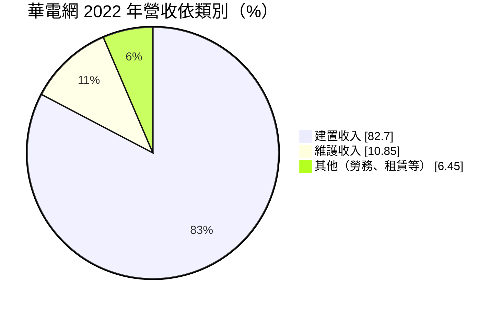
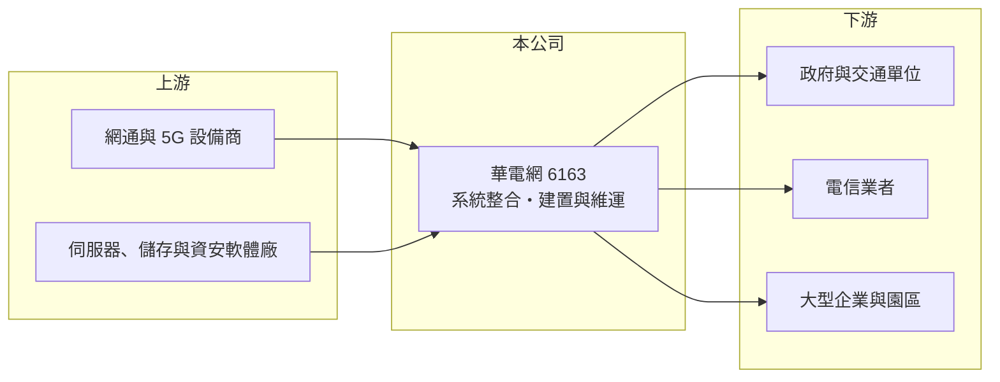

# 6163 華電網

> 上櫃｜[[產業索引-通信網路業|通信網路業]]｜上市（櫃）日期 2002/03/19

# 第一章：企業模式與商業藍圖

> [!info] 撰寫說明
> 精簡版，由 Claude 依公開資料整理，架構比照 [[2330台積電]] 的四章研究，資料截至 2026-10-08。來源：股感（華電網 2023 年法說會與財報整理）、Goodinfo 年度經營績效、櫃買中心開放資料（基本資料、綜合損益、資產負債、每月營收、本益比）。營收比重為 2022 年資料，近年結構可能已變動。#待校對

本章說明華電聯網（股票代號：6163，以下簡稱華電網）的商業模式：從電信系統整合起家，擴展到政府與企業智慧化專案的[[系統整合]]商。

- **核心業務：** 華電網成立於 1994 年，2002 年在櫃買中心掛牌，總部位於新北市汐止，董事長兼總經理為陳國章。公司以電信整合系統服務起家，目前以 5G 為核心，延伸到資通訊、智慧應用、數位媒體與資訊安全四大領域。代表案例包括桃園機場 5G 智慧旅運空間、淡海新市鎮智慧交通、新店寶高智慧產業園區、桃園市政資料治理與大數據平台等。
- **營收結構：** 依 2022 年資料，建置收入約占 82.7%、維護收入約 10.85%，其餘為勞務與租賃收入。管理層說明，設備及短期建置約占八成，維護合約約占 12% 至 15%。這表示華電網的營收大部分是一次性的專案，只有一成多是能年年續約的[[經常性收入]]。
- **客戶結構：** 客戶以政府（交通等領域）、電信業者與一般企業為主，電信客戶包括多媒體服務（MOD）等相關合作。系統整合商的價值在於把多家廠商的設備與軟體整合成能運作的系統，並在完工後負責維運。
- **長期方向：** 公司以「整合、應用、服務」為策略，深耕政府、企業與電信客群，並拓展大型企業、軌道交通、政府智慧化與海外市場。長期能否提高維護與服務收入的比重，是降低營收波動、提高獲利品質的關鍵。

# 第二章：護城河深度與競爭優勢

本章評估華電網的護城河。從營業利益率長期在 0% 至 3.5% 之間來看，系統整合是規模大、利潤薄的生意，華電網屬於窄護城河。

- **競爭優勢：** 華電網的優勢來自三十年的電信系統整合經驗與政府標案實績。大型公共工程與電信專案在投標時重視過往實績、資格與維運能力，已累積案例的廠商較容易得標。完工後的維護合約讓客戶與華電網綁在一起，形成一定的轉換成本。
- **主要對手：** 國內系統整合同業包括 [[6214精誠]]、[[2471資通]]、[[5410國眾]]、[[3029零壹]]、[[6183關貿]]、[[2453凌群]]，以及電信商旗下的系統整合部門（對手名單為產業常識整理，待校對）。政府標案多以價格競爭，毛利空間有限。
- **觀察重點：** 第一，維護與服務收入的比重能否從一成多提升。第二，大型專案在驗收時程與成本控管上是否穩定。第三，2026 年營收大幅成長下，營業利益率能否回到 3% 以上。

# 第三章：財務體質與盈利規模

資料日期：2026-10-08。數字取自 Goodinfo 年度經營績效、股感財報整理與櫃買中心開放資料，表格是撰寫當時的快照；最新月營收、毛利率、累計 EPS 由自動排程寫在本筆記的屬性欄位（月營收、毛利率、累計EPS 等）。#待校對

華電網的財務數字顯示營收規模穩定成長，但利潤率很薄，獲利對專案組合與驗收時點高度敏感。

| 年度 | 營收（新台幣） | [[毛利率]] | [[營業利益率]] | EPS（元） | [[ROE]] |
|---|---|---|---|---|---|
| 2020 | 44.8 億 | 21.6% | -0.04% | 0.02 | 0.14% |
| 2021 | 61.9 億 | 22.2% | 3.41% | 1.43 | 8.62% |
| 2022 | 60.9 億 | 20.1% | 1.93% | 1.06 | 6.24% |
| 2023 | 52.5 億 | 20.4% | 0.26% | 0.42 | 2.46% |
| 2024 | 55.0 億 | 22.2% | 3.00% | 0.93 | 5.27% |
| 2025 | 61.1 億 | 20.1% | 2.13% | 0.75 | 3.93% |
| 2026 上半年 | 30.31 億 | 17.5% | -0.9% | -0.18 | 未查得 |

註：2020 至 2025 年取自 Goodinfo 合併報表；2026 上半年取自櫃買中心開放資料（毛利率、營業利益率依開放資料推算）。

- **營收規模：** 2020 至 2025 年營收年複合成長率約 6.4%（推算），在 50 至 62 億元之間波動。2026 年 1 至 8 月累計營收 42.85 億元，較去年同期 33.72 億元成長約 27%，年初數月單月營收年增率超過六成至一倍，推估有大型專案集中認列（推估）。
- **獲利：** 毛利率穩定在 20% 至 22%，但營業費用吃掉大部分毛利，營業利益率最高只有 3.41%。2021 至 2025 年平均 ROE 約 5.3%（推算）。2026 年上半年營收成長，但毛利率降到 17.5%，營業損失 0.28 億元，代表新增專案的毛利較低（推估）。
- **財務特色：** 2026 年第二季底資產總計 72.76 億元、負債 42.89 億元（其中流動負債 39.39 億元）、歸屬母公司權益 29.33 億元，每股淨值 19.71 元，負債比約 59%。系統整合商常需墊付設備款、承擔長天期的應收帳款與合約資產，因此流動負債比重高是產業特性。依櫃買中心資料，最近一次現金股利約 0.58 元，以 2025 年 EPS 0.75 元計算[[配息率]]約 77%（推算）。
- **[[ROIC]] 與 [[WACC]]：** 以 2025 年營業利益約 1.30 億元（61.1 億元 × 2.13%）扣 20% 稅後約 1.04 億元，投入資本以權益總計約 29.87 億元加非流動負債 3.50 億元（短期借款未查得，未計入）約 33.4 億元計算，ROIC 約 3.1%（推算；若計入短期借款，ROIC 會更低）。WACC 以 CAPM 推估：無風險利率 1.75%、市場風險溢酬 6%、β 取 1.0（推估，系統整合股常見值），權益成本約 7.75%；稅前負債成本假設 2.5%，WACC 約 6% 至 7%（推算）。ROIC 長期低於 WACC，代表目前的專案組合賺不回資金成本，提高維運服務比重與專案毛利是改善價值創造的方向。

# 第四章：總體風險與地緣政治

本章整理華電網面對的長期風險，主要來自專案型營收與低利潤率。

- **產業週期：** 政府智慧化、5G 與交通建設的預算週期決定專案數量，政府預算刪減或延宕會直接影響得標與驗收。電信商的資本支出在 5G 建置高峰後趨緩，也會影響相關系統整合需求。
- **營運風險：** 專案型收入的認列取決於驗收時點，季度與年度獲利波動大。大型專案若成本超支或工期延誤，可能吞掉整年利潤。營業利益率只有 2% 至 3%，任何成本上升都可能讓本業轉虧。
- **其他風險：** 墊款與應收帳款金額大，若客戶付款延遲，需要以短期借款支應營運資金，利率上升會增加利息負擔。資安專案若發生重大失誤，會影響政府標案資格與商譽。

# 專有名詞解析

## 金融

- **[[經常性收入]]**：每年能穩定重複產生的收入，例如維護合約、訂閱費，比一次性專案收入更可預測。
- **[[配息率]]**：股利占每股盈餘的比例，反映公司把多少獲利分給股東。
- **[[ROIC]]**：投入資本報酬率，稅後營業利益除以股東權益與有息負債的合計，衡量本業對所有資金提供者的報酬。
- **[[WACC]]**：加權平均資金成本，依股東權益與負債的比重加權計算的資金成本，ROIC 高於它才代表創造價值。

## 產業

- **[[系統整合]]**：把多家廠商的硬體、軟體與網路整合成能運作的完整系統，並負責建置與後續維運的服務。

# 核心供應鏈

- 上游：網通與 5G 設備商、伺服器、儲存與資安軟體廠（代理品牌本次未查得，待校對）。
- 下游／客戶：中央與地方政府、交通單位（桃園機場、淡海新市鎮等案例）、電信業者（如 [[2412中華電]] 的多媒體服務相關合作，待校對）、大型企業與產業園區。
- 同業：[[6214精誠]]、[[2471資通]]、[[5410國眾]]、[[3029零壹]]、[[6183關貿]]、[[2453凌群]]、[[6218豪勉]]。

## 最新新聞
<!-- news:start（自動產生，請勿手動編輯此範圍） -->
- 2026-10-12 📰 媒體 18:51｜營收速報 - 華電網(6163)9月營收9.17億元年增率高達87.35％｜[鉅亨網](https://news.cnyes.com/news/id/6628395)
- 2026-10-06 📰 媒體 17:37｜華電網董座：半導體領域在手訂單樂觀 明年相關業績估增3成｜[鉅亨網](https://news.cnyes.com/news/id/6622728)
- 2026-10-06 📰 媒體 17:30｜華電網成立子公司碩維 挾PQC技術攻AI基建商機｜[鉅亨網](https://news.cnyes.com/news/id/6622688)

完整紀錄：[[6163華電網 新聞]]
<!-- news:end -->

## 相關連結
- [公開資訊觀測站](https://mopsov.twse.com.tw/mops/web/t05st03?step=1&firstin=1&co_id=6163)
- [Goodinfo](https://goodinfo.tw/tw/StockDetail.asp?STOCK_ID=6163)
- [Yahoo 股市](https://tw.stock.yahoo.com/quote/6163)
- [鉅亨網新聞](https://www.cnyes.com/twstock/6163/news)
