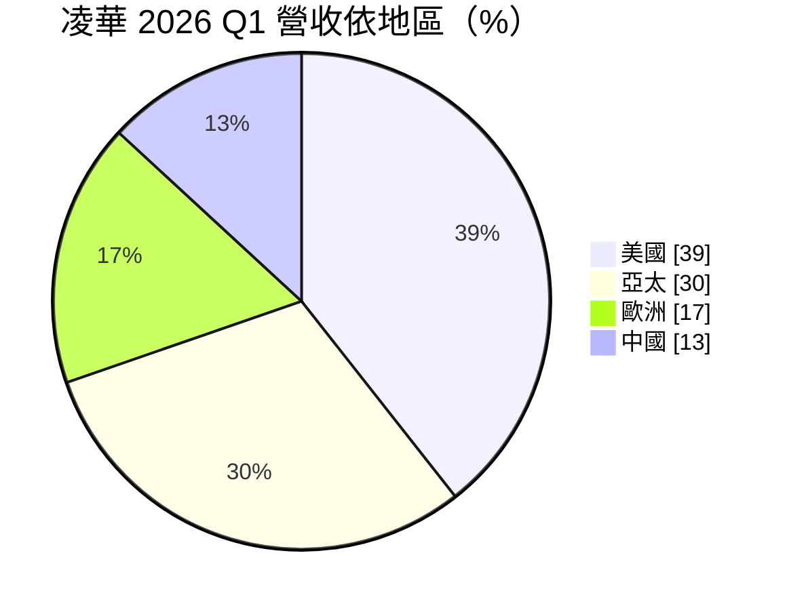
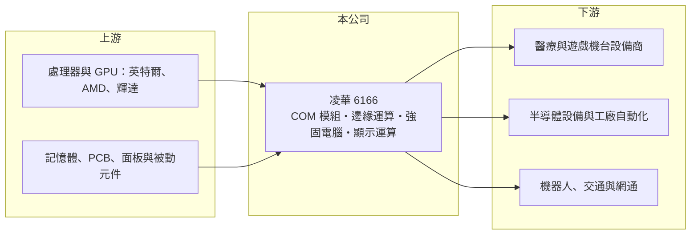

# 6166 凌華

> 上市｜[[產業索引-電腦及週邊設備業|電腦及週邊設備業]]｜上市（櫃）日期 2004/11/08

# 第一章：企業模式與商業藍圖

> [!info] 撰寫說明
> 精簡版，由 Claude 依公開資料整理，架構比照 [[2330台積電]]，資料截至 2026-10-08。來源：證交所開放資料快照（基本資料、2026 年第二季資產負債與損益、股利）、Goodinfo 經營績效頁、富果 2026 年 5 月法說會備忘錄、自由時報與優分析新聞標題。富果備忘錄為第三方整理，數字以公司公告為準。#待校對

凌華是台灣主要的[[工業電腦]]與[[邊緣運算]]平台廠，理解它的關鍵在於：它賣的不是一般電腦，而是要在工廠、醫院、機台裡穩定運作十年以上的運算核心，客戶一旦把它設計進設備，就會跟著設備的生命週期長期採購。

- **核心業務：** 凌華成立於 1995 年，2004 年在證交所上市，總部位於桃園龜山，英文名 ADLINK。主要產品分為五條線：[[COM模組]]（模組化電腦）、客製化強固型電腦（DRC）、邊緣運算平台（ECP）、與 [[2409友達]] 合作的顯示運算（EV，例如醫療與工業用一體式平板電腦），以及智能實體自動化（IPA，含運動控制與機器視覺）。這些產品都屬於嵌入在客戶設備內部的運算單元，凌華的價值在於硬體可靠度、長期供貨與軟體整合能力。
- **營收結構：** 依富果整理的 2026 年第一季法說內容，以地區計美國占 39%、亞太 30%、歐洲 17%、中國 13%，美國比重因醫療與顯示運算出貨大增而升高。以產業看，泛用自動化約占 27%（其中機器人相關約 6% 至 7%），醫療約 15% 至 16%。公司把業務整理為「4+6」：機器人、半導體、車用、綠能四個新成長領域，加上遊戲、醫療、自動化、網通、強固電腦、運輸六個傳統核心領域。
- **營運據點：** 生產主要在台灣林口，美國聖荷西設有組裝測試廠；為分散地緣政治風險，公司在北美與中南美尋找 SMT 與 PCB 製造夥伴，部分已進入試產（2026 年法說說法）。研發與業務據點遍及美、歐、中國與亞太，符合工業電腦「貼近客戶做客製化」的產業特性。
- **長期方向：** 凌華的長期策略是把 AI 從雲端推到設備端，也就是[[邊緣 AI]]。具體做法包括為協作型、人形與 AMR 機器人提供搭載 GPU 的運算模組，投資法博機器人並與 [[4585達明]] 合作機器人專案，以及為半導體設備提供運動控制與 AI 視覺；綠能方面則開發儲能電池管理系統。這些新領域若能放大，凌華就能從單純賣板卡，升級為提供系統級方案。

# 第二章：護城河深度與競爭優勢

凌華的護城河來自工業客戶的設計導入與長期供貨承諾，屬於利基型的中等護城河，但近年獲利率偏低，代表護城河尚未充分轉化為定價能力。

- **競爭優勢：** 工業與醫療設備一旦選定運算模組，就要通過長時間的可靠度測試與法規認證，更換供應商的成本很高，因此凌華的訂單具有黏性，這就是[[設計導入]]帶來的[[轉換成本]]。凌華的另一項優勢是產品線寬，從 COM 模組、強固電腦到機器視覺都能提供，並長期與 [[NVDA輝達]]、[[INTC英特爾]] 等晶片商合作開發平台（#待校對），能較早取得新一代晶片的設計資源。
- **主要對手：** 台灣工業電腦同業包括龍頭 [[2395研華]]，以及 [[6414樺漢]]、[[6579研揚]]、[[3479安勤]]、[[8234新漢]]、[[2397友通]]、[[3088艾訊]] 等；國際上則有德國 Kontron、congatec 等 COM 模組廠（#待校對）。研華規模與通路遠大於凌華，凌華的差異化在於醫療、遊戲機台、半導體設備等專案型客製市場。
- **觀察重點：** 凌華的毛利率長期維持在 35% 至 40%，但營業利益率在 2020 至 2025 年間只有 0.6% 至 5.6%，代表研發與管銷費用吃掉大部分毛利。2026 年上半年營業利益率回升到 11.4%，長期最該追蹤的是這個改善能否延續，也就是營收規模擴大後費用率能否下降，以及機器人與醫療等高價值應用的占比能否持續提高。

# 第三章：財務體質與盈利規模

資料日期：2026-10-08，表格是撰寫當時的快照；最新月營收、毛利率、累計 EPS 由自動排程寫在本筆記的屬性欄位（月營收、毛利率、累計EPS 等）。#待校對

凌華的財務呈現「高毛利、低營業利益」的結構：產品附加價值不低，但費用率偏高，使 ROE 長期在個位數徘徊，只有景氣好的年份才明顯改善。

| 年度 | 營收（億元） | [[毛利率]] | [[營業利益率]] | EPS（元） | [[ROE]] |
|---|---|---|---|---|---|
| 2020 | 96.4 | 39.6% | 4.93% | 1.12 | 5.25% |
| 2021 | 96.7 | 36.8% | 1.43% | 0.55 | 2.66% |
| 2022 | 117 | 36.3% | 5.26% | 3.71 | 16.0% |
| 2023 | 114 | 36.6% | 2.83% | 1.51 | 5.28% |
| 2024 | 101 | 37.7% | 0.61% | 0.23 | 0.25% |
| 2025 | 118 | 35.8% | 5.57% | 2.35 | 9.06% |

（來源：Goodinfo 經營績效頁。2026 年上半年依證交所資料：營收 79.0 億元、毛利率 34.6%、營業利益率 11.4%、EPS 3.12 元。）

- **營收規模：** 2020 至 2025 年營收由 96.4 億元增至 118 億元，年複合成長率約 4.1%（推算），期間在 2024 年因工業客戶去化庫存而衰退一成多，2025 年恢復成長。2026 年上半年營收已達 79 億元，若下半年維持，全年將明顯創新高，主要動能來自美國的醫療與顯示運算出貨。
- **獲利：** 近五年（2021 至 2025）平均 ROE 約 6.7%（推算），在工業電腦族群中偏低。主因是營業利益率長期在 1% 至 6% 之間，2024 年甚至只有 0.6%。2026 年上半年營業利益率升到 11.4%，顯示營收放大時[[營業槓桿]]明顯，但能否成為常態仍需觀察。
- **財務特色：** 依 2026 年第二季資料，總資產約 165.9 億元、股東權益約 61.7 億元、負債約 104.2 億元，其中流動負債 83.3 億元，負債比約六成三，在工業電腦同業中偏高（推估包含短期借款與應付帳款，有息負債細項未查得）。2025 年度每股配發現金股利 1.2 元，以 EPS 2.35 元計[[配息率]]約 51%（推算）；Goodinfo 統計的長期平均現金股利約 1.17 元，配息隨獲利波動。自由現金流是否長期為正未查得。
- **[[ROIC]] 與 [[WACC]]：** 以 2025 年營業利益約 6.57 億元（118 億元 × 5.57%）、稅率 20% 計算，稅後營業利益約 5.26 億元。有息負債未查得，投入資本以股東權益 61.7 億元到「權益加全部負債」165.9 億元為區間，ROIC 約 3.2% 至 8.5%（推算）；2024 年同法計算接近 0%。WACC 以 [[CAPM]] 推估：無風險利率 1.75%、市場風險溢酬 6%、β 假設 1.0（工業電腦股常見值），權益成本約 7.75%；稅後負債成本假設 2%、負債占三成，WACC 約 6.0%（推算）。過去五年多數年份 ROIC 低於或接近 WACC，代表凌華長期並未穩定創造經濟價值；2026 年上半年的獲利改善若能延續，才有機會讓利差轉正。

# 第四章：總體風險與地緣政治

凌華的風險來自工業景氣循環、高費用結構，以及地緣政治下的供應鏈重組。

- **產業週期：** 工業電腦的需求跟著企業資本支出走，製造業投資轉弱時，客戶會先消化庫存，2023 至 2024 年就出現營收衰退與獲利急降。半導體設備、遊戲機台等客戶也各有自己的景氣循環，下游庫存調整會沿供應鏈放大，形成[[長鞭效應]]。
- **營運風險：** 凌華的費用率高，營收只要小幅下滑，營業利益就可能接近零，這是過去十年獲利波動大的主因。新事業如機器人、綠能的投入期長，若量產不如預期，研發費用會持續壓縮獲利。記憶體等關鍵零組件缺料或漲價，也可能影響交期與毛利。
- **其他風險：** 中國營收比重已降到一成多，2026 年第一季中國營收年減三成，反映中國客戶轉向本土供應鏈的趨勢。美國關稅政策促使公司在北美建立製造夥伴，可能增加成本。營收多以美元計價，新台幣升值會壓縮毛利。

# 專有名詞解析

## 應用

- **[[邊緣運算]]**：在設備端或靠近資料產生處處理資料，降低延遲與網路傳輸量，是工業電腦的主要應用方向。
- **[[邊緣 AI]]**：在終端或靠近資料產生處（工廠、醫院、企業機房）執行 AI 運算，而非全部送到雲端資料中心。

## 金融

- **[[轉換成本]]**：客戶更換供應商需付出的時間、驗證與風險成本，越高代表既有供應商的地位越穩固。

## 產業

- **[[工業電腦]]**：用於工廠自動化、交通、醫療等場域的電腦，強調長期供貨、耐用與穩定。
- **[[COM模組]]**：Computer on Module，把處理器、記憶體等核心電路做成標準尺寸模組，客戶只需設計底板即可導入設備，縮短開發時間。
- **[[設計導入]]**：產品被客戶選入設備設計並完成驗證，之後該設備量產期間都會持續採購，是長期營收的來源。

# 核心供應鏈

- 上游：處理器與 GPU 供應商 [[INTC英特爾]]、[[AMD超微]]、[[NVDA輝達]]；面板合作夥伴 [[2409友達]]；記憶體、PCB 與被動元件供應商。
- 下游／客戶：醫療設備、遊戲機台、半導體前後段設備、工廠自動化與機器人業者（具體客戶名單公開資料未點名，#待校對）；機器人合作對象 [[4585達明]]、法博機器人。
- 同業：[[2395研華]]、[[6414樺漢]]、[[6579研揚]]、[[3479安勤]]、[[8234新漢]]、[[2397友通]]、[[3088艾訊]]、[[6570維田]]。

## 最新新聞
<!-- news:start（自動產生，請勿手動編輯此範圍） -->
- 2026-10-12 📰 媒體 09:58｜貿協率凌華、東碩16家台企2度進軍東京醫療展 三大主題展31項創新醫療方案｜[鉅亨網](https://news.cnyes.com/news/id/6627679)
- 2026-10-06 📰 媒體 19:50｜營收速報 - 凌華(6166)9月營收15.30億元年增率高達50.5％｜[鉅亨網](https://news.cnyes.com/news/id/6622944)

完整紀錄：[[6166凌華 新聞]]
<!-- news:end -->

## 相關連結
- [公開資訊觀測站](https://mopsov.twse.com.tw/mops/web/t05st03?step=1&firstin=1&co_id=6166)
- [Goodinfo](https://goodinfo.tw/tw/StockDetail.asp?STOCK_ID=6166)
- [Yahoo 股市](https://tw.stock.yahoo.com/quote/6166)
- [鉅亨網新聞](https://www.cnyes.com/twstock/6166/news)
