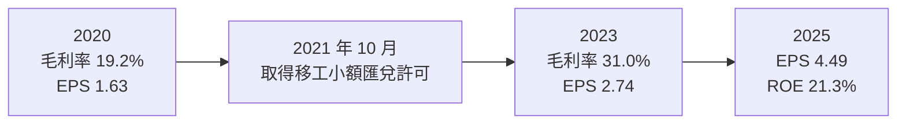
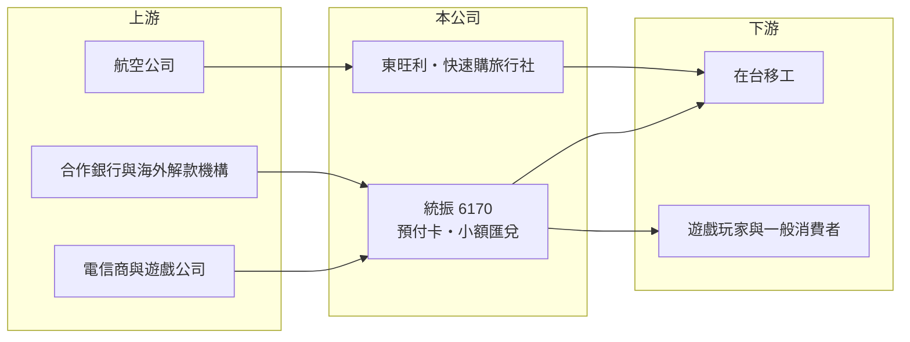

# 6170 統振

> 上櫃｜[[產業索引-通信網路業|通信網路業]]｜上市（櫃）日期 2002/04/16

# 第一章：企業模式與商業藍圖

> [!info] 撰寫說明
> 精簡版，由 Claude 依公開資料整理，架構比照 [[2330台積電]] 的四章研究，資料截至 2026-10-08。來源：nStock（公司概況與 2026 年營收、股利）、Goodinfo 年度經營績效、櫃買中心開放資料（基本資料、綜合損益、資產負債、每月營收、本益比）、財經媒體標題（優分析：移工經濟圈、旅運業務）。公開資料有限，本次未取得產品別營收比重；早年電池業務依記憶整理。#待校對

本章說明統振股份有限公司（股票代號：6170，以下簡稱統振）的商業模式：以手機預付卡與遊戲儲值卡通路起家，近年轉型為服務在台移工的金融與生活服務平台。

- **核心業務：** 統振成立於 1977 年，2002 年在櫃買中心掛牌，總部位於台北內湖。公司主要業務包括行動電話預付卡與網路遊戲儲值卡的買賣、電信小額付費，以及 2021 年 10 月取得金管會許可的外籍移工國外[[小額匯兌]]業務。統振早年也經營手機電池模組（依記憶整理，待校對），目前帳上歸類為通信網路業，但實際已是以通路與金融服務為主的公司。
- **營收結構：** 公司未揭露各業務的營收比重。從毛利率由 2020 年的 19.2% 升到 2025 年的 31.3% 推估，營收組合正從低毛利的預付卡買賣，轉向高毛利的匯款手續費與服務收入（推估）。預付卡業務以營收規模大、毛利薄為特徵；匯款與服務業務則以手續費為收入，營收規模小但毛利高。
- **子公司：** 東旺利（持股 92.26%，2006 年成立，經營電信器材批發，2012 年下半年起增加食品與化妝品零售批發）與快速購旅行社（持股 67%，2024 年 8 月成立，經營代購國內外客票）。旅行社的設立，是把匯款平台累積的移工客群導流到返鄉機票等旅運業務。
- **長期方向：** 統振的長期方向是經營「移工經濟圈」：以預付卡與匯款建立與移工的日常接觸，再延伸到機票、生活用品與其他金融服務。台灣在台移工人數長期維持在 70 萬人以上（依記憶，待校對），政府放寬移工政策時，客群可望擴大。

# 第二章：護城河深度與競爭優勢

本章評估統振的護城河。從近五年 ROE 平均超過 16%、且逐年提高來看，統振在移工服務這個利基市場建立了實在的競爭優勢。

- **競爭優勢：** 移工小額匯兌需要金管會許可，屬於特許業務，新進者需要時間申請與建立合規系統。統振多年經營預付卡通路，在移工聚集的地點與社群中已有品牌認知與實體據點，可以把預付卡的客戶直接轉為匯款客戶。匯款業務一旦建立使用習慣，客戶每月固定匯款，形成穩定的[[經常性收入]]。
- **主要對手：** 移工匯款的對手包括銀行、郵局、其他取得小額匯兌許可的業者與非法地下匯兌；預付卡通路則與電信商自營通路、超商競爭（對手名單為產業常識整理，待校對）。地下匯兌以低價與便利吸引客戶，合法業者需要靠便利性與安全性勝出。
- **觀察重點：** 第一，匯款業務的客戶數與匯款量成長。第二，旅行社等延伸服務能否提高每位客戶的貢獻。第三，法規變化，包括小額匯兌許可的費率與金額上限、移工引進政策的調整。

# 第三章：財務體質與盈利規模

資料日期：2026-10-08。數字取自 Goodinfo 年度經營績效、nStock 與櫃買中心開放資料，表格是撰寫當時的快照；最新月營收、毛利率、累計 EPS 由自動排程寫在本筆記的屬性欄位（月營收、毛利率、累計EPS 等）。#待校對

統振的財務數字顯示營收持平、但毛利率與 EPS 持續上升，這正是商業模式轉型的財務證據。

| 年度 | 營收（新台幣） | [[毛利率]] | [[營業利益率]] | EPS（元） | [[ROE]] |
|---|---|---|---|---|---|
| 2020 | 35.6 億 | 19.2% | 4.74% | 1.63 | 12.2% |
| 2021 | 29.8 億 | 21.2% | 4.82% | 1.86 | 13.3% |
| 2022 | 24.7 億 | 24.7% | 6.21% | 2.73 | 16.9% |
| 2023 | 22.6 億 | 31.0% | 9.88% | 2.74 | 15.2% |
| 2024 | 29.1 億 | 29.8% | 9.19% | 3.39 | 16.9% |
| 2025 | 31.9 億 | 31.3% | 9.82% | 4.49 | 21.3% |
| 2026 上半年 | 15.89 億 | 32.4% | 9.8% | 2.18 | 未查得 |

註：2020 至 2025 年取自 Goodinfo 合併報表；2026 上半年取自櫃買中心開放資料（毛利率、營業利益率依開放資料推算）。

- **營收規模：** 2020 至 2025 年營收年複合成長率約 -2.2%（推算），但這不代表衰退：低毛利預付卡買賣比重下降，營收規模自然縮小。2026 年 1 至 8 月累計營收 21.44 億元，與去年同期 21.58 億元大致持平。
- **獲利：** 毛利率從 19.2% 升到 31.3%，營業利益率從 4.7% 升到 9.8%，EPS 從 1.63 元增至 4.49 元，2021 至 2025 年平均 ROE 約 16.7%（推算）。2026 年上半年營業利益 1.55 億元、業外收入 1.10 億元，歸屬母公司淨利 2.12 億元，業外收入占比不低，來源本次未查得。
- **財務特色：** 2026 年第二季底資產總計 53.16 億元、負債 33.46 億元（幾乎都是流動負債）、歸屬母公司權益 19.56 億元，每股淨值 20.11 元。匯兌與儲值業務會暫收客戶資金，流動負債偏高可能反映待匯出款項與預收款，而非借款（推估）。依櫃買中心資料，最近一次現金股利 4 元，以 2025 年 EPS 4.49 元計算[[配息率]]約 89%（推算）；nStock 統計近五年平均現金股利 2.71 元，股利隨獲利逐年提高。
- **[[ROIC]] 與 [[WACC]]：** 以 2025 年營業利益約 3.13 億元（31.9 億元 × 9.82%）扣 20% 稅後約 2.51 億元，投入資本以歸屬母公司權益 19.56 億元加非流動負債 0.37 億元（流動負債推估多為客戶暫收款，未計入）約 19.9 億元計算，ROIC 約 12.6%（推算）。WACC 以 CAPM 推估：無風險利率 1.75%、市場風險溢酬 6%、β 取 0.9（推估，通路與支付服務股波動較低），權益成本約 7.15%；有息負債少，WACC 約 7%（推算）。ROIC 高於 WACC 約 5 個百分點，且利差隨轉型擴大，代表統振的移工服務模式正在創造價值。

# 第四章：總體風險與地緣政治

本章整理統振面對的長期風險，核心是法規與單一客群的依賴。

- **產業週期：** 預付卡與匯款業務和景氣的關聯不高，主要取決於在台移工人數與其收入。移工來源國的經濟、匯率與台灣的引進政策，比電子產業週期更重要。
- **營運風險：** 小額匯兌是特許業務，主管機關調整費率上限、金額限制或洗錢防制要求，會直接影響收入與合規成本。客群高度集中在移工，若引進政策緊縮或移工轉向其他國家，業務規模會受影響。電子支付與數位銀行普及，也可能壓縮匯款手續費。
- **其他風險：** 匯兌業務需處理大量客戶資金，資安、洗錢防制與內控失誤都可能招致處分。業外收入占獲利比重不低，若來源不穩定，EPS 會波動。新事業（旅行社、零售）的經營效益仍待驗證。

# 專有名詞解析

## 金融

- **[[小額匯兌]]**：經金管會許可、替外籍移工把薪資小額匯回母國的業務，每筆金額有上限，收取手續費。
- **[[經常性收入]]**：每年能穩定重複產生的收入，例如維護合約、訂閱費，比一次性專案收入更可預測。
- **[[配息率]]**：股利占每股盈餘的比例，反映公司把多少獲利分給股東。
- **[[ROIC]]**：投入資本報酬率，稅後營業利益除以股東權益與有息負債的合計，衡量本業對所有資金提供者的報酬。
- **[[WACC]]**：加權平均資金成本，依股東權益與負債的比重加權計算的資金成本，ROIC 高於它才代表創造價值。

# 核心供應鏈

- 上游：電信商（預付卡與小額付費，如 [[2412中華電]]、[[3045台灣大]]、[[4904遠傳]]，合作關係待校對）、遊戲公司、合作銀行與移工母國的解款機構、航空公司。
- 下游／客戶：在台移工（匯款、預付卡、機票）、遊戲玩家與一般消費者。
- 同業：[[6136富爾特]]（電信預付卡與 SIM 卡通路）。

## 最新新聞
<!-- news:start -->
<!-- news:end -->

## 相關連結
- [公開資訊觀測站](https://mopsov.twse.com.tw/mops/web/t05st03?step=1&firstin=1&co_id=6170)
- [Goodinfo](https://goodinfo.tw/tw/StockDetail.asp?STOCK_ID=6170)
- [Yahoo 股市](https://tw.stock.yahoo.com/quote/6170)
- [鉅亨網新聞](https://www.cnyes.com/twstock/6170/news)
