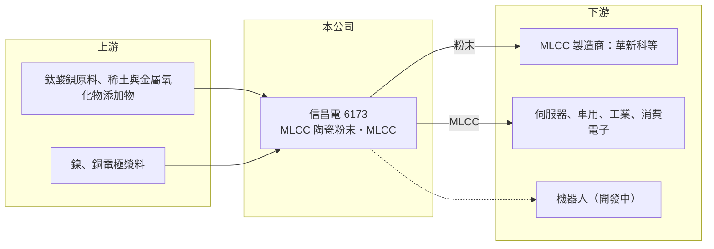

# 6173 信昌電

> 上櫃｜[[產業索引-電子零組件業|電子零組件業]]｜上市（櫃）日期 2002/04/19

# 第一章：企業模式與商業藍圖

> [!info] 撰寫說明
> 精簡版，由 Claude 依公開資料整理，架構比照 [[2330台積電]]，資料截至 2026-10-08。來源：櫃買中心開放資料（基本資料、2026 年上半年財報）、Goodinfo 經營績效頁、工商時報 2026 年 6 月報導。集團關係與客戶描述部分憑記憶整理，已標待校對。#待校對

本章說明信昌電陶（6173）的商業模式：它同時做 [[MLCC]] 最上游的陶瓷介電粉末，以及 MLCC 成品，是台灣少數掌握這項關鍵材料的公司。

- **核心業務：** 信昌電成立於 1990 年，總部在桃園楊梅，2002 年在櫃買中心掛牌。依 2026 年 6 月工商時報報導，公司兩大產品線是陶瓷粉末與 MLCC。陶瓷粉末是以鈦酸鋇為基礎、再加入微量添加物調配的介電材料，決定 MLCC 能做到多小、容值多高、耐溫多好，是 MLCC 最關鍵的原料。
- **營收結構：** 本次未查得粉末與 MLCC 的營收比重。公司在 2026 年表示 AI 相關營收比重將首度超過 10%，來源是 AI 伺服器機櫃使用的 MLCC 數量大幅增加；機器人應用則已進入中、美、歐大廠的設計導入階段，預期 2027 年起放量。
- **營運據點：** 台灣楊梅為總部與主要生產基地，其他據點本次未查得。董事長焦佑衡，市場普遍將信昌電歸入華新麗華焦家旗下的華科事業群，與 [[2492華新科]] 關係密切（待校對）。
- **長期方向：** 粉末事業的價值在於「材料自主」。MLCC 往小型化、高容值發展時，粉末顆粒必須更細、更均勻，全球能穩定量產高階介電粉末的廠商很少，以日本廠為主。信昌電若能在高階粉末取得更多客戶認證，就能分享整個 MLCC 產業的成長，而不必只靠自家 MLCC 的市占。

# 第二章：護城河深度與競爭優勢

本章分析信昌電的護城河。材料廠的護城河來自配方與製程經驗，以及客戶不願輕易更換關鍵原料的轉換成本。

- **競爭優勢：** MLCC 廠更換介電粉末，等於要重新驗證整條產品線的電性與可靠度，耗時又有風險，因此粉末供應商一旦導入就很難被取代。信昌電長期替台灣 MLCC 產業供應粉末，加上與華科事業群的合作關係（待校對），讓它擁有相對穩定的客戶基礎。
- **主要對手：** 陶瓷粉末的國際對手以日本堺化學、Ferro（現屬 Vibrantz）等為主，中國國瓷材料近年快速擴產（同業定位為整理性描述，待校對）。MLCC 成品方面則與 [[2327國巨]]、[[2492華新科]]、村田製作所、三星電機等大廠同場，但信昌電的 MLCC 規模小得多，偏向利基規格。
- **觀察重點：** 營業利益率在 2021 年高峰達 19.6%，2023 年低谷仍有 10.7%，2025 年回到 16.8%，即使在 MLCC 景氣谷底也維持兩位數，這是材料廠護城河的具體證據。長期要看 AI 伺服器與車用帶動的高容值、高耐壓產品比重能否持續提升，讓獲利的高峰與低谷都往上移。

# 第三章：財務體質與盈利規模

資料日期：2026-10-08，表格是撰寫當時的快照；最新月營收、毛利率、累計 EPS 由自動排程寫在本筆記的屬性欄位（月營收、毛利率、累計EPS 等）。#待校對

本章用多年度數字檢視信昌電：本業利潤率穩健，但資產中有大量金融投資，使 ROE 看起來偏低。

| 年度 | 營收（億元） | [[毛利率]] | [[營業利益率]] | EPS（元） | [[ROE]] |
|---|---|---|---|---|---|
| 2020 | 52.1 | 25.1% | 17.4% | 4.60 | 16.1% |
| 2021 | 60.1 | 26.4% | 19.6% | 6.67 | 19.2% |
| 2022 | 41.4 | 23.3% | 14.9% | 2.96 | 7.5% |
| 2023 | 36.5 | 19.2% | 10.7% | 2.64 | 6.9% |
| 2024 | 37.2 | 21.4% | 13.2% | 2.91 | 7.3% |
| 2025 | 40.6 | 24.3% | 16.8% | 3.26 | 7.1% |

- **營收規模：** 2020 至 2025 年營收年複合成長率約 -4.9%（推算），主因是 2021 年 MLCC 景氣高峰後的回落。2026 年上半年營收 23.9 億元、營業利益率 21.4%、EPS 2.98 元，已接近 2021 年的高峰水準。
- **獲利：** 毛利率在 19% 至 26% 之間循環，營業費用率只有約 7% 至 8%，因此毛利率每提升一點，大部分直接轉成營業利益。這種費用精簡的結構，讓信昌電在景氣回升時的獲利彈性很大。
- **財務特色：** 近 5 年（2021 至 2025）平均 ROE 約 9.6%（推算），2022 年後僅約 7%。原因在於資產負債表：2026 年第二季股東權益 101.5 億元，其中「其他權益」高達 32.3 億元，非流動資產 82.9 億元，代表公司持有大量以公允價值評價的長期投資（持有標的待校對）。2026 年上半年其他綜合損益 9.4 億元，比本期淨利 5.1 億元還高。負債僅 20.9 億元，負債比約 17%，財務非常保守。
- **[[ROIC]] 與 [[WACC]]：** 2025 年營業利益約 6.8 億元（40.6 億 × 16.8%），稅後約 5.5 億元。以股東權益 101.5 億元為投入資本，ROIC 約 5.4%；以 2026 年上半年營業利益年化約 10.3 億元計算約 8%（推算）。由於權益中有大量金融投資，若只計入實際營運用的資本，本業 ROIC 會明顯高於上述數字（推估，營運資本金額未查得）。WACC 以 [[CAPM]] 推估：無風險利率 1.75%、市場風險溢酬 6%、β 假設 1.1（被動元件景氣循環股常見值），股東權益成本約 8.35%；負債比重低，假設有息負債占資本 5%、稅後成本 2%，WACC 約 8%（推算）。以帳面資本計算，ROIC 與 WACC 大致相當；本業本身應能創造價值，但大量閒置於金融投資的資本拉低了整體資本效率。

# 第四章：總體風險與地緣政治

本章整理信昌電長期要面對的風險。

- **產業週期：** MLCC 是被動元件中景氣循環最明顯的產品，2021 年缺貨、2022 至 2023 年庫存去化，信昌電營收由 60 億元降到 36.5 億元，EPS 由 6.67 元降到 2.64 元。粉末需求跟著 MLCC 廠的稼動率走，同樣會放大波動。
- **營運風險：** 中國粉末與 MLCC 廠快速擴產，可能在中低階規格造成價格壓力；高階粉末則需要與日本大廠競爭客戶認證。客戶若集中在少數 MLCC 廠或集團內關係企業（待校對），訂單會受單一客戶策略影響。
- **其他風險：** 鈦酸鋇與稀土添加物等原料價格、燒結製程的電力成本，以及新台幣匯率都會影響毛利。大量權益投資使淨值隨金融市場波動，股東權益可能在一年內大幅增減。

# 專有名詞解析

## 金融

- **[[ROIC]]**：投入資本報酬率，衡量公司用股東與債權人投入的資本，每年能賺回多少稅後營業利益。
- **[[WACC]]**：加權平均資金成本，依股東權益與負債的比重，加權計算公司取得資金的平均成本。
- **[[CAPM]]**：資本資產定價模型，以無風險利率加上 β 乘以市場風險溢酬，推估股東要求的報酬率。

## 產業

- **[[MLCC]]**：積層陶瓷電容，以多層陶瓷介電質與電極交錯堆疊而成，是用量最大的被動元件，一台 AI 伺服器需要數萬顆。
- **[[被動元件]]**：不需外加電源就能運作的電子元件，主要是電容、電阻與電感，負責儲能、濾波與穩壓。
- **[[精密陶瓷]]**：以高純度粉末經配方、成型與燒結製成的功能性陶瓷，MLCC 的介電層即屬此類。

# 核心供應鏈

- 上游：鈦酸鋇與稀土、金屬氧化物等粉末原料，以及 MLCC 用的鎳、銅電極材料，具名供應商未查得。
- 下游／客戶：粉末賣給 MLCC 製造商（推估包含 [[2492華新科]]，待校對）；MLCC 賣給 AI 伺服器、車用、工業與消費性電子客戶。
- 同業：粉末有日本堺化學、Ferro 與中國國瓷材料；MLCC 有 [[2327國巨]]、[[2492華新科]]、村田製作所、三星電機。

## 最新新聞
<!-- news:start（自動產生，請勿手動編輯此範圍） -->
- 2026-10-06 📰 媒體 18:50｜營收速報 - 信昌電(6173)9月營收5.27億元年增率高達54.76％｜[鉅亨網](https://news.cnyes.com/news/id/6622887)

完整紀錄：[[6173信昌電 新聞]]
<!-- news:end -->

## 相關連結
- [公開資訊觀測站](https://mopsov.twse.com.tw/mops/web/t05st03?step=1&firstin=1&co_id=6173)
- [Goodinfo](https://goodinfo.tw/tw/StockDetail.asp?STOCK_ID=6173)
- [Yahoo 股市](https://tw.stock.yahoo.com/quote/6173)
- [鉅亨網新聞](https://www.cnyes.com/twstock/6173/news)
